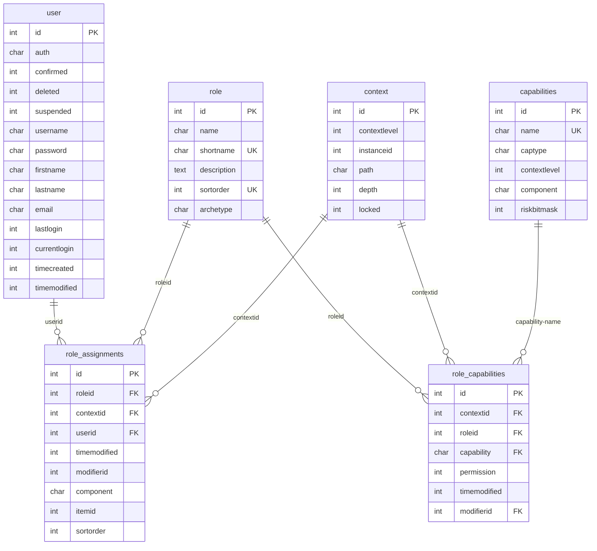
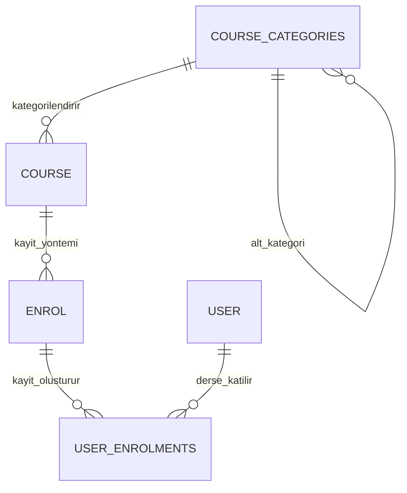
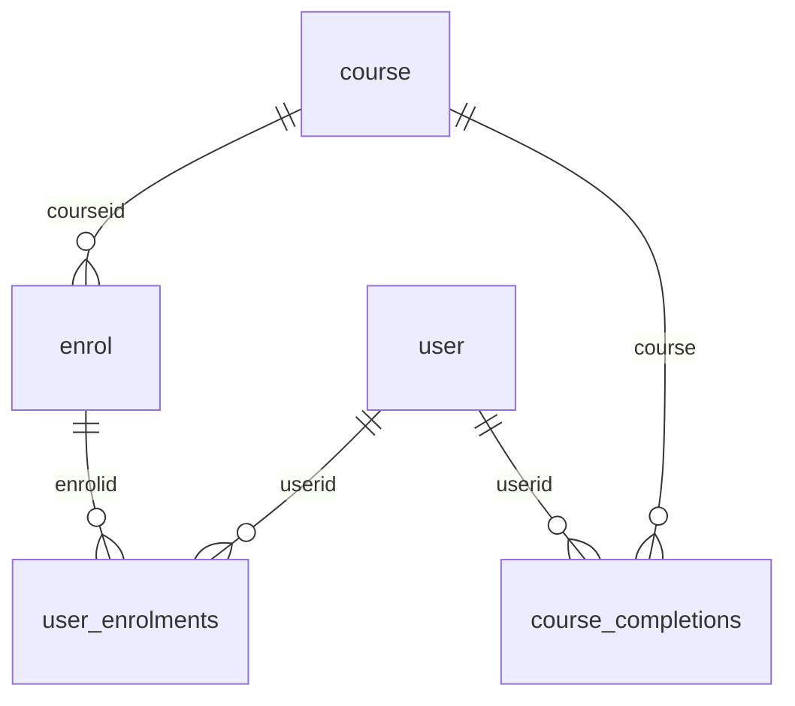
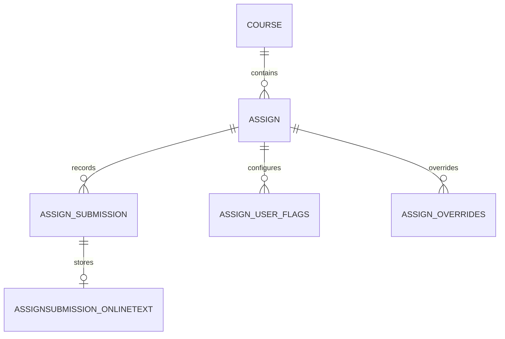
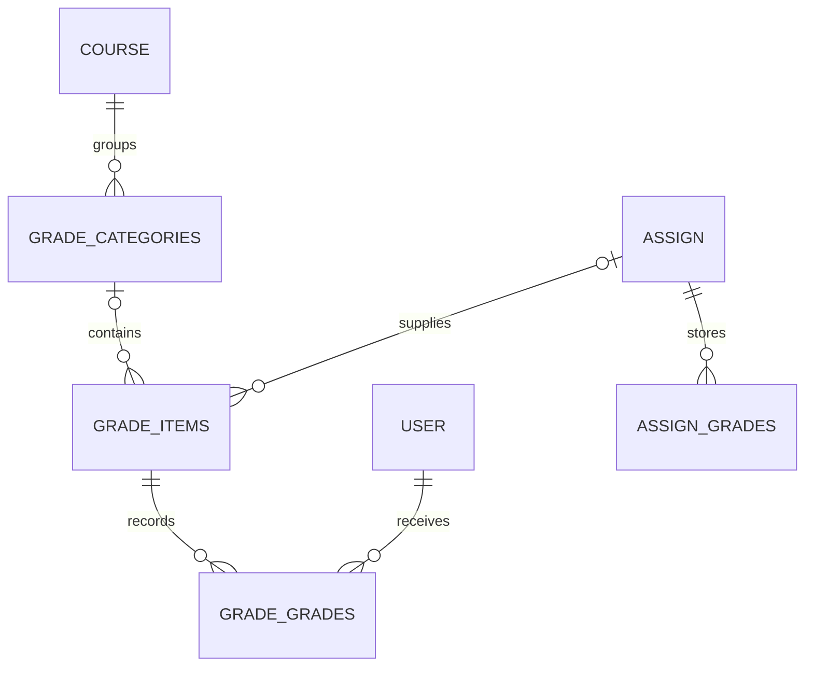
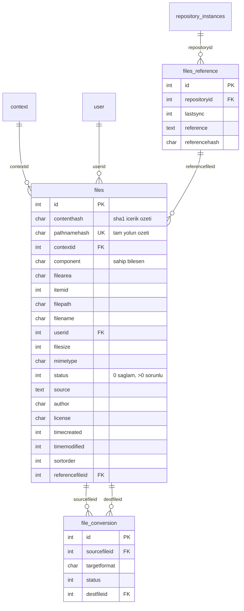

# WBS-1 Kapsamın Belirlenmesi ve Mevcut Sistem Analizi

Moodle sürümü: 5.3 LTS

## 1. Geliştirme ve test ortamı (Fatma Zehra)

Ekibin hepsi Moodle'ı kendi bilgisayarında aynı sürüm, aynı kaynak kod ve aynı örnek veriyle çalıştırır. Kurulum adımları, sıfırlama ve sık karşılaşılan sorunlar: [ortam/README.md](../ortam/README.md).

| | |
| --- | --- |
| İncelenen sürüm | Moodle 5.3.1 (LTS; aktif destek Ekim 2027'ye, güvenlik desteği Ekim 2029'a kadar) |
| Kaynak kod revizyonu | `cfe123f26fc7071981fe949cb16cd5a08a8234f1` (Moodle release 5.3.1, 12.11.2026) |
| Çalıştırma | moodlehq/moodle-docker · PHP 8.3 · PostgreSQL 17 · Apache |
| Windows | WSL 2 (Ubuntu) içinde; kod Linux dosya sisteminde tutulur |
| Örnek veri | `ortam/ornek-veri.feature` (Moodle'ın test senaryosu aracıyla tek komutla yüklenir) |

**Örnek veri seti:** 3 kategori, 3 ders, 15 kullanıcı (yönetici, 2 öğretmen, asistan, danışman, 10 öğrenci), 4 ödev, 1 ders dosyası, 10 teslim ve 5 not. Veri; teslim edilip notlandırılmış, teslim edilip notlandırılmamış, taslakta kalmış ve hiç teslim edilmemiş ödev durumlarının hepsini içerir.

**Tekrarlanabilirlik:** Ortam `docker compose down` ile tamamen silinip yaklaşık 5 dakikada aynı verilerle yeniden kurulabilir. Böylece eski ve yeni sistemin karşılaştırmalı testleri her seferinde aynı başlangıç verisiyle çalıştırılır.

**Ortam kurulumunda öğrenilenler:**
- Windows'ta kodun `C:\` altından Docker'a bağlanması dosya erişimini çok yavaşlatıyor: veritabanı kurulumu yaklaşık 2 saat sürdü ve sayfalar dakikalarca açıldı. Kod WSL'in Linux dosya sistemine taşındığında aynı kurulum 3 dakikaya indi. Bu yüzden Windows kullanan herkes WSL içinde çalışır. Bu durum, eski sistemin performans ölçümlerinin de Linux dosya sisteminde yapılması gerektiğini gösteriyor; aksi hâlde Moodle'ın değil dosya erişiminin yavaşlığı ölçülür.
- Moodle 5.x'te web dosyaları `public/` klasörüne taşınmış, komut satırı kurulum betikleri ise ana klasörde kalmış.
- Moodle'ın test senaryosu aracı, geliştirici kütüphanelerinin (`composer install`) kurulmasını gerektiriyor.
- Ödev teslim durumu (taslak veya gönderildi) teslimin kendisine göre değil, ödevin "öğrenci gönder butonuna basmalı" (`submissiondrafts`) ayarına göre belirleniyor. Bu, ödev modülü analizinde korunacak bir iş kuralı adayı.

## 2. Kapsam ve SRS girişi (Fatma Zehra)

Bu bölüm, WBS-1 ve WBS-2 dokümanlarının birlikte oluşturduğu Yazılım Gereksinim Belirtiminin (SRS) giriş kısmıdır. Yapısı ISO/IEC/IEEE 29148:2018 gereksinim mühendisliği standardının SRS önerisine göre düzenlenmiştir.

### 2.1 Amaç

Bu SRS, Moodle 5.3.1'in seçilen alt fonksiyonlarının yapay zekâ desteğiyle yeni bir mimaride ve farklı bir programlama dilinde yeniden geliştirilmesi için gereksinimleri tanımlar. Hedef okuyucular proje ekibi, danışman öğretim üyesi ve değerlendiricilerdir. Doküman, geliştirmeye başlamadan önce neyin korunacağını, neyin düzeltileceğini ve neyin yeni ekleneceğini netleştirmek için kullanılır.

### 2.2 Kapsam

**Kapsam dahilinde**
- Moodle 5.3.1'in (revizyon `cfe123f2`) aşağıdaki alt fonksiyonlarının analizi; ilk sürümde geliştirilecek olanlar §9'da seçilir:
  - Kimlik ve yetkilendirme
  - Ders ve kayıt
  - Danışmanlık (ön şartlar, ders seçim kısıtları)
  - Ödev ve teslim
  - Değerlendirme
  - Dosya yönetimi
- Yeni modül: Otomatik eğitim planı oluşturma
- Seçilen fonksiyonların yeni dilde ve mimaride yeniden geliştirilmesi, bunun için gereken veri aktarımı
- Eski ve yeni sistemin aynı girdilerle karşılaştırmalı doğrulanması ve kalite ölçümleri

**Kapsam dışında**
- Moodle'ın bütünü ve seçilmeyen etkinlik türleri (sınav, forum, çalıştay, SCORM, H5P vb.)
- Üçüncü taraf eklentiler ve mobil uygulama
- Moodle arayüzünün görsel olarak birebir kopyalanması
- Gerçek kurum verisinin taşınması (yalnızca test verisi kullanılır)
- Eski sistemde yapılacak değişiklikler; eski sistem karşılaştırma için olduğu gibi korunur

### 2.3 Tanımlar ve kısaltmalar

| Terim | Anlamı |
| --- | --- |
| Eski sistem | Moodle 5.3.1, revizyon `cfe123f2` |
| Yeni sistem | Seçilen fonksiyonların hedef dilde yeniden geliştirilmiş hâli |
| Modül / alt fonksiyon | Moodle'ın birlikte analiz edilen bir işlev grubu (ör. Ödev ve teslim) |
| Rol | Kullanıcının bir bağlamda sahip olduğu yetki seti (ör. öğrenci, öğretmen) |
| Bağlam (context) | Moodle'da yetkinin geçerli olduğu kapsam: site, kategori, ders, etkinlik |
| Yetenek (capability) | Moodle'da tek bir işleme verilen izin (ör. `mod/assign:grade`) |
| FR | Fonksiyonel gereksinim |
| NFR | Fonksiyonel olmayan gereksinim (performans, güvenlik, kullanılabilirlik vb.) |
| BR | Korunacak iş kuralı |
| BUG | Eski sistemde düzeltilecek hata veya eksik |
| KPI | Ana performans göstergesi |
| YZ | Yapay zekâ |
| Karakterizasyon testi | Eski sistemin mevcut davranışını kaydeden test |
| İzlenebilirlik | Gereksinim, eski kod, yeni kod ve test arasındaki eşleme |

### 2.4 Kullanıcı rolleri

| Rol | Moodle karşılığı | Örnek veride | Temel işleri |
| --- | --- | --- | --- |
| Site yöneticisi | `admin` | admin | Site ayarları, kullanıcı ve rol yönetimi |
| Yönetici | `manager` | yonetici1 | Kategori, ders ve kullanıcı yönetimi |
| Öğretmen | `editingteacher` | ogretmen1, ogretmen2 | Ders içeriği, ödev oluşturma, notlandırma |
| Düzenleme yetkisiz öğretmen | `teacher` | asistan1 | Notlandırma, içerik değiştiremez |
| Öğrenci | `student` | ogrenci1–ogrenci10 | Derse katılım, ödev teslimi, not görüntüleme |
| Danışman | Standart rolü yok | danisman1 | Ders seçim onayı, eğitim planı takibi (bkz. §4.3, §5) |

### 2.5 Gereksinimlerin yazımı

Her gereksinim aşağıdaki alanlarla yazılır:

| Alan | Açıklama |
| --- | --- |
| Kimlik | `<MODÜL>-<TÜR>-<NO>`, ör. `ASG-FR-03` |
| Sınıf | **K** korunacak · **D** düzeltilecek · **Y** yeni |
| Açıklama | Tek ve test edilebilir bir ifade |
| Kaynak | Eski kodun yeri, kullanıcı ihtiyacı (§3) veya hata kaydı |
| Öncelik | **M** mutlaka · **S** olmalı · **C** olabilir (MoSCoW) |
| Kabul kriteri | Gereksinimin karşılandığı nasıl anlaşılır |
| Test | İlgili test senaryosunun kimliği |

**Modül önekleri:** `AUTH` kimlik ve yetkilendirme · `CRS` ders ve kayıt · `ADV` danışmanlık · `ASG` ödev ve teslim · `GRD` değerlendirme · `FILE` dosya yönetimi · `PLAN` otomatik eğitim planı.
**Tür ekleri:** `FR` fonksiyonel · `NFR` fonksiyonel olmayan · `BR` iş kuralı · `BUG` hata/eksik.

### 2.6 Varsayımlar ve kısıtlar

- Eski sistem sürümü ve revizyonu proje boyunca sabittir; yeni Moodle sürümleri dikkate alınmaz.
- Hedef dil ve mimari WBS-2'de seçilir. Bu bölümdeki gereksinimler dilden bağımsız yazılır.
- Bütün geliştirme ve testler `ortam/ornek-veri.feature` ile üretilen ortak veriyle yapılır.
- YZ ile üretilen her çıktı insan incelemesinden ve testten geçmeden kabul edilmez; kullanımı WBS-2 §4'e göre kaydedilir.
- Ekip 5 kişidir; harcanan efor, YZ destekli ve manuel geliştirmenin karşılaştırılması için kayıt altına alınır.

### 2.7 SRS'in bölümleri

| SRS bileşeni | Yeri |
| --- | --- |
| Giriş, kapsam, roller, gereksinim yazımı | WBS-1 §2 (bu bölüm) |
| Kullanıcı ihtiyaçları | WBS-1 §3 |
| Mevcut fonksiyonların gereksinimleri (K/D) | WBS-1 §4 |
| Yeni fonksiyon gereksinimleri (Y) | WBS-1 §5 |
| Fonksiyonel olmayan gereksinimler ve KPI'lar | WBS-1 §6 |
| Seçilen modüller ve bağımlılıklar | WBS-1 §9 |
| Veri ve arayüz tasarımı | WBS-2 §3 |
| İzlenebilirlik | WBS-2 §5 |

## 3. Kullanıcı ihtiyaçları anketi (İrem)

**Durum:** Anket tasarımı tamamlandı; yanıt toplama henüz yapılmadı. Bu bölüm anket formunu ve dağıtım planını tanımlar. Sonuçlar toplandıkça §3.3'teki özet doldurulacak ve ilgili modül analizlerindeki "Kullanıcı ihtiyaçları ve şikâyetler" alt başlıklarına (§4.1.3, §4.4.3, §4.5.3, §4.6.3 ve ADV §4.3.3) işlenecektir.

### 3.1 Amaç ve yöntem

Anketin amacı, modül analizlerinde koddan çıkarılan "araştırılacak kullanıcı ihtiyacı" adaylarını (bkz. §4.1.3 AUTH, §4.6.3 FILE) gerçek kullanıcı görüşüyle doğrulamak veya elemek; ayrıca otomatik eğitim planı (§5) modülü için beklenti toplamaktır. Anket kısa tutulur (5 dakikadan az), açık ve kapalı uçlu sorular karışık kullanılır, öğrenci ve öğretmen için ayrı form hazırlanır çünkü ihtiyaçları farklıdır (§2.4 roller).

### 3.2 Dağıtım planı

| | |
| --- | --- |
| Hedef kitle | Ortam ekibindeki örnek veri rolleriyle eşleşen gerçek kullanıcılar: öğrenciler ve öğretmenler (mümkünse danışmanlık yapan bir öğretim üyesi de ayrıca görüşülür) |
| Yöntem | Çevrimiçi kısa form (Google Forms veya eşdeğeri); bağlantı sınıf/bölüm iletişim kanalından paylaşılır |
| Gönüllülük ve anonimlik | Katılım gönüllüdür; yanıtlar isimsiz toplanır, yalnızca rol (öğrenci/öğretmen) ve kullandığı sistem (Moodle deneyimi var mı) sorulur |
| Süre | Hedef: ekip toplantısına kadar (bkz. "Bekleme noktası") en az 10 öğrenci ve 3 öğretmen yanıtı |
| Analiz | Kapalı uçlu sorular yüzde olarak, açık uçlu yanıtlar tema olarak (ör. "gezinme", "bildirim", "ödev durumu") özetlenir |

### 3.3 Soru formu

**A. Öğrenci formu**

1. Moodle'ı en çok hangi işler için kullanıyorsunuz? (çoktan seçmeli: ödev teslimi, not görme, ders materyaline erişim, duyuru takibi, diğer)
2. Moodle'da en çok zorlandığınız şey nedir? (açık uçlu)
3. Ödev teslim ederken veya notunuzu kontrol ederken yaşadığınız bir sorun oldu mu? Anlatır mısınız? (açık uçlu)
4. Aşağıdakilerden hangisi sizin için **çok önemli**? (çoktan seçmeli, birden fazla işaretlenebilir): teslim durumumu (taslak/gönderildi) net görmek · gecikme/kesim tarihine yaklaştığımda uyarı almak · notumu neden aldığımı anlamak · dosyalarımı kolayca bulmak
5. Bir "otomatik ders/eğitim planı" özelliği olsa (önünüzdeki dönem hangi dersleri almanız gerektiğini, ön şartları ve "olsa iyi olur" tavsiyelerini gösteren), sizin için en faydalı olacak bilgi ne olurdu? (açık uçlu)
6. (1-5 Likert) Moodle'ı kullanımı kolay buluyorum.

**B. Öğretmen formu**

1. Moodle'da en çok zaman kaybettiğiniz işlem hangisi? (açık uçlu)
2. Ödev değerlendirirken veya not defterini kullanırken karşılaştığınız bir sorun var mı? (açık uçlu)
3. Öğrencilerin ders seçimi için danışmanlık/ön şart kontrolü yaparken (manuel olarak) en çok neyle uğraşıyorsunuz? (açık uçlu) — bu soru doğrudan ADV modülü (§4.3) ve PLAN modülü (§5) için girdi sağlar
4. Aşağıdakilerden hangisi sizin için **çok önemli**? (çoktan seçmeli, birden fazla işaretlenebilir): değerlendirme bekleyen teslimleri hızlı bulmak · ön şartı sağlamayan öğrenciyi otomatik engellemek · not defterinde kilitli/elle değiştirilmiş notları ayırt etmek · ders dosyalarını düzenlemek
5. Bir öğrencinin bir sonraki dönem hangi dersleri alabileceğini/alması gerektiğini otomatik öneren bir özellik olsa, hangi kısıtların (zorunlu ön şart, kontenjan, danışman onayı, "olsa iyi olur" tavsiye) mutlaka dikkate alınması gerekir? (açık uçlu)
6. (1-5 Likert) Moodle'ın ders ve kayıt yönetimi ihtiyaçlarımı karşılıyor.

### 3.4 Sonuçların özeti

**Bekleniyor.** Yanıtlar toplandığında burada: (a) yanıt sayısı ve rol dağılımı, (b) kapalı uçlu soruların yüzdeleri, (c) açık uçlu yanıtlardan çıkan 3-5 tema ve (d) her temanın hangi modülün hangi gereksinimine (XXX-FR/BR/BUG) bağlandığı listelenecektir.

## 4. Modül analizleri

Her modül için alt başlıklar: Moodle'daki karşılığı · İş akışları · Kullanıcı ihtiyaçları · İş kuralları (korunacak) · Hatalar ve eksikler (düzeltilecek) · Veri modeli · Yetkilendirme · Bağımlılıklar ve entegrasyonlar · Gereksinimler · Test senaryoları · İlk sürüme alınsın mı?

### 4.1 Kimlik ve yetkilendirme (Sinem)
#### 4.1.1 Moodle'daki karşılığı

Kimlik doğrulama ve yetkilendirme Moodle'da tek bir modülden oluşmaz. Kimlik doğrulama eklentileri, oturum yönetimi, kullanıcı hesapları ve bağlama dayalı rol-yetenek (role-capability) sistemi birlikte çalışır.

Bu analiz Moodle 5.3.1, revizyon `cfe123f2` temel alınarak hazırlanmıştır. Dosya yolları Moodle kaynak kodunun kök dizinine göre verilmiştir.

| Bileşen | Kaynak kod | Görevi |
| --- | --- | --- |
| Giriş işlemleri | `login/index.php` | Kullanıcının sisteme girişini yönetir. |
| Kimlik doğrulama | `public/lib/moodlelib.php:3795` — `authenticate_user_login()` | Kullanıcı adı, parola, hesap durumu ve doğrulama eklentilerini kontrol eder. |
| Oturum oluşturma | `public/lib/moodlelib.php:4074` — `complete_user_login()` | Başarılı doğrulamadan sonra kullanıcı oturumunu oluşturur. |
| Oturum ve erişim zorunluluğu | `public/lib/moodlelib.php:2259` — `require_login()` | Giriş, ders erişimi ve oturumla ilgili kontrolleri uygular. |
| Yetenek kontrolü | `public/lib/accesslib.php:432` — `has_capability()` | Kullanıcının belirtilen bağlamda ilgili yeteneğe sahip olup olmadığını değerlendirir. |
| Yetki zorunluluğu | `public/lib/accesslib.php:872` — `require_capability()` | Yetki bulunmuyorsa istisna oluşturur. |
| Site yöneticisi kontrolü | `public/lib/accesslib.php:702` — `is_siteadmin()` | Site yöneticisi durumunu kontrol eder. |
| Kimlik doğrulama eklentileri | `auth/` | Manual, email, LDAP, OAuth2 ve diğer doğrulama yöntemleri. |
| Parola işlemleri | `login/forgot_password.php`, `login/change_password.php` | Parola sıfırlama ve değiştirme işlemleri. |
| Yetkilendirme verileri | `lib/db/install.xml` | Kullanıcı, rol, yetenek ve bağlam verilerinin şeması. |

#### 4.1.2 İş akışları

**A. Kullanıcının sisteme giriş yapması**

1. Kullanıcı giriş ekranında kimlik bilgilerini girer.
2. `authenticate_user_login()` kullanıcıyı belirler ve ilgili doğrulama eklentisini kullanır.
3. Hesabın silinmiş, askıya alınmış veya kilitlenmiş olması gibi durumlar kontrol edilir.
4. Kimlik doğrulama başarılıysa `complete_user_login()` oturumu oluşturur.
5. Giriş zamanı ve oturum bilgileri güncellenir; giriş olayı tetiklenir.
6. Zorunlu parola değişikliği gerekiyorsa kullanıcı ilgili sayfaya yönlendirilir.

**B. Kullanıcının korumalı bir sayfaya erişmesi**

1. Kullanıcı bir ders veya yönetim sayfasını açar.
2. `require_login()` oturumun ve ilgili ders erişiminin geçerliliğini değerlendirir.
3. İşlem belirli bir yetenek gerektiriyorsa `require_capability()` çağrılır.
4. `has_capability()` kullanıcının rollerini, bağlamını ve yetenek izinlerini değerlendirir.
5. İzin varsa işlem sürdürülür; yoksa erişim reddedilir.

**C. Rol ve bağlam değerlendirmesi**

1. Kullanıcının sistem, kategori, ders veya etkinlik bağlamındaki rolleri belirlenir.
2. İlgili rollerin yetenek izinleri değerlendirilir.
3. `CAP_PROHIBIT` gibi engelleyici izinler dikkate alınır.
4. Nihai yetki kararı, bağlam hiyerarşisi ve etkin rol bilgilerine göre verilir.

#### 4.1.3 Kullanıcı ihtiyaçları ve şikâyetler

Kullanıcı anketi henüz tamamlanmadığından doğrulanmış kullanıcı şikâyetleri bu aşamada bulunmamaktadır.

Ankette değerlendirilmesi önerilen konular:

- Giriş ve parola sıfırlama işlemlerinin anlaşılabilirliği.
- Yetki hatası mesajlarının kullanıcıya açıklığı.
- Öğrenci ve öğretmenlerin yalnızca kendi yetkilerine uygun işlemleri görmesi.
- Oturum süresi dolduğunda kullanıcı deneyimi.
- Dersler arasında değişen yetkilerin kullanıcı tarafından anlaşılması.

Bu maddeler doğrulanmış şikâyet değil, araştırılacak kullanıcı ihtiyaçlarıdır.

#### 4.1.4 İş kuralları: korunacaklar

| Kimlik | Kural | Eski kod |
| --- | --- | --- |
| AUTH-BR-01 | Kullanıcı sisteme giriş yapmadan önce etkin kimlik doğrulama yöntemi üzerinden doğrulanır. | `public/lib/moodlelib.php:3795` |
| AUTH-BR-02 | Silinmiş veya askıya alınmış kullanıcıların normal giriş yapması engellenir. | `authenticate_user_login()` |
| AUTH-BR-03 | Hesap kilitleme etkinse kilitli hesapların giriş denemeleri reddedilir. | `authenticate_user_login()` |
| AUTH-BR-04 | Başarısız giriş denemeleri kayıt altına alınır ve ilgili olay tetiklenir. | `authenticate_user_login()` |
| AUTH-BR-05 | Başarılı girişten sonra kullanıcı oturumu oluşturulur ve giriş olayı tetiklenir. | `complete_user_login()` |
| AUTH-BR-06 | Zorunlu parola değişikliği koşulu varsa kullanıcı normal iş akışına devam etmeden parola değiştirme sürecine yönlendirilir. | `complete_user_login()` |
| AUTH-BR-07 | Korunan sayfalara erişimde geçerli oturum ve ilgili erişim koşulları denetlenir. | `public/lib/moodlelib.php:2259` |
| AUTH-BR-08 | Yetkiler yalnızca kullanıcı rolüne değil, rolün geçerli olduğu bağlama göre değerlendirilir. | `public/lib/accesslib.php:432, 788` |
| AUTH-BR-09 | İlgili bağlamda geçerli `CAP_PROHIBIT` izni erişimi engeller. | `public/lib/accesslib.php:788-843` |
| AUTH-BR-10 | Misafir veya anonim kullanıcılar yazma işlemleri ve riskli yetenekler açısından sınırlandırılır. | `public/lib/accesslib.php:432-582` |
| AUTH-BR-11 | Bağlam kilitleri belirli yazma yeteneklerini sınırlandırabilir. | `has_capability()` |
| AUTH-BR-12 | Yetki kontrolü başarısızsa `require_capability()` işlemi istisnayla durdurur. | `public/lib/accesslib.php:872-877` |
| AUTH-BR-13 | Site yöneticisi için özel yetki davranışları bulunur; ancak tüm güvenlik ve oturum kontrolleri koşulsuz atlanmaz. | `has_capability()`, `require_login()` |
| AUTH-BR-14 | Ders erişimi, yalnızca oturum açılmış olmasına değil, ders kaydı ve ilgili erişim kurallarına da bağlıdır. | `require_login()` |

#### 4.1.5 Hatalar ve eksikler: düzeltilecekler (aday)

İncelenen kaynak kodda doğrudan doğrulanmış bir AUTH yazılım hatası tespit edilmemiştir.

| Kimlik | Gözlem | Durum | Doğrulama |
| --- | --- | --- | --- |
| AUTH-BUG-01 | Geliştirme yapılandırmasında yetkisiz erişim hatasıyla birlikte çağrı yığını görüntülenmiştir. `debug=0` ve `debugdisplay=0` ayarlarıyla yapılan tekrarda çağrı yığını görüntülenmemiştir. | **Doğrulanmış Moodle hatası değil; yapılandırmaya bağlı gözlem.** | T-AUTH-02, T-AUTH-10 |
| AUTH-BUG-02 | Yanlış parola ve hesap kilitleme durumlarındaki hata mesajlarının kullanıcı deneyimi ve bilgi ifşası açısından değerlendirilmesi gerekmektedir. | Araştırılacak; hata doğrulanmadı | T-AUTH-05, T-AUTH-06 |

Bu maddeler doğrulanmadan `D` sınıfında kesin hata düzeltme gereksinimi olarak değerlendirilmez.

#### 4.1.6 Veri modeli

Moodle'ın kimlik ve yetkilendirme altyapısı, kullanıcı hesapları ile bağlama dayalı rol ve yetenek yönetimini birbirine bağlayan altı temel tablo üzerinden incelenmiştir. Tabloların alanları, anahtarları ve indeksleri `lib/db/install.xml` dosyasından doğrulanmıştır.

**Temel tablolar**

| Tablo | Açıklama | Önemli alanlar |
| --- | --- | --- |
| `user` | Kullanıcı hesaplarını ve kimlik bilgilerini saklar. | `id`, `username`, `password`, `auth`, `confirmed`, `deleted`, `suspended`, `email`, `lastlogin` |
| `role` | Sistemdeki rolleri tanımlar. | `id`, `name`, `shortname`, `description`, `archetype` |
| `context` | Yetkilerin geçerli olduğu bağlamları ve hiyerarşiyi tutar. | `id`, `contextlevel`, `instanceid`, `path`, `depth`, `locked` |
| `capabilities` | Sistemde tanımlı yetenekleri saklar. | `id`, `name`, `captype`, `contextlevel`, `component`, `riskbitmask` |
| `role_assignments` | Kullanıcıya belirli bağlamda rol atanmasını sağlar. | `id`, `roleid`, `contextid`, `userid`, `component`, `itemid` |
| `role_capabilities` | Rolün belirli bağlamdaki yetenek iznini tanımlar. | `id`, `roleid`, `contextid`, `capability`, `permission` |

**ER diyagramı**

**Anahtarlar ve veri bütünlüğü kuralları**

| Tablo | Kural |
| --- | --- |
| `user` | `id` birincil anahtardır. `(mnethostid, username)` birleşimi benzersizdir. |
| `role` | `id` birincil anahtardır. `shortname` ve `sortorder` ayrı ayrı benzersiz indekslere sahiptir. |
| `context` | `id` birincil anahtardır. `(contextlevel, instanceid)` birleşimi benzersizdir. |
| `capabilities` | `id` birincil anahtardır. `name` benzersiz anahtardır. |
| `role_assignments` | `roleid`, `contextid`, `userid` alanları sırasıyla `role`, `context` ve `user` tablolarına yabancı anahtardır. |
| `role_capabilities` | `roleid`, `contextid`, `modifierid` ve `capability` yabancı anahtardır. `(roleid, contextid, capability)` birleşimi benzersizdir. |

**Önemli indeksler**

- `role_assignments`: `(roleid, contextid)`, `(userid, contextid, roleid)`, `(component, itemid, userid)`.
- `role_capabilities`: benzersiz `(roleid, contextid, capability)` indeksi.
- `context`: benzersiz `(contextlevel, instanceid)` indeksi; ayrıca `path` indeksi.
- `user`: benzersiz `(mnethostid, username)` indeksi; ayrıca `email`, `auth`, `deleted` gibi sorgu alanları için indeksler.

**Korunması gereken veri modeli davranışları**

- Kullanıcı adının benzersizliği `mnethostid` ile birlikte değerlendirilir.
- Kullanıcının rolü bağlamdan bağımsız değildir; rol ataması kullanıcı, rol ve bağlam ilişkisiyle saklanır.
- Bir rolün aynı bağlamda aynı yetenek için birden fazla izin kaydı bulunamaz.
- Yetki kontrolü, `context` hiyerarşisini ve `role_capabilities.permission` değerlerini dikkate alır.
- `context.locked` alanı bağlamın ve alt bağlamlarının kilitlenme durumunu temsil eder.

Kaynak: `public/lib/db/install.xml`, `user` (870), `role` (1184), `context` (1201), `capabilities` (1230 civarı), `role_assignments` (1304), `role_capabilities` (1329). Yetki değerlendirme mantığı: `public/lib/accesslib.php`, `has_capability()` ve `has_capability_in_accessdata()`.

#### 4.1.7 Yetkilendirme

Moodle'da yetkilendirme rol tabanlı olmakla birlikte bağlama duyarlıdır. Aynı kullanıcı bir derste öğretmen, başka bir derste öğrenci olabilir.

| İşlem | Öğrenci | Düzenleyen öğretmen | Site yöneticisi |
| --- | --- | --- | --- |
| Kendi hesabıyla giriş yapma | Evet | Evet | Evet |
| Kayıtlı olduğu dersi görüntüleme | Evet | Evet | Evet |
| SENG101 ders ayarlarını düzenleme | Hayır | Evet | Evet |
| Site yapılandırmasını yönetme | Hayır | Hayır | Evet |

Tablo, incelenen rollerin örnek veri üzerindeki temel davranışlarını temsil eder. Ayrıntılı yetki matrisi Moodle rol yapılandırması ve `has_capability()` kontrolleri üzerinden genişletilecektir.

#### 4.1.8 Bağımlılıklar ve entegrasyonlar

- **CRS:** Ders kayıt durumu, kullanıcının ders erişimini etkiler.
- **ASG ve GRD:** Ödev teslimi ve notlandırma yetkileri AUTH üzerinden değerlendirilir.
- **FILE:** Dosya erişiminde kullanıcı kimliği, bağlam ve yetenek kontrolü kullanılır.
- **Oturum yönetimi:** Giriş, çıkış ve oturum geçerliliği.
- **Kimlik doğrulama eklentileri:** Manual, email, LDAP, OAuth2 ve diğer yöntemler.
- **Olay ve hook altyapısı:** Giriş ve yetkiyle ilgili olaylar ve genişletme noktaları.

#### 4.1.9 Gereksinimler

Sınıf: **K** korunacak, **D** değiştirilecek/düzeltilecek, **Y** yeni. Öncelik: **M** mutlaka, **S** olmalı, **C** olabilir.

D sınıfı, mevcut davranışın düzeltilmesini veya hedef mimariye uygun biçimde değiştirilmesini gerektiren gereksinimleri ifade eder. Sınıflandırma, işlevin korunması veya değiştirilmesiyle ilgilidir; bütün modüllerin C# ve .NET 10 kullanılarak yeniden geliştirilecek olması tek başına D sınıfı anlamına gelmez.

| Kimlik | Sınıf | Açıklama | Kaynak | Öncelik | Kabul kriteri | Test |
| --- | --- | --- | --- | --- | --- | --- |
| AUTH-FR-01 | K | Geçerli kullanıcı bilgileriyle oturum açılabilmelidir. | AUTH-BR-01, 05 | M | Geçerli hesapla oturum oluşturulur. | T-AUTH-01 |
| AUTH-FR-02 | K | Yetkisiz kullanıcı korunan işlemleri gerçekleştirememelidir. | AUTH-BR-08, 12 | M | Yetkisiz ders ayarı düzenleme denemesi reddedilir. | T-AUTH-02 |
| AUTH-FR-03 | K | Öğretmen kendi yetkili olduğu dersin ayarlarına erişebilmelidir. | AUTH-BR-08 | M | Öğretmen ders ayarları formunu açabilir. | T-AUTH-03 |
| AUTH-FR-04 | K | Askıya alınmış veya silinmiş hesapların girişi engellenmelidir. | AUTH-BR-02 | M | Askıya alınmış hesapla giriş reddedilir; silinmiş hesap için doğrulama beklemektedir. | T-AUTH-04 |
| AUTH-FR-05 | K | Geçersiz parola ile giriş reddedilmeli ve başarısız denemeler kaydedilmelidir. | AUTH-BR-01, 04 | M | Yanlış parolayla oturum oluşturulmaz; başarısız giriş kaydı ayrıca doğrulanacaktır. | T-AUTH-05 |
| AUTH-FR-06 | K | Etkin hesap kilitleme kuralları uygulanmalıdır. | AUTH-BR-03 | S | Kilitlenmiş hesapla giriş yapılamaz. | T-AUTH-06 |
| AUTH-FR-07 | K | Kullanıcı yetkileri rol ve bağlam birlikte değerlendirilerek belirlenmelidir. | AUTH-BR-08, 09 | M | Farklı derslerde erişim davranışı değişir; farklı bağlamlarda rol atama testi ayrıca yapılacaktır. | T-AUTH-07 |
| AUTH-FR-08 | K | Kullanıcı çıkış yaptığında korunan sayfalara yeniden giriş yapmadan erişememelidir. | AUTH-BR-07 | M | Çıkış sonrası ders bağlantısı açıldığında giriş ekranına yönlendirilir; oturum zaman aşımı ayrıca test edilecektir. | T-AUTH-08 |
| AUTH-FR-09 | K | Zorunlu parola değişikliği uygulanmalıdır. | AUTH-BR-06 | S | Kullanıcı parola değişikliği akışına yönlendirilir. | T-AUTH-09 |
| AUTH-NFR-01 | Y | Yetkisiz erişim yanıtları hassas sistem ayrıntılarını açıklamamalıdır. | WBS-1 §6, K3-K4 | M | Kullanıcıya çağrı yığını veya hassas yapılandırma bilgisi gösterilmez. | T-AUTH-10 |
| AUTH-NFR-02 | Y | Yetkilendirme testlerinde yetkisiz işlemlerin tamamı reddedilmelidir. | WBS-1 §6, K4 | M | Yetkisiz erişim engelleme oranı %100 olur. | T-AUTH-02, T-AUTH-07 |

#### 4.1.10 Test senaryoları

Test ortamı: Moodle 5.3.1, PHP 8.3, PostgreSQL 17; ortak örnek veri seti.

| Kimlik | Tür | Adımlar | Beklenen sonuç | Eski sistem sonucu |
| --- | --- | --- | --- | --- |
| T-AUTH-01 | Normal | `ogrenci1` hesabıyla giriş yapılır. | Dashboard açılır. | **Başarılı:** Dashboard açıldı. |
| T-AUTH-02 | Yetkisiz | `ogrenci1`, `/course/edit.php?id=2` adresini açar. | Ders ayarlarına erişim reddedilir. | **Başarılı:** `required_capability_exception` ile erişim reddedildi. Geliştirme ortamında çağrı yığını görüntülendi. |
| T-AUTH-03 | Normal | `ogretmen1`, SENG101 ders ayarlarını açar. | Düzenleme formu görüntülenir. | **Başarılı:** Ayarlar formu açıldı. Değişiklik kaydedilmedi. |
| T-AUTH-04 | Yetkisiz | `ogrenci10` hesabı askıya alınır ve doğru parolayla giriş denenir. | Giriş reddedilir. | **Başarılı:** Askıya alınmış `ogrenci10` hesabıyla giriş reddedildi. "Unable to log in — Your login info may be incorrect. Please try again." mesajı görüntülendi. |
| T-AUTH-05 | Hatalı girdi | `ogrenci10` hesabıyla yanlış parola kullanılarak giriş denenir. | Giriş reddedilir. | **Başarılı:** Giriş reddedildi. "Unable to log in — Your login info may be incorrect. Please try again." mesajı görüntülendi. |
| T-AUTH-06 | Sınır | Account lockout threshold `3` yapılır. `ogrenci10` hesabıyla üç kez yanlış parola, ardından bir kez doğru parola denenir. | Hesap kilitlenir ve doğru parolayla da giriş engellenir. | **Başarılı:** Üç başarısız deneme sonrası hesap kilitlendi. Doğru parola da reddedildi. "Your account is locked. An unlock link has been sent via email." mesajı görüntülendi. E-posta teslimi doğrulanmadı. |
| T-AUTH-07 | Yetkilendirme | `ogretmen1` ile SENG101 ve SENG201 derslerinin Settings sekmeleri kontrol edilir; ardından CENG301 (`/course/view.php?id=4`) açılır. | Kullanıcının ders bağlamına göre erişimi değişir. | **Başarılı:** SENG101 ve SENG201'de Settings sekmesi görüntülendi. CENG301 için kayıt seçeneklerine yönlendirildi ve "You cannot enrol yourself in this course." mesajı gösterildi. |
| T-AUTH-08 | Oturum | `ogrenci1` ile SENG101 açılır, çıkış yapılır ve aynı ders bağlantısı tekrar açılır. | Çıkış sonrası yeniden giriş istenir. | **Başarılı:** Çıkış yapıldıktan sonra SENG101 bağlantısı açıldığında Moodle giriş sayfasına yönlendirdi. |
| T-AUTH-09 | Parola | `ogrenci10` için Force password change etkinleştirilir ve kullanıcı giriş yapar. | Kullanıcı parola değiştirme ekranına yönlendirilir. | **Başarılı:** `ogrenci10` giriş sonrasında Change password sayfasına yönlendirildi. "You must change your password to proceed." uyarısı görüntülendi. Parola değiştirme işlemi tamamlanmadı. |
| T-AUTH-10 | Güvenlik | `config.php` içinde `debug=0` ve `debugdisplay=0` ayarlanır. `ogrenci1` ile `/course/edit.php?id=2` adresine erişilir. | Yetkisiz erişim reddedilir; çağrı yığını ve hassas hata ayıklama bilgileri gösterilmez. | **Başarılı:** Ders ayarlarına erişim reddedildi. Kullanıcıya yetki hatası gösterildi; çağrı yığını veya PHP hata ayıklama bilgisi görüntülenmedi. Yerel ortamda üretim benzeri hata ayarlarıyla test edildi. |

**Test kapsamı ve sınırlılıklar:** T-AUTH-01 ile T-AUTH-10 arasındaki 10 test senaryosu yerel Moodle 5.3.1 ortamında uygulanmış ve belirtilen gözlemler elde edilmiştir. Bununla birlikte T-AUTH-03'te ders ayarları kaydedilmemiş, T-AUTH-04'te silinmiş hesap durumu denenmemiş, T-AUTH-05'te başarısız girişin veritabanına kaydı ayrıca doğrulanmamış, T-AUTH-06'da kilit açma e-postasının teslimi kontrol edilmemiştir. T-AUTH-07'de farklı derslerde erişim davranışı gözlemlenmiş ancak farklı rol atamaları oluşturulmamıştır. T-AUTH-08'de çıkış sonrası erişim kontrol edilmiş, zaman aşımı senaryosu uygulanmamıştır. T-AUTH-09'da parola değiştirme sayfasına yönlendirme doğrulanmış ancak parola değiştirme işlemi tamamlanmamıştır. T-AUTH-10, gerçek üretim ortamında değil, yerel ortamda hata ayıklama kapatılarak gerçekleştirilmiştir. Bu sınırlılıklar sonraki doğrulama aşamasında ele alınacaktır.

#### 4.1.11 Öneri: ilk sürüme alınsın mı?

**Evet, zorunlu çekirdek modül olarak alınmalıdır.**

AUTH, diğer modüllerin güvenli çalışması için temel bağımlılıktır. İlk sürümde kullanıcı girişi, oturum yönetimi, kullanıcı-rol-bağlam ilişkileri, yetki kontrolü ve yetkisiz erişimin engellenmesi bulunmalıdır.

Moodle'ın bütün harici kimlik doğrulama eklentilerinin birebir yeniden geliştirilmesi ilk sürüm için gerekli değildir. Öncelik, ortak örnek verideki kullanıcıların güvenli giriş yapması ve AUTH ile CRS arasındaki erişim kurallarının korunmasıdır.

Yeni mimaride roller ve yetenekler merkezi bir yetkilendirme mekanizmasıyla değerlendirilmeli; ders, ödev, not ve dosya modülleri bu mekanizmayı ortak kullanmalıdır.

### 4.2 Ders ve kayıt (Sinem)
#### 4.2.1 Moodle'daki karşılığı
Moodle 5.3.1'de ders kayıt işlemleri `public/lib/enrollib.php`
dosyasında yer alan `enrol_plugin` sınıfı üzerinden yönetilir.

Kaynak kod incelemesinde aşağıdaki fonksiyonların varlığı doğrulanmıştır:

| Fonksiyon | Kaynak satırı | Görevi |
|---|---|---|
| `enrol_user()` | 2113 | Kullanıcıyı derse kaydetme |
| `update_user_enrol()` | 2215 | Mevcut ders kaydını güncelleme |
| `unenrol_user()` | 2295 | Kullanıcının ders kaydını kaldırma |

Bu fonksiyonlar, ders kayıt yönetiminin temel işlemlerini oluşturur.
**Veritabanı tabloları**

Moodle 5.3.1 kaynak kodundaki `public/lib/db/install.xml`
dosyası incelenerek aşağıdaki tablolar doğrulanmıştır.

| Tablo | Kaynak satırı | Açıklama |
|---|---|---|
| `course` | 70 | Derslerin temel bilgilerini saklar. |
| `course_categories` | 123 | Ders kategorilerini tanımlar. |
| `enrol` | 255 | Derslerde kullanılan kayıt eklentisi örneklerini saklar. |
| `user_enrolments` | 302 | Öğrenci ve öğretmenlerin ders kayıtlarını saklar. |

Kaynak: Moodle 5.3.1, `public/lib/db/install.xml`.
#### 4.2.2 Veri Modeli ve İlişkiler

Moodle 5.3.1 kaynak kodundaki `public/lib/db/install.xml` dosyası incelenerek CRS modülünün temel veri modeli belirlenmiştir.

| Tablo | Önemli Alanlar | Görevi |
|---|---|---|
| `course` | `id`, `category`, `fullname`, `shortname`, `visible` | Ders bilgilerini tutar. |
| `course_categories` | `id`, `name`, `parent`, `visible` | Ders kategorilerini ve kategori hiyerarşisini tutar. |
| `enrol` | `id`, `courseid`, `enrol`, `status` | Dersin kayıt yöntemlerini tanımlar. |
| `user_enrolments` | `id`, `enrolid`, `userid`, `status`, `timestart`, `timeend` | Kullanıcıların ders kayıtlarını tutar. |

**ER Diyagramı**

**Tablolar Arası İlişkiler**

1. `course.category` → `course_categories.id`: Dersin bağlı olduğu kategoriyi belirtir.
2. `course_categories.parent` → `course_categories.id`: Kategoriler arasındaki üst-alt kategori ilişkisini belirtir.
3. `enrol.courseid` → `course.id`: Kayıt yönteminin bağlı olduğu dersi belirtir.
4. `user_enrolments.enrolid` → `enrol.id`: Kullanıcı kaydının hangi kayıt yöntemi üzerinden oluşturulduğunu belirtir.
5. `user_enrolments.userid` → `user.id`: Ders kaydının hangi kullanıcıya ait olduğunu belirtir.

**Veri Bütünlüğü**

- Her tablonun `id` alanı birincil anahtar olarak tanımlanmıştır.
- `enrol.courseid`, `course.id` alanına yabancı anahtar ile bağlıdır.
- `user_enrolments.enrolid`, `enrol.id` alanına yabancı anahtar ile bağlıdır.
- `user_enrolments.userid`, `user.id` alanına yabancı anahtar ile bağlıdır.
- `user_enrolments` tablosundaki `(enrolid, userid)` alanları üzerinde benzersiz indeks bulunmaktadır. Bu nedenle aynı kullanıcı, aynı kayıt yöntemi üzerinden birden fazla kez kaydedilemez.
- `course.category` alanı indekslenmiştir ancak kaynak şemada açık bir yabancı anahtar olarak tanımlanmamıştır.
- `course_categories.parent` alanı kaynak şemada yabancı anahtar olarak tanımlanmıştır; ancak şemadaki açıklamada bu özyinelemeli ilişkinin çalışması için alanın `NULL` kabul etmesi gerektiği belirtilmektedir.

**Kaynak:** Moodle 5.3.1, `public/lib/db/install.xml`, satır 70–323.
#### 4.2.3 Ders Oluşturma İş Akışı

Moodle 5.3.1'de ders oluşturma işlemi `public/course/lib.php` dosyasındaki `create_course()` fonksiyonu üzerinden gerçekleştirilir.

**İş Akışı**

1. Dersin bağlı olacağı kategorinin `course_categories` tablosunda mevcut olduğu doğrulanır.
2. Dersin kısa adının (`shortname`) daha önce kullanılmadığı kontrol edilir.
3. Ders kimlik numarası (`idnumber`) belirtilmişse benzersizliği kontrol edilir.
4. Ders başlangıç ve bitiş tarihleri `course_validate_dates()` fonksiyonuyla doğrulanır.
5. Oluşturulma ve değiştirilme zamanları ile varsayılan ders ayarları hazırlanır.
6. Ders bilgileri `course` tablosuna kaydedilir.
7. Yeni ders için `context_course::instance()` ile ders bağlamı oluşturulur.
8. Ders açıklaması, dosyaları ve format seçenekleri işlenir.
9. Ders sıralaması ve ilgili önbellek güncellenir.
10. `course_created` olayı tetiklenir ve ders oluşturma sonrası hook çalıştırılır.
11. Varsayılan bloklar ve ders bölümleri oluşturulur.
12. `enrol_course_updated()` ile dersin kayıt yöntemleri yapılandırılır.
13. Ders etiketleri ve özel alanları varsa kaydedilir.
14. Oluşturulan ders nesnesi döndürülür.

**Hata Durumları**

- Kategori bulunamazsa işlem hata ile sonlandırılır.
- Kısa ad veya ders kimlik numarası daha önce kullanılmışsa `moodle_exception` fırlatılır.
- Ders tarihleri geçersizse `course_validate_dates()` tarafından döndürülen hata koduyla işlem sonlandırılır.

**Yetkilendirme Notu**

`create_course()` fonksiyonunun incelenen gövdesinde doğrudan bir kullanıcı yetki kontrolü bulunmamaktadır. Bu nedenle ders oluşturma yetkisinin çağıran bileşenlerde ayrıca incelenmesi gerekmektedir.

**Kaynak:** Moodle 5.3.1, `public/course/lib.php`, satır 1774–1913.

#### 4.2.4 Ders Güncelleme İş Akışı

Moodle 5.3.1'de ders güncelleme işlemi `public/course/lib.php` dosyasındaki `update_course()` fonksiyonu üzerinden gerçekleştirilir.

**İş Akışı**

1. Güncellenecek dersin sistem ana sayfası (`SITEID`) olmadığı kontrol edilir.
2. Mevcut ders bilgileri ve ders bağlamı alınır.
3. Eski ve yeni ders bilgileri karşılaştırılarak değiştirilen alanlar belirlenir.
4. Dersin değiştirilme zamanı (`timemodified`) güncellenir.
5. Ders açıklaması ve ilgili dosyalar işlenir.
6. Kısa ad (`shortname`) ve ders kimlik numarası (`idnumber`) değiştirilmişse benzersizlikleri kontrol edilir.
7. Başlangıç ve bitiş tarihleri `course_validate_dates()` ile doğrulanır.
8. Kategori değişikliği ve ders görünürlüğü değerlendirilir. Ders gizli bir kategoriye taşınıyorsa görünürlüğü buna göre güncellenir.
9. Dersin özel alanları kaydedilir ve form gönderimi sonrası hook çalıştırılır.
10. Yeni ders bilgileri `course` tablosunda güncellenir.
11. Ders ve ders görseli önbellekleri yenilenir.
12. Ders formatı seçenekleri güncellenir.
13. Kategori değişmişse ders bağlamı yeni kategoriye taşınır; gerektiğinde ders sıralaması güncellenir.
14. İlgili önbellekler temizlenir ve artık uygun olmayan bloklar kaldırılır.
15. Özel rol adları ve kayıt yöntemi ayarları güncellenir.
16. Ders etiketleri varsa kaydedilir.
17. `course_updated` olayı tetiklenir ve `after_course_updated` hook'u çalıştırılır.
18. Ders formatı veya teması değişmişse önceki yapılandırmaya ait ilgili kayıtlar ve önbellekler temizlenir.

**Hata Durumları**

- Sistem ana sayfası dersinin güncellenmesi engellenir.
- Başka bir derste kullanılan kısa ad veya kimlik numarası verilirse `moodle_exception` fırlatılır.
- Ders tarihleri geçersizse işlem hata ile sonlandırılır.

**Yetkilendirme Notu**

`update_course()` fonksiyonunun incelenen gövdesinde doğrudan kullanıcı yetki kontrolü bulunmamaktadır. Yetkilendirme ve form doğrulamalarının çağıran bileşenlerde ayrıca incelenmesi gerekmektedir.

**Kaynak:** Moodle 5.3.1, `public/course/lib.php`, satır 1925–2107.

#### 4.2.5 Ders Silme İş Akışı

Moodle 5.3.1'de ders silme işlemi `public/lib/moodlelib.php` dosyasındaki `delete_course()` fonksiyonu üzerinden gerçekleştirilir.

**İş Akışı**

1. Silinecek dersin kimliği belirlenir ve ders bilgileri alınır. Ders bulunamazsa işlem `false` döndürerek sonlandırılır.
2. Ders bağlamı (`context_course`) alınır.
3. Sistem ana sayfası dersinin (`SITEID`) silinmesi engellenir.
4. Ders için bekleyen veya devam eden yedekleme/geri yükleme işlemleri kontrol edilir. Böyle bir işlem varsa silme gerçekleştirilmez.
5. Daha önce çalıştırılmamışsa eklentilerin `pre_course_delete` callback'leri ve `before_course_deleted` hook'u çalıştırılır.
6. Ders, silme işlemi devam ediyor olarak işaretlenir.
7. Asenkron silme tercih edilmiş ve sistemde etkinleştirilmişse `course_async_deletion` görevi kuyruğa eklenir. Bu durumda fonksiyon `true` döndürür; gerçek silme işlemi daha sonra gerçekleştirilir.
8. Eşzamanlı silmede arama indeksleme sistemine silme işleminin başladığı bildirilir.
9. Derse ait özel alan verileri kaldırılır.
10. `remove_course_contents()` ile dersin içeriği temizlenir. Bu fonksiyon varsayılan olarak kullanıcı kayıtlarını, kayıt yöntemi örneklerini ve rol atamalarını da kaldıracak şekilde tasarlanmıştır.
11. Ders bağlamı silinir.
12. `course` ve `course_format_options` tablolarındaki ilgili kayıtlar kaldırılır.
13. Derse ait önbellek temizlenir ve arama indeksleme sistemine silme işleminin tamamlandığı bildirilir.
14. `course_deleted` olayı tetiklenir.
15. Fonksiyon `true` döndürerek tamamlanır.

**Hata ve Engelleme Durumları**

- Ders bulunamazsa `false` döndürülür.
- Sistem ana sayfası dersi silinemez.
- Bekleyen veya devam eden yedekleme/geri yükleme işlemi varsa ders silinmez.

**Asenkron Silme Notu**

Asenkron silme etkin olduğunda `true` sonucu, dersin fiziksel olarak tamamen silindiğini değil, silme görevinin kuyruğa alındığını ifade eder.

**Kaynak:** Moodle 5.3.1, `public/lib/moodlelib.php`, satır 4470–4572. İçerik temizleme işlemi için aynı dosyadaki `remove_course_contents()` fonksiyonunun açıklaması incelenmiştir.
#### 4.2.6 Kullanıcıyı Derse Kaydetme İş Akışı

Moodle 5.3.1'de kullanıcıların derslere kaydedilmesi, `public/lib/enrollib.php` dosyasındaki `enrol_plugin::enrol_user()` fonksiyonu üzerinden gerçekleştirilir.

**İş Akışı**

1. Kayıt yapılacak dersin sistem ana sayfası (`SITEID`) olmadığı kontrol edilir.
2. Kayıt yöntemi örneğinin (`enrol`) ilgili eklentiyle eşleştiği doğrulanır.
3. Ders bağlamı `context_course::instance()` ile alınır.
4. Kullanıcının aynı kayıt yöntemi üzerinden mevcut kaydı olup olmadığı `user_enrolments` tablosundan kontrol edilir.
5. Kayıt mevcutsa başlangıç tarihi, bitiş tarihi veya durum değişmiş olduğunda `update_user_enrol()` çağrılır.
6. Kayıt mevcut değilse kullanıcı kimliği, kayıt yöntemi, durum, başlangıç ve bitiş tarihleri ile işlem yapan kullanıcı bilgisi hazırlanır.
7. Yeni kayıt `user_enrolments` tablosuna eklenir.
8. Yeni kayıt oluşturulduysa `user_enrolment_created` olayı tetiklenir ve ilgili ders kategorisi önbelleği için güncelleme işlemi gerçekleştirilir.
9. `after_user_enrolled` hook'u çalıştırılır.
10. Rol kimliği (`roleid`) belirtilmişse kullanıcıya ders bağlamında ilgili rol atanır.
11. Not geçmişinin geri yüklenmesi etkinse önceki notlar geri yüklenir.
12. Kaydedilen kullanıcı mevcut oturumdaki kullanıcıysa ilgili kayıt ve geçici misafir erişimi önbellekleri temizlenir.

**Hata ve Kontrol Durumları**

- Sistem ana sayfası dersine kayıt yapılması engellenir.
- Kayıt yöntemi ile eklenti adı uyuşmuyorsa `coding_exception` fırlatılır.
- Ders bağlamı bulunamazsa işlem hata ile sonlandırılır.
- Aynı kullanıcı için aynı kayıt yöntemi üzerinden gereksiz ikinci kayıt oluşturulmaz.

**Veri Bütünlüğü**

`user_enrolments` tablosundaki `(enrolid, userid)` benzersiz indeksi, aynı kullanıcının aynı kayıt yöntemi üzerinden birden fazla kayıt oluşturmasını engeller.

**Kaynak:** Moodle 5.3.1, `public/lib/enrollib.php`, satır 2113–2200.

#### 4.2.7 Ders Kaydı Güncelleme İş Akışı

Moodle 5.3.1'de mevcut bir kullanıcı ders kaydının güncellenmesi, `public/lib/enrollib.php` dosyasındaki `enrol_plugin::update_user_enrol()` fonksiyonu üzerinden gerçekleştirilir.

**İş Akışı**

1. Kayıt yöntemi örneğinin (`enrol`) ilgili eklentiyle eşleştiği kontrol edilir.
2. Kullanıcının mevcut kaydı `user_enrolments` tablosundan `enrolid` ve `userid` alanları kullanılarak sorgulanır.
3. Kullanıcıya ait kayıt bulunamazsa işlem sonlandırılır.
4. Kayıt durumu (`status`), başlangıç zamanı (`timestart`) ve bitiş zamanı (`timeend`) için belirtilen yeni değerler mevcut değerlerle karşılaştırılır.
5. Herhangi bir değişiklik yoksa veritabanı güncellemesi yapılmadan işlem sonlandırılır.
6. Değişiklik varsa `before_user_enrolment_updated` hook'u çalıştırılır. Durum ve bitiş zamanı değişiklikleri ilgili parametrelerle bildirilir.
7. İşlemi gerçekleştiren kullanıcının kimliği (`modifierid`) ve güncelleme zamanı (`timemodified`) kaydedilir.
8. `user_enrolments` tablosundaki mevcut kayıt güncellenir.
9. `mark_user_dirty()` çağrılarak kullanıcıya ilişkin kayıt bilgilerinin değiştiği işaretlenir.
10. `core_access` bileşenindeki `suspended_userids` önbelleği ilgili ders için geçersiz kılınır.
11. `user_enrolment_updated` olayı tetiklenir.
12. `core_course_category::user_enrolment_changed()` çağrılarak ders kategorisiyle ilişkili kayıt değişikliği işlenir.

**Hata ve Kontrol Durumları**

- Kayıt yöntemi ile eklenti adı uyuşmuyorsa `coding_exception` fırlatılır.
- Kullanıcının mevcut kaydı bulunamazsa işlem gerçekleştirilmez.
- Değişiklik içermeyen güncelleme taleplerinde gereksiz veritabanı işlemi yapılmaz.
- `NULL` olarak bırakılan güncelleme parametreleri mevcut alan değerlerini değiştirmez.

**Veri Bütünlüğü**

Güncelleme işlemi yeni bir kullanıcı kaydı oluşturmaz. Mevcut `user_enrolments` kaydının yalnızca değişen alanları güncellenir. İşlemi yapan kullanıcı ve güncelleme zamanı kayıt üzerinde tutulur.

**Kaynak:** Moodle 5.3.1, `public/lib/enrollib.php`, satır 2215–2284.

#### 4.2.8 Dersten Kayıt Silme İş Akışı

Moodle 5.3.1'de bir kullanıcının ders kaydının kaldırılması, `public/lib/enrollib.php` dosyasındaki `enrol_plugin::unenrol_user()` fonksiyonu üzerinden gerçekleştirilir.

**İş Akışı**

1. Kayıt yöntemi örneğinin (`enrol`) ilgili eklentiyle eşleştiği doğrulanır.
2. Ders bağlamı `context_course::instance()` ile alınır.
3. Kullanıcının ilgili kayıt yöntemi üzerinden mevcut kaydı `user_enrolments` tablosunda sorgulanır.
4. Kayıt bulunamazsa işlem sonlandırılır.
5. `before_user_enrolment_removed` hook'u çalıştırılır.
6. Kullanıcının ilgili kayıt yöntemi üzerinden oluşturulmuş grup üyelikleri kaldırılır.
7. İlgili kayıt yöntemine bağlı rol atamaları kaldırılır.
8. Kullanıcının `user_enrolments` tablosundaki ilgili kaydı silinir.
9. Kullanıcının aynı derste başka bir kayıt yöntemi üzerinden kaydının bulunup bulunmadığı kontrol edilir.
10. Başka bir kayıt varsa `lastenrol` değeri `false` olarak belirlenir ve genel ders verileri korunur.
11. Başka kayıt yoksa:
    - Ders bağlamındaki kalan rol atamaları kaldırılır.
    - Kullanıcının dersteki grup üyelikleri temizlenir.
    - `grade_user_unenrol()` çağrılarak not sistemiyle ilişkili kayıt silme işlemleri yürütülür.
    - `user_lastaccess` tablosundaki derse ait son erişim kaydı silinir.
    - `lastenrol` değeri `true` olarak belirlenir.
12. `user_enrolment_deleted` olayı tetiklenir.
13. `mark_user_dirty()` ile kullanıcıya ait kayıt bilgilerinin değiştiği işaretlenir.
14. `core_course_category::user_enrolment_changed()` çağrılarak ders kategorisiyle ilişkili kayıt değişikliği işlenir.
15. İşlem mevcut oturumdaki kullanıcıyı etkiliyorsa ilgili kayıt ve geçici misafir erişimi önbellekleri temizlenir.

**Hata ve Kontrol Durumları**

- Kayıt yöntemi ile eklenti adı uyuşmuyorsa `coding_exception` fırlatılır.
- Ders bağlamı bulunamazsa işlem hata ile sonlandırılır.
- Kullanıcının ilgili kayıt yöntemi üzerinden kaydı bulunmuyorsa silme işlemi gerçekleştirilmez.

**Veri Bütünlüğü**

Bir kullanıcı aynı derse birden fazla kayıt yöntemi üzerinden kaydedilmiş olabilir. Bu nedenle yalnızca ilgili kayıt yönteminin silinmesi ile kullanıcının dersten tamamen çıkarılması birbirinden ayrılır.

Kullanıcının dersteki son kaydı silindiğinde ek temizlik işlemleri gerçekleştirilir. Başka kayıtları bulunuyorsa bu genel temizlik adımları çalıştırılmaz.

**Kaynak:** Moodle 5.3.1, `public/lib/enrollib.php`, satır 2295–2390.
#### 4.2.9 İş Kuralları

Moodle 5.3.1 kaynak kodunda ders yönetimi ve kullanıcı kayıt işlemleri için aşağıdaki kurallar doğrulanmıştır.

| Kural ID | İş Kuralı | Kaynak |
|---|---|---|
| CRS-BR-01 | Ders oluşturulurken geçerli bir ders kategorisi bulunmalıdır. | `public/course/lib.php`, `create_course()` |
| CRS-BR-02 | Dersin kısa adı (`shortname`) benzersiz olmalıdır. | `public/course/lib.php`, `create_course()`, `update_course()` |
| CRS-BR-03 | Boş olmayan ders kimlik numarası (`idnumber`) başka bir ders tarafından kullanılamaz. | `public/course/lib.php`, `create_course()`, `update_course()` |
| CRS-BR-04 | Ders başlangıç ve bitiş tarihleri Moodle'ın tarih doğrulama kurallarına uygun olmalıdır. | `public/course/lib.php`, `create_course()`, `update_course()` |
| CRS-BR-05 | Sistem ana sayfası dersi (`SITEID`) normal ders güncelleme, silme ve kullanıcı kaydetme işlemlerine konu olamaz. | `public/course/lib.php`, `update_course()`; `public/lib/moodlelib.php`, `delete_course()`; `public/lib/enrollib.php`, `enrol_user()` |
| CRS-BR-06 | Bekleyen veya devam eden yedekleme/geri yükleme işlemi bulunan ders silinemez. | `public/lib/moodlelib.php`, `delete_course()` |
| CRS-BR-07 | Aynı kullanıcı, aynı kayıt yöntemi örneğine birden fazla kez kaydedilemez. | `public/lib/db/install.xml`, `user_enrolments` benzersiz indeksi |
| CRS-BR-08 | Mevcut ders kaydı yalnızca ilgili alanlarda değişiklik varsa güncellenir. | `public/lib/enrollib.php`, `update_user_enrol()` |
| CRS-BR-09 | Kullanıcının bir kayıt yöntemi üzerinden kaydı kaldırıldığında diğer kayıt yöntemleri üzerinden mevcut kayıtları korunur. | `public/lib/enrollib.php`, `unenrol_user()` |
| CRS-BR-10 | Kullanıcının dersteki son kaydı kaldırıldığında kalan roller, grup üyelikleri ve ilgili ders verileri için ek temizlik yapılır. | `public/lib/enrollib.php`, `unenrol_user()` |
| CRS-BR-11 | Asenkron ders silme etkinse silme işlemi arka plan görevine aktarılabilir. | `public/lib/moodlelib.php`, `delete_course()` |
| CRS-BR-12 | Kullanıcı derse kaydedilirken rol kimliği belirtilmişse ilgili ders bağlamında rol ataması yapılır. | `public/lib/enrollib.php`, `enrol_user()` |
| CRS-BR-13 | Ders oluşturma, güncelleme, silme ve kullanıcı kayıt değişikliklerinde ilgili sistem olayları tetiklenir. | `public/course/lib.php`, `public/lib/moodlelib.php`, `public/lib/enrollib.php` |

#### 4.2.10 Fonksiyonel Gereksinimler

Moodle 5.3.1 kaynak kodunda doğrulanan ders yönetimi ve kayıt işlemleri temel alınarak aşağıdaki fonksiyonel gereksinimler belirlenmiştir.

| Gereksinim ID | Sınıf (K/D/Y) | Öncelik (M/S/C) | Fonksiyonel Gereksinim | İlgili İş Kuralı |
|---|---|---|---|---|
| CRS-FR-01 | K | M | Sistem, geçerli bir kategori altında yeni ders oluşturulmasını sağlamalıdır. | CRS-BR-01 |
| CRS-FR-02 | K | M | Sistem, ders oluşturma ve güncelleme sırasında kısa ad ve ders kimlik numarası benzersizliğini kontrol etmelidir. | CRS-BR-02, CRS-BR-03 |
| CRS-FR-03 | K | M | Sistem, ders başlangıç ve bitiş tarihlerini doğrulamalıdır. | CRS-BR-04 |
| CRS-FR-04 | K | M | Sistem, mevcut ders bilgilerinin güncellenmesini sağlamalıdır. | CRS-BR-02, CRS-BR-03, CRS-BR-04 |
| CRS-FR-05 | D | M | Sistem, silinmesine izin verilen derslerin içerikleri ve ilişkili kayıtlarıyla birlikte kaldırılmasını sağlamalıdır. | CRS-BR-05, CRS-BR-06 |
| CRS-FR-06 | D | M | Sistem, kullanıcıların geçerli kayıt yöntemleri üzerinden derslere kaydedilmesini sağlamalıdır. | CRS-BR-05, CRS-BR-07 |
| CRS-FR-07 | K | M | Sistem, mevcut kullanıcı ders kayıtlarının durum, başlangıç ve bitiş zamanı bilgilerinin güncellenmesini sağlamalıdır. | CRS-BR-08 |
| CRS-FR-08 | D | M | Sistem, kullanıcıların belirli bir kayıt yöntemi üzerinden ders kayıtlarının kaldırılmasını sağlamalıdır. | CRS-BR-09, CRS-BR-10 |
| CRS-FR-09 | D | M | Sistem, ders kayıt işlemlerinde ilgili kullanıcı rollerini yönetebilmelidir. | CRS-BR-10, CRS-BR-12 |
| CRS-FR-10 | D | S | Sistem, ders oluşturma, güncelleme, silme ve kullanıcı kayıt değişikliklerinde ilgili olayları tetiklemelidir. | CRS-BR-13 |
| CRS-FR-11 | D | C | Sistem, etkinleştirilmişse ders silme işlemlerini asenkron görev olarak yürütebilmelidir. | CRS-BR-11 |

**Kaynaklar:**
- `public/course/lib.php`: `create_course()`, `update_course()`
- `public/lib/moodlelib.php`: `delete_course()`
- `public/lib/enrollib.php`: `enrol_user()`, `update_user_enrol()`, `unenrol_user()`
- `public/lib/db/install.xml`: Ders ve kayıt tabloları

**Not:** Bu gereksinimler mevcut Moodle 5.3.1 davranışlarından türetilmiştir. Modernizasyon kapsamında önerilecek değişiklikler ayrıca değerlendirilecektir.

#### 4.2.11 Fonksiyonel Olmayan Gereksinimler

Moodle 5.3.1 ders ve kayıt yönetimi kaynak kodu incelenerek aşağıdaki fonksiyonel olmayan gereksinimler türetilmiştir.
| Gereksinim ID | Sınıf (K/D/Y) | Öncelik (M/S/C) | Kategori | Fonksiyonel Olmayan Gereksinim | Kaynak |
|---|---|---|---|---|---|
| CRS-NFR-01 | K | M | Veri Bütünlüğü | Sistem, aynı kullanıcının aynı kayıt yöntemi örneğine mükerrer kaydedilmesini engellemelidir. | `public/lib/db/install.xml` |
| CRS-NFR-02 | D | M | Veri Bütünlüğü | Sistem, ders silme sırasında ilişkili içeriklerin ve kayıtların temizlenmesini sağlamalıdır. | `public/lib/moodlelib.php`, `delete_course()` |
| CRS-NFR-03 | D | S | Güvenilirlik | Sistem, devam eden veya bekleyen yedekleme/geri yükleme işlemleriyle çakışabilecek ders silme işlemlerini engellemelidir. | `public/lib/moodlelib.php`, `delete_course()` |
| CRS-NFR-04 | D | S | Performans | Sistem, ders ve kullanıcı kayıt bilgilerindeki değişikliklerden sonra ilgili önbellekleri geçersiz kılmalıdır. | `public/course/lib.php`, `public/lib/enrollib.php` |
| CRS-NFR-05 | K | S | Verimlilik | Sistem, kayıt bilgileri değişmediğinde gereksiz veritabanı güncellemesi yapmamalıdır. | `public/lib/enrollib.php`, `update_user_enrol()` |
| CRS-NFR-06 | D | C | Ölçeklenebilirlik | Sistem, yapılandırmaya bağlı olarak ders silme işlemlerini arka plan görevleriyle gerçekleştirebilmelidir. | `public/lib/moodlelib.php`, `delete_course()` |
| CRS-NFR-07 | D | S | İzlenebilirlik | Sistem, ders ve kullanıcı kayıt değişikliklerinde ilgili olayları oluşturmalıdır. | `public/course/lib.php`, `public/lib/moodlelib.php`, `public/lib/enrollib.php` |
| CRS-NFR-08 | D | C | Genişletilebilirlik | Yeni sistem, ders ve kayıt işlemlerine ilişkin ek işlevlerin Moodle eklenti ve hook mekanizmalarına bağımlı olmadan, modüler servisler ve tanımlı genişletme noktaları aracılığıyla geliştirilebilmesini desteklemelidir. | `public/course/lib.php`, `public/lib/moodlelib.php`, `public/lib/enrollib.php` (mevcut Moodle genişletme mekanizmaları; hedef tasarım önerisi) |

**Değerlendirme Sınırları**

Bu gereksinimler kaynak kod incelemesinden türetilmiştir. Performans, eşzamanlı kullanıcı kapasitesi, işlem süreleri ve yük altındaki sistem davranışı için ölçüm yapılmamıştır. Dolayısıyla bu özelliklerin belirli bir performans seviyesini karşıladığı iddia edilmemektedir.

**Sınıflandırma ve Önceliklendirme Notu**

Gereksinimlerin sınıflandırılmasında K (Korunacak), D (Değiştirilecek/Düzeltilecek) ve Y (Yeni); önceliklendirilmesinde M (Must), S (Should) ve C (Could) kullanılmıştır.

K sınıfındaki gereksinimlerin işlevsel davranışlarının yeni sistemde korunması, D sınıfındaki gereksinimlerin ise hedef mimariye uygun olarak yeniden tasarlanması öngörülmektedir. Tüm gereksinimler C# ve .NET 10 tabanlı yeni uygulamada yeniden geliştirilecektir.

Özellikle Moodle'a özgü eklenti, hook, önbellek ve asenkron görev mekanizmalarının birebir taşınması hedeflenmemektedir. Bu mekanizmalarla ilişkili gereksinimler, yeni sistemin servis ve veri modeli doğrultusunda değerlendirilecektir.

M öncelikli gereksinimler ilk sürüm için zorunlu kabul edilirken S ve C öncelikli gereksinimlerin uygulama sırası proje kapsamına ve geliştirme planına göre belirlenecektir. Bu sınıflandırma ve öncelikler hedef tasarım kararlarıdır; WBS-1 kaynak kod analizinde doğrulanmış Moodle özellikleriyle karıştırılmamalıdır.

### 4.3 Danışmanlık (İrem)

#### 4.3.1 Moodle'daki karşılığı

Bu analiz Moodle 5.3.1, revizyon `cfe123f2` temel alınarak hazırlanmıştır; dosya yolları `public/` dizinine görecelidir.

**Ana bulgu: Moodle çekirdeğinde "danışmanlık" diye ayrı bir eklenti veya klasör yoktur.** §2.4'teki kullanıcı rolleri tablosunda da belirtildiği gibi "Danışman" için standart bir Moodle rolü tanımlı değildir; örnek veride `danisman1` özel olarak oluşturulmuş bir hesaptır, sistemde onu "danışman" yapan ayrı bir yetenek (capability) yoktur. Aşağıdaki üç altyapı parçası, istenen davranışın (danışman onayı, ön şartlar, ders seçim kısıtları) **yalnızca kısmi ve dolaylı** karşılığıdır:

| Parça | Kaynak kodun yeri | Ne yapar | ADV'nin istediğine ne kadar karşılık gelir |
| --- | --- | --- | --- |
| Manuel kayıt (`enrol_manual`) | `enrol/manual/lib.php`; yetki: `enrol/manual/db/access.php:30-50` (`enrol/manual:enrol`, editingteacher/manager) | Yetkili biri öğrenciyi doğrudan derse ekler | Kısmi: "yetkili biri ekliyor" var, ama "danışman" diye ayrı bir rol/yetenek yok; onay nedeni veya hangi ön şartın kontrol edildiği hiçbir yerde tutulmaz |
| Kayıt yazma çekirdek fonksiyonu | `lib/enrollib.php:2113` — `enrol_plugin::enrol_user()` | Kaydı `user_enrolments` tablosuna yazar | Alt yapı olarak yeniden kullanılabilir; onay/red durumu taşımaz |
| Self-enrolment kısıtları | `enrol/self/lib.php:334-339` (kontenjan `customint3`); kayıt anahtarı ve kohort kısıtı (`enrol/self/lang/en/enrol_self.php`) | Kendi kendine kayıtta kontenjan, kayıt anahtarı veya kohort üyeliği şartı koyar | Kısmi: "ders seçim kısıtı"nın en yakın karşılığı budur, ama kısıt her zaman serttir (ya izin verir ya `maxenrolledreached` ile reddeder); "danışman onayı gerekir" seçeneği yoktur |
| Etkinlik/bölüm ön şartı (Restrict access → Activity completion) | `availability/condition/completion/classes/condition.php:135` — `is_available()` | Bir etkinlik/bölümün görünürlüğünü **aynı ders içindeki** başka bir etkinliğin tamamlanma durumuna bağlar | Kısmi ve yanıltıcı olabilir: **ders içi** çalışır; "SENG201 için SENG101'in tamamlanmış olması" gibi **dersler arası** bir kontrol değildir |
| Ders tamamlama kaydı | `course_completions` tablosu (`lib/db/install.xml:203-222`) | Kullanıcının bir dersi ne zaman tamamladığını tutar | Ders-arası ön şart kontrolü teorik olarak bu tablo üzerine kurulabilir, ama çekirdekte böyle bir kontrol **yazılmamıştır** |

**Sonuç:** Danışmanlık, Moodle'da "üzerine inşa edilecek hazır bir modül" değil, **WBS-3/4'te sıfırdan yazılacak yeni bir modüldür.** Yukarıdaki parçalar yalnızca yeniden kullanılabilecek altyapı (kayıt yazma, kontenjan deseni, tamamlama verisi) olarak değerlendirilmelidir; iş mantığının kendisi (danışman ataması, onay/red akışı, derslerarası ön şart, "olsa iyi olur" kısıtlar) eksiktir.

#### 4.3.2 İş akışları

Moodle'da bugün gerçekte olan ve ADV'nin doldurması gereken boşlukları gösteren en yakın karşılık akışlar:

**A. Öğrencinin bir derse kaydolması için bugünkü (dolaylı) yol**
1. Öğrenci danışmanıyla Moodle **dışında** (e-posta, yüz yüze) görüşür; bu görüşmenin hiçbir kaydı sistemde tutulmaz.
2. Yetkili biri `enrol/manual` üzerinden öğrenciyi derse ekler **veya** öğrenci kendisi self-enrolment ile (kayıt anahtarını biliyorsa) kaydolur.
3. Ön şart kontrolü **yapılmaz**: Moodle, öğrencinin SENG101'i tamamlamadan SENG201'e kaydolmasını engelleyen hiçbir çekirdek mekanizmaya sahip değildir.
4. Kontenjan doluysa (self-enrolment, `customint3`) öğrenciye yalnızca "maksimum kullanıcı sayısına ulaşıldı" mesajı gösterilir; alternatif ders önerisi yoktur.

**B. Ders içi (yanıltıcı) "ön şart" örneği**
1. Öğretmen bir etkinliğe "Restrict access" ekler ve bunu aynı dersteki başka bir etkinliğin tamamlanma durumuna bağlar.
2. `availability/classes/info.php:175` (`is_available()`) her sayfa isteğinde bu koşulu değerlendirir.
3. Bu akış yalnızca **aynı ders içinde** çalışır; ders-arası bir kullanım örneği için **kullanılamaz**.

**C. Danışmanın öğrenciyi izlemesi**
1. "Danışman" yetkisine sahip biri öğrencinin ders tamamlama durumunu (`course_completions`) ancak o öğrencinin kayıtlı olduğu derslerde yetkisi varsa görebilir.
2. Bütün öğrencileri ve derslerini tek ekranda gösteren, "bu öğrenci şu dersi alabilir mi" diyen bir danışmanlık ekranı **yoktur**.

#### 4.3.3 Kullanıcı ihtiyaçları ve şikâyetler

§3'teki anket sonuçları henüz toplanmadı (bkz. §3.4). Öğretmen formunun 3. ve 5. soruları (§3.3 B) doğrudan bu modül için tasarlandı. Kod incelemesinden ve mevcut altyapının sınırlarından çıkan, ankette doğrulanacak aday ihtiyaçlar:

- Danışmanın, öğrencinin hangi dersleri alabileceğini (ön şartları sağlıyor mu) elle, derse derse kontrol etmek zorunda kalması.
- Kontenjanı dolu bir derse kayıt denendiğinde öğrencinin alternatif bir ders görmemesi.
- "Zorunlu değil ama önerilir" türünden yumuşak kısıtların hiçbir şekilde sisteme girilememesi.
- Danışman onayının nerede ve ne zaman verildiğinin kayıt altında olmaması; anlaşmazlık durumunda kanıt bulunamaması.

#### 4.3.4 İş kuralları: korunacaklar (yeniden kullanılacak altyapı)

ADV'ye özgü bir iş kuralı mevcut sistemde yoktur (modül yok). Aşağıdakiler, yeni modül tasarlanırken **bozulmaması gereken**, zaten çalışan genel Moodle davranışlarıdır:

| Kimlik | Kural | Eski kod |
| --- | --- | --- |
| ADV-BR-01 | Kayıt yazma işlemi (`enrol_user()`), kaydı yapan kişiyi (`modifierid`) ve zamanı (`timecreated`) ayrı ayrı tutar. | `lib/enrollib.php:2113`; `lib/db/install.xml:302-323` |
| ADV-BR-02 | Bir kullanıcı aynı kayıt örneğine (enrol instance) yalnızca bir kez kaydedilebilir (`enrolid, userid` benzersiz). | `lib/db/install.xml:321` |
| ADV-BR-03 | Kontenjan dolunca yeni kayıt reddedilir; mevcut kayıtlı kullanıcılar etkilenmez. | `enrol/self/lib.php:334-339` |
| ADV-BR-04 | Kayıt ve yetki kontrolü her zaman bağlam (context) ve yetenek (capability) üzerinden yapılır; AUTH'tan miras alınır. | `lib/accesslib.php:432` (bkz. §4.1.4) |

#### 4.3.5 Hatalar ve eksikler: düzeltilecekler/eklenecekler (ADV-BUG)

Bunlar klasik anlamda "düzeltilecek hata" değil, **Moodle çekirdeğinde var olmayan ve yeni modülde eklenmesi gereken davranışlardır**; ortak kuralımız eksikleri de `XXX-BUG` öneki ile kaydetmeyi öngördüğü için bu numaralandırma kullanıldı.

| Kimlik | Gözlem | Kaynak/kanıt | Etkisi |
| --- | --- | --- | --- |
| ADV-BUG-01 | Ders-arası ön şart kontrolü yok: bir dersin ön şartı olan başka bir dersin tamamlanmış olması, kayıt sırasında **hiçbir şekilde** kontrol edilmez. | `availability/condition/completion/classes/condition.php:135` yalnızca aynı ders kapsamında çalışır; `course_completions` (`lib/db/install.xml:203`) var ama kayıt sırasında sorgulanmaz | Öğrenci ön şartı sağlamadan derse kaydolabilir |
| ADV-BUG-02 | Danışman onayı iş akışı yok: kayıt (`enrol_user()`) onay/red durumu, gerekçe veya onaylayan danışman bilgisi taşımaz. | `lib/enrollib.php:2113`; `lib/db/install.xml:302-323` (`user_enrolments` tablosunda böyle bir alan yok) | Onay süreci sistem dışında (e-posta vb.) kalır, denetlenemez |
| ADV-BUG-03 | "Danışman" diye bir rol/yetenek tanımlı değil. | §2.4; `role` tablosunun `archetype` listesinde danışman yok | Yetkilendirme tasarımı sıfırdan yapılmalı |
| ADV-BUG-04 | Kontenjan dolduğunda alternatif öneri verilmez; hata mesajı yalnızca reddeder. Ayrıca kontenjan sayacı yalnızca **aynı self-enrolment örneğine** kayıtlı kullanıcıları sayar, dersin toplam kayıt sayısını değil (T-ADV-E01'de doğrulandı — bkz. §4.3.10). | `enrol/self/lib.php:334-339` (`maxenrolledreached`) | Öğrenci için "ne yapmalıyım" sorusu yanıtsız kalır; PLAN'ın kontenjan hesabı bu sayaca değil CRS'nin toplam kayıt verisine dayanmalı |
| ADV-BUG-05 | "Olsa iyi olur" (yumuşak) kısıt kavramı yok; availability/enrolment kısıtları her zaman serttir (ya engeller ya hiç göstermez). | `availability/classes/info.php:175` (`is_available()` boole döner, ara durum yok) | Esnek danışmanlık tavsiyesi verilemez |

#### 4.3.6 Veri modeli

Yeni modülün kendi veri tasarımı WBS-2 §3.3'tedir (dilden bağımsız). Burada yalnızca **üzerine inşa edilecek mevcut Moodle tabloları** listelenir:

| Tablo | Alanlar (ilgili) | Not |
| --- | --- | --- |
| `enrol` | `id, enrol, courseid, roleid, customint3 (kontenjan), password, status` | Kayıt yöntemi tanımı; `customint3` kontenjan desenidir |
| `user_enrolments` | `id, enrolid, userid, status, modifierid, timecreated, timemodified` | Gerçek kayıt; onay/red alanı yok |
| `course_completions` | `id, userid, course, timecompleted` | Ön şart kontrolü için kullanılabilecek ama şu an kullanılmayan veri |
| `course_modules.availability` | JSON (`lib/db/install.xml:346`) | Ders içi görünürlük kısıtı; ders-arası değil |

Bu şema "danışman onayı" ve "ders-arası ön şart" kavramlarını **temsil edemez**; WBS-2 §3.3'teki yeni varlıklar (ön şart kuralı, danışman ataması, kayıt talebi) bu boşluğu kapatmak için tasarlanmıştır.

#### 4.3.7 Yetkilendirme

| İşlem | Öğrenci | Öğretmen | Danışman (yeni) | Yönetici |
| --- | --- | --- | --- | --- |
| Kendi ders seçimini/önerisini görme | Evet | — | — | Evet |
| Manuel kayıt ekleme (mevcut `enrol/manual:enrol`) | Hayır | Evet | Mevcut Moodle'da **hayır** (yetki yok) | Evet |
| Self-enrolment kontenjanını değiştirme | Hayır | Evet (ders düzenleme yetkisiyle) | Mevcut Moodle'da **hayır** | Evet |
| Ön şart/danışman onayı tanımlama (yeni) | Hayır | WBS-2'de netleşir | Evet (yeni yetki, WBS-2 §3.3) | Evet |

Mevcut sistemde "danışman" için ayrı bir satır **yazılamaz**, çünkü böyle bir yetenek yok; tablo bu boşluğu açıkça göstermek için eklendi.

#### 4.3.8 Bağımlılıklar ve entegrasyonlar

- **AUTH:** Yeni "danışman" rolü ve yetkisi AUTH'un bağlam/yetenek modeli üzerine kurulmalıdır (§4.1).
- **CRS (ders ve kayıt):** ADV, CRS'nin kayıt (`enrol`, `user_enrolments`) altyapısını kullanır; CRS modül sahibi Sinem'in §4.2 analizini tamamlamasını bekler.
- **Ders tamamlama:** Ön şart kontrolü için `course_completions` verisine bağımlıdır; bu veri bugün ayarlansa bile kayıt sırasında okunmaz.
- **PLAN (otomatik eğitim planı, §5):** PLAN, ADV'nin tanımlayacağı ön şart ve danışman onayı kurallarını **girdi** olarak kullanır; ADV'nin kısıt modeli PLAN'ın "zorunlu" ve "olsa iyi olur" kısıt ayrımıyla aynı sözlüğü paylaşmalıdır (bkz. §5.4).
- **Bildirim/e-posta:** Danışman onay isteği ve sonucu için bildirim altyapısı gerekir; Moodle'ın mesajlaşma API'si bu çalışmada incelenmemiştir, ilk sürüm kapsamı dışında tutulabilir.

#### 4.3.9 Gereksinimler

Sınıf: **K** korunacak · **D** düzeltilecek · **Y** yeni. Modülün neredeyse tamamı **Y** sınıfındadır çünkü Moodle'da karşılığı yoktur; yalnızca altyapı tekrar kullanımı **K** olarak işaretlenmiştir.

| Kimlik | Sınıf | Açıklama | Kaynak | Öncelik | Kabul kriteri | Test |
| --- | --- | --- | --- | --- | --- | --- |
| ADV-FR-01 | Y | Yönetici/öğretmen bir derse bir veya daha fazla "zorunlu ön şart dersi" tanımlayabilmelidir. | ADV-BUG-01 | M | Ön şart tanımlandıktan sonra WBS-2 §3.3 API'sinde görünür. | T-ADV-01 |
| ADV-FR-02 | Y | Öğrenci, zorunlu ön şartı sağlamadığı bir derse kayıt talep ettiğinde kayıt reddedilmeli ve nedeni gösterilmelidir. | ADV-BUG-01 | M | Ön şartı sağlamayan öğrencinin talebi "ön şart sağlanmadı" mesajıyla reddedilir. | T-ADV-02 |
| ADV-FR-03 | Y | "Olsa iyi olur" (yumuşak) kısıt tanımlanabilmeli ve sağlanmadığında kayıt **engellenmeden** uyarı gösterilmelidir. | ADV-BUG-05 | S | Yumuşak kısıtı sağlamayan öğrenci uyarıyı görür ama kayıt tamamlanabilir. | T-ADV-03 |
| ADV-FR-04 | Y | Danışman rolü tanımlanabilmeli ve danışmana atanan öğrencilerin kayıt taleplerini onaylama/reddetme yetkisi verilmelidir. | ADV-BUG-02, 03 | M | Danışman onayı olmadan "danışman onayı gerektiren" bir derse kayıt tamamlanmaz. | T-ADV-04 |
| ADV-FR-05 | Y | Onay/red kararı, kararı veren danışman, zaman ve gerekçe ile birlikte kayıt altına alınmalıdır. | ADV-BUG-02 | M | Karar geçmişi sorgulanabilir. | T-ADV-05 |
| ADV-FR-06 | K | Kontenjan dolunca yeni kayıt talebi reddedilmelidir (mevcut self-enrolment davranışı korunur). | ADV-BR-03 | M | Kontenjan dolu derse kayıt talebi reddedilir. | T-ADV-06 |
| ADV-FR-07 | Y | Kontenjan dolu veya ön şartı sağlanmayan bir derse kayıt reddedildiğinde öğrenciye alternatif ders önerisi gösterilmelidir (PLAN ile ortak kısıt sözlüğü, §5.4). | ADV-BUG-04 | C | Reddedilen talebin yanında en az bir alternatif ders önerisi listelenir. | T-ADV-07 |
| ADV-NFR-01 | Y | Yetkisiz kullanıcı (danışman olmayan biri) onay/red kararı veremez. | AUTH-BR-08, 12 | M | Yetkisiz onay denemesi reddedilir. | T-ADV-08 |

#### 4.3.10 Test senaryoları

Modülün kendisi Moodle'da olmadığı için aşağıdaki "eski sistem" testleri, **ADV'nin üzerine kurulacağı mevcut altyapının sınırlarını** doğrular; amaç bu sınırların doğru tespit edildiğini göstermektir. Yeni modülün kendi davranışı (ADV-FR-01–07) ancak WBS-3/4'te kod yazıldıktan sonra test edilebilir ve T-ADV-01–08 o aşamada çalıştırılacaktır.

**Ortam ve yöntem:** `ortam/README.md`'deki adımlarla kurulan resmî `moodlehq/moodle-docker` ortamında, Moodle 5.3.1 revizyon `cfe123f26fc7071981fe949cb16cd5a08a8234f1`, PHP 8.3, PostgreSQL 17, `ortam/ornek-veri.feature` yüklü (14/14 adım başarılı). Senaryolar tarayıcı yerine Moodle'ın kendi iç API'lerini (`enrol_self_external::enrol_user()`, `has_capability()`, `get_fast_modinfo()`) doğrudan çağıran bir PHP CLI betiğiyle çalıştırıldı — bu betik, tarayıcıdaki "kayıt ol" formunun/AJAX çağrısının arkasında çalışan **aynı** Moodle fonksiyonlarını tetikler, sonuçlar gerçek veritabanı durumuyla (`user_enrolments` tablosu) doğrulandı. Her senaryo kendi kayıt yöntemi örneğini (self-enrolment instance) kurup test etti; ortam yalnızca bu testler için kullanıldı, üretim/paylaşım amaçlı değildir.

| Kimlik | Tür | Adımlar | Beklenen sonuç | Eski sistem sonucu |
| --- | --- | --- | --- | --- |
| T-ADV-E01 | Sınır (mevcut altyapı) | CENG301'de self-enrolment kontenjanı (`customint3`) **1** kullanıcıyla sınırlandı; önce `ogrenci7` doğru anahtarla (`ceng301key`) kaydolmayı denedi (kontenjanı doldurmak için), sonra `ogrenci6` aynı anahtarla kaydolmayı denedi. | Kontenjan dolunca ikinci kayıt reddedilir, alternatif önerilmez. | **Geçti.** `ogrenci7` kaydoldu (self-enrol sayacı 0→1). `ogrenci6`'nın denemesi `enrol_self_external::enrol_user()` tarafından reddedildi: *"Maximum number of users allowed to self-enrol was already reached."* `user_enrolments` tablosunda `ogrenci6` kaydı oluşmadı. **Beklenmeyen ek bulgu:** kontenjan sayacı (`enrol/self/lib.php:334-339`) yalnızca **aynı self-enrolment örneğine** kayıtlı kullanıcıları sayıyor; CENG301'e manuel kayıt (`enrol/manual`) ile eklenmiş 6 kullanıcı (5 öğrenci + ogretmen2) bu sayaca hiç dahil değil. Yani Moodle'ın "kontenjanı" bir dersin toplam koltuk sayısı değil, **tek bir kayıt yönteminin** sınırıdır — bu, ADV-BUG-04'e eklenmesi gereken önemli bir ayrıntı (PLAN'ın kontenjan hesabı CRS'nin toplam kayıt sayısına bakmalı, tek bir enrol örneğine değil). |
| T-ADV-E02 | Normal (mevcut altyapı) | PHP CLI ile SENG201'deki bir etkinliğin `cmid`'si alındı; SENG101'in `get_fast_modinfo()` önbelleğindeki `modinfo->cms` dizisinde bu `cmid`'nin bulunup bulunmadığı doğrudan kontrol edildi. | Cmid bulunamaz; `availability/condition/completion` koşulu bulunamayan cmid'i her zaman "erişilemez" sayar (ADV-BUG-01 doğrulanır). | **Geçti.** SENG201'deki etkinliğin `cmid`'si (`3`) SENG101'in `modinfo->cms` dizisinde **bulunamadı** (`HAYIR`). Kaynak: `availability/condition/completion/classes/condition.php:138` — cmid modinfo'da yoksa koşul doğrudan `$allow = false` olur. Yani SENG101 içinde "SENG201'in şu etkinliği tamamlanmış olmalı" türünden bir kısıt **kurulamaz/anlamlı çalışmaz**; ders-arası ön şart Moodle çekirdeğinde yok. |
| T-ADV-E03 | Yetkisiz | `has_capability('enrol/manual:enrol', ...)` SENG101 bağlamında `danisman1` ve (karşılaştırma için) `ogretmen1` kullanıcı kimlikleriyle PHP CLI ile doğrudan çağrıldı. | `danisman1` için `false`, `ogretmen1` için `true` döner (ADV-BUG-03 doğrulanır). | **Geçti.** `danisman1`: **HAYIR** (yetki yok). `ogretmen1`: **EVET** (yetki var). Danışman hesabının Moodle'da manuel kayıt yetkisine sahip olmadığı — çünkü böyle bir yetki tanımlı değil — doğrulandı. |
| T-ADV-E04 | Hatalı girdi (mevcut altyapı) | SENG201'de self-enrolment anahtarı `seng201key` olarak ayarlandı (kontenjan sınırsız, yalnızca şifre kontrolü izole edildi); `ogrenci6` önce yanlış anahtarla (`YANLIS-ANAHTAR`), sonra doğru anahtarla kaydolmayı denedi. | Yanlış anahtar reddedilir, kayıt oluşmaz; doğru anahtar kabul edilir. | **Geçti.** Yanlış anahtarla deneme `enrol_self\form\enrol_form`'un kullandığı kontrolle aynı mesajı döndü: *"Incorrect enrolment key, please try again"*; `user_enrolments`'ta kayıt oluşmadı. Hemen ardından doğru anahtarla yapılan deneme başarılı oldu (`status=true`) — karşılaştırma için. |

**Not:** E0x kimlikleri yalnızca mevcut altyapının davranışını doğrular (ADV-BUG tespitlerinin kanıtıdır). Yeni modülün kendi gereksinimlerinin testleri (T-ADV-01–08) WBS-3/4'te kod yazıldıktan sonra tanımlanıp çalıştırılacaktır.

#### 4.3.11 Öneri: ilk sürüme alınsın mı?

**Kısmen evet — yalnızca çekirdek ön şart ve kontenjan kuralları.** Gerekçe: danışmanlık modülünün tamamı (ADV-FR-01–07) Moodle'da karşılığı olmayan, sıfırdan yazılacak bir modüldür; bu onu diğer **K** sınıfı ağırlıklı modüllerden (AUTH, ASG, GRD, FILE) daha yüksek riskli ve daha fazla tasarım kararı gerektiren bir aday yapar. Buna karşın CRS ve PLAN (§5) modülleri ADV'nin ön şart/kısıt modeline **bağımlıdır**; ADV olmadan PLAN anlamlı öneri üretemez.

Önerilen kapsam daraltması: ilk sürümde yalnızca **zorunlu ön şart kontrolü** (ADV-FR-01, 02) ve **mevcut kontenjan davranışının korunması** (ADV-FR-06) alınsın; danışman onay akışı (ADV-FR-04, 05) ve yumuşak kısıt/öneri (ADV-FR-03, 07) ikinci aşamaya bırakılsın. Bu daraltma, PLAN modülünün en azından sert kısıtlara göre öneri üretebilmesini sağlar (bkz. §5.8).

#### 4.3.12 Yapay zekâ ve efor kaydı

Kullanılan model Claude Sonnet 5 (Claude Code). Bağlam: WBS-1 §2 (SRS girişi, gereksinim şablonu), §4.1 (AUTH analizi, yetkilendirme deseni için örnek), görev dağılım belgesi ve Moodle 5.3.1 kaynak kodunun ilgili kısımları (`enrol/`, `availability/`, `lib/enrollib.php`, `lib/db/install.xml`) — sabit revizyon `cfe123f26fc7071981fe949cb16cd5a08a8234f1`'den GitHub üzerinden tek tek dosya olarak indirilip incelendi. Yapılan iş: §4.3'ün ilk taslağı (iki aşamada) ve §4.3.10'daki dört test senaryosunun gerçek çalıştırılması.

**İkinci aşama (test çalıştırma):** `ortam/README.md` adımlarıyla resmî `moodlehq/moodle-docker` ortamı bu makinede kuruldu, sabit revizyon checkout edildi, composer bağımlılıkları kuruldu, `ortam/ornek-veri.feature` yüklendi (14/14 adım). T-ADV-E01–E04 için Moodle'ın gerçek iç API'lerini çağıran bir PHP CLI betiği yazılıp container içinde çalıştırıldı (tarayıcı/Selenium kullanılmadı; betik, tarayıcıdaki kayıt formunun arkasındaki aynı fonksiyonları — `enrol_self_external::enrol_user()`, `has_capability()`, `get_fast_modinfo()` — doğrudan çağırır). Sonuçlar gerçek veritabanı durumuyla doğrulandı. **Düzeltme:** T-ADV-E01'in ilk denemesinde kontenjan (`customint3`) dersin toplam kayıtlı kullanıcı sayısına (6) eşitlenmişti, ama test beklenenin aksine geçti çünkü kontenjan sayacının yalnızca **aynı self-enrolment örneğine** kayıtlı kullanıcıları saydığı (manuel kayıtları saymadığı) fark edilmemişti; script düzeltilip kontenjan 1 olarak ayarlanıp önce bir kullanıcı self-enrol ile kaydedilerek yeniden çalıştırıldı ve beklenen ret alındı. Bu düzeltme sırasında ortaya çıkan bulgu ADV-BUG-04'e eklendi. İnsan (İrem) incelemesi henüz tamamlanmadı.

### 4.4 Ödev ve teslim (Aslı Ceren)

#### 4.4.1 Moodle’daki karşılığı

Sabit revizyon `cfe123f2`. `public/mod/assign` etkinliği ödev, teslim ve öğretmen değerlendirme ekranlarını yönetir. `locallib.php` içinde oluşturma (`add_instance`, 787), teslim kaydı (`save_submission`, 8661), açık teslim kontrolü (`submissions_open`, 6903), gönderme (`submit_for_grading`, 7502) ve teslim listesi (`view_grading_table`, 5010) bulunur. Çevrimiçi metin `submission/onlinetext`, dosya teslimi `submission/file` eklentisidir.

#### 4.4.2 İş akışları

Düzenleyen öğretmen derse ödev ekler, tarihleri ve teslim türünü seçer. Öğrenci ödevi açar, metin veya etkinleştirilen türde dosya ekler ve kaydeder. Gönderme onayı gerekiyorsa taslak üzerinden ayrıca gönderir. Yetkili değerlendirici teslim ve not durumlarını listeler, öğrencinin teslimini açar ve değerlendirmeye geçer (§4.5). [Moodle 5.3 ödev etkinliği](https://docs.moodle.org/503/en/Assignment_activity) · [Ödev ayarları ve teslim tarihleri](https://docs.moodle.org/503/en/Assignment_settings)

#### 4.4.3 Kullanıcı ihtiyaçları ve şikâyetler

§3’te yayımlanmış anket sonucu bulunmadığından şikâyet kaydı yok. Doğrulanacak ihtiyaçlar öğrencinin taslak ve gönderildi durumlarını ayırt edebilmesi ve öğretmenin değerlendirme bekleyen teslimleri bulabilmesidir.

#### 4.4.4 Korunacak iş kuralları

| Kimlik | Sınıf | Açıklama | Kaynak | Öncelik | Kabul kriteri | Test |
| --- | --- | --- | --- | --- | --- | --- |
| ASG-BR-01 | K | Kaydetmenin sonucu gönderme onayı ayarına bağlıdır. | `locallib.php:8701-8705` | M | Onay açıkken taslak, kapalıyken gönderildi olur. | T-ASG-01 |
| ASG-BR-02 | K | Teslim erişimi işlem anında yetki ve teslim penceresine göre kontrol edilir. | `locallib.php:6903,7014,8781–8790` | M | Kesim tarihi geçince uzatması olmayan öğrenci kayıt yapamaz. | T-ASG-04 |

#### 4.4.5 Hatalar ve eksikler

Bu çalışma kapsamında doğrulanmış ASG hatası kayda alınmadı.

#### 4.4.6 Veri modeli

`course` 1—N `assign`. `course_modules.instance`, etkinlik türü `assign` olduğunda ödeve bağlanır ve etkinlik bağlamını belirler. `assign` tarihleri (`allowsubmissionsfromdate`, `duedate`, `cutoffdate`), gönderme onayı ve not ayarını taşır. `assign_submission` ödev, kullanıcı veya grup, deneme numarası, son deneme işareti ve durumu taşır. `(assignment, userid, groupid, attemptnumber)` benzersizdir. Metin `assignsubmission_onlinetext.submission` üzerinden bağlanır. Dosyalar File API alanında saklanır. Kullanıcıya özgü kilit ve uzatma bilgileri `assign_user_flags`, kullanıcı veya grup bazlı ayar değişiklikleri `assign_overrides` içindedir. Kaynaklar `public/mod/assign/db/install.xml:7-175` ve `submission/onlinetext/db/install.xml:7`.

#### 4.4.7 Yetkilendirme

| Rol | İşlem ve kapsam |
| --- | --- |
| Öğrenci | Etkinlik bağlamında `mod/assign:view` ve `mod/assign:submit` ile teslim penceresi açıkken kendi teslimini veya grup teslimini yönetir. |
| Düzenleyen öğretmen | Ders bağlamında `moodle/course:manageactivities` ve `mod/assign:addinstance` ile ödev oluşturur. `mod/assign:grade` ile değerlendirir. |
| Düzenleme yetkisiz öğretmen | Etkin bağlamda `mod/assign:grade` ile grup kısıtları içinde değerlendirir. |
| Yönetici | İzinleri atanan bağlam ve yetenekler belirler. |

#### 4.4.8 Bağımlılıklar ve entegrasyonlar

Ders, kayıt ve gruplar erişim kapsamını verir. Dosya işlemleri File API’ye, not aktarımı Gradebook API’ye bağlıdır. Tarihler takvimle, yapılandırmaya bağlı bildirimler mesajlaşma ile ilişkilidir.

#### 4.4.9 Gereksinimler

| Kimlik | Sınıf | Açıklama | Kaynak | Öncelik | Kabul kriteri | Test |
| --- | --- | --- | --- | --- | --- | --- |
| ASG-FR-01 | K | Düzenleyen öğretmen dersinde ödev oluşturabilir. | `locallib.php:787` | M | Ödev belirtilen derste ve bölümde görünür. | T-ASG-02 |
| ASG-FR-02 | K | Öğrenci etkinleştirilmiş çevrimiçi metin teslimini kaydedebilir. | `locallib.php:8661` | M | Yeniden açıldığında kayıtlı metin görünür. | T-ASG-01 |
| ASG-FR-03 | K | Yetkili değerlendirici teslim durumlarını listeler. | `locallib.php:5010` | M | Liste teslim eden ve etmeyen öğrencileri ayırt eder. | T-ASG-03 |
| ASG-NFR-01 | K | Yetkisiz öğrenci başkasının teslim içeriğini okuyamaz. | `locallib.php:5572-5587`, §6 K4 | M | Yetkisiz erişim içeriği döndürmez. | T-ASG-05 |

Bu çekirdek gereksinimler mevcut Moodle davranışını koruduğu için K sınıfındadır. Ödev oluşturma, bireysel metin teslimi, teslim durumları, kesim tarihi ve erişim denetimi uçtan uca ilk sürüm senaryosu için gerekli olduğundan M önceliğindedir. Doğrulanmış bir düzeltme veya onaylanmış yeni kullanıcı işlevi bulunmadığı için D ve Y kimliği açılmadı.

#### 4.4.10 Test senaryoları

| Test | Senaryo ve beklenen sonuç | Eski sistem sonucu |
| --- | --- | --- |
| T-ASG-01 | Ayrı test dersinde onay ayarları farklı iki ödevde aynı geçerli metni kaydet. Yeniden açıldığında metin vardır ve durum ayara göre taslak veya gönderildi olur. Taslak ayrıca gönderilebilir. | Geçti. Metin her iki ödevde kaldı. Onaylı akış önce taslak, ayrıca gönderilince gönderildi oldu. |
| T-ASG-02 | Düzenleyen öğretmen test dersinin bir bölümüne geçerli ödev ekler. Öğrenci ders içinde ödevi görür. | Geçti. Öğretmenin oluşturduğu ödevi öğrenci ders bölümünde gördü. |
| T-ASG-03 | SENG101 Ödev 1 teslim listesinde teslimli ve teslimsiz öğrencileri ayırt et. | Geçti. Öğretmen listesinde teslimli ve teslimsiz öğrenciler görüntülendi. |
| T-ASG-04 | Ayrı test ödevinde kesim sonrasında teslim düğmesini kontrol et. Ödev açıkken alınan geçerli öğrenci formunu kesim sonrasında doğrudan POST et ve veritabanı durumunu karşılaştır. | Geçti. Düğme gizlendi. Geçerli POST kesim sonrasında HTTP 404 döndürdü ve teslim durumu değişmedi. Aynı istek ödev yeniden açılınca HTTP 200 ile metni kaydetti. |
| T-ASG-05 | Öğrenci ile başka bir öğrencinin teslim içeriğine erişmeyi dene. Moodle izin hatası gösterir. | Geçti. Öğretmen teslim metnini gördü. Diğer öğrenci izin hatası aldı. Geliştirici ayarlarında HTTP 500, hata ayıklama kapalıyken HTTP 404 döndü. |

#### 4.4.11 İlk sürüme alınma önerisi

Ders ve kayıt yetkileri hazırsa çevrimiçi metin, bireysel teslim ve temel durum yönetimi ilk sürüme alınabilir. Bu akış ortak veride örnekleniyor ve notlandırma için uçtan uca giriş sağlıyor. Grup teslimi, yeniden açılan denemeler ve dosyalı teslim ilk sürüm çekirdeğinin dışında bırakıldı. Bunlar sırasıyla grup sahipliği, yeniden açma iş akışı ve dosya modülüyle bütünleşme kararları gerektirir. Deneme 0 bağlantısı çekirdek sayısal puanlama testinde veritabanından doğrulandı.

### 4.5 Değerlendirme (Aslı Ceren)

#### 4.5.1 Moodle’daki karşılığı

Sabit revizyon `cfe123f2`. Ödev puanlama işlemi `public/mod/assign/locallib.php:10245` (`save_grade`), not defterine aktarım `public/mod/assign/lib.php:1011,1118` (`assign_grade_item_update`, `assign_update_grades`) üzerinden izlenir. Öğrencinin raporu `public/grade/report/user/index.php`, dersin değerlendirici görünümü `public/grade/report/grader/index.php` içindedir.

#### 4.5.2 İş akışları

Öğretmen teslim listesinden öğrenciyi açar, etkinliğin yöntemine göre puan ve geri bildirim kaydeder. Ödev puanı not kalemiyle eşleşir. Not defteri kategori ve ders toplamlarını ilgili politikaya göre hesaplar. Öğrenci kendi kullanıcı raporunu açar ve görünür kalemleri inceler. Yetkili öğretmen ders not defterinde öğrencileri ve kalemleri birlikte görür. [Moodle 5.3 notlandırma](https://docs.moodle.org/503/en/Grades) · [Öğrenci not raporu](https://docs.moodle.org/503/en/User_report)

#### 4.5.3 Kullanıcı ihtiyaçları ve şikâyetler

§3’te yayımlanmış anket sonucu bulunmadığından şikâyet kaydı yok. Araştırılacak ihtiyaçlar öğrencinin bekleyen notu sıfırdan ayırt etmesi ve öğretmenin ödev puanının not defterine aktarımını görebilmesidir.

#### 4.5.4 Korunacak iş kuralları

| Kimlik | Sınıf | Açıklama | Kaynak | Öncelik | Kabul kriteri | Test |
| --- | --- | --- | --- | --- | --- | --- |
| GRD-BR-01 | K | Ödevin puanı ilişkili not kalemine iletilir. | `mod/assign/lib.php:1011,1118`, `lib/gradelib.php:64` | M | Puan güncellemesi korumasız notta deftere yansır. Kilitli veya elle değiştirilmiş nihai değer korunur. | T-GRD-01 |
| GRD-BR-02 | K | Puan kaleminin alt ve üst sınırı uygulanır. | `mod/assign/gradeform.php:76-102`, `lib/db/install.xml:2020` | M | 0 ve 100 kabul edilir. −1 ve 101 reddedilir ve son geçerli değer korunur. | T-GRD-04 |

#### 4.5.5 Hatalar ve eksikler

Bu çalışma kapsamında doğrulanmış GRD hatası kayda alınmadı.

#### 4.5.6 Veri modeli

`assign_grades` ödev, öğrenci, değerlendirici, deneme ve puan bilgilerini tutar. `grade_items` dersin etkinlik, manuel veya toplam kalemini, kaynak etkinliği, puan sınırlarını, görünürlük ve kilit ayarlarını tanımlar. `grade_grades` satırı kalem ve kullanıcı çifti için ham ve nihai puan ile gizleme, kilit ve geçersiz kılma bilgilerini taşır. `grade_categories` dersin gruplama ve toplama yapısını kurar. `hidden` kalıcı gizleme veya bitiş tarihi taşıyabilir. `locktime` otomatik kilit zamanını belirtir. `(itemid, userid)` çifti benzersizdir. Notlandırılmamış değer boş kalabilir. Sıfır geçerli puandır. Şema kaynakları `public/mod/assign/db/install.xml:83` ve `public/lib/db/install.xml:1997-2107`. Ortak feature içindeki `grade grades` adımı not defterini besler. Öğretmenin ödev notu kaydetme akışı ayrı senaryoda sınanır.

#### 4.5.7 Yetkilendirme

| Rol | İşlem ve kapsam |
| --- | --- |
| Öğrenci | Ders bağlamında kullanıcı raporu ve kendi görünür değerleri. |
| Öğretmen ve asistan | Puanlama için `mod/assign:grade`, ders defteri için `gradereport/grader:view` ve `moodle/grade:viewall` gerekir. Grup bağlamı geçerlidir. |
| Yönetici | Atanan kapsamda rapor, not düzenleme ve yönetim yetkileri geçerlidir. Gizli değerleri görmek için ayrı izin gerekir. |

#### 4.5.8 Bağımlılıklar ve entegrasyonlar

Not defteri ders, kayıt ve yetenek bağlamına bağlıdır. Ödev kaynak puanı, not defteri nihai değeri ve görünürlük politikası ayrı veriler olarak ele alınır. Ölçek, rubrik ve kategori toplama yöntemleri ileride kapsamlandırılabilir.

#### 4.5.9 Gereksinimler

| Kimlik | Sınıf | Açıklama | Kaynak | Öncelik | Kabul kriteri | Test |
| --- | --- | --- | --- | --- | --- | --- |
| GRD-FR-01 | K | Yetkili öğretmen ödev için puan girebilir. | `mod/assign/locallib.php:10245` | M | Geçerli puan ilgili kullanıcı ve deneme için kaydedilir. | T-GRD-01 |
| GRD-FR-02 | K | Öğrenci kendi görünür notlarını ders raporunda görür. | `grade/report/user/index.php:52-55` | M | Öğrenci SENG101 Ödev 1’de kendi puanını görür. Gizli puan görünmez ve kalem satırı ders politikasına uyar. | T-GRD-02 |
| GRD-FR-03 | K | Yetkili öğretmen dersin not defterini açabilir. | `grade/report/grader/index.php:82-83` | M | İzinli öğrenciler ve dersin not kalemleri görüntülenir. | T-GRD-03 |
| GRD-NFR-01 | K | Öğrencinin başka bir öğrencinin bireysel notlarına erişimi engellenir. | `grade/report/user/index.php:52-73` | M | Başka bir öğrencinin kimliğiyle istenen rapor not verisi döndürmez. | T-GRD-05 |

Bu çekirdek gereksinimler mevcut sayısal notlandırmayı koruduğu için K sınıfındadır. Not kaydı, aktarım, puan sınırları, öğrenci ve öğretmen raporları ile gizlilik ilk sürüm senaryosu için gerekli olduğundan M önceliğindedir. Hata ayıklama kapalı tekrarında izin reddi 404 döndürdüğü için geliştirici ortamındaki 500 gözleminden D kimliği türetilmedi. Onaylanmış yeni kullanıcı işlevi bulunmadığından Y kimliği açılmadı.

#### 4.5.10 Test senaryoları

| Test | Senaryo ve beklenen sonuç | Eski sistem sonucu |
| --- | --- | --- |
| T-GRD-01 | Ayrı test ödevinde geçerli puan kaydet. Aynı öğrencinin değerlendirme ekranını yeniden aç ve puanı öğrenci not raporuyla karşılaştır. Veritabanında not ile teslim denemesini eşleştir. Ayrı kopyada not aktarımını kilitli, elle değiştirilmiş ve korumasız kayıtlarla karşılaştır. | Geçti. 100 puan yeniden açılan değerlendirici ekranında ve öğrenci raporunda göründü. SQL, not ve teslimin aynı ödev ve öğrenci için deneme 0 ile eşleştiğini doğruladı. Ödev aktarım testinde kilitli not 85 ve elle değiştirilmiş not 72 olarak kaldı. Korumasız not 90’dan 88’e güncellendi. |
| T-GRD-02 | ogrenci1 SENG101 kullanıcı raporunda Ödev 1 için 85 puanı görür. | Geçti. Öğrenci Ödev 1 satırında 85 puanı gördü. Moodle’ın gizli not Behat paketindeki 4 senaryo, rol ve görünüm ayarlarına bağlı boş puan ve gizli satır davranışını doğruladı. |
| T-GRD-03 | ogretmen1 SENG101 defterinde Ödev 1 kalemini ve izinli öğrenci satırlarını görür. | Geçti. Öğretmen izinli öğrenci satırını ve not kalemini gördü. |
| T-GRD-04 | Ayrı 0–100 test ödevinde 0 ve 100’ü kaydet. Her geçerli değerden sonra sırasıyla −1 ve 101’i gönder ve yeniden açılan formdaki puanı kontrol et. | Geçti. 0 ve 100 kaydedildi. −1 ve 101 sınır hatası verdi. Form yeniden açıldığında sırasıyla 0.00 ve 100.00 korundu. |
| T-GRD-05 | Öğrenciyle başka bir öğrencinin raporunu iste. Moodle izin hatası gösterir. | Geçti. Moodle izin hatası ve geliştirici ayarlarında HTTP 500, hata ayıklama kapalıyken HTTP 404 döndürdü. Not tablosu gösterilmedi. |

#### 4.5.11 İlk sürüme alınma önerisi

Ödevle birlikte sayısal puanlama ve kişisel rapor ilk sürüme alınabilir. Bu kapsam öğrencinin teslimden sonuca kadar akışını tamamlar. Rubrik, ölçek, elle not değiştirme yönetimi ve gelişmiş toplam politikaları çekirdek sayısal yazma akışının dışındadır. Puan aktarımı tasarımı, mevcut kilitli veya elle değiştirilmiş değerlere saygı gösterir. Gizlemeyi görünür not raporu kapsamında ele alır.

### 4.6 Dosya yönetimi (Seray)

Bu bölüm Moodle 5.3.1, revizyon `cfe123f2` kaynak koduna göre yazılmıştır. Dosya yolları `public/` klasörüne görecelidir. Bölümdeki bilgiler koddan okunarak çıkarılmıştır; §4.6.10'daki test senaryoları henüz eski sistemde çalıştırılmamıştır ve "Hatalar ve eksikler" altındaki maddeler testle doğrulanana kadar **aday** sayılır.

#### 4.6.1 Moodle'daki karşılığı

Dosya yönetimi Moodle'da tek bir eklenti değil, çekirdekte (core) duran bir **Dosya API'sidir**. Diğer bütün modüller (ödev, kaynak, profil vb.) dosyalarını bu API üzerinden saklar.

| Parça | Kaynak kodun yeri | Görevi |
| --- | --- | --- |
| Dosya deposu | `lib/filestorage/file_storage.php` (2476 satır), `stored_file.php` | Dosya kaydı oluşturma, bulma, silme, kopyalama; temizlik görevi (`cron`, satır 2261) |
| Fiziksel depolama | `lib/filestorage/file_system.php`, `file_system_filedir.php` | Dosya içeriğini diskte tutar (içerik adresli havuz) |
| Paketleyiciler | `lib/filestorage/zip_packer.php`, `tgz_packer.php`, `mbz_packer.php` | Zip ve yedek dosyası açma/oluşturma |
| Dosya sunumu | `pluginfile.php` → `file_pluginfile()` (`lib/filelib.php:4443`), `send_stored_file()` (`lib/filelib.php:2674`) | Dosyayı yetki kontrolünden sonra tarayıcıya gönderir |
| Taslak sunumu | `draftfile.php` | Yüklenmiş ama henüz kaydedilmemiş dosyaları sahibine gösterir |
| Yükleme | `repository/upload/lib.php`, `repository/draftfiles_ajax.php` | Dosya seçici ve doğrulama |
| Kaynak eklentileri (repository) | `repository/` (upload, user, coursefiles, local, recent, url; harici: dropbox, onedrive, nextcloud, s3, webdav, googledocs, flickr vb.) | Dosyanın nereden geldiği |
| Arayüz | `files/index.php` (ders dosyaları), `user/files.php` (özel dosyalar) | Dosya yönetim sayfaları |
| Yardımcı işlevler | `lib/filelib.php` (`file_save_draft_area_files`, `file_prepare_draft_area`, `file_get_user_used_space` vb.) | Taslaktan kalıcı alana kaydetme, kota hesabı |
| Veri | `lib/db/install.xml` satır 2656–2730: `files`, `files_reference`, `file_conversion` | Dosya kayıtları |
| Disk | `$CFG->dataroot/filedir`, `$CFG->dataroot/trashdir` | Dosya içerikleri ve çöp |

**Not:** `contentbank` (içerik bankası, H5P) ve önizleme/dönüştürme (`file_conversion`, `get_file_preview`) ayrı özelliklerdir; bu analizde yalnızca bağımlılık olarak geçer.

#### 4.6.2 İş akışları

**A. Dosya yükleme (öğrenci veya öğretmen)**
1. Kullanıcı bir formdaki dosya seçiciden (filemanager/filepicker) dosyayı seçer.
2. `repository_upload::process_upload()` dosyayı doğrular: ad temizlenir, uzunluk, tür, virüs, boyut ve alan sınırları kontrol edilir (bkz. FILE-BR-06 – 09).
3. Dosya, kullanıcının **taslak alanına** (`component='user'`, `filearea='draft'`, bir `itemid`) yazılır.
4. Kullanıcı formu kaydedince `file_save_draft_area_files()` (`lib/filelib.php:1066`) taslaktaki dosyaları gerçek alana (ör. ödev teslimi) kaydeder.

**B. Dosya indirme / görüntüleme**
1. Bağlantı `pluginfile.php/{contextid}/{component}/{filearea}/{itemid}/{yol}/{dosyaadı}` biçimindedir.
2. `file_pluginfile()` bağlamı (context) bulur. Bileşenin kendi `*_pluginfile` işlevi giriş ve yetki kontrolünü yapar. Örnekler: ödev ek dosyaları için `assign_pluginfile` (giriş zorunlu + `mod/assign:view`); ödev **teslim dosyaları** için `assignsubmission_file_pluginfile` (giriş zorunlu + teslimi görme yetkisi, grup teslimlerinde grup kontrolü, indirme her zaman zorlanır).
3. Yetki varsa `send_stored_file()` dosyayı gönderir; değilse "dosya bulunamadı" döner (`send_file_not_found`).

**C. Dosya silme**
1. `stored_file::delete()` (`lib/filestorage/stored_file.php:364`) bir veritabanı işlemi başlatır.
2. Bu dosyaya referans veren başka dosyalar varsa onlar **kopyaya dönüştürülür**; dosya kendisi bir referanssa bağı koparılır.
3. `files` kaydı silinir, ardından `after_file_deleted` eklenti kancaları çalışır.
4. Aynı içeriği kullanan başka kayıt kalmadıysa fiziksel dosya `trashdir`'e taşınır (`remove_file`).
5. Temizlik görevi çöp klasörünü boşaltır (varsayılan en çok günde bir kez).

**D. Zamanlanmış temizlik** (`file_storage::cron`, `lib/filestorage/file_storage.php:2261`)
- 4 günden eski taslak alanları silinir.
- Sahipsiz önizleme ve dönüştürme dosyaları silinir.
- Silinmiş bağlamlara ait dosyalar silinir; çöp klasörü boşaltılır (`filescleanupperiod`, varsayılan 86400 sn).

**E. Dosya yönetim sayfaları**
- Ders dosyaları (`files/index.php`): öğretmen/yönetici ders dosyalarını yönetir.
- Özel dosyalar (`user/files.php`): her kullanıcı kendi dosyalarını yönetir.

#### 4.6.3 Kullanıcı ihtiyaçları ve şikâyetler

Öğrenci ve öğretmen şikâyetleri WBS-1 §3'teki anket sonuçlarından alınacaktır; anket henüz tamamlanmadığı için bu başlık **doldurulacaktır**. Anket sonuçlarından bağımsız olarak koddan çıkan ve ankette sorulması gereken konular: taslağın 4 gün sonra kaybolması, kota dolunca verilen hata mesajının anlaşılırlığı, çok dosyalı yükleme ve sürükle-bırak deneyimi.

#### 4.6.4 İş kuralları: korunacaklar

| Kimlik | Kural | Eski kod |
| --- | --- | --- |
| FILE-BR-01 | Dosya içeriği SHA-1 özetiyle adreslenen **havuzda** bir kez saklanır. Aynı içerikli birçok dosya kaydı tek fiziksel dosyayı paylaşır. Fiziksel yol özetin ilk iki ve sonraki iki karakterinden oluşan iki alt dizindir (`filedir/ab/cd/<özet>`). | `lib/filestorage/file_system_filedir.php:185-190`; `lib/db/install.xml:2659` |
| FILE-BR-02 | Bir dosya `pathnamehash` (bağlam + bileşen + alan + öğe + yol + ad) ile tekil olarak tanımlanır; aynı yolda aynı adlı iki dosya olamaz (benzersiz dizin). | `lib/db/install.xml:2660, 2688` |
| FILE-BR-03 | Fiziksel dosya yalnızca hiçbir `files` kaydı o içeriği kullanmıyorsa çöpe taşınır. Boş içeriğin (boş dizenin özeti) fiziksel dosyası hiç silinmez. | `lib/filestorage/file_system.php:226-243`; `file_system_filedir.php:287-321` |
| FILE-BR-04 | Çöpe taşınan dosyalar temizlik görevi ile kalıcı silinir; görev sıklığı `filescleanupperiod` (varsayılan 24 saat). | `lib/filestorage/file_system_filedir.php:326-333`; `file_storage.php:2305-2307` |
| FILE-BR-05 | Yüklemeler önce kullanıcıya özel **taslak alanına** gider; 4 günden eski taslaklar silinir. | `lib/filestorage/file_storage.php:2268-2278` |
| FILE-BR-06 | Dosya adı `PARAM_FILE` ile temizlenir ve en çok 255 karakter olabilir. | `repository/upload/lib.php:148-152, 173-175`; `file_storage.php:49` |
| FILE-BR-07 | Aynı adlı dosya yüklenirse üzerine yazma istenmediyse benzersiz bir ad üretilir. | `repository/upload/lib.php:237-245`; `repository/lib.php:949` |
| FILE-BR-08 | Boyut sınırları: dosya başına sınır (PHP `upload_max_filesize` ve `post_max_size`, site, ders ve modül sınırlarının **en küçüğü**), alan toplam sınırı ve taslak başına en çok öğe sayısı. Boş içerik veya klasör yüklemesi reddedilir. | `public/lib/moodlelib.php:6337-6364`; `repository/upload/lib.php:220-231, 212-214` |
| FILE-BR-09 | Kabul edilen dosya türü formda tanımlıysa, tür içeriğe ve uzantıya göre denetlenir. Her yüklenen dosya antivirüs taramasından geçer. | `repository/upload/lib.php:177-199, 202` |
| FILE-BR-10 | Kullanıcı kotası: özel dosyalar için `userquota` (varsayılan 100 MB). `moodle/user:ignoreuserquota` yetkisi olan kullanıcı muaftır. | `admin/settings/security.php:63-65`; `lib/filelib.php:639-651`; `lib/db/access.php:632-637` |
| FILE-BR-11 | Dosya sunumu her zaman dosyanın ait olduğu **bileşenin** yetki kontrolünden geçer; yetkisiz erişimde "dosya bulunamadı" döner. | `lib/filelib.php:4443-4620`; `mod/assign/lib.php:1383-1425`; `mod/assign/submission/file/lib.php:38-88` |
| FILE-BR-12 | Taslak dosyaları yalnızca sahibi görebilir, misafir göremez ve taslaklar her zaman **indirmeye zorlanır** (tarayıcıda çalıştırılmaz). | `draftfile.php:33-36, 69-72, 88` |
| FILE-BR-13 | Bir dosya silinirken ona referans veren dosyalar kopyaya dönüştürülür; silme tek veritabanı işlemi içinde yapılır. | `lib/filestorage/stored_file.php:364-389` |
| FILE-BR-14 | Silinen her dosya için `after_file_deleted` kancası çağrılır; böylece eklentiler kendi verilerini temizleyebilir. | `lib/filestorage/stored_file.php:391-399` |

#### 4.6.5 Hatalar ve eksikler: düzeltilecekler (aday)

Aşağıdakiler kod okunurken görülen **adaylardır**; eski sistemde yeniden üretilip doğrulanana kadar `D` sınıfına kesin olarak alınmaz.

| Kimlik | Gözlem | Eski kod | Doğrulama |
| --- | --- | --- | --- |
| FILE-BUG-01 | Kota hesabı dosyaları `(contenthash, filename)` çiftine göre gruplayıp yalnızca en son kaydı topluyor. Farklı klasörlerde duran, aynı ad ve içeriğe sahip dosyalar **bir kez** sayılır; kullanılan alan olduğundan az görünür. | `lib/filelib.php:639-651` | T-FILE-10 |
| FILE-BUG-02 | Taslak temizliği taslağın **oluşturulma** zamanına bakıyor (`timecreated`), son değişikliğe değil. 4 günden uzun açık bekleyen bir form taslağı kaydedilmeden önce silinebilir. | `lib/filestorage/file_storage.php:2268-2278` | T-FILE-08 |
| FILE-BUG-03 | Çöp klasörü yaşa göre değil toptan boşaltılıyor (`fulldelete`). Kurtarma penceresi, son temizlikten bu yana geçen süreye bağlı ve en çok `filescleanupperiod` kadardır; kullanıcıya açık bir geri alma yoktur. | `lib/filestorage/file_system_filedir.php:330-333` | T-FILE-07 |
| FILE-BUG-04 | `is_file_removable` kodda "kritik bölüm" olarak işaretli: aynı içerik tam silinirken yeniden yüklenirse yarış durumu oluşabilir, bu yüzden dosyanın çöpten kurtarılabilmesi gerekir. Yeni sistemde bu durum tasarımla kapatılmalıdır. | `lib/filestorage/file_system.php:234-241` | Kod incelemesi (testle doğrulanamaz) |

#### 4.6.6 Veri modeli

Üç tablo vardır; içerik tablosu yoktur (içerik diskte).

- **Dizinler:** `component+filearea+contextid+itemid`, `contenthash`, `pathnamehash` (benzersiz), `license`, `filename`.
- **Klasörler** ayrı bir tablo değil, `filename='.'` olan `files` kayıtlarıdır (`file_storage.php:2268-2272` aynı kuralı kullanır).
- **Fiziksel veri:** `filedir/<ab>/<cd>/<sha1>` ve `trashdir/...`. Veritabanı ve disk birlikte yedeklenmezse tutarsızlık oluşur.

#### 4.6.7 Yetkilendirme

| İşlem | Yetenek | Öğrenci | Öğretmen (`teacher`) | Düzenleyen öğretmen | Yönetici |
| --- | --- | --- | --- | --- | --- |
| Ders dosyalarını yönetme | `moodle/course:managefiles` | ✗ | ✗ | ✓ | ✓ |
| Kendi özel dosyalarını yönetme | `moodle/user:manageownfiles` | ✓ | ✓ | ✓ | ✓ |
| Dosya yükleme (bir etkinlik içinde) | `repository/upload:view` | ✓ | ✓ | ✓ | ✓ |
| Kullanıcı kotasından muaf olma | `moodle/user:ignoreuserquota` | ✗ | ✗ | ✗ | ✓ (site yöneticisi) |
| Dosya boyut sınırından muaf olma | `moodle/course:ignorefilesizelimits` | ✗ | ✗ | ✗ | ✓ (site yöneticisi) |
| Başkasının taslak dosyasını görme | (yetenek yok, sahibe bağlı) | ✗ | ✗ | ✗ | ✗ |
| Etkinliğe ait dosyayı görme | Etkinlik yeteneği (ör. `mod/assign:view`) ve dosya sahipliği | Bileşene bağlı (bkz. §4.4) | Bileşene bağlı | Bileşene bağlı | Bileşene bağlı |

Kaynak: `lib/db/access.php:619, 632, 951, 975`; `repository/upload/db/access.php:30`; `draftfile.php:33-36, 69-72`. Tablodaki "Yönetici" sütunu site yöneticisini (her yeteneğe sahip) kapsar; `manager` rolünün `ignoreuserquota` ve `ignorefilesizelimits` yetkileri varsayılan olarak yoktur.

#### 4.6.8 Bağımlılıklar ve entegrasyonlar

- **Bağlam ve yetki sistemi** (context, capability, rol): bütün erişim kararları buradan çıkar.
- **Ödev (ASG), kaynak ve diğer etkinlikler:** dosyalarının sahibidir; sunum yetkisini kendi `*_pluginfile` işlevleriyle verir. Ödev teslim dosyaları için bkz. §4.4.
- **Yedekleme ve geri yükleme:** `mbz_packer` ve `tgz_packer` ile dosyaları paketler.
- **Antivirüs** (`core\antivirus\manager`), **zamanlanmış görevler** (cron), **dosya dönüştürme** (`file_conversion`) ve **önizleme** üretimi.
- **Harici depolar** (Dropbox, OneDrive, Nextcloud, S3, WebDAV, Google Drive): `files_reference` ile dosyaya referans olarak bağlanır.
- **Veritabanı işlemleri:** silme ve taşıma sırasında bütünlük için kullanılır.

#### 4.6.9 Gereksinimler

Sınıf: **K** korunacak · **D** düzeltilecek · **Y** yeni. Öncelik: **M** mutlaka · **S** olmalı · **C** olabilir.

| Kimlik | Sınıf | Açıklama | Kaynak | Öncelik | Kabul kriteri | Test |
| --- | --- | --- | --- | --- | --- | --- |
| FILE-FR-01 | K | Kullanıcı bir dosyayı taslak alanına yükleyebilir. | FILE-BR-05 | M | Yükleme başarılı olur, dosya yalnızca yükleyen kullanıcının taslak alanında görünür. | T-FILE-01 |
| FILE-FR-02 | K | Taslaktaki dosyalar form kaydedilince kalıcı alana kaydedilir. | `lib/filelib.php:1066` | M | Kayıttan sonra dosya hedef alanda bulunur. | T-FILE-02 |
| FILE-FR-03 | K | Yetkili kullanıcı dosyayı indirebilir. | FILE-BR-11 | M | Yetkili kullanıcı için 200 ve doğru içerik. | T-FILE-03 |
| FILE-FR-04 | K | Yetkisiz kullanıcı dosyaya erişemez. | FILE-BR-11 | M | Yetkisiz denemelerin tamamı reddedilir; yanıtta dosya içeriği veya yığın izi yok. | T-FILE-04, T-FILE-05 |
| FILE-FR-05 | K | Kullanıcı yüklediği dosyayı silebilir. | `stored_file.php:364` | M | Dosya listeden kalkar; içerik başka kayıtta kullanılıyorsa onlar etkilenmez. | T-FILE-06 |
| FILE-FR-06 | K | Aynı içerikli dosyalar tek fiziksel kopya olarak saklanır. | FILE-BR-01, FILE-BR-03 | S | İki aynı dosya yüklenince diskte tek içerik kalır; biri silinince diğeri açılmaya devam eder. | T-FILE-07 |
| FILE-FR-07 | K | Aynı adlı dosya yüklenince benzersiz ad üretilir. | FILE-BR-07 | S | İkinci dosya `ad (1)` benzeri adla saklanır, birincisi bozulmaz. | T-FILE-09 |
| FILE-FR-08 | K | Boyut sınırını aşan dosya reddedilir. | FILE-BR-08 | M | Anlaşılır hata mesajı; dosya kaydedilmez. | T-FILE-11 |
| FILE-FR-09 | K | Kullanıcı kotası aşılınca yükleme reddedilir. | FILE-BR-10 | S | Kota aşımında hata; kota muafı kullanıcı yükleyebilir. | T-FILE-10 |
| FILE-FR-10 | K | Geçersiz ad, boş dosya ve izin verilmeyen tür reddedilir. | FILE-BR-06, 08, 09 | M | Her durumda anlaşılır hata, 5xx yok. | T-FILE-12, T-FILE-13 |
| FILE-FR-11 | K | Yüklenen dosya antivirüs taramasından geçer. | FILE-BR-09 | C | Tarayıcı varsa zararlı dosya reddedilir. | T-FILE-14 |
| FILE-FR-12 | K | Eski taslaklar ve çöp temizlik görevi ile silinir. | FILE-BR-04, 05 | S | Görev çalışınca süresi dolan taslaklar silinir. | T-FILE-08 |
| FILE-FR-13 | K | Öğretmen ders dosyalarını yönetir; öğrenci yönetemez. | `files/index.php:55-56` | M | Öğretmen için sayfa açılır, öğrenci için reddedilir. | T-FILE-05 |
| FILE-BUG-01 | D | Kota hesabı aynı ad ve içerikli dosyaları klasörden bağımsız tekilleştirmemeli. | FILE-BUG-01 | S | İki klasördeki aynı dosya iki kez sayılır. | T-FILE-10 |
| FILE-BUG-02 | D | Kullanıcı hâlâ düzenlediği taslak, oluşturulma tarihine göre silinmemeli. | FILE-BUG-02 | S | 4 günden uzun açık kalan form taslağı korunur. | T-FILE-08 |
| FILE-NFR-01 | Y | Dosya indirme yanıtı 50 eş zamanlı kullanıcıda p95 ≤ 1.000 ms olmalı. | WBS-1 §6, K8 | S | k6 ölçümü. | T-FILE-15 |
| FILE-NFR-02 | Y | Veritabanı kaydı ile fiziksel dosya tutarlı olmalı; bir yarım kalan işlem sahipsiz kayıt bırakmamalı. | FILE-BUG-04 | M | Yükleme/silme sırasında hata enjekte edilince tutarsızlık yok. | T-FILE-16 |

**Kapsam dışı (ilk sürümde):** harici depolar, dosya dönüştürme ve önizleme, zip/tgz/mbz paketleyiciler, içerik bankası.

#### 4.6.10 Test senaryoları

Senaryolar `ortam/ornek-veri.feature` verisiyle çalıştırılacaktır (kullanıcılar `ogretmen1`, `ogrenci1`, `ogrenci2`, `danisman1`; ders SENG101; dosya "SENG101 Ders Notları"). **Eski sistem sonucu:** Moodle ortamında çalıştırıldıktan sonra doldurulacaktır; şimdilik tüm senaryolar `Bekliyor`.

| Kimlik | Tür | Adımlar | Beklenen sonuç | Eski sonuç |
| --- | --- | --- | --- | --- |
| T-FILE-01 | Normal | `ogrenci1` özel dosyalarına 1 MB bir PDF yükler. | Dosya listede görünür, taslak alanındaysa yalnızca `ogrenci1` görür. | Bekliyor |
| T-FILE-02 | Normal | Taslağa yüklenen dosya kaydedilir (form gönderilir). | Dosya kalıcı alanda; taslak alanı temizlenir. | Bekliyor |
| T-FILE-03 | Normal | `ogrenci1`, SENG101 Ders Notları dosyasını indirir. | Dosya indirilir, içerik özdeş. | Bekliyor |
| T-FILE-04 | Yetkisiz | Giriş yapmamış ziyaretçi bir `pluginfile.php` adresini açar. | Giriş sayfasına yönlendirilir veya "dosya bulunamadı"; içerik yok. | Bekliyor |
| T-FILE-05 | Yetkisiz | `ogrenci1`, `files/index.php` (ders dosyaları) sayfasını açar; `ogretmen1` aynı sayfayı açar. | Öğrenci: yetki hatası. Öğretmen: sayfa açılır. | Bekliyor |
| T-FILE-06 | Normal | Kullanıcı yüklediği dosyayı siler. | Dosya listeden kalkar. | Bekliyor |
| T-FILE-07 | Sınır | `ogrenci1` ve `ogrenci2` aynı dosyayı yükler; biri siler. | Diğerinin dosyası açılmaya devam eder; ikisi de silinince fiziksel dosya çöpe taşınır. | Bekliyor |
| T-FILE-08 | Sınır | Temizlik görevi çalıştırılırken 5 günlük taslak ve 1 günlük taslak bulunur. | 5 günlük silinir, 1 günlük kalır; hâlâ düzenlenen 5 günlük taslak da silinir (FILE-BUG-02). | Bekliyor |
| T-FILE-09 | Sınır | Aynı ad ve içerikle iki kez yükleme. | İkinci dosya benzersiz adla kaydedilir. | Bekliyor |
| T-FILE-10 | Sınır | Kota 1 MB yapılır; iki klasöre aynı 600 KB dosya yüklenir. | Hesaplanan kullanım 600 KB mı 1,2 MB mı: FILE-BUG-01 doğrulanır. Kota aşımında hata. | Bekliyor |
| T-FILE-11 | Hatalı girdi | Site sınırının üstünde bir dosya yüklenir. | Boyut hatası, dosya kaydedilmez. | Bekliyor |
| T-FILE-12 | Hatalı girdi | 256 karakterlik ad ve geçersiz karakterli ad yüklenir. | Ad hatası veya temizlenmiş ad; 5xx yok. | Bekliyor |
| T-FILE-13 | Hatalı girdi | Boş dosya ve klasör yüklemesi denenir. | "Geçersiz dosya" hatası. | Bekliyor |
| T-FILE-14 | Hatalı girdi | EICAR test dosyası yüklenir (antivirüs açıksa). | Dosya reddedilir. | Bekliyor |
| T-FILE-15 | Performans | 50 eş zamanlı kullanıcı aynı dosyayı indirir (k6). | p95 ölçülür (başlangıç değeri). | Bekliyor |
| T-FILE-16 | Dayanıklılık | Yükleme sırasında bağlantı kesilir. | Sahipsiz kayıt veya dosya kalmaz. | Bekliyor |

#### 4.6.11 Öneri: ilk sürüme alınsın mı?

**Evet, ama yalnızca çekirdek alt küme olarak.** Gerekçe: ödev teslimi, ders kaynakları ve profil resmi dahil hemen her modül dosyaya bağımlıdır; dosya yönetimi olmadan diğer modüller çalışamaz. Buna karşın Moodle'ın dosya sistemi (harici depolar, dönüştürme, önizleme, paketleyiciler) çok geniştir; ilk sürümde şu çekirdek alınmalıdır: taslaktan kalıcıya yükleme, içerik adresli depolama, bileşen yetkisiyle sunum, silme ve çöp, boyut/kota/ad kuralları, temizlik görevi. Harici depolar, dönüştürme ve paketleyiciler sonraya bırakılmalıdır.

**Dikkat:** Ödev modülü (§4.4) dosya teslimini kullanıyorsa bu iki modül aynı ilk sürümde birlikte seçilmelidir; bağımlılık haritası (§9) için not düşülmüştür.

## 5. Yeni modül: Otomatik eğitim planı (İrem)

Bu, Moodle'da karşılığı olmayan **tamamen yeni** bir modüldür (bkz. §4.3.1); dolayısıyla §4'teki 11 alt başlık yerine görev dağılımında tanımlanan yapı (kullanıcı ihtiyaçları, girdiler, çıktılar, gereksinimler, kabul kriterleri) kullanılmıştır.

### 5.1 Kullanıcı ihtiyaçları

**Durum:** §3'teki anket sonuçları bekleniyor; öğrenci formu soru 5 ve öğretmen formu soru 5 (§3.3) doğrudan bu modül için tasarlandı. Kod/altyapı incelemesinden çıkan, ankette doğrulanacak aday ihtiyaçlar:

- Öğrenci: önündeki dönem hangi dersleri alabileceğini ve hangi ön şartların eksik olduğunu tek ekranda görmek.
- Öğrenci: zorunlu olmayan ama "alınması tavsiye edilen" dersleri (olsa iyi olur kısıtları) zorunlu olanlardan ayırt etmek.
- Öğretmen/danışman: önerilen planın hangi kısıtlara göre üretildiğini görebilmek (şeffaflık).

### 5.2 Girdiler

| Girdi | Kaynak | Not |
| --- | --- | --- |
| Müfredat (dersler, kredi, dönem) | CRS'nin ders kataloğu (WBS-2 §3.2, Sinem) | Moodle'da ayrı bir "müfredat/program" kavramı yoktur; CRS'nin ders listesi ve kategori yapısı taban alınır |
| Zorunlu ön şartlar | ADV-FR-01 kuralları (§4.3.9) | ADV'nin ürettiği `kind=hard` kayıtlar |
| "Olsa iyi olur" kısıtlar | ADV-FR-03 kuralları | ADV'nin ürettiği `kind=soft` kayıtlar |
| Öğrencinin tamamladığı dersler | `course_completions` (mevcut Moodle verisi, §4.3.6) | Doğrudan okunabilir, çekirdek değişikliği gerekmez |
| Kontenjan ve dönem takvimi | CRS (WBS-2 §3.2) | Kontenjanı dolu dersler öneriden düşürülür veya "dolu" işaretlenir |
| Kullanıcı ihtiyaçları/beklentiler | §3 anket sonuçları | Bekleniyor |

### 5.3 Çıktılar

- Öğrenci başına, önündeki dönem için **önerilen ders listesi**: zorunlu ön şartı sağlanan, kontenjanı uygun dersler.
- Her önerilen/engellenen ders için **gerekçe** (hangi ön şart sağlandı/sağlanmadı, hangi "olsa iyi olur" kısıt dikkate alındı).
- **Engellenen dersler** listesi: zorunlu ön şartı sağlanmayan dersler ve eksik ön şart bilgisi.
- **Yumuşak uyarılar**: "olsa iyi olur" kısıtı sağlanmayan ama yine de seçilebilir dersler.

### 5.4 Kısıtlar

| Tür | Tanım | Örnek | Davranış |
| --- | --- | --- | --- |
| Zorunlu (hard) | Sağlanmazsa ders öneriden tamamen çıkarılır | "SENG201 için SENG101 tamamlanmış olmalı" | ADV-FR-02 ile aynı kural kümesi kullanılır |
| Olsa iyi olur (soft) | Sağlanmazsa ders önerilir ama uyarıyla işaretlenir | "CENG301'den önce SENG201'i almış olmak önerilir" | ADV-FR-03 ile aynı kural kümesi kullanılır |

PLAN kendi kısıt modelini tanımlamaz; ADV'nin ürettiği `kind=hard/soft` kayıtlarını **tüketir** (bkz. §4.3.8). Bu, iki modülün aynı kısıt sözlüğünü paylaşmasını ve çakışan tanım riskinin azalmasını sağlar.

### 5.5 Gereksinimler (PLAN-FR)

| Kimlik | Sınıf | Açıklama | Kaynak | Öncelik | Kabul kriteri | Test |
| --- | --- | --- | --- | --- | --- | --- |
| PLAN-FR-01 | Y | Sistem, bir öğrenci için zorunlu ön şartları sağlanan dersleri listeleyebilmelidir. | ADV-FR-01, 02 | M | Ön şartı sağlanmayan ders listede yer almaz. | T-PLAN-01 |
| PLAN-FR-02 | Y | Sistem, "olsa iyi olur" kısıtı sağlanmayan dersleri ayrı bir uyarı etiketiyle listelemelidir. | ADV-FR-03 | S | Böyle bir ders listede "önerilir, dikkat" etiketiyle görünür. | T-PLAN-02 |
| PLAN-FR-03 | Y | Kontenjanı dolu bir ders öneriden otomatik çıkarılmalı veya "dolu" olarak işaretlenmelidir. | ADV-FR-06 | S | Kontenjanı dolu ders ya listede yok ya da "dolu" etiketiyle görünür. | T-PLAN-03 |
| PLAN-FR-04 | Y | Her önerilen/engellenen ders için gerekçe (hangi kural) gösterilmelidir. | §5.3 | M | Her ders satırında en az bir gerekçe metni vardır. | T-PLAN-04 |
| PLAN-FR-05 | Y | Danışman/öğretmen, önerilen planı değiştirmeden önce görebilmelidir (salt okunur). | §5.1 | C | Danışman giriş yaptığında kendi öğrencisinin planını görebilir. | T-PLAN-05 |
| PLAN-NFR-01 | Y | Yetkisiz kullanıcı başka bir öğrencinin plan verisini göremez. | AUTH-BR-08 | M | Yetkisiz istek reddedilir. | T-PLAN-06 |

### 5.6 Kabul kriterleri

- Zorunlu ön şartı sağlanmayan hiçbir ders "önerilen" listede görünmez (PLAN-FR-01).
- Yumuşak kısıtı sağlanmayan dersler listeden çıkarılmaz, yalnızca işaretlenir (PLAN-FR-02).
- Kontenjanı dolu ders ya listeden çıkar ya da açıkça "dolu" işaretlenir (PLAN-FR-03); iki davranıştan hangisinin seçileceği ADV ile birlikte WBS-2/3'te netleşir.
- Her öneri/engelleme satırının en az bir okunabilir gerekçesi vardır (PLAN-FR-04).
- Başka bir öğrencinin planına yetkisiz erişim denemesi reddedilir (PLAN-NFR-01).

### 5.7 Bağımlılıklar

PLAN, ADV'nin ön şart/kısıt verisine (§4.3, §5.4) ve CRS'nin ders kataloğu ile kontenjan verisine (WBS-2 §3.2) bağımlıdır. İkisi de henüz tasarım/geliştirme aşamasında olduğu için PLAN'ın kod geliştirmesi WBS-3/4'te bu iki modülden **sonra** planlanmalıdır; bu nedenle PLAN'ın veri ve arayüz (API) tasarımı WBS-2 §3'e değil, WBS-4'e (yeni fonksiyonların geliştirilmesi) bırakılmıştır.

### 5.8 Öneri: ilk sürüme alınsın mı?

**Hayır, ilk sürümde değil — ikinci dalgaya bırakılmalı.** Gerekçe: PLAN, kendisi de "ilk sürümde kısmi" önerilen ADV'nin (§4.3.11) ürettiği ön şart/kısıt verisine bağımlıdır; ADV'nin çekirdek ön şart kuralı tamamlanmadan PLAN'ın önerdiği liste anlamlı olmaz. Kullanıcı ihtiyaçları da henüz ankete bağlı (bekleniyor, §3.4). Önerilen sıra: ADV çekirdek kısıtları → PLAN çekirdek önerisi (PLAN-FR-01, 03, 04) → danışman onayı ve yumuşak kısıtlar (ADV-FR-03-05 + PLAN-FR-02, 05) ikinci dalga.

### 5.9 Yapay zekâ ve efor kaydı

Kullanılan model Claude Sonnet 5 (Claude Code). Bağlam: §4.3 (ADV) analizi, §3 anket tasarımı, WBS-1 §2.5 gereksinim şablonu. Yapılan iş: §5'in tamamının ilk taslağı; bağımlılıkları ADV ve CRS'ye açıkça bağlayan gerekçe ve "ilk sürüme alınmasın" önerisi YZ tarafından üretildi, İrem tarafından onaylanacak. Düzeltme: İlk taslakta PLAN'ın kendi API tasarımını WBS-2 §3'e koyma eğilimi vardı; görev dağılımında İrem'e yalnızca WBS-1 §5 atandığı ve §3 listesinde PLAN'a ayrı bir alt başlık olmadığı fark edilince tasarım WBS-4'e ertelendi (§5.7). İnsan incelemesi ve anket sonuçlarının işlenmesi henüz tamamlanmadı.

## 6. Ana performans göstergeleri ve kalite kriterleri (Fatma Zehra)

Kriterler geliştirme başlamadan önce tanımlanır ve eski ile yeni sistem aynı koşullarda ölçülür. Pilot projede (eShop) kullanılan 13 kriter Moodle'a uyarlanmış; kullanım kolaylığı, yetkisiz erişim ve YZ/manuel karşılaştırması eklenmiştir. Son sütun ISO/IEC 25010:2023 ürün kalite modelindeki karşılıktır.

Başarı ölçütlerindeki "≤ eski", yeni sistemin eski sistemden kötü olmaması gerektiğini gösterir. Eski sistemin değerleri WBS-1 §8'deki başlangıç ölçümlerinden alınır.

### 6.1 Kriterler

| # | Kriter | Ölçüt | Araç | Başarı ölçütü (yeni sistem) | ISO/IEC 25010 |
| --- | --- | --- | --- | --- | --- |
| **Güvenli dönüşüm** | | | | | |
| K1 | Davranışın korunması | **K** sınıfı gereksinimlerin karşılaştırmalı testlerinin geçme oranı | Uçtan uca testler (iki sistemde aynı senaryolar) | %100 | İşlevsel uygunluk |
| K2 | Hataların düzeltilmesi | **D** sınıfı gereksinimlerin testlerinin geçme oranı | Uçtan uca testler | %100 | İşlevsel uygunluk, güvenilirlik |
| K3 | Hatalı girdiye dayanıklılık | Geçersiz kimlik, sınır değer ve hatalı form verisinde 5xx yanıt ve yığın izi (stack trace) gösteren sayfa sayısı | Uçtan uca testler | 0 | Güvenilirlik |
| K4 | Yetkisiz erişimin engellenmesi | Her korumalı işlem için yetkisiz rolle yapılan denemelerin reddedilme oranı; rol–yetki matrisinin eski sistemle uyumu | Uçtan uca testler, API testleri | %100 reddedilir; matris eski sistemle aynı (bilinçli değişiklikler **D** olarak kayıtlı) | Güvenlik |
| K5 | Test kapsamı | İş mantığı katmanında satır ve dal kapsamı | Hedef dilin kapsam aracı | Satır ≥ %80, dal ≥ %60 | Bakım yapılabilirlik (test edilebilirlik) |
| K6 | Statik güvenlik | Ciddiyete göre güvenlik bulgusu; bulgu / 1.000 satır | CodeQL, SonarCloud | Yüksek/kritik 0; bulgu / 1.000 satır ≤ eski | Güvenlik |
| K7 | Dinamik güvenlik | Çalışan sisteme pasif tarama bulguları | OWASP ZAP baseline | Yüksek risk 0; orta risk ≤ eski | Güvenlik |
| **Kaliteli kod ve ürün** | | | | | |
| K8 | Yanıt süresi | Medyan ve p95 (ms), saniyedeki istek | k6 | p95 ≤ eski; 50 eş zamanlı kullanıcıda p95 ≤ 1.000 ms | Performans verimliliği |
| K9 | Yük altında hata | Yük testi süresince hata oranı | k6 | < %1 | Güvenilirlik |
| K10 | Kaynak kullanımı | Yük süresince ortalama ve en yüksek CPU (%), bellek (MiB) | `docker stats` | ≤ eski | Performans verimliliği |
| K11 | Kullanım kolaylığı | Standart görevlerde tamamlama oranı, görev süresi, tıklama sayısı; SUS puanı | Kullanıcı testi (en az 5 katılımcı, iki sistemde aynı görevler), SUS anketi | Tamamlama ≥ %90; süre ve tıklama ≤ eski; SUS ≥ 68 | Etkileşim yeteneği |
| K12 | Erişilebilirlik | Otomatik denetimde WCAG 2.1 AA ihlali | axe / Lighthouse | Kritik ihlal 0; toplam ≤ eski | Etkileşim yeteneği |
| K13 | Sürdürülebilirlik | Bakım derecesi, kod kokusu / 1.000 satır, kod tekrarı, fonksiyon başına bilişsel karmaşıklık | SonarCloud | Derece A; tekrar ≤ %3; karmaşıklık ≤ 15 | Bakım yapılabilirlik |
| K14 | Standartlara uyum | İsimlendirme ve stil kuralı ihlali | Hedef dilin linter'ı, SonarCloud | 0 | Bakım yapılabilirlik |
| K15 | Kod büyüklüğü | Aynı fonksiyonlar için satır sayısı (üçüncü taraf ve üretilmiş kod hariç) | cloc | ≤ eski (raporlanır) | Bakım yapılabilirlik |
| **Hızlı dönüşüm** | | | | | |
| K16 | Efor | Gerçek adam-saat / adam-ay; COCOMO II (baştan yazma ve uyarlama modeli) tahminine oranı | Ekip saat kaydı, COCOMO II | Gerçek efor < baştan yazma tahmini | — (süreç) |
| K17 | YZ / manuel karşılaştırması | Aynı fonksiyonlar için efor, test ve incelemede bulunan hata / 1.000 satır, yeniden çalışma oranı | YZ kayıt şablonu (WBS-2 §4) | Raporlanır; eşik yok, karşılaştırma amaçlı | — (süreç) |
| K18 | Dağıtılabilirlik | Tek komutla çalışma, imaj boyutu, açılış süresi | Docker Compose | `docker compose up` ile çalışır | Esneklik (taşınabilirlik) |

### 6.2 Ana performans göstergeleri (KPI)

Projenin başarısını özetleyen göstergeler; ara ve son raporlarda bu sırayla verilir:

1. **Davranış koruma oranı** (K1): K sınıfı testlerin geçme yüzdesi
2. **Hata düzeltme oranı** (K2): D sınıfı testlerin geçme yüzdesi
3. **Yetkisiz erişim engelleme oranı** (K4)
4. **Yüksek/kritik güvenlik bulgusu sayısı** (K6, K7)
5. **p95 yanıt süresi değişimi** (K8): yeni / eski
6. **SUS puanı ve görev tamamlama oranı** (K11)
7. **Sürdürülebilirlik derecesi** (K13)
8. **Efor oranı** (K16): gerçek efor / COCOMO II baştan yazma tahmini
9. **YZ destekli ve manuel geliştirme arasındaki efor ve hata farkı** (K17)

### 6.3 Ölçüm kuralları

- **Aynı veri:** İki sistem de `ortam/ornek-veri.feature` ile yüklenmiş aynı veriyle ölçülür. Yük testlerinde ek veri gerekiyorsa her iki sisteme aynı şekilde eklenir.
- **Aynı ortam:** İki sistem aynı makinede, Docker içinde ve Linux dosya sisteminde (Windows'ta WSL) çalışır. `C:\` üzerinden yapılan ölçümler geçersizdir (bkz. §1).
- **Tekrar:** Her performans senaryosu ısınma koşusundan sonra en az 5 kez çalıştırılır; medyan ve p95 raporlanır.
- **Yük seviyeleri:** En az iki seviye (5 ve 50 eş zamanlı kullanıcı).
- **İstatistik:** İki sistemin tekrar sonuçları Mann-Whitney U testiyle karşılaştırılır.
- **Kullanıcı testi:** Görevler önceden yazılır (ör. ödev teslim etme, ödev oluşturma, not verme, notunu görme). Katılımcıların yarısı önce eski, yarısı önce yeni sistemi kullanır; böylece öğrenme etkisi dengelenir.
- **Raporlama:** Her kriter için iyileşmeler kadar kötüleşmeler ve sınırlılıklar da raporlanır.
- **Sürekli denetim:** K1–K6 ve K14 yeni sistemin CI'ında her pull request'te otomatik çalışır; zorunlu kontrolleri geçmeyen kod ana dala alınmaz.

## 7. Literatür, mevcut araçlar ve özgünlük hedefi (Seray)

Bu bölüm, projenin dayandığı çalışmaları ve mevcut araçları özetler ve projenin neyi farklı yaptığını söyler. Tarama sınırlıdır: kaynaklar proje süresince web aramasıyla bulunmuş, özet ve rakamlar kaynağın kendi sayfasındaki ifadelere göre yazılmıştır. Araç ve ürün adları değişebilir; kullanılan sürümler Kaynaklar'da bağlantıyla verilmiştir.

### 7.1 Yapay zekâ destekli modernizasyon araçları

| Araç / çalışma | Ne yapar | Bu projeyle ilişkisi |
| --- | --- | --- |
| **GitHub Copilot modernization** (eski adı app modernization) | Java ve .NET uygulamalarını bir sürümden diğerine yükseltir, derleme hatalarını giderir, Azure'a taşımaya yardım eder. Visual Studio, VS Code ve IntelliJ içinde çalışır. | **Aynı dilde sürüm yükseltme** yapar; PHP gibi farklı bir dilden C#'a geçişi kapsamaz. Hedef platformumuz (.NET 10) bu aracın desteklediği ortamdır. |
| **AWS Transform** (custom) | Kurum çapında kod dönüşümü için ajan tabanlı bir hizmet. Java, Node.js ve Python yükseltmeleri hazırdır; kullanıcı kendi dönüşüm tanımını yazabilir. Windows .NET ve ana bilgisayar (COBOL → Java) iş yükleri için de ayrı kabiliyetleri vardır. | Ticari ve bulut hizmetidir. Dönüşüm kurallarını kullanıcı tanımlar; **PHP'den C#'a hazır tanım bildirilmemiştir**. Müşteri sonuçları üreticinin kendi bildirimidir. |
| **Google'ın dahili kod göçleri** (Nikolov ve ark., 2025) | Büyük kod tabanında yapay zekâ ile sınıflı değişiklik üretir; AST tabanlı kesin yöntemlerle değişiklikleri bulur ve doğrular, derleme veya test başarısız olursa yapay zekâ ile onarır. Bir deneyim raporudur, kontrollü deney değildir. | Bizim yöntemimize en yakın çalışma: YZ'yi **tek başına bırakmayıp** otomatik doğrulamayla çevreler. Farkımız: tek firmanın dahili altyapısı yerine, 5 kişilik ekibin kendi gereksinimlerine bağlı bir izlenebilirlik matrisi kullanması. |
| **"Migrating Code At Scale With LLMs At Google"** (2025) | 12 ayda üç geliştiricinin yaptığı 39 göç, 595 kod değişikliği ve 93.574 düzenleme. Geliştiriciler göç süresinin yaklaşık yarıya indiğini tahmin etmiştir. | Süre kazancı **ölçülmemiş, geliştirici tahminidir**. Biz YZ ve elle yazımı aynı işlev için ölçeriz (K17). |

### 7.2 Kod çevirisi araştırmaları

- **TransCoder** (Roziere ve ark., NeurIPS 2020): C++, Java ve Python arasında paralel veri olmadan, tek dilli GitHub kodundan öğrenerek işlev çevirir; 852 işlevlik, birim testli bir test kümesi yayımlamıştır. **PHP bu üç dilin içinde yoktur.** Makale, dinamik türlü dilden statik türlü dile çevirmede değişken türlerinin çıkarılmasının zor olduğunu belirtir. PHP'den C#'a geçişte aynı sorun vardır.
- **"Lost in Translation"** (Pan ve ark., ICSE 2024): Büyük dil modellerinin kod çevirisinde yaptığı hataları inceler; 1.700 örnekte doğru çeviri oranı modele ve dil çiftine göre %2,1 ile %47,3 arasında değişir. 15 kategoriden oluşan bir hata sınıflandırması sunar ve hata belirtilerine göre istem hazırlamanın sonucu ortalama %5,5 iyileştirdiğini bildirir. **Çıkarım:** çeviri çıktısı testsiz kabul edilemez. Bu, projemizdeki "her gereksinimin testi olmalı" kuralını (WBS-2 §5.2) destekler.

### 7.3 PHP'den başka dile dönüşüm

Yapılan taramada **PHP'den başka bir dile otomatik çeviri üzerine kapsamlı bir araştırma bulunamadı.** Bulunanlar dolaylıdır:
- **HipHop for PHP (HPHPc):** PHP'yi C++'a derler; amacı çevirinin okunabilir yeni kod vermesi değil, çalışma hızıdır.
- **Haxe:** PHP, Java ve C# gibi dillere **derleyen** bir dildir; PHP'den derlemez.
- Genel kaynak-kaynak çevirici karşılaştırmaları (ör. SLATE 2025) PHP'yi ayrıca ele almaz.

Bu yüzden satır satır çeviri yerine, davranışı **gereksinim ve test düzeyinde** tanımlayıp yeni mimaride yeniden yazma yaklaşımı seçilmiştir (WBS-2 §2).

### 7.4 Özgünlük hedefi

Projenin amacı yeni bir çeviri aracı geliştirmek değildir. Özgün katkı, **yöntem ve ölçümdedir**:

1. **Gerçek ve büyük bir uygulama:** Moodle 5.3.1'in seçilen alt fonksiyonları (AUTH, CRS, ASG, GRD, FILE vb.), sabit bir revizyonda (`cfe123f2`) ve tekrarlanabilir bir ortamda ele alınır.
2. **Davranışın korunması ölçülür:** Gereksinimler K (korunacak), D (düzeltilecek) ve Y (yeni) olarak sınıflanır; **aynı testler eski ve yeni sistemde çalıştırılır** (K1, K2). Aracın "çalışıyor" demesi yerine test sonucu esas alınır.
3. **İzlenebilirlik:** Her gereksinim eski koda, yeni koda ve teste bağlanır (WBS-2 §5); YZ'nin yazdığı her satırın bir gereksinime dayandığı gösterilebilir.
4. **YZ ve elle yazım karşılaştırması:** Her modülden bir işlev YZ ile, bir işlev elle yazılır; efor, hata oranı ve yeniden çalışma ölçülür (WBS-2 §4.4, K17). Google çalışmalarındaki süre kazancı tahminlerinden farklı olarak, burada **aynı ekip, aynı koşul ve kayıtlı süre** vardır.
5. **Çok ölçütlü kalite:** İşlevsellikle birlikte güvenlik (CodeQL, ZAP), performans (k6), bakım yapılabilirlik (SonarCloud) ve erişilebilirlik aynı ölçüm hattında karşılaştırılır (WBS-1 §6, K1–K18).
6. **Hedef dilin gerekçeli seçimi:** Dil seçimi ekip bilgisi, performans ve YZ desteği ölçütleriyle belgelenmiştir (WBS-2 §1).

**Sınırlar (dürüst değerlendirme):** Örneklem küçüktür (5 kişi, birkaç işlev çifti); sonuçlar istatistiksel genelleme değil, **kontrollü vaka çalışması** olarak yorumlanmalıdır. Moodle'ın tamamı kapsam dışıdır. Literatür taraması sistematik değildir; yukarıda eksik kalan çalışmalar olabilir.

### 7.5 Kaynaklar

- Pan, R. ve ark. "Lost in Translation: A Study of Bugs Introduced by Large Language Models while Translating Code." ICSE 2024. DOI: 10.1145/3597503.3639226. https://arxiv.org/abs/2308.03109
- Roziere, B. ve ark. "Unsupervised Translation of Programming Languages." NeurIPS 2020. https://arxiv.org/abs/2006.03511
- Nikolov, S. ve ark. "How is Google using AI for internal code migrations?" 2025. https://arxiv.org/abs/2501.06972
- "Migrating Code At Scale With LLMs At Google." 2025. https://arxiv.org/abs/2504.09691
- Microsoft Learn. "GitHub Copilot modernization." https://learn.microsoft.com/azure/developer/github-copilot-app-modernization/overview
- GitHub Docs. "Upgrade projects with GitHub Copilot." https://docs.github.com/en/copilot/tutorials/upgrade-projects
- AWS. "AWS Transform custom." https://aws.amazon.com/transform/custom
- AWS. "AWS Transform custom is now generally available" (1 Aralık 2025). https://aws.amazon.com/about-aws/whats-new/2025/12/transform-custom-organization-wide-modernization

## 8. Eski sistemin başlangıç ölçümleri (Aslı Ceren)

### 8.1 Ortam ve veri doğrulaması

16 Kasım 2026, Europe/Istanbul. Ubuntu WSL 2 (Linux `6.18.58.1-microsoft-standard-WSL2`), Intel Core i7-1165G7 (4 çekirdek, 8 mantıksal işlemci), Docker’a ayrılmış 8 mantıksal işlemci ve yaklaşık 7.65 GiB RAM. Docker Desktop 4.99.0, Engine 29.9.3, Moodle 5.3.1 (`cfe123f26fc7071981fe949cb16cd5a08a8234f1`), resmî moodle-docker (`f0583ec8`), PHP 8.3.36 ve PostgreSQL 17.12. Resmî Docker şablonunun geliştirici hata ayarları (`E_ALL`, `debugdisplay=1`) etkin kaldı. Moodle kaynakları Ubuntu dosya sisteminde `~/moodle-lab/moodle`. Uygulama `http://localhost:8000` üzerinde çalıştı. Oturum açma ekranı HTTP 200 döndürdü.

Ekip feature dosyası 14/14 adımda yüklendi. Veritabanı sayımları 15 örnek kullanıcı, 3 örnek ders, 4 ödev, 10 teslim ve 5 dolu ödev notu gösterdi. Feature SHA-256 `e79ec1e26605e0257783193d9fed45b22ec03ff0caf4132b1fdb517340ce8523`. Yükleme günlüğü `~/moodle-lab/evidence/fixture.log`. Son kontrolde 10 metinli teslim ve 5 dolu not vardı. Moodle, Ödev 1’in 50 VU ısınmasında henüz teslimi olmayan dört öğrenci için içeriksiz `new` satırları oluşturdu. Fiziksel `assign_submission` satır sayısı bu nedenle 14 oldu. `fixture-submission-status.txt` durumları ve zamanları gösterir.

### 8.2 Performans

k6 2.4.0 Ubuntu içinde çalıştırıldı. Senaryolar ders kataloğu (`/course/index.php`), SENG101 ders sayfası, SENG101 Ödev 1 ve öğrencinin SENG101 not raporudur. `/my/courses.php` bu kurulumda kontrol koşusunda panele yönlendirdiği için ders listesi olarak Moodle ders kataloğu seçildi.

§6.3 tekrar ve yük seviyelerini belirler. Süreler için her senaryo × yük seviyesi başında 10 sn ısınma, ardından 15 sn süren 5 ölçüm ve koşular arasında 5 sn ara kullanıldı. VU başına her sayfa isteğinden sonra 1 sn bekleme uygulandı. [Grafana k6 sabit VU modeli](https://grafana.com/docs/k6/latest/using-k6/scenarios/executors/constant-vus/) k6, giriş sayfasındaki `logintoken` ile her VU için ayrı Moodle oturumu açtı. Yükte 5 VU ilk beş öğrenci hesabını, 50 VU on öğrenci hesabını döngüsel olarak kullandı. İkinci durumda her hesap beş bağımsız oturum taşıdı. Bu düzen eşzamanlı oturum yükünü temsil eder. Örnek kullanıcılar ve kurs kayıtları aynı kaldı. Ödevin 50 VU ölçüm tekrarları, ısınmada Moodle’ın açtığı dört boş teslim satırı oluştuktan sonra başladı.

Hedef istekleri için HTTP 200, aynı son URL ve beklenen HTML gövde kimliği arandı. Yönlendirmeler başarısız hedef isteği sayıldı. Giriş ve ısınma metrikleri tabloya dahil edilmedi. Ölçüm sayfanın HTML yanıtını kapsar. Sayfa kaynaklarının tarayıcıda yüklenmesi veya etkileşim süreleri ayrı bir ölçümdür. Her hedefin ortalama yanıt süresi, koşu ortalamalarının ortalamasıdır. Medyan ve p95, beş ayrı koşunun ilgili istatistiğinin medyanıdır. İstek/sn, 15 sn ölçüm penceresi başına tamamlanan hedef isteklerinin ortalamasıdır. Hata oranı tüm koşuların hedef istek sayısıyla ağırlıklandırılır. Web ve veritabanı için CPU ve RAM, hedef yanıtlarının zaman aralığındaki `docker stats` örneklerinden hesaplanır.

Ham k6 metrik noktaları, koşu özetleri ve Docker örnekleri `~/moodle-lab/evidence/k6/` dizinindedir. Betikler `~/moodle-lab/evidence/` dizinindedir. Mann–Whitney U karşılaştırması hedef sistem ölçümleriyle yapılacaktır.

Ölçüm 01:31–01:57 arasında tamamlandı. 40 ölçüm koşusu, 8 ısınma ve 1 kısa doğrulama koşusu kaydedildi. Ölçüm tekrarlarında 9.770 hedef sayfa yanıtı işlendi.

**K8 yanıt süreleri ve K9 hata oranı**

| Sayfa | VU | Ort. ms | Medyan ms | p95 ms | İstek/sn | Hata % |
| --- | ---: | ---: | ---: | ---: | ---: | ---: |
| Ders kataloğu | 5 | 129.61 | 127.85 | 143.16 | 4.67 | 0.00 |
| Ders kataloğu | 50 | 678.80 | 653.01 | 1249.16 | 31.64 | 0.00 |
| SENG101 ders sayfası | 5 | 204.99 | 213.82 | 237.54 | 4.33 | 0.00 |
| SENG101 ders sayfası | 50 | 974.79 | 938.56 | 1523.29 | 27.05 | 0.00 |
| SENG101 Ödev 1 | 5 | 276.58 | 287.14 | 341.27 | 4.00 | 0.00 |
| SENG101 Ödev 1 | 50 | 1079.36 | 880.97 | 1615.23 | 25.57 | 0.00 |
| SENG101 öğrenci not raporu | 5 | 213.00 | 212.73 | 252.95 | 4.33 | 0.00 |
| SENG101 öğrenci not raporu | 50 | 865.81 | 848.88 | 1469.89 | 28.67 | 0.00 |

**K10 kaynak kullanımı**

| Sayfa | VU | Container | CPU ort. % | CPU tepe % | RAM ort. MiB | RAM tepe MiB | Örnek |
| --- | ---: | --- | ---: | ---: | ---: | ---: | ---: |
| SENG101 Ödev 1 | 5 | PostgreSQL | 20.95 | 34.83 | 152.48 | 167.60 | 25 |
| SENG101 Ödev 1 | 5 | Moodle web | 60.14 | 86.78 | 400.60 | 603.60 | 25 |
| SENG101 Ödev 1 | 50 | PostgreSQL | 173.21 | 195.50 | 191.60 | 225.40 | 25 |
| SENG101 Ödev 1 | 50 | Moodle web | 551.39 | 626.75 | 750.58 | 793.80 | 25 |
| SENG101 ders sayfası | 5 | PostgreSQL | 12.73 | 17.08 | 149.09 | 164.70 | 25 |
| SENG101 ders sayfası | 5 | Moodle web | 64.16 | 80.83 | 389.96 | 549.40 | 25 |
| SENG101 ders sayfası | 50 | PostgreSQL | 104.58 | 124.32 | 180.35 | 211.60 | 24 |
| SENG101 ders sayfası | 50 | Moodle web | 589.44 | 679.27 | 757.33 | 798.10 | 24 |
| SENG101 öğrenci not raporu | 5 | PostgreSQL | 17.73 | 21.27 | 152.10 | 152.80 | 25 |
| SENG101 öğrenci not raporu | 5 | Moodle web | 58.56 | 74.62 | 399.13 | 597.20 | 25 |
| SENG101 öğrenci not raporu | 50 | PostgreSQL | 141.07 | 200.82 | 182.12 | 205.60 | 25 |
| SENG101 öğrenci not raporu | 50 | Moodle web | 573.70 | 697.29 | 743.26 | 779.80 | 25 |
| Ders kataloğu | 5 | PostgreSQL | 7.91 | 11.23 | 146.90 | 152.90 | 25 |
| Ders kataloğu | 5 | Moodle web | 46.19 | 53.76 | 347.65 | 349.10 | 25 |
| Ders kataloğu | 50 | PostgreSQL | 99.23 | 148.77 | 169.60 | 205.80 | 22 |
| Ders kataloğu | 50 | Moodle web | 560.41 | 726.62 | 726.42 | 742.10 | 22 |

İlk tablo K8/K9, ikinci tablo K10 başlangıç değerlerini gösterir. Docker CPU yüzdesi bir mantıksal işlemciyi %100 kabul eder. 50 VU’da dört sayfanın p95 medyanı da hedef sistem için belirlenen 1.000 ms eşiğini aştı. Bu yükte en yüksek p95 medyanı Ödev 1’de ölçüldü. Hedef sayfa hata oranı tüm koşularda %0 oldu. Küçük ortak veri seti ve sabit 15 sn ölçüm penceresi sonuçların kapsamını belirler.

### 8.3 OWASP ZAP baseline

ZAP 2.17.0, resmî `ghcr.io/zaproxy/zaproxy` imajı (digest `sha256:9624669db72f54d86c4b46a7064518bd9bf79d8c61a4c31befa9923489f328af`). Container uygulamanın ağ ad alanında çalıştı. Yerel TCP yönlendirmesi container içinde Moodle’ın kanonik `localhost:8000` adresini web sunucusuna bağladı. Yalnızca yerel Moodle hedeflendi. Komut `zap-baseline.py -t http://localhost:8000 -m 1 -r baseline.html -J baseline.json`. Kimlik doğrulaması kullanılmadığı için oturum gerektiren öğrenci ve öğretmen ekranları kapsam dışındaydı. [ZAP baseline belgeleri](https://www.zaproxy.org/docs/docker/baseline-scan/)

47 URL keşfedildi. Konsol özeti 0 fail, 17 warn ve 51 pass gösterdi. İşlem uyarı koduyla (`2`) tamamlandı. JSON raporu bazı kural kimliklerini alt uyarılara ayırır.

| ZAP risk etiketi | Başlıca uyarılar |
| --- | --- |
| Yüksek | Apache ve PHP sürüm eşleştirmesi (`20020`, düşük güven). |
| Orta | CSP başlığı eksik (`10038`). Bazı formlarda ZAP’ın tanıdığı CSRF belirteci bulunmadı (`10202`, düşük güven). |
| Düşük | Büyük yönlendirme, COEP/COOP/CORP ve Permissions-Policy başlıkları, JavaScript işlevleri, Server/X-Powered-By başlıklarında sürüm bilgisi, zaman damgası, X-Content-Type-Options eksikliği. |
| Bilgilendirme | Kimlik doğrulama ve oturum tanıma, yorumlar, önbellekleme, modern uygulama işareti ve denetlenebilir HTML özniteliği. |

Bulgular pasif tarama uyarısıdır. Özellikle sürüm ve CSRF eşleştirmesi ayrıca doğrulama gerektirir. Ham HTML, JSON, komut ve konsol günlüğü `~/moodle-lab/evidence/zap/` dizinindedir.

### 8.4 İşlevsel doğrulama

SENG101’in ortak örnek verisinde öğretmen teslim listesi, kişisel not raporu, ders not defteri ve erişim izinleri doğrulandı. `T-ASG-05` ve `T-GRD-05` beklenen izin reddini gösterdi. Geliştirici yapılandırmasında her iki ret HTTP 500 olarak döndü. Bu testler yalnızca korunan içeriğin erişime kapalı olduğunu doğrular. Hedef API, izin durumları için WBS-2 §3.4.2 ve §3.5.2’deki 4xx sözleşmesini kullanır.

Ödev oluşturma, çevrimiçi metin ve taslak onayı, kesim sonrası form erişimi ve 0–100 puan sınırı için Behat 4 senaryo ve 67 adım çalıştırdı. Hepsi geçti. Yazma senaryoları ortak veriden ayrılmış `b_` test tablolarını kullandı. Toplam 10 test kimliği, 5 HTTP kontrolü ve 4 Behat senaryosuyla doğrulandı. Kanıtlar `~/moodle-lab/evidence/functional-pages.log`, `characterization.feature` ve `behat.log`.

Son kontrolde, `debug=0` ve `debugdisplay=0` olan geçici veritabanı kopyasında iki izin reddi HTTP 404 döndürdü. Yanıtlarda görünür yığın izi yoktu. Behat puan sınırı kontrolü 33/33 adımda geçti. SQL not ve teslimin deneme 0’da eşleştiğini doğruladı. Kesim tarihinden sonra geçerli teslim formuyla gönderilen POST HTTP 404 döndürdü ve veritabanı durumu değişmedi. Aynı form ödev yeniden açılınca HTTP 200 ile metni kaydetti. Bu karşılaştırma ortak veritabanının geçici kopyasında yapıldı. Yeni kanıtlar `~/moodle-lab/evidence/final-check/` dizinindeki `production-permissions.log`, `grading.log`, `grade-attempt.log`, `cutoff.log` ve `grade-protection.log` dosyalarında. 40 k6 koşusu ve CPU/RAM tabloları mevcut çıktılardan yeniden hesaplandı. ZAP JSON kapsamı ve konsol uyarı sayısı doğrulandı.

Moodle’ın sabit revizyonundaki ek Behat paketleri de geçti. `hidden_grades.log` 4 senaryo ve 140 adımda rol ve görünüme bağlı gizlemeyi, `locking.log` 2 senaryo ve 40 adımda kalem kilidi kaldırıldığında bireysel kilidin korunmasını, `grade_override.log` 1 senaryo ve 18 adımda elle değiştirilen notun deftere yansımasını doğruladı. Süreli gizleme ve otomatik kilit zamanının sınır anı ayrıca çalıştırılmadı.

### 8.5 Yapay zekâ ve efor kaydı

Aslı Ceren’in beyanına göre kullanılan model GPT-6.1 Sol, düşünme seviyesi Orta. Proje planı, gereksinimlerin belirlenmesi, geliştirme ortamının kurulumu, görev yönetimi ve teknik kararlar insan sorumluluğundaydı. Yapay zekâ dokümantasyon, test betikleri, performans ölçümleri ve teknik analizde yardımcı olarak kullanıldı. İnsan ve yapay zekâ katkı oranı ölçülmedi. Bağlam olarak ekip görev dağılımı, proje kapsamı, WBS belgeleri, ortak feature ve sabit Moodle kaynak kodu kullanıldı. Destek verilen işler kaynak incelemesi, ASG/GRD taslakları, REST ve izlenebilirlik, kurulum, k6/ZAP betikleri ve doğrulama. Revizyon ve kaynak satırları yerelde kontrol edildi. İlk k6 denemesinde PostgreSQL tablo öneki düzeltildi ve ders listesi için doğru hedef seçildi. Behat, test listesini güncelledikten sonra senaryoları buldu. Ham metrikler, 40 koşunun özetleri, işlevsel test kimlikleri ve ZAP tarama kapsamı çapraz kontrol edildi. Son kontrolde 12 gereksinimin sınıf ve öncelik gerekçeleri yeniden incelendi ve ek test kanıtları doğrulandı.

**Sorumlu ekip üyesi** Aslı Ceren Can

| Çalışma | Bildirilen süre |
| --- | ---: |
| Bireysel insan çalışması | Yaklaşık 3 saat |
| Codex çalışması | Yaklaşık 2 saat |

İnsan katkısı gereksinimlerin incelenmesini, yapay zekânın yönlendirilmesini, sonuçların kontrol edilmesini, GitHub işlemlerini ve test çıktılarının ekiple paylaşılmasını kapsar.

Bu süreler yalnızca Aslı Ceren Can’ın sorumluluğundaki ASG ve GRD modüllerine aittir. Diğer ekip üyelerinin süreleri kapsam dışındadır. İnsan ve Codex süreleri ayrı kaydedilmiştir ve katkı yüzdesi olarak yorumlanmaz.

### 8.6 Ekip paylaşımı ve yeniden üretim

[ASG ve GRD test paketi](../ortam/testler/asg-grd/README.md) WSL Ubuntu’da ortak fixture ile testleri yeniden çalıştırma adımlarını içerir. `benchmark.sh`, `pages.js` ve `summarize.py` k6 koşularını ve kaynak ölçümü özetini üretir. `functional.sh`, geçici veritabanı kopyasında `verify_pages.py`, `cutoff.py` ve `grade-protection.php` kontrollerini yürütür. Ardından `characterization.feature`, Moodle Behat senaryoları ve SQL deneme doğrulaması çalışır. `common.sh` iki çalıştırıcı için ortam ve çıktı dizinini hazırlar. [SONUCLAR.md](../ortam/testler/asg-grd/SONUCLAR.md) mevcut performans ve ZAP özetini içerir.

Temizlenmiş paylaşım kopyası [evidence/](../ortam/testler/asg-grd/evidence/) dizinindedir. İşlevsel test günlükleri dizin kökünde, k6 koşuları `k6/`, ZAP rapor özeti `zap/` ve son doğrulama günlükleri `final-check/` altındadır. [Paylaşım denetimi](../ortam/testler/asg-grd/evidence/PAYLASIM-DENETIMI.md) her kaynak dosya için uygulanan işlemi listeler.

Orijinal ham kanıtlar repo dışında `~/moodle-lab/evidence/` altında saklanır. Yeni koşuların ham çıktıları da repo dışındaki ayrı koşu dizinlerine yazılır. Test kimlik bilgileri yerel olarak sağlanır.

## 9. Seçilen modüller, bağımlılık haritası ve kararlar (Fatma Zehra)