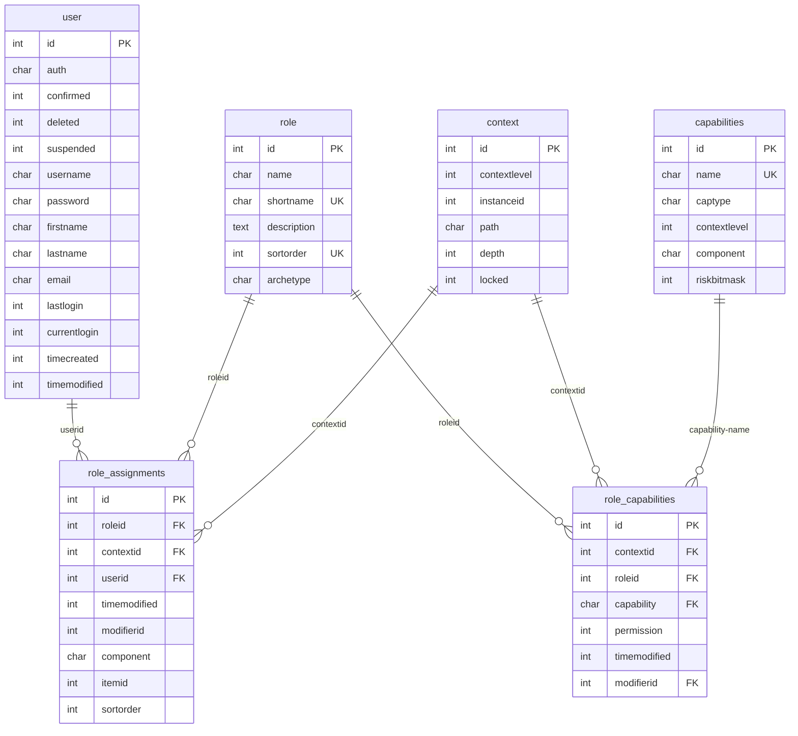
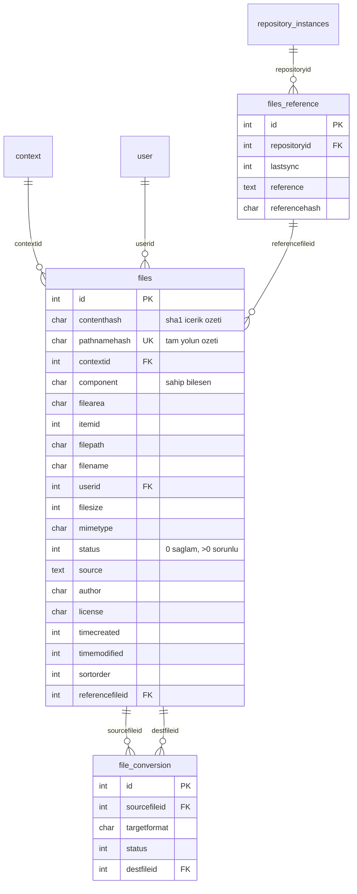

# WBS-1 Kapsamın Belirlenmesi ve Mevcut Sistem Analizi

Moodle sürümü: 5.3 LTS

## 1. Geliştirme ve test ortamı (Fatma Zehra)

Ekibin hepsi Moodle'ı kendi bilgisayarında aynı sürüm, aynı kaynak kod ve aynı örnek veriyle çalıştırır. Kurulum adımları, sıfırlama ve sık karşılaşılan sorunlar: [ortam/README.md](../ortam/README.md).

| | |
| --- | --- |
| İncelenen sürüm | Moodle 5.3.1 (LTS; aktif destek Ekim 2027'ye, güvenlik desteği Ekim 2029'a kadar) |
| Kaynak kod revizyonu | `cfe123f26fc7071981fe949cb16cd5a08a8234f1` (Moodle release 5.3.1, 12.11.2026) |
| Çalıştırma | moodlehq/moodle-docker · PHP 8.3 · PostgreSQL 17 · Apache |
| Windows | WSL 2 (Ubuntu) içinde; kod Linux dosya sisteminde tutulur |
| Örnek veri | `ortam/ornek-veri.feature` (Moodle'ın test senaryosu aracıyla tek komutla yüklenir) |

**Örnek veri seti:** 3 kategori, 3 ders, 15 kullanıcı (yönetici, 2 öğretmen, asistan, danışman, 10 öğrenci), 4 ödev, 1 ders dosyası, 10 teslim ve 5 not. Veri; teslim edilip notlandırılmış, teslim edilip notlandırılmamış, taslakta kalmış ve hiç teslim edilmemiş ödev durumlarının hepsini içerir.

**Tekrarlanabilirlik:** Ortam `docker compose down` ile tamamen silinip yaklaşık 5 dakikada aynı verilerle yeniden kurulabilir. Böylece eski ve yeni sistemin karşılaştırmalı testleri her seferinde aynı başlangıç verisiyle çalıştırılır.

**Ortam kurulumunda öğrenilenler:**
- Windows'ta kodun `C:\` altından Docker'a bağlanması dosya erişimini çok yavaşlatıyor: veritabanı kurulumu yaklaşık 2 saat sürdü ve sayfalar dakikalarca açıldı. Kod WSL'in Linux dosya sistemine taşındığında aynı kurulum 3 dakikaya indi. Bu yüzden Windows kullanan herkes WSL içinde çalışır. Bu durum, eski sistemin performans ölçümlerinin de Linux dosya sisteminde yapılması gerektiğini gösteriyor; aksi hâlde Moodle'ın değil dosya erişiminin yavaşlığı ölçülür.
- Moodle 5.x'te web dosyaları `public/` klasörüne taşınmış, komut satırı kurulum betikleri ise ana klasörde kalmış.
- Moodle'ın test senaryosu aracı, geliştirici kütüphanelerinin (`composer install`) kurulmasını gerektiriyor.
- Ödev teslim durumu (taslak veya gönderildi) teslimin kendisine göre değil, ödevin "öğrenci gönder butonuna basmalı" (`submissiondrafts`) ayarına göre belirleniyor. Bu, ödev modülü analizinde korunacak bir iş kuralı adayı.

## 2. Kapsam ve SRS girişi (Fatma Zehra)

Bu bölüm, WBS-1 ve WBS-2 dokümanlarının birlikte oluşturduğu Yazılım Gereksinim Belirtiminin (SRS) giriş kısmıdır. Yapısı ISO/IEC/IEEE 29148:2018 gereksinim mühendisliği standardının SRS önerisine göre düzenlenmiştir.

### 2.1 Amaç

Bu SRS, Moodle 5.3.1'in seçilen alt fonksiyonlarının yapay zekâ desteğiyle yeni bir mimaride ve farklı bir programlama dilinde yeniden geliştirilmesi için gereksinimleri tanımlar. Hedef okuyucular proje ekibi, danışman öğretim üyesi ve değerlendiricilerdir. Doküman, geliştirmeye başlamadan önce neyin korunacağını, neyin düzeltileceğini ve neyin yeni ekleneceğini netleştirmek için kullanılır.

### 2.2 Kapsam

**Kapsam dahilinde**
- Moodle 5.3.1'in (revizyon `cfe123f2`) aşağıdaki alt fonksiyonlarının analizi; ilk sürümde geliştirilecek olanlar §9'da seçilir:
  - Kimlik ve yetkilendirme
  - Ders ve kayıt
  - Danışmanlık (ön şartlar, ders seçim kısıtları)
  - Ödev ve teslim
  - Değerlendirme
  - Dosya yönetimi
- Yeni modül: Otomatik eğitim planı oluşturma
- Seçilen fonksiyonların yeni dilde ve mimaride yeniden geliştirilmesi, bunun için gereken veri aktarımı
- Eski ve yeni sistemin aynı girdilerle karşılaştırmalı doğrulanması ve kalite ölçümleri

**Kapsam dışında**
- Moodle'ın bütünü ve seçilmeyen etkinlik türleri (sınav, forum, çalıştay, SCORM, H5P vb.)
- Üçüncü taraf eklentiler ve mobil uygulama
- Moodle arayüzünün görsel olarak birebir kopyalanması
- Gerçek kurum verisinin taşınması (yalnızca test verisi kullanılır)
- Eski sistemde yapılacak değişiklikler; eski sistem karşılaştırma için olduğu gibi korunur

### 2.3 Tanımlar ve kısaltmalar

| Terim | Anlamı |
| --- | --- |
| Eski sistem | Moodle 5.3.1, revizyon `cfe123f2` |
| Yeni sistem | Seçilen fonksiyonların hedef dilde yeniden geliştirilmiş hâli |
| Modül / alt fonksiyon | Moodle'ın birlikte analiz edilen bir işlev grubu (ör. Ödev ve teslim) |
| Rol | Kullanıcının bir bağlamda sahip olduğu yetki seti (ör. öğrenci, öğretmen) |
| Bağlam (context) | Moodle'da yetkinin geçerli olduğu kapsam: site, kategori, ders, etkinlik |
| Yetenek (capability) | Moodle'da tek bir işleme verilen izin (ör. `mod/assign:grade`) |
| FR | Fonksiyonel gereksinim |
| NFR | Fonksiyonel olmayan gereksinim (performans, güvenlik, kullanılabilirlik vb.) |
| BR | Korunacak iş kuralı |
| BUG | Eski sistemde düzeltilecek hata veya eksik |
| KPI | Ana performans göstergesi |
| YZ | Yapay zekâ |
| Karakterizasyon testi | Eski sistemin mevcut davranışını kaydeden test |
| İzlenebilirlik | Gereksinim, eski kod, yeni kod ve test arasındaki eşleme |

### 2.4 Kullanıcı rolleri

| Rol | Moodle karşılığı | Örnek veride | Temel işleri |
| --- | --- | --- | --- |
| Site yöneticisi | `admin` | admin | Site ayarları, kullanıcı ve rol yönetimi |
| Yönetici | `manager` | yonetici1 | Kategori, ders ve kullanıcı yönetimi |
| Öğretmen | `editingteacher` | ogretmen1, ogretmen2 | Ders içeriği, ödev oluşturma, notlandırma |
| Düzenleme yetkisiz öğretmen | `teacher` | asistan1 | Notlandırma, içerik değiştiremez |
| Öğrenci | `student` | ogrenci1–ogrenci10 | Derse katılım, ödev teslimi, not görüntüleme |
| Danışman | Standart rolü yok | danisman1 | Ders seçim onayı, eğitim planı takibi (bkz. §4.3, §5) |

### 2.5 Gereksinimlerin yazımı

Her gereksinim aşağıdaki alanlarla yazılır:

| Alan | Açıklama |
| --- | --- |
| Kimlik | `<MODÜL>-<TÜR>-<NO>`, ör. `ASG-FR-03` |
| Sınıf | **K** korunacak · **D** düzeltilecek · **Y** yeni |
| Açıklama | Tek ve test edilebilir bir ifade |
| Kaynak | Eski kodun yeri, kullanıcı ihtiyacı (§3) veya hata kaydı |
| Öncelik | **M** mutlaka · **S** olmalı · **C** olabilir (MoSCoW) |
| Kabul kriteri | Gereksinimin karşılandığı nasıl anlaşılır |
| Test | İlgili test senaryosunun kimliği |

**Modül önekleri:** `AUTH` kimlik ve yetkilendirme · `CRS` ders ve kayıt · `ADV` danışmanlık · `ASG` ödev ve teslim · `GRD` değerlendirme · `FILE` dosya yönetimi · `PLAN` otomatik eğitim planı.
**Tür ekleri:** `FR` fonksiyonel · `NFR` fonksiyonel olmayan · `BR` iş kuralı · `BUG` hata/eksik.

### 2.6 Varsayımlar ve kısıtlar

- Eski sistem sürümü ve revizyonu proje boyunca sabittir; yeni Moodle sürümleri dikkate alınmaz.
- Hedef dil ve mimari WBS-2'de seçilir. Bu bölümdeki gereksinimler dilden bağımsız yazılır.
- Bütün geliştirme ve testler `ortam/ornek-veri.feature` ile üretilen ortak veriyle yapılır.
- YZ ile üretilen her çıktı insan incelemesinden ve testten geçmeden kabul edilmez; kullanımı WBS-2 §4'e göre kaydedilir.
- Ekip 5 kişidir; harcanan efor, YZ destekli ve manuel geliştirmenin karşılaştırılması için kayıt altına alınır.

### 2.7 SRS'in bölümleri

| SRS bileşeni | Yeri |
| --- | --- |
| Giriş, kapsam, roller, gereksinim yazımı | WBS-1 §2 (bu bölüm) |
| Kullanıcı ihtiyaçları | WBS-1 §3 |
| Mevcut fonksiyonların gereksinimleri (K/D) | WBS-1 §4 |
| Yeni fonksiyon gereksinimleri (Y) | WBS-1 §5 |
| Fonksiyonel olmayan gereksinimler ve KPI'lar | WBS-1 §6 |
| Seçilen modüller ve bağımlılıklar | WBS-1 §9 |
| Veri ve arayüz tasarımı | WBS-2 §3 |
| İzlenebilirlik | WBS-2 §5 |

## 3. Kullanıcı ihtiyaçları anketi (İrem)

## 4. Modül analizleri

Her modül için alt başlıklar: Moodle'daki karşılığı · İş akışları · Kullanıcı ihtiyaçları · İş kuralları (korunacak) · Hatalar ve eksikler (düzeltilecek) · Veri modeli · Yetkilendirme · Bağımlılıklar ve entegrasyonlar · Gereksinimler · Test senaryoları · İlk sürüme alınsın mı?

### 4.1 Kimlik ve yetkilendirme (Sinem)
#### 4.1.1 Moodle'daki karşılığı

Kimlik doğrulama ve yetkilendirme Moodle'da tek bir modülden oluşmaz. Kimlik doğrulama eklentileri, oturum yönetimi, kullanıcı hesapları ve bağlama dayalı rol-yetenek (role-capability) sistemi birlikte çalışır.

Bu analiz Moodle 5.3.1, revizyon `cfe123f2` temel alınarak hazırlanmıştır. Dosya yolları `public/` dizinine görecelidir.

| Bileşen | Kaynak kod | Görevi |
| --- | --- | --- |
| Giriş işlemleri | `login/index.php` | Kullanıcının sisteme girişini yönetir. |
| Kimlik doğrulama | `lib/moodlelib.php:3795` — `authenticate_user_login()` | Kullanıcı adı, parola, hesap durumu ve doğrulama eklentilerini kontrol eder. |
| Oturum oluşturma | `lib/moodlelib.php:4074` — `complete_user_login()` | Başarılı doğrulamadan sonra kullanıcı oturumunu oluşturur. |
| Oturum ve erişim zorunluluğu | `lib/moodlelib.php:2259` — `require_login()` | Giriş, ders erişimi ve oturumla ilgili kontrolleri uygular. |
| Yetenek kontrolü | `lib/accesslib.php:432` — `has_capability()` | Kullanıcının belirtilen bağlamda ilgili yeteneğe sahip olup olmadığını değerlendirir. |
| Yetki zorunluluğu | `lib/accesslib.php:872` — `require_capability()` | Yetki bulunmuyorsa istisna oluşturur. |
| Site yöneticisi kontrolü | `lib/accesslib.php:702` — `is_siteadmin()` | Site yöneticisi durumunu kontrol eder. |
| Kimlik doğrulama eklentileri | `auth/` | Manual, email, LDAP, OAuth2 ve diğer doğrulama yöntemleri. |
| Parola işlemleri | `login/forgot_password.php`, `login/change_password.php` | Parola sıfırlama ve değiştirme işlemleri. |
| Yetkilendirme verileri | `lib/db/install.xml` | Kullanıcı, rol, yetenek ve bağlam verilerinin şeması. |

#### 4.1.2 İş akışları

**A. Kullanıcının sisteme giriş yapması**

1. Kullanıcı giriş ekranında kimlik bilgilerini girer.
2. `authenticate_user_login()` kullanıcıyı belirler ve ilgili doğrulama eklentisini kullanır.
3. Hesabın silinmiş, askıya alınmış veya kilitlenmiş olması gibi durumlar kontrol edilir.
4. Kimlik doğrulama başarılıysa `complete_user_login()` oturumu oluşturur.
5. Giriş zamanı ve oturum bilgileri güncellenir; giriş olayı tetiklenir.
6. Zorunlu parola değişikliği gerekiyorsa kullanıcı ilgili sayfaya yönlendirilir.

**B. Kullanıcının korumalı bir sayfaya erişmesi**

1. Kullanıcı bir ders veya yönetim sayfasını açar.
2. `require_login()` oturumun ve ilgili ders erişiminin geçerliliğini değerlendirir.
3. İşlem belirli bir yetenek gerektiriyorsa `require_capability()` çağrılır.
4. `has_capability()` kullanıcının rollerini, bağlamını ve yetenek izinlerini değerlendirir.
5. İzin varsa işlem sürdürülür; yoksa erişim reddedilir.

**C. Rol ve bağlam değerlendirmesi**

1. Kullanıcının sistem, kategori, ders veya etkinlik bağlamındaki rolleri belirlenir.
2. İlgili rollerin yetenek izinleri değerlendirilir.
3. `CAP_PROHIBIT` gibi engelleyici izinler dikkate alınır.
4. Nihai yetki kararı, bağlam hiyerarşisi ve etkin rol bilgilerine göre verilir.

#### 4.1.3 Kullanıcı ihtiyaçları ve şikâyetler

Kullanıcı anketi henüz tamamlanmadığından doğrulanmış kullanıcı şikâyetleri bu aşamada bulunmamaktadır.

Ankette değerlendirilmesi önerilen konular:

- Giriş ve parola sıfırlama işlemlerinin anlaşılabilirliği.
- Yetki hatası mesajlarının kullanıcıya açıklığı.
- Öğrenci ve öğretmenlerin yalnızca kendi yetkilerine uygun işlemleri görmesi.
- Oturum süresi dolduğunda kullanıcı deneyimi.
- Dersler arasında değişen yetkilerin kullanıcı tarafından anlaşılması.

Bu maddeler doğrulanmış şikâyet değil, araştırılacak kullanıcı ihtiyaçlarıdır.

#### 4.1.4 İş kuralları: korunacaklar

| Kimlik | Kural | Eski kod |
| --- | --- | --- |
| AUTH-BR-01 | Kullanıcı sisteme giriş yapmadan önce etkin kimlik doğrulama yöntemi üzerinden doğrulanır. | `lib/moodlelib.php:3795` |
| AUTH-BR-02 | Silinmiş veya askıya alınmış kullanıcıların normal giriş yapması engellenir. | `authenticate_user_login()` |
| AUTH-BR-03 | Hesap kilitleme etkinse kilitli hesapların giriş denemeleri reddedilir. | `authenticate_user_login()` |
| AUTH-BR-04 | Başarısız giriş denemeleri kayıt altına alınır ve ilgili olay tetiklenir. | `authenticate_user_login()` |
| AUTH-BR-05 | Başarılı girişten sonra kullanıcı oturumu oluşturulur ve giriş olayı tetiklenir. | `complete_user_login()` |
| AUTH-BR-06 | Zorunlu parola değişikliği koşulu varsa kullanıcı normal iş akışına devam etmeden parola değiştirme sürecine yönlendirilir. | `complete_user_login()` |
| AUTH-BR-07 | Korunan sayfalara erişimde geçerli oturum ve ilgili erişim koşulları denetlenir. | `lib/moodlelib.php:2259` |
| AUTH-BR-08 | Yetkiler yalnızca kullanıcı rolüne değil, rolün geçerli olduğu bağlama göre değerlendirilir. | `lib/accesslib.php:432, 788` |
| AUTH-BR-09 | İlgili bağlamda geçerli `CAP_PROHIBIT` izni erişimi engeller. | `lib/accesslib.php:788-843` |
| AUTH-BR-10 | Misafir veya anonim kullanıcılar yazma işlemleri ve riskli yetenekler açısından sınırlandırılır. | `lib/accesslib.php:432-582` |
| AUTH-BR-11 | Bağlam kilitleri belirli yazma yeteneklerini sınırlandırabilir. | `has_capability()` |
| AUTH-BR-12 | Yetki kontrolü başarısızsa `require_capability()` işlemi istisnayla durdurur. | `lib/accesslib.php:872-877` |
| AUTH-BR-13 | Site yöneticisi için özel yetki davranışları bulunur; ancak tüm güvenlik ve oturum kontrolleri koşulsuz atlanmaz. | `has_capability()`, `require_login()` |
| AUTH-BR-14 | Ders erişimi, yalnızca oturum açılmış olmasına değil, ders kaydı ve ilgili erişim kurallarına da bağlıdır. | `require_login()` |

#### 4.1.5 Hatalar ve eksikler: düzeltilecekler (aday)

İncelenen kaynak kodda doğrudan doğrulanmış bir AUTH yazılım hatası tespit edilmemiştir.

| Kimlik | Gözlem | Durum | Doğrulama |
| --- | --- | --- | --- |
| AUTH-BUG-01 | Geliştirme yapılandırmasında yetkisiz erişim hatasıyla birlikte çağrı yığını görüntülenmiştir. `debug=0` ve `debugdisplay=0` ayarlarıyla yapılan tekrarda çağrı yığını görüntülenmemiştir. | **Doğrulanmış Moodle hatası değil; yapılandırmaya bağlı gözlem.** | T-AUTH-02, T-AUTH-10 |
| AUTH-BUG-02 | Yanlış parola ve hesap kilitleme durumlarındaki hata mesajlarının kullanıcı deneyimi ve bilgi ifşası açısından değerlendirilmesi gerekmektedir. | Araştırılacak; hata doğrulanmadı | T-AUTH-05, T-AUTH-06 |

Bu maddeler doğrulanmadan `D` sınıfında kesin hata düzeltme gereksinimi olarak değerlendirilmez.

#### 4.1.6 Veri modeli

Moodle'ın kimlik ve yetkilendirme altyapısı, kullanıcı hesapları ile bağlama dayalı rol ve yetenek yönetimini birbirine bağlayan altı temel tablo üzerinden incelenmiştir. Tabloların alanları, anahtarları ve indeksleri `lib/db/install.xml` dosyasından doğrulanmıştır.

**Temel tablolar**

| Tablo | Açıklama | Önemli alanlar |
| --- | --- | --- |
| `user` | Kullanıcı hesaplarını ve kimlik bilgilerini saklar. | `id`, `username`, `password`, `auth`, `confirmed`, `deleted`, `suspended`, `email`, `lastlogin` |
| `role` | Sistemdeki rolleri tanımlar. | `id`, `name`, `shortname`, `description`, `archetype` |
| `context` | Yetkilerin geçerli olduğu bağlamları ve hiyerarşiyi tutar. | `id`, `contextlevel`, `instanceid`, `path`, `depth`, `locked` |
| `capabilities` | Sistemde tanımlı yetenekleri saklar. | `id`, `name`, `captype`, `contextlevel`, `component`, `riskbitmask` |
| `role_assignments` | Kullanıcıya belirli bağlamda rol atanmasını sağlar. | `id`, `roleid`, `contextid`, `userid`, `component`, `itemid` |
| `role_capabilities` | Rolün belirli bağlamdaki yetenek iznini tanımlar. | `id`, `roleid`, `contextid`, `capability`, `permission` |

**ER diyagramı**

**Anahtarlar ve veri bütünlüğü kuralları**

| Tablo | Kural |
| --- | --- |
| `user` | `id` birincil anahtardır. `(mnethostid, username)` birleşimi benzersizdir. |
| `role` | `id` birincil anahtardır. `shortname` ve `sortorder` ayrı ayrı benzersiz indekslere sahiptir. |
| `context` | `id` birincil anahtardır. `(contextlevel, instanceid)` birleşimi benzersizdir. |
| `capabilities` | `id` birincil anahtardır. `name` benzersiz anahtardır. |
| `role_assignments` | `roleid`, `contextid`, `userid` alanları sırasıyla `role`, `context` ve `user` tablolarına yabancı anahtardır. |
| `role_capabilities` | `roleid`, `contextid`, `modifierid` ve `capability` yabancı anahtardır. `(roleid, contextid, capability)` birleşimi benzersizdir. |

**Önemli indeksler**

- `role_assignments`: `(roleid, contextid)`, `(userid, contextid, roleid)`, `(component, itemid, userid)`.
- `role_capabilities`: benzersiz `(roleid, contextid, capability)` indeksi.
- `context`: benzersiz `(contextlevel, instanceid)` indeksi; ayrıca `path` indeksi.
- `user`: benzersiz `(mnethostid, username)` indeksi; ayrıca `email`, `auth`, `deleted` gibi sorgu alanları için indeksler.

**Korunması gereken veri modeli davranışları**

- Kullanıcı adının benzersizliği `mnethostid` ile birlikte değerlendirilir.
- Kullanıcının rolü bağlamdan bağımsız değildir; rol ataması kullanıcı, rol ve bağlam ilişkisiyle saklanır.
- Bir rolün aynı bağlamda aynı yetenek için birden fazla izin kaydı bulunamaz.
- Yetki kontrolü, `context` hiyerarşisini ve `role_capabilities.permission` değerlerini dikkate alır.
- `context.locked` alanı bağlamın ve alt bağlamlarının kilitlenme durumunu temsil eder.

Kaynak: `public/lib/db/install.xml`, `user` (870), `role` (1184), `context` (1201), `capabilities` (1230 civarı), `role_assignments` (1304), `role_capabilities` (1329). Yetki değerlendirme mantığı: `public/lib/accesslib.php`, `has_capability()` ve `has_capability_in_accessdata()`.

#### 4.1.7 Yetkilendirme

Moodle'da yetkilendirme rol tabanlı olmakla birlikte bağlama duyarlıdır. Aynı kullanıcı bir derste öğretmen, başka bir derste öğrenci olabilir.

| İşlem | Öğrenci | Düzenleyen öğretmen | Site yöneticisi |
| --- | --- | --- | --- |
| Kendi hesabıyla giriş yapma | Evet | Evet | Evet |
| Kayıtlı olduğu dersi görüntüleme | Evet | Evet | Evet |
| SENG101 ders ayarlarını düzenleme | Hayır | Evet | Evet |
| Site yapılandırmasını yönetme | Hayır | Hayır | Evet |

Tablo, incelenen rollerin örnek veri üzerindeki temel davranışlarını temsil eder. Ayrıntılı yetki matrisi Moodle rol yapılandırması ve `has_capability()` kontrolleri üzerinden genişletilecektir.

#### 4.1.8 Bağımlılıklar ve entegrasyonlar

- **CRS:** Ders kayıt durumu, kullanıcının ders erişimini etkiler.
- **ASG ve GRD:** Ödev teslimi ve notlandırma yetkileri AUTH üzerinden değerlendirilir.
- **FILE:** Dosya erişiminde kullanıcı kimliği, bağlam ve yetenek kontrolü kullanılır.
- **Oturum yönetimi:** Giriş, çıkış ve oturum geçerliliği.
- **Kimlik doğrulama eklentileri:** Manual, email, LDAP, OAuth2 ve diğer yöntemler.
- **Olay ve hook altyapısı:** Giriş ve yetkiyle ilgili olaylar ve genişletme noktaları.

#### 4.1.9 Gereksinimler

Sınıf: **K** korunacak, **D** düzeltilecek, **Y** yeni. Öncelik: **M** mutlaka, **S** olmalı, **C** olabilir.

| Kimlik | Sınıf | Açıklama | Kaynak | Öncelik | Kabul kriteri | Test |
| --- | --- | --- | --- | --- | --- | --- |
| AUTH-FR-01 | K | Geçerli kullanıcı bilgileriyle oturum açılabilmelidir. | AUTH-BR-01, 05 | M | Geçerli hesapla oturum oluşturulur. | T-AUTH-01 |
| AUTH-FR-02 | K | Yetkisiz kullanıcı korunan işlemleri gerçekleştirememelidir. | AUTH-BR-08, 12 | M | Yetkisiz ders ayarı düzenleme denemesi reddedilir. | T-AUTH-02 |
| AUTH-FR-03 | K | Öğretmen kendi yetkili olduğu dersin ayarlarına erişebilmelidir. | AUTH-BR-08 | M | Öğretmen ders ayarları formunu açabilir. | T-AUTH-03 |
| AUTH-FR-04 | K | Askıya alınmış veya silinmiş hesapların girişi engellenmelidir. | AUTH-BR-02 | M | Askıya alınmış hesapla giriş reddedilir; silinmiş hesap için doğrulama beklemektedir. | T-AUTH-04 |
| AUTH-FR-05 | K | Geçersiz parola ile giriş reddedilmeli ve başarısız denemeler kaydedilmelidir. | AUTH-BR-01, 04 | M | Yanlış parolayla oturum oluşturulmaz; başarısız giriş kaydı ayrıca doğrulanacaktır. | T-AUTH-05 |
| AUTH-FR-06 | K | Etkin hesap kilitleme kuralları uygulanmalıdır. | AUTH-BR-03 | S | Kilitlenmiş hesapla giriş yapılamaz. | T-AUTH-06 |
| AUTH-FR-07 | K | Kullanıcı yetkileri rol ve bağlam birlikte değerlendirilerek belirlenmelidir. | AUTH-BR-08, 09 | M | Farklı derslerde erişim davranışı değişir; farklı bağlamlarda rol atama testi ayrıca yapılacaktır. | T-AUTH-07 |
| AUTH-FR-08 | K | Kullanıcı çıkış yaptığında korunan sayfalara yeniden giriş yapmadan erişememelidir. | AUTH-BR-07 | M | Çıkış sonrası ders bağlantısı açıldığında giriş ekranına yönlendirilir; oturum zaman aşımı ayrıca test edilecektir. | T-AUTH-08 |
| AUTH-FR-09 | K | Zorunlu parola değişikliği uygulanmalıdır. | AUTH-BR-06 | S | Kullanıcı parola değişikliği akışına yönlendirilir. | T-AUTH-09 |
| AUTH-NFR-01 | Y | Yetkisiz erişim yanıtları hassas sistem ayrıntılarını açıklamamalıdır. | WBS-1 §6, K3-K4 | M | Kullanıcıya çağrı yığını veya hassas yapılandırma bilgisi gösterilmez. | T-AUTH-10 |
| AUTH-NFR-02 | Y | Yetkilendirme testlerinde yetkisiz işlemlerin tamamı reddedilmelidir. | WBS-1 §6, K4 | M | Yetkisiz erişim engelleme oranı %100 olur. | T-AUTH-02, T-AUTH-07 |

#### 4.1.10 Test senaryoları

Test ortamı: Moodle 5.3.1, PHP 8.3, PostgreSQL 17; ortak örnek veri seti.

| Kimlik | Tür | Adımlar | Beklenen sonuç | Eski sistem sonucu |
| --- | --- | --- | --- | --- |
| T-AUTH-01 | Normal | `ogrenci1` hesabıyla giriş yapılır. | Dashboard açılır. | **Başarılı:** Dashboard açıldı. |
| T-AUTH-02 | Yetkisiz | `ogrenci1`, `/course/edit.php?id=2` adresini açar. | Ders ayarlarına erişim reddedilir. | **Başarılı:** `required_capability_exception` ile erişim reddedildi. Geliştirme ortamında çağrı yığını görüntülendi. |
| T-AUTH-03 | Normal | `ogretmen1`, SENG101 ders ayarlarını açar. | Düzenleme formu görüntülenir. | **Başarılı:** Ayarlar formu açıldı. Değişiklik kaydedilmedi. |
| T-AUTH-04 | Yetkisiz | `ogrenci10` hesabı askıya alınır ve doğru parolayla giriş denenir. | Giriş reddedilir. | **Başarılı:** Askıya alınmış `ogrenci10` hesabıyla giriş reddedildi. "Unable to log in — Your login info may be incorrect. Please try again." mesajı görüntülendi. |
| T-AUTH-05 | Hatalı girdi | `ogrenci10` hesabıyla yanlış parola kullanılarak giriş denenir. | Giriş reddedilir. | **Başarılı:** Giriş reddedildi. "Unable to log in — Your login info may be incorrect. Please try again." mesajı görüntülendi. |
| T-AUTH-06 | Sınır | Account lockout threshold `3` yapılır. `ogrenci10` hesabıyla üç kez yanlış parola, ardından bir kez doğru parola denenir. | Hesap kilitlenir ve doğru parolayla da giriş engellenir. | **Başarılı:** Üç başarısız deneme sonrası hesap kilitlendi. Doğru parola da reddedildi. "Your account is locked. An unlock link has been sent via email." mesajı görüntülendi. E-posta teslimi doğrulanmadı. |
| T-AUTH-07 | Yetkilendirme | `ogretmen1` ile SENG101 ve SENG201 derslerinin Settings sekmeleri kontrol edilir; ardından CENG301 (`/course/view.php?id=4`) açılır. | Kullanıcının ders bağlamına göre erişimi değişir. | **Başarılı:** SENG101 ve SENG201'de Settings sekmesi görüntülendi. CENG301 için kayıt seçeneklerine yönlendirildi ve "You cannot enrol yourself in this course." mesajı gösterildi. |
| T-AUTH-08 | Oturum | `ogrenci1` ile SENG101 açılır, çıkış yapılır ve aynı ders bağlantısı tekrar açılır. | Çıkış sonrası yeniden giriş istenir. | **Başarılı:** Çıkış yapıldıktan sonra SENG101 bağlantısı açıldığında Moodle giriş sayfasına yönlendirdi. |
| T-AUTH-09 | Parola | `ogrenci10` için Force password change etkinleştirilir ve kullanıcı giriş yapar. | Kullanıcı parola değiştirme ekranına yönlendirilir. | **Başarılı:** `ogrenci10` giriş sonrasında Change password sayfasına yönlendirildi. "You must change your password to proceed." uyarısı görüntülendi. Parola değiştirme işlemi tamamlanmadı. |
| T-AUTH-10 | Güvenlik | `config.php` içinde `debug=0` ve `debugdisplay=0` ayarlanır. `ogrenci1` ile `/course/edit.php?id=2` adresine erişilir. | Yetkisiz erişim reddedilir; çağrı yığını ve hassas hata ayıklama bilgileri gösterilmez. | **Başarılı:** Ders ayarlarına erişim reddedildi. Kullanıcıya yetki hatası gösterildi; çağrı yığını veya PHP hata ayıklama bilgisi görüntülenmedi. Yerel ortamda üretim benzeri hata ayarlarıyla test edildi. |

**Test kapsamı ve sınırlılıklar:** T-AUTH-01 ile T-AUTH-10 arasındaki 10 test senaryosu yerel Moodle 5.3.1 ortamında uygulanmış ve belirtilen gözlemler elde edilmiştir. Bununla birlikte T-AUTH-03'te ders ayarları kaydedilmemiş, T-AUTH-04'te silinmiş hesap durumu denenmemiş, T-AUTH-05'te başarısız girişin veritabanına kaydı ayrıca doğrulanmamış, T-AUTH-06'da kilit açma e-postasının teslimi kontrol edilmemiştir. T-AUTH-07'de farklı derslerde erişim davranışı gözlemlenmiş ancak farklı rol atamaları oluşturulmamıştır. T-AUTH-08'de çıkış sonrası erişim kontrol edilmiş, zaman aşımı senaryosu uygulanmamıştır. T-AUTH-09'da parola değiştirme sayfasına yönlendirme doğrulanmış ancak parola değiştirme işlemi tamamlanmamıştır. T-AUTH-10, gerçek üretim ortamında değil, yerel ortamda hata ayıklama kapatılarak gerçekleştirilmiştir. Bu sınırlılıklar sonraki doğrulama aşamasında ele alınacaktır.

#### 4.1.11 Öneri: ilk sürüme alınsın mı?

**Evet, zorunlu çekirdek modül olarak alınmalıdır.**

AUTH, diğer modüllerin güvenli çalışması için temel bağımlılıktır. İlk sürümde kullanıcı girişi, oturum yönetimi, kullanıcı-rol-bağlam ilişkileri, yetki kontrolü ve yetkisiz erişimin engellenmesi bulunmalıdır.

Moodle'ın bütün harici kimlik doğrulama eklentilerinin birebir yeniden geliştirilmesi ilk sürüm için gerekli değildir. Öncelik, ortak örnek verideki kullanıcıların güvenli giriş yapması ve AUTH ile CRS arasındaki erişim kurallarının korunmasıdır.

Yeni mimaride roller ve yetenekler merkezi bir yetkilendirme mekanizmasıyla değerlendirilmeli; ders, ödev, not ve dosya modülleri bu mekanizmayı ortak kullanmalıdır.

### 4.2 Ders ve kayıt (Sinem)

### 4.3 Danışmanlık (İrem)

### 4.4 Ödev ve teslim (Aslı Ceren)

### 4.5 Değerlendirme (Aslı Ceren)

### 4.6 Dosya yönetimi (Seray)

Bu bölüm Moodle 5.3.1, revizyon `cfe123f2` kaynak koduna göre yazılmıştır. Dosya yolları `public/` klasörüne görecelidir. Bölümdeki bilgiler koddan okunarak çıkarılmıştır; §4.6.10'daki test senaryoları henüz eski sistemde çalıştırılmamıştır ve "Hatalar ve eksikler" altındaki maddeler testle doğrulanana kadar **aday** sayılır.

#### 4.6.1 Moodle'daki karşılığı

Dosya yönetimi Moodle'da tek bir eklenti değil, çekirdekte (core) duran bir **Dosya API'sidir**. Diğer bütün modüller (ödev, kaynak, profil vb.) dosyalarını bu API üzerinden saklar.

| Parça | Kaynak kodun yeri | Görevi |
| --- | --- | --- |
| Dosya deposu | `lib/filestorage/file_storage.php` (2476 satır), `stored_file.php` | Dosya kaydı oluşturma, bulma, silme, kopyalama; temizlik görevi (`cron`, satır 2261) |
| Fiziksel depolama | `lib/filestorage/file_system.php`, `file_system_filedir.php` | Dosya içeriğini diskte tutar (içerik adresli havuz) |
| Paketleyiciler | `lib/filestorage/zip_packer.php`, `tgz_packer.php`, `mbz_packer.php` | Zip ve yedek dosyası açma/oluşturma |
| Dosya sunumu | `pluginfile.php` → `file_pluginfile()` (`lib/filelib.php:4443`), `send_stored_file()` (`lib/filelib.php:2674`) | Dosyayı yetki kontrolünden sonra tarayıcıya gönderir |
| Taslak sunumu | `draftfile.php` | Yüklenmiş ama henüz kaydedilmemiş dosyaları sahibine gösterir |
| Yükleme | `repository/upload/lib.php`, `repository/draftfiles_ajax.php` | Dosya seçici ve doğrulama |
| Kaynak eklentileri (repository) | `repository/` (upload, user, coursefiles, local, recent, url; harici: dropbox, onedrive, nextcloud, s3, webdav, googledocs, flickr vb.) | Dosyanın nereden geldiği |
| Arayüz | `files/index.php` (ders dosyaları), `user/files.php` (özel dosyalar) | Dosya yönetim sayfaları |
| Yardımcı işlevler | `lib/filelib.php` (`file_save_draft_area_files`, `file_prepare_draft_area`, `file_get_user_used_space` vb.) | Taslaktan kalıcı alana kaydetme, kota hesabı |
| Veri | `lib/db/install.xml` satır 2656–2730: `files`, `files_reference`, `file_conversion` | Dosya kayıtları |
| Disk | `$CFG->dataroot/filedir`, `$CFG->dataroot/trashdir` | Dosya içerikleri ve çöp |

**Not:** `contentbank` (içerik bankası, H5P) ve önizleme/dönüştürme (`file_conversion`, `get_file_preview`) ayrı özelliklerdir; bu analizde yalnızca bağımlılık olarak geçer.

#### 4.6.2 İş akışları

**A. Dosya yükleme (öğrenci veya öğretmen)**
1. Kullanıcı bir formdaki dosya seçiciden (filemanager/filepicker) dosyayı seçer.
2. `repository_upload::process_upload()` dosyayı doğrular: ad temizlenir, uzunluk, tür, virüs, boyut ve alan sınırları kontrol edilir (bkz. FILE-BR-06 – 09).
3. Dosya, kullanıcının **taslak alanına** (`component='user'`, `filearea='draft'`, bir `itemid`) yazılır.
4. Kullanıcı formu kaydedince `file_save_draft_area_files()` (`lib/filelib.php:1066`) taslaktaki dosyaları gerçek alana (ör. ödev teslimi) kaydeder.

**B. Dosya indirme / görüntüleme**
1. Bağlantı `pluginfile.php/{contextid}/{component}/{filearea}/{itemid}/{yol}/{dosyaadı}` biçimindedir.
2. `file_pluginfile()` bağlamı (context) bulur. Bileşenin kendi `*_pluginfile` işlevi giriş ve yetki kontrolünü yapar. Örnekler: ödev ek dosyaları için `assign_pluginfile` (giriş zorunlu + `mod/assign:view`); ödev **teslim dosyaları** için `assignsubmission_file_pluginfile` (giriş zorunlu + teslimi görme yetkisi, grup teslimlerinde grup kontrolü, indirme her zaman zorlanır).
3. Yetki varsa `send_stored_file()` dosyayı gönderir; değilse "dosya bulunamadı" döner (`send_file_not_found`).

**C. Dosya silme**
1. `stored_file::delete()` (`lib/filestorage/stored_file.php:364`) bir veritabanı işlemi başlatır.
2. Bu dosyaya referans veren başka dosyalar varsa onlar **kopyaya dönüştürülür**; dosya kendisi bir referanssa bağı koparılır.
3. `files` kaydı silinir, ardından `after_file_deleted` eklenti kancaları çalışır.
4. Aynı içeriği kullanan başka kayıt kalmadıysa fiziksel dosya `trashdir`'e taşınır (`remove_file`).
5. Temizlik görevi çöp klasörünü boşaltır (varsayılan en çok günde bir kez).

**D. Zamanlanmış temizlik** (`file_storage::cron`, `lib/filestorage/file_storage.php:2261`)
- 4 günden eski taslak alanları silinir.
- Sahipsiz önizleme ve dönüştürme dosyaları silinir.
- Silinmiş bağlamlara ait dosyalar silinir; çöp klasörü boşaltılır (`filescleanupperiod`, varsayılan 86400 sn).

**E. Dosya yönetim sayfaları**
- Ders dosyaları (`files/index.php`): öğretmen/yönetici ders dosyalarını yönetir.
- Özel dosyalar (`user/files.php`): her kullanıcı kendi dosyalarını yönetir.

#### 4.6.3 Kullanıcı ihtiyaçları ve şikâyetler

Öğrenci ve öğretmen şikâyetleri WBS-1 §3'teki anket sonuçlarından alınacaktır; anket henüz tamamlanmadığı için bu başlık **doldurulacaktır**. Anket sonuçlarından bağımsız olarak koddan çıkan ve ankette sorulması gereken konular: taslağın 4 gün sonra kaybolması, kota dolunca verilen hata mesajının anlaşılırlığı, çok dosyalı yükleme ve sürükle-bırak deneyimi.

#### 4.6.4 İş kuralları: korunacaklar

| Kimlik | Kural | Eski kod |
| --- | --- | --- |
| FILE-BR-01 | Dosya içeriği SHA-1 özetiyle adreslenen **havuzda** bir kez saklanır. Aynı içerikli birçok dosya kaydı tek fiziksel dosyayı paylaşır. Fiziksel yol özetin ilk iki ve sonraki iki karakterinden oluşan iki alt dizindir (`filedir/ab/cd/<özet>`). | `lib/filestorage/file_system_filedir.php:185-190`; `lib/db/install.xml:2659` |
| FILE-BR-02 | Bir dosya `pathnamehash` (bağlam + bileşen + alan + öğe + yol + ad) ile tekil olarak tanımlanır; aynı yolda aynı adlı iki dosya olamaz (benzersiz dizin). | `lib/db/install.xml:2660, 2688` |
| FILE-BR-03 | Fiziksel dosya yalnızca hiçbir `files` kaydı o içeriği kullanmıyorsa çöpe taşınır. Boş içeriğin (boş dizenin özeti) fiziksel dosyası hiç silinmez. | `lib/filestorage/file_system.php:226-243`; `file_system_filedir.php:287-321` |
| FILE-BR-04 | Çöpe taşınan dosyalar temizlik görevi ile kalıcı silinir; görev sıklığı `filescleanupperiod` (varsayılan 24 saat). | `lib/filestorage/file_system_filedir.php:326-333`; `file_storage.php:2305-2307` |
| FILE-BR-05 | Yüklemeler önce kullanıcıya özel **taslak alanına** gider; 4 günden eski taslaklar silinir. | `lib/filestorage/file_storage.php:2268-2278` |
| FILE-BR-06 | Dosya adı `PARAM_FILE` ile temizlenir ve en çok 255 karakter olabilir. | `repository/upload/lib.php:148-152, 173-175`; `file_storage.php:49` |
| FILE-BR-07 | Aynı adlı dosya yüklenirse üzerine yazma istenmediyse benzersiz bir ad üretilir. | `repository/upload/lib.php:237-245`; `repository/lib.php:949` |
| FILE-BR-08 | Boyut sınırları: dosya başına sınır (PHP `upload_max_filesize` ve `post_max_size`, site, ders ve modül sınırlarının **en küçüğü**), alan toplam sınırı ve taslak başına en çok öğe sayısı. Boş içerik veya klasör yüklemesi reddedilir. | `lib/moodlelib.php:6337-6364`; `repository/upload/lib.php:220-231, 212-214` |
| FILE-BR-09 | Kabul edilen dosya türü formda tanımlıysa, tür içeriğe ve uzantıya göre denetlenir. Her yüklenen dosya antivirüs taramasından geçer. | `repository/upload/lib.php:177-199, 202` |
| FILE-BR-10 | Kullanıcı kotası: özel dosyalar için `userquota` (varsayılan 100 MB). `moodle/user:ignoreuserquota` yetkisi olan kullanıcı muaftır. | `admin/settings/security.php:63-65`; `lib/filelib.php:639-651`; `lib/db/access.php:632-637` |
| FILE-BR-11 | Dosya sunumu her zaman dosyanın ait olduğu **bileşenin** yetki kontrolünden geçer; yetkisiz erişimde "dosya bulunamadı" döner. | `lib/filelib.php:4443-4620`; `mod/assign/lib.php:1383-1425`; `mod/assign/submission/file/lib.php:38-88` |
| FILE-BR-12 | Taslak dosyaları yalnızca sahibi görebilir, misafir göremez ve taslaklar her zaman **indirmeye zorlanır** (tarayıcıda çalıştırılmaz). | `draftfile.php:33-36, 69-72, 88` |
| FILE-BR-13 | Bir dosya silinirken ona referans veren dosyalar kopyaya dönüştürülür; silme tek veritabanı işlemi içinde yapılır. | `lib/filestorage/stored_file.php:364-389` |
| FILE-BR-14 | Silinen her dosya için `after_file_deleted` kancası çağrılır; böylece eklentiler kendi verilerini temizleyebilir. | `lib/filestorage/stored_file.php:391-399` |

#### 4.6.5 Hatalar ve eksikler: düzeltilecekler (aday)

Aşağıdakiler kod okunurken görülen **adaylardır**; eski sistemde yeniden üretilip doğrulanana kadar `D` sınıfına kesin olarak alınmaz.

| Kimlik | Gözlem | Eski kod | Doğrulama |
| --- | --- | --- | --- |
| FILE-BUG-01 | Kota hesabı dosyaları `(contenthash, filename)` çiftine göre gruplayıp yalnızca en son kaydı topluyor. Farklı klasörlerde duran, aynı ad ve içeriğe sahip dosyalar **bir kez** sayılır; kullanılan alan olduğundan az görünür. | `lib/filelib.php:639-651` | T-FILE-10 |
| FILE-BUG-02 | Taslak temizliği taslağın **oluşturulma** zamanına bakıyor (`timecreated`), son değişikliğe değil. 4 günden uzun açık bekleyen bir form taslağı kaydedilmeden önce silinebilir. | `lib/filestorage/file_storage.php:2268-2278` | T-FILE-08 |
| FILE-BUG-03 | Çöp klasörü yaşa göre değil toptan boşaltılıyor (`fulldelete`). Kurtarma penceresi, son temizlikten bu yana geçen süreye bağlı ve en çok `filescleanupperiod` kadardır; kullanıcıya açık bir geri alma yoktur. | `lib/filestorage/file_system_filedir.php:330-333` | T-FILE-07 |
| FILE-BUG-04 | `is_file_removable` kodda "kritik bölüm" olarak işaretli: aynı içerik tam silinirken yeniden yüklenirse yarış durumu oluşabilir, bu yüzden dosyanın çöpten kurtarılabilmesi gerekir. Yeni sistemde bu durum tasarımla kapatılmalıdır. | `lib/filestorage/file_system.php:234-241` | Kod incelemesi (testle doğrulanamaz) |

#### 4.6.6 Veri modeli

Üç tablo vardır; içerik tablosu yoktur (içerik diskte).

- **Dizinler:** `component+filearea+contextid+itemid`, `contenthash`, `pathnamehash` (benzersiz), `license`, `filename`.
- **Klasörler** ayrı bir tablo değil, `filename='.'` olan `files` kayıtlarıdır (`file_storage.php:2268-2272` aynı kuralı kullanır).
- **Fiziksel veri:** `filedir/<ab>/<cd>/<sha1>` ve `trashdir/...`. Veritabanı ve disk birlikte yedeklenmezse tutarsızlık oluşur.

#### 4.6.7 Yetkilendirme

| İşlem | Yetenek | Öğrenci | Öğretmen (`teacher`) | Düzenleyen öğretmen | Yönetici |
| --- | --- | --- | --- | --- | --- |
| Ders dosyalarını yönetme | `moodle/course:managefiles` | ✗ | ✗ | ✓ | ✓ |
| Kendi özel dosyalarını yönetme | `moodle/user:manageownfiles` | ✓ | ✓ | ✓ | ✓ |
| Dosya yükleme (bir etkinlik içinde) | `repository/upload:view` | ✓ | ✓ | ✓ | ✓ |
| Kullanıcı kotasından muaf olma | `moodle/user:ignoreuserquota` | ✗ | ✗ | ✗ | ✓ (site yöneticisi) |
| Dosya boyut sınırından muaf olma | `moodle/course:ignorefilesizelimits` | ✗ | ✗ | ✗ | ✓ (site yöneticisi) |
| Başkasının taslak dosyasını görme | (yetenek yok, sahibe bağlı) | ✗ | ✗ | ✗ | ✗ |
| Etkinliğe ait dosyayı görme | Etkinlik yeteneği (ör. `mod/assign:view`) ve dosya sahipliği | Bileşene bağlı (bkz. §4.4) | Bileşene bağlı | Bileşene bağlı | Bileşene bağlı |

Kaynak: `lib/db/access.php:619, 632, 951, 975`; `repository/upload/db/access.php:30`; `draftfile.php:33-36, 69-72`. Tablodaki "Yönetici" sütunu site yöneticisini (her yeteneğe sahip) kapsar; `manager` rolünün `ignoreuserquota` ve `ignorefilesizelimits` yetkileri varsayılan olarak yoktur.

#### 4.6.8 Bağımlılıklar ve entegrasyonlar

- **Bağlam ve yetki sistemi** (context, capability, rol): bütün erişim kararları buradan çıkar.
- **Ödev (ASG), kaynak ve diğer etkinlikler:** dosyalarının sahibidir; sunum yetkisini kendi `*_pluginfile` işlevleriyle verir. Ödev teslim dosyaları için bkz. §4.4.
- **Yedekleme ve geri yükleme:** `mbz_packer` ve `tgz_packer` ile dosyaları paketler.
- **Antivirüs** (`core\antivirus\manager`), **zamanlanmış görevler** (cron), **dosya dönüştürme** (`file_conversion`) ve **önizleme** üretimi.
- **Harici depolar** (Dropbox, OneDrive, Nextcloud, S3, WebDAV, Google Drive): `files_reference` ile dosyaya referans olarak bağlanır.
- **Veritabanı işlemleri:** silme ve taşıma sırasında bütünlük için kullanılır.

#### 4.6.9 Gereksinimler

Sınıf: **K** korunacak · **D** düzeltilecek · **Y** yeni. Öncelik: **M** mutlaka · **S** olmalı · **C** olabilir.

| Kimlik | Sınıf | Açıklama | Kaynak | Öncelik | Kabul kriteri | Test |
| --- | --- | --- | --- | --- | --- | --- |
| FILE-FR-01 | K | Kullanıcı bir dosyayı taslak alanına yükleyebilir. | FILE-BR-05 | M | Yükleme başarılı olur, dosya yalnızca yükleyen kullanıcının taslak alanında görünür. | T-FILE-01 |
| FILE-FR-02 | K | Taslaktaki dosyalar form kaydedilince kalıcı alana kaydedilir. | `lib/filelib.php:1066` | M | Kayıttan sonra dosya hedef alanda bulunur. | T-FILE-02 |
| FILE-FR-03 | K | Yetkili kullanıcı dosyayı indirebilir. | FILE-BR-11 | M | Yetkili kullanıcı için 200 ve doğru içerik. | T-FILE-03 |
| FILE-FR-04 | K | Yetkisiz kullanıcı dosyaya erişemez. | FILE-BR-11 | M | Yetkisiz denemelerin tamamı reddedilir; yanıtta dosya içeriği veya yığın izi yok. | T-FILE-04, T-FILE-05 |
| FILE-FR-05 | K | Kullanıcı yüklediği dosyayı silebilir. | `stored_file.php:364` | M | Dosya listeden kalkar; içerik başka kayıtta kullanılıyorsa onlar etkilenmez. | T-FILE-06 |
| FILE-FR-06 | K | Aynı içerikli dosyalar tek fiziksel kopya olarak saklanır. | FILE-BR-01, FILE-BR-03 | S | İki aynı dosya yüklenince diskte tek içerik kalır; biri silinince diğeri açılmaya devam eder. | T-FILE-07 |
| FILE-FR-07 | K | Aynı adlı dosya yüklenince benzersiz ad üretilir. | FILE-BR-07 | S | İkinci dosya `ad (1)` benzeri adla saklanır, birincisi bozulmaz. | T-FILE-09 |
| FILE-FR-08 | K | Boyut sınırını aşan dosya reddedilir. | FILE-BR-08 | M | Anlaşılır hata mesajı; dosya kaydedilmez. | T-FILE-11 |
| FILE-FR-09 | K | Kullanıcı kotası aşılınca yükleme reddedilir. | FILE-BR-10 | S | Kota aşımında hata; kota muafı kullanıcı yükleyebilir. | T-FILE-10 |
| FILE-FR-10 | K | Geçersiz ad, boş dosya ve izin verilmeyen tür reddedilir. | FILE-BR-06, 08, 09 | M | Her durumda anlaşılır hata, 5xx yok. | T-FILE-12, T-FILE-13 |
| FILE-FR-11 | K | Yüklenen dosya antivirüs taramasından geçer. | FILE-BR-09 | C | Tarayıcı varsa zararlı dosya reddedilir. | T-FILE-14 |
| FILE-FR-12 | K | Eski taslaklar ve çöp temizlik görevi ile silinir. | FILE-BR-04, 05 | S | Görev çalışınca süresi dolan taslaklar silinir. | T-FILE-08 |
| FILE-FR-13 | K | Öğretmen ders dosyalarını yönetir; öğrenci yönetemez. | `files/index.php:55-56` | M | Öğretmen için sayfa açılır, öğrenci için reddedilir. | T-FILE-05 |
| FILE-BUG-01 | D | Kota hesabı aynı ad ve içerikli dosyaları klasörden bağımsız tekilleştirmemeli. | FILE-BUG-01 | S | İki klasördeki aynı dosya iki kez sayılır. | T-FILE-10 |
| FILE-BUG-02 | D | Kullanıcı hâlâ düzenlediği taslak, oluşturulma tarihine göre silinmemeli. | FILE-BUG-02 | S | 4 günden uzun açık kalan form taslağı korunur. | T-FILE-08 |
| FILE-NFR-01 | Y | Dosya indirme yanıtı 50 eş zamanlı kullanıcıda p95 ≤ 1.000 ms olmalı. | WBS-1 §6, K8 | S | k6 ölçümü. | T-FILE-15 |
| FILE-NFR-02 | Y | Veritabanı kaydı ile fiziksel dosya tutarlı olmalı; bir yarım kalan işlem sahipsiz kayıt bırakmamalı. | FILE-BUG-04 | M | Yükleme/silme sırasında hata enjekte edilince tutarsızlık yok. | T-FILE-16 |

**Kapsam dışı (ilk sürümde):** harici depolar, dosya dönüştürme ve önizleme, zip/tgz/mbz paketleyiciler, içerik bankası.

#### 4.6.10 Test senaryoları

Senaryolar `ortam/ornek-veri.feature` verisiyle çalıştırılacaktır (kullanıcılar `ogretmen1`, `ogrenci1`, `ogrenci2`, `danisman1`; ders SENG101; dosya "SENG101 Ders Notları"). **Eski sistem sonucu:** Moodle ortamında çalıştırıldıktan sonra doldurulacaktır; şimdilik tüm senaryolar `Bekliyor`.

| Kimlik | Tür | Adımlar | Beklenen sonuç | Eski sonuç |
| --- | --- | --- | --- | --- |
| T-FILE-01 | Normal | `ogrenci1` özel dosyalarına 1 MB bir PDF yükler. | Dosya listede görünür, taslak alanındaysa yalnızca `ogrenci1` görür. | Bekliyor |
| T-FILE-02 | Normal | Taslağa yüklenen dosya kaydedilir (form gönderilir). | Dosya kalıcı alanda; taslak alanı temizlenir. | Bekliyor |
| T-FILE-03 | Normal | `ogrenci1`, SENG101 Ders Notları dosyasını indirir. | Dosya indirilir, içerik özdeş. | Bekliyor |
| T-FILE-04 | Yetkisiz | Giriş yapmamış ziyaretçi bir `pluginfile.php` adresini açar. | Giriş sayfasına yönlendirilir veya "dosya bulunamadı"; içerik yok. | Bekliyor |
| T-FILE-05 | Yetkisiz | `ogrenci1`, `files/index.php` (ders dosyaları) sayfasını açar; `ogretmen1` aynı sayfayı açar. | Öğrenci: yetki hatası. Öğretmen: sayfa açılır. | Bekliyor |
| T-FILE-06 | Normal | Kullanıcı yüklediği dosyayı siler. | Dosya listeden kalkar. | Bekliyor |
| T-FILE-07 | Sınır | `ogrenci1` ve `ogrenci2` aynı dosyayı yükler; biri siler. | Diğerinin dosyası açılmaya devam eder; ikisi de silinince fiziksel dosya çöpe taşınır. | Bekliyor |
| T-FILE-08 | Sınır | Temizlik görevi çalıştırılırken 5 günlük taslak ve 1 günlük taslak bulunur. | 5 günlük silinir, 1 günlük kalır; hâlâ düzenlenen 5 günlük taslak da silinir (FILE-BUG-02). | Bekliyor |
| T-FILE-09 | Sınır | Aynı ad ve içerikle iki kez yükleme. | İkinci dosya benzersiz adla kaydedilir. | Bekliyor |
| T-FILE-10 | Sınır | Kota 1 MB yapılır; iki klasöre aynı 600 KB dosya yüklenir. | Hesaplanan kullanım 600 KB mı 1,2 MB mı: FILE-BUG-01 doğrulanır. Kota aşımında hata. | Bekliyor |
| T-FILE-11 | Hatalı girdi | Site sınırının üstünde bir dosya yüklenir. | Boyut hatası, dosya kaydedilmez. | Bekliyor |
| T-FILE-12 | Hatalı girdi | 256 karakterlik ad ve geçersiz karakterli ad yüklenir. | Ad hatası veya temizlenmiş ad; 5xx yok. | Bekliyor |
| T-FILE-13 | Hatalı girdi | Boş dosya ve klasör yüklemesi denenir. | "Geçersiz dosya" hatası. | Bekliyor |
| T-FILE-14 | Hatalı girdi | EICAR test dosyası yüklenir (antivirüs açıksa). | Dosya reddedilir. | Bekliyor |
| T-FILE-15 | Performans | 50 eş zamanlı kullanıcı aynı dosyayı indirir (k6). | p95 ölçülür (başlangıç değeri). | Bekliyor |
| T-FILE-16 | Dayanıklılık | Yükleme sırasında bağlantı kesilir. | Sahipsiz kayıt veya dosya kalmaz. | Bekliyor |

#### 4.6.11 Öneri: ilk sürüme alınsın mı?

**Evet, ama yalnızca çekirdek alt küme olarak.** Gerekçe: ödev teslimi, ders kaynakları ve profil resmi dahil hemen her modül dosyaya bağımlıdır; dosya yönetimi olmadan diğer modüller çalışamaz. Buna karşın Moodle'ın dosya sistemi (harici depolar, dönüştürme, önizleme, paketleyiciler) çok geniştir; ilk sürümde şu çekirdek alınmalıdır: taslaktan kalıcıya yükleme, içerik adresli depolama, bileşen yetkisiyle sunum, silme ve çöp, boyut/kota/ad kuralları, temizlik görevi. Harici depolar, dönüştürme ve paketleyiciler sonraya bırakılmalıdır.

**Dikkat:** Ödev modülü (§4.4) dosya teslimini kullanıyorsa bu iki modül aynı ilk sürümde birlikte seçilmelidir; bağımlılık haritası (§9) için not düşülmüştür.

## 5. Yeni modül: Otomatik eğitim planı (İrem)

## 6. Ana performans göstergeleri ve kalite kriterleri (Fatma Zehra)

Kriterler geliştirme başlamadan önce tanımlanır ve eski ile yeni sistem aynı koşullarda ölçülür. Pilot projede (eShop) kullanılan 13 kriter Moodle'a uyarlanmış; kullanım kolaylığı, yetkisiz erişim ve YZ/manuel karşılaştırması eklenmiştir. Son sütun ISO/IEC 25010:2023 ürün kalite modelindeki karşılıktır.

Başarı ölçütlerindeki "≤ eski", yeni sistemin eski sistemden kötü olmaması gerektiğini gösterir. Eski sistemin değerleri WBS-1 §8'deki başlangıç ölçümlerinden alınır.

### 6.1 Kriterler

| # | Kriter | Ölçüt | Araç | Başarı ölçütü (yeni sistem) | ISO/IEC 25010 |
| --- | --- | --- | --- | --- | --- |
| **Güvenli dönüşüm** | | | | | |
| K1 | Davranışın korunması | **K** sınıfı gereksinimlerin karşılaştırmalı testlerinin geçme oranı | Uçtan uca testler (iki sistemde aynı senaryolar) | %100 | İşlevsel uygunluk |
| K2 | Hataların düzeltilmesi | **D** sınıfı gereksinimlerin testlerinin geçme oranı | Uçtan uca testler | %100 | İşlevsel uygunluk, güvenilirlik |
| K3 | Hatalı girdiye dayanıklılık | Geçersiz kimlik, sınır değer ve hatalı form verisinde 5xx yanıt ve yığın izi (stack trace) gösteren sayfa sayısı | Uçtan uca testler | 0 | Güvenilirlik |
| K4 | Yetkisiz erişimin engellenmesi | Her korumalı işlem için yetkisiz rolle yapılan denemelerin reddedilme oranı; rol–yetki matrisinin eski sistemle uyumu | Uçtan uca testler, API testleri | %100 reddedilir; matris eski sistemle aynı (bilinçli değişiklikler **D** olarak kayıtlı) | Güvenlik |
| K5 | Test kapsamı | İş mantığı katmanında satır ve dal kapsamı | Hedef dilin kapsam aracı | Satır ≥ %80, dal ≥ %60 | Bakım yapılabilirlik (test edilebilirlik) |
| K6 | Statik güvenlik | Ciddiyete göre güvenlik bulgusu; bulgu / 1.000 satır | CodeQL, SonarCloud | Yüksek/kritik 0; bulgu / 1.000 satır ≤ eski | Güvenlik |
| K7 | Dinamik güvenlik | Çalışan sisteme pasif tarama bulguları | OWASP ZAP baseline | Yüksek risk 0; orta risk ≤ eski | Güvenlik |
| **Kaliteli kod ve ürün** | | | | | |
| K8 | Yanıt süresi | Medyan ve p95 (ms), saniyedeki istek | k6 | p95 ≤ eski; 50 eş zamanlı kullanıcıda p95 ≤ 1.000 ms | Performans verimliliği |
| K9 | Yük altında hata | Yük testi süresince hata oranı | k6 | < %1 | Güvenilirlik |
| K10 | Kaynak kullanımı | Yük süresince ortalama ve en yüksek CPU (%), bellek (MiB) | `docker stats` | ≤ eski | Performans verimliliği |
| K11 | Kullanım kolaylığı | Standart görevlerde tamamlama oranı, görev süresi, tıklama sayısı; SUS puanı | Kullanıcı testi (en az 5 katılımcı, iki sistemde aynı görevler), SUS anketi | Tamamlama ≥ %90; süre ve tıklama ≤ eski; SUS ≥ 68 | Etkileşim yeteneği |
| K12 | Erişilebilirlik | Otomatik denetimde WCAG 2.1 AA ihlali | axe / Lighthouse | Kritik ihlal 0; toplam ≤ eski | Etkileşim yeteneği |
| K13 | Sürdürülebilirlik | Bakım derecesi, kod kokusu / 1.000 satır, kod tekrarı, fonksiyon başına bilişsel karmaşıklık | SonarCloud | Derece A; tekrar ≤ %3; karmaşıklık ≤ 15 | Bakım yapılabilirlik |
| K14 | Standartlara uyum | İsimlendirme ve stil kuralı ihlali | Hedef dilin linter'ı, SonarCloud | 0 | Bakım yapılabilirlik |
| K15 | Kod büyüklüğü | Aynı fonksiyonlar için satır sayısı (üçüncü taraf ve üretilmiş kod hariç) | cloc | ≤ eski (raporlanır) | Bakım yapılabilirlik |
| **Hızlı dönüşüm** | | | | | |
| K16 | Efor | Gerçek adam-saat / adam-ay; COCOMO II (baştan yazma ve uyarlama modeli) tahminine oranı | Ekip saat kaydı, COCOMO II | Gerçek efor < baştan yazma tahmini | — (süreç) |
| K17 | YZ / manuel karşılaştırması | Aynı fonksiyonlar için efor, test ve incelemede bulunan hata / 1.000 satır, yeniden çalışma oranı | YZ kayıt şablonu (WBS-2 §4) | Raporlanır; eşik yok, karşılaştırma amaçlı | — (süreç) |
| K18 | Dağıtılabilirlik | Tek komutla çalışma, imaj boyutu, açılış süresi | Docker Compose | `docker compose up` ile çalışır | Esneklik (taşınabilirlik) |

### 6.2 Ana performans göstergeleri (KPI)

Projenin başarısını özetleyen göstergeler; ara ve son raporlarda bu sırayla verilir:

1. **Davranış koruma oranı** (K1): K sınıfı testlerin geçme yüzdesi
2. **Hata düzeltme oranı** (K2): D sınıfı testlerin geçme yüzdesi
3. **Yetkisiz erişim engelleme oranı** (K4)
4. **Yüksek/kritik güvenlik bulgusu sayısı** (K6, K7)
5. **p95 yanıt süresi değişimi** (K8): yeni / eski
6. **SUS puanı ve görev tamamlama oranı** (K11)
7. **Sürdürülebilirlik derecesi** (K13)
8. **Efor oranı** (K16): gerçek efor / COCOMO II baştan yazma tahmini
9. **YZ destekli ve manuel geliştirme arasındaki efor ve hata farkı** (K17)

### 6.3 Ölçüm kuralları

- **Aynı veri:** İki sistem de `ortam/ornek-veri.feature` ile yüklenmiş aynı veriyle ölçülür. Yük testlerinde ek veri gerekiyorsa her iki sisteme aynı şekilde eklenir.
- **Aynı ortam:** İki sistem aynı makinede, Docker içinde ve Linux dosya sisteminde (Windows'ta WSL) çalışır. `C:\` üzerinden yapılan ölçümler geçersizdir (bkz. §1).
- **Tekrar:** Her performans senaryosu ısınma koşusundan sonra en az 5 kez çalıştırılır; medyan ve p95 raporlanır.
- **Yük seviyeleri:** En az iki seviye (5 ve 50 eş zamanlı kullanıcı).
- **İstatistik:** İki sistemin tekrar sonuçları Mann-Whitney U testiyle karşılaştırılır.
- **Kullanıcı testi:** Görevler önceden yazılır (ör. ödev teslim etme, ödev oluşturma, not verme, notunu görme). Katılımcıların yarısı önce eski, yarısı önce yeni sistemi kullanır; böylece öğrenme etkisi dengelenir.
- **Raporlama:** Her kriter için iyileşmeler kadar kötüleşmeler ve sınırlılıklar da raporlanır.
- **Sürekli denetim:** K1–K6 ve K14 yeni sistemin CI'ında her pull request'te otomatik çalışır; zorunlu kontrolleri geçmeyen kod ana dala alınmaz.

## 7. Literatür, mevcut araçlar ve özgünlük hedefi (Seray)

## 8. Eski sistemin başlangıç ölçümleri (Aslı Ceren)

## 9. Seçilen modüller, bağımlılık haritası ve kararlar (Fatma Zehra)