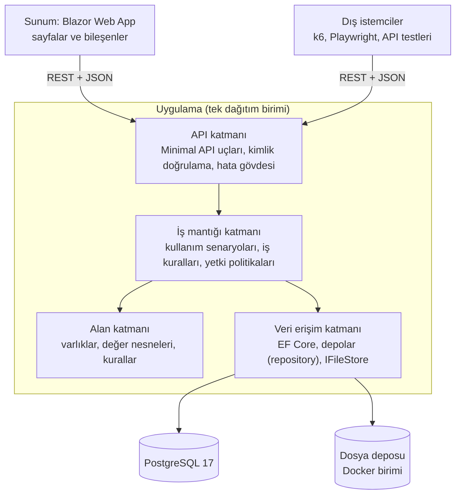
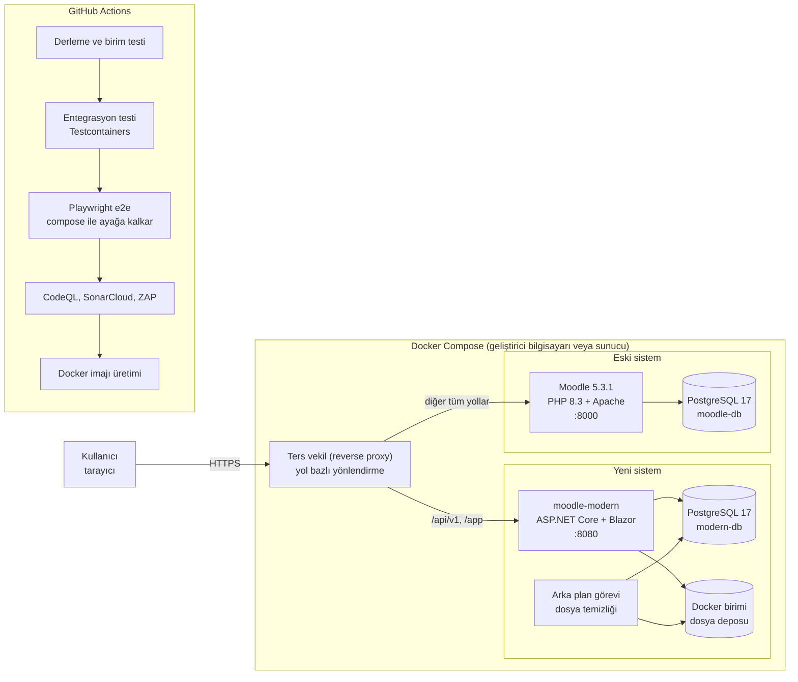

# WBS-2 Hedef Mimari ve Modernizasyon Sürecinin Tasarlanması

## 1. Hedef dil ve teknoloji seçimi (Seray)

Seçim, SRS'teki "farklı bir programlama dili" şartına (WBS-1 §1) ve sürüm planına göre yapılmıştır: 1. sürümde AUTH, CRS, ASG, GRD; 2. sürümde FILE, ADV; 3. sürümde PLAN yazılacaktır. Puanlar 1 (zayıf) – 5 (çok iyi) arasındadır ve ekibin ilk değerlendirmesidir; grup toplantısında onaylanır.

### 1.1 Adaylar

| Aday | Arka uç | Ön yüz |
| --- | --- | --- |
| **A** | C# · .NET 10 · ASP.NET Core | Blazor Web App |
| **B** | Python 3.13 · FastAPI | React (TypeScript) |
| **C** | TypeScript · Node.js 22 · NestJS | React (TypeScript) |

PHP (Laravel, Symfony) aday alınmamıştır: Moodle zaten PHP'dir ve proje "farklı dilde yeniden yazım"ı sınar.

### 1.2 Karşılaştırma

| Ölçüt | A: C# / .NET | B: Python / FastAPI | C: TypeScript / NestJS |
| --- | --- | --- | --- |
| Performans (K8, K10) | 5 – derlenmiş, düşük bellek; 50 eş zamanlı kullanıcıda p95 ≤ 1.000 ms hedefi rahat | 3 – eşzamansız çalışır ama CPU işinde yavaştır | 4 – tek iş parçacıklı, G/Ç ağırlıklı işte iyi |
| Ekosistem | 4 – kimlik (ASP.NET Core Identity), ORM (EF Core), dosya akışı, arka plan görevleri çerçevenin içinde | 5 – çok geniş kütüphane; kimlik ve yetkilendirme çoğunlukla ek paket ister | 5 – geniş npm ekosistemi; paket sayısı ve sürüm kayması bakım yükü getirir |
| Ekip bilgisi | 5 – eShop pilotu aynı yığınla (.NET 10, Blazor, EF Core) yapıldı; ekip bu yığında çalıştı | 2 – pilotta kullanılmadı | 2 – pilotta kullanılmadı |
| YZ araçlarının kod üretimi | 4 – iyi; Blazor için örnek sayısı React'ten azdır | 5 – en yaygın; en çok eğitim verisi | 5 – çok iyi; React için çok örnek vardır |
| Tür güvenliği (K3, K13) | 5 – derleyici hataları erkenden yakalar | 3 – tür ipuçları isteğe bağlıdır | 4 – TypeScript denetimi, çalışma anında yine de gevşektir |
| Test ve kalite araçları (K5–K7, K13, K14) | 5 – xUnit, coverlet, CodeQL, SonarCloud, analizörler hazır | 4 – pytest, coverage.py, CodeQL | 4 – Jest, c8, CodeQL |
| Docker ve barındırma | 5 – resmî küçük imajlar, pilotta kullanıldı | 5 | 5 |

**Değerlendirme.** Üç aday da Docker'da sorunsuz çalışır; ayrım **ekip bilgisi**, **performans** ve **tür güvenliği**nde ortaya çıkar. B ve C'nin tek üstünlüğü YZ araçlarının biraz daha iyi kod üretmesidir; ama ekip bu yığınları pilotta kullanmadığı için YZ'nin hatalarını fark etme ve düzeltme gücü düşer. Bu proje YZ'nin ürettiği kodun düzeltme eforunu da ölçtüğü için (K17), ekibin tanıdığı dilde ölçmek daha güvenilirdir.

### 1.3 Öneri

**A: C# / .NET 10 + ASP.NET Core + Blazor Web App.**

Gerekçe:
1. **Ekip bilgisi:** Pilotta aynı yığın kullanıldı; WBS-1 §6'daki kalite ölçüm hattı (CI, CodeQL, SonarCloud, Playwright, k6) hazır ve yeniden kullanılabilir.
2. **Kapsam:** 1. sürümün AUTH ve GRD modülleri kimlik, rol ve hesaplama ağırlıklıdır; ASP.NET Core Identity ve ilke tabanlı yetkilendirme (policy-based authorization) bunları çerçeve içinden verir.
3. **Hedefler:** K5 (kapsam ≥ %80), K8 (p95) ve K10 (kaynak) hedefleri bu yığında en rahat yakalanır.
4. **Tür güvenliği:** Gereksinim kimliğine bağlı test yazarken derleyici, YZ'nin ürettiği hataların bir kısmını erkenden yakalar.
5. **Tek dil:** Arka uç ve ön yüz C# olduğundan 5 kişilik ekip tek dilde çalışır; modüller arası geçiş kolay olur.

Risk ve önlem: YZ araçlarının Blazor'daki başarısı React'ten düşük olabilir. Önlem olarak ön yüz bileşenleri küçük tutulur; her bileşen bir API ucuna bağlanır ve YZ çıktısı pilottaki gibi insan incelemesinden geçer. Üretim sütunu (YZ / Manuel / YZ + düzeltme) bu riski ölçer.

### 1.4 Seçilen teknoloji yığını

| Katman | Seçim | Gerekçe |
| --- | --- | --- |
| Dil / çalışma zamanı | C# 14, .NET 10 | Yukarıdaki öneri |
| Web ve API | ASP.NET Core (Minimal API), REST + JSON | WBS-2 §3'teki API tablolarıyla birebir; OpenAPI belgesi otomatik üretilir |
| Ön yüz | Blazor Web App; veriyi REST API'den alır | API tek sözleşme olur; k6 ve API testleri aynı uçları kullanır |
| Kimlik | ASP.NET Core Identity + çerez oturumu | Ayrıntı §3.1'de (Sinem) |
| Veri erişimi | Entity Framework Core + Npgsql | Şema geçişleri (migration) kodla sürümlenir |
| Veritabanı | PostgreSQL 17 | Moodle ortamıyla aynı sürüm; veri taşıma ve karşılaştırma kolaylaşır; lisans ücretsizdir |
| Dosya deposu | Yerel disk (Docker birimi); `IFileStore` arayüzü arkasında | §3.6'daki `storage_key` yapısı; sonradan nesne deposuna (S3 uyumlu) geçiş kolay |
| Birim ve entegrasyon testi | xUnit, Testcontainers (gerçek PostgreSQL) | İş mantığı ve veri katmanı gerçek veritabanıyla sınanır |
| Uçtan uca test | Playwright (TypeScript) | Moodle'a da aynı senaryo uygulanır (K1, K2) |
| Yük testi | k6 | K8, K9 |
| Kapsam | coverlet | K5 |
| Statik / dinamik güvenlik | CodeQL, SonarCloud, OWASP ZAP | K6, K7, K13, K14 |
| Konteyner | Docker, Docker Compose | Moodle ortamıyla aynı yaklaşım |
| CI/CD | GitHub Actions | Pilotla aynı; her PR'de derleme, test ve tarama |

## 2. Hedef mimari ve deployment diyagramı (Seray)

### 2.1 Genel yaklaşım

Sistem **modüler monolit**tir: tek dağıtım birimi, içinde modül sınırları açık. Gerekçe: 5 kişilik ekip ve 3 sürümlük plan için mikro hizmet işletmesi gereksiz maliyettir; ancak modüller (AUTH, CRS, ASG, GRD, FILE, ADV, PLAN) birbirine yalnızca arayüzlerle bağlandığı için sürüm sürüm eklenebilir ve gerekirse sonradan ayrılabilir.

### 2.2 Katmanlar



| Katman | Sorumluluk | Bağımlılık kuralı |
| --- | --- | --- |
| Sunum (Blazor) | Ekranlar, form doğrulama, API çağrısı | Yalnızca API'yi bilir |
| API | Yol, istek/yanıt şeması, oturum ve yetki denetiminin girişi, tek tip hata gövdesi (K3: yığın izi dönmez) | İş mantığını çağırır, veri erişimini bilmez |
| İş mantığı | Kullanım senaryoları; WBS-1'deki iş kuralları (`*-BR-*`) burada tek yerde yazılır; yetki politikaları | Alan ve veri erişim **arayüzlerine** bağlıdır |
| Alan | Varlıklar ve değişmez kurallar | Hiçbir şeye bağlı değildir |
| Veri erişim | EF Core, depolar, dosya deposu, geçişler | İş mantığının tanımladığı arayüzleri uygular |

Bağımlılık yönü içeriye doğrudur: sunum → API → iş mantığı → alan; veri erişim, iş mantığındaki arayüzleri uygular. Bu kural K13 (bakım) için derleme sırasında mimari testiyle denetlenir.

### 2.3 Klasör yapısı

```text
moodle-modern/
├── src/
│   ├── Moodle.Domain/             # alan katmanı, modül başına klasör
│   │   ├── Auth/  Courses/  Assignments/  Grading/  Files/  Advising/  Planning/
│   ├── Moodle.Application/        # iş mantığı: kullanım senaryoları, arayüzler, yetki politikaları
│   │   ├── Auth/  Courses/  Assignments/  Grading/  Files/  Advising/  Planning/
│   ├── Moodle.Infrastructure/     # veri erişimi
│   │   ├── Persistence/           # DbContext, yapılandırmalar, Migrations/
│   │   ├── Storage/               # IFileStore: yerel disk gerçeklemesi
│   │   └── Jobs/                  # arka plan görevleri (dosya temizliği vb.)
│   ├── Moodle.Api/                # uç noktalar, modül başına bir dosya; Program.cs
│   └── Moodle.Web/                # Blazor Web App (sayfalar, bileşenler)
├── tests/
│   ├── Moodle.UnitTests/          # iş mantığı (K5)
│   ├── Moodle.IntegrationTests/   # API + Testcontainers PostgreSQL
│   ├── e2e/                       # Playwright; aynı senaryo Moodle'a da uygulanır
│   └── performance/               # k6
├── docker/                        # Dockerfile, compose, proxy ayarı
├── .github/workflows/             # CI
└── docs/
```

Her modül, kendi klasörü dışındaki modülün **arayüzünü** çağırır, gerçeklemesini çağırmaz (ör. `ASG`, dosya için `IFileService` kullanır). Yeni kod gereksinim kimliğiyle işaretlenir (WBS-2 §5.2, kural 4).

### 2.4 Kimlik doğrulama ve yetkilendirme yaklaşımı

- Oturum: ASP.NET Core Identity, güvenli ve `HttpOnly` çerez. Ayrıntı §3.1'dedir (Sinem).
- Yetki: Moodle'ın bağlam + rol + yetenek modeli (WBS-1 §4.1) **ilke tabanlı yetkilendirme** olarak karşılanır: her uç bir ilkeye bağlanır, ilke "kullanıcı, bağlam ve yetenek"e bakar.
- Bileşen yetkisi: Dosya gibi paylaşılan servisler, sahip modülün `canRead`/`canWrite` işlevini çağırır (§3.6.3).
- Yetkisiz isteğe `404` döner (varlık sızdırılmaz); ayrım WBS-1'deki rol–yetki matrisine uyar (K4).

### 2.5 Veritabanı ve dosya deposu

- **Veritabanı:** tek PostgreSQL 17 örneği, tek şema; tablo adları modül önekli değildir ama her modülün tabloları kendi `Infrastructure/Persistence` yapılandırmasında tanımlıdır. Şema değişikliği yalnızca EF Core geçişiyle yapılır.
- **Dosya deposu:** içerik adresli, `ab/cd/<sha256>` yolu (§3.6.1). Veritabanında yalnızca üst veri tutulur. Depo `IFileStore` arkasındadır; geliştirmede yerel disk, ileride nesne deposu.
- **Yedekleme:** veritabanı ve dosya deposu birlikte yedeklenmelidir; yalnız biri geri yüklenirse "dosya var, içerik yok" tutarsızlığı oluşur. Bu nokta işletme notudur.

### 2.6 Dağıtım diyagramı



| Bileşen | Teknoloji | Port | Veri |
| --- | --- | --- | --- |
| Yeni uygulama | .NET 10, tek konteyner | 8080 | `modern-db`, dosya birimi |
| Yeni veritabanı | PostgreSQL 17 | 5432 (yalnız ağ içi) | `modern-db` birimi |
| Eski sistem | Moodle 5.3.1, PHP 8.3, Apache | 8000 | `moodle-db`, Moodle veri dizini |
| Ters vekil | nginx veya Caddy | 80/443 | Yok |
| CI | GitHub Actions | — | İmaj kayıt defteri |

Hem eski hem yeni sistem aynı bilgisayarda çalıştığı için K1, K2, K8 ve K10 aynı koşulda ölçülür.

### 2.7 Eski ve yeni sistemin geçiş sürecinde birlikte çalışması

Yaklaşım **modül modül geçiş**tir (strangler fig): ters vekil, hangi yolun hangi sisteme gideceğini söyler; modül hazır oldukça yönlendirme yeni sisteme çevrilir.

1. **Veritabanları ayrıdır.** Yeni sistem, Moodle'ın veritabanına yazmaz; Moodle şeması yeni sistemin sözleşmesi olmaz. Veri, modül geçişinde tek yönlü bir aktarım betiğiyle taşınır (kullanıcılar, dersler, kayıtlar, ödevler, notlar, dosya üst verisi).
2. **Bir modül aynı anda yalnızca bir sistemde yazılır.** Hem eski hem yeni sistemde yazılan modül çakışma doğurur; bu yüzden geçiş anında ilgili yol yeni sisteme çevrilir ve Moodle'da o işlev kapatılır.
3. **Sıra sürüm planına uyar:**

| Sürüm | Modüller | Geçişte bilinmesi gereken |
| --- | --- | --- |
| 1 | AUTH, CRS, ASG, GRD | Kimlik ilk taşınan modüldür; kullanıcı ve rol aktarımı tamamlanmadan diğerleri açılamaz. **Ödev teslimi dosya gerektirir** (aşağıya bakın). |
| 2 | FILE (tam), ADV | FILE'ın 1. sürümde başlayan çekirdeği burada tamamlanır; ADV, AUTH ve CRS'ye bağlıdır. |
| 3 | PLAN | Önceki modüllerin verisini okur. |

4. **Dosya bağımlılığı.** ASG 1. sürümde, FILE ise 2. sürümde planlıdır; oysa ödev teslimi dosya yükleme, taslaktan kalıcıya geçiş ve yetkili indirme gerektirir. Bu yüzden `IFileService` 1. sürümde, **yalnızca ASG'nin ihtiyaç duyduğu çekirdek** (taslak, kaydet, indir, sil, boyut sınırı; WBS-1 §4.6.11) ile gerçeklenir; kota, çöp kutusu geri alma, yönetici ayarları ve temizlik görevi (FILE'ın kalanı) 2. sürümde eklenir. Aksi hâlde ASG metin teslimiyle sınırlı kalır.
5. **Kimlik paylaşımı.** Geçiş döneminde kullanıcı iki sistemde de oturum açar. Tek oturum açma (SSO) bu proje kapsamında **yoktur**; sınav ve karşılaştırma ortamında test kullanıcıları iki sistemde aynı kimlikle tanımlanır (`ornek-veri.feature`).
6. **Geri dönüş.** Modül yönlendirmesi vekil ayarıyla geri alınabilir; aktarım betiği yeniden çalıştırılabilir (aynı veriyle kurulum 5 dakika, `ortam/README.md`).

### 2.8 Açık noktalar

- Ters vekil için nginx ve Caddy arasında seçim, kurulum denemesinden sonra yapılacaktır.
- Ödev teslim dosyalarının yetkisi §3.4 ile birlikte kesinleşecektir.
- Dil seçimi grup toplantısında onaylanmadıkça §1.3 "öneri"dir.

## 3. Veri ve arayüz tasarımı

API tabloları: Metot · Yol · İstek · Yanıt · Hangi rol çağırabilir

### 3.1 Kimlik ve yetkilendirme (Sinem)
#### 3.1.1 Tasarım yaklaşımı

Kimlik ve yetkilendirme (AUTH) modülünün modernizasyonunda Moodle 5.3.1'in mevcut kimlik doğrulama, oturum yönetimi ve rol-bağlam tabanlı yetkilendirme mekanizmalarının korunması esas alınacaktır. Amaç, mevcut güvenlik kurallarını ve diğer modüllerle entegrasyonu koruyarak daha sürdürülebilir, güvenli ve yönetilebilir bir hedef tasarım oluşturmaktır.

Hedef tasarımda kimlik doğrulama, oturum yönetimi ve yetkilendirme sorumlulukları mantıksal olarak ayrılacaktır. Bu sorumluluklar, mevcut Moodle altyapısıyla uyumlu servis arayüzleri üzerinden yönetilecektir.

**Temel tasarım ilkeleri**

1. Kullanıcıların geçerli kimlik bilgileriyle sisteme giriş yapması sağlanacaktır.
2. Askıya alınmış, silinmiş veya geçerli hesap kilitleme kuralları nedeniyle erişimi engellenmiş kullanıcıların oturum açması önlenecektir.
3. Geçersiz parola girişleri reddedilecek ve başarısız giriş olayları izlenebilir olacaktır.
4. Kullanıcı yetkileri yalnızca rol adına göre değil, ilgili bağlam ve capability tanımları üzerinden değerlendirilecektir.
5. Oturum sonlandırma ve zaman aşımı kontrolleri korunacaktır.
6. Zorunlu parola değiştirme akışı desteklenecektir.
7. Mevcut Moodle kimlik doğrulama eklentileriyle uyumluluk gözetilecektir.
8. AUTH modülünün CRS, ASG, GRD ve FILE modülleriyle olan yetkilendirme bağımlılıkları korunacaktır.

**Hedef mimari yaklaşımı**

Kimlik doğrulama, oturum yönetimi ve yetkilendirme işlemleri aşağıdaki mantıksal bileşenlerle temsil edilecektir:

| Bileşen | Sorumluluk |
|---|---|
| Authentication Service | Kullanıcı kimlik bilgilerinin doğrulanması ve hesap durumunun kontrol edilmesi |
| Session Management | Oturum oluşturma, sonlandırma ve geçerlilik kontrolü |
| Authorization Service | Rol, bağlam ve capability üzerinden erişim kararlarının verilmesi |
| User Repository | Kullanıcı hesap bilgilerinin mevcut veri modeli üzerinden yönetilmesi |
| Role and Context Repository | Rol atamaları, bağlam hiyerarşisi ve yetki tanımlarının yönetilmesi |

Bu bileşenler hedef tasarım için önerilen mantıksal sorumluluk ayrımlarıdır. Ayrı mikroservisler olarak uygulanmaları zorunlu değildir.

Mevcut Moodle 5.3.1 veri modeli ve eklenti mekanizmalarıyla uyumluluk korunacak; modernizasyon kapsamında önerilen API ve servis arayüzleri mevcut Moodle bileşenlerinden açıkça ayrıştırılacaktır.

**Gereksinim ilişkisi:** AUTH-FR-01–AUTH-FR-09.

#### 3.1.2 Veri modeli ve bütünlük kuralları

AUTH modülünün hedef veri modeli, Moodle 5.3.1'in mevcut kullanıcı, rol, bağlam ve yetenek (capability) tablolarını temel alacaktır. Modernizasyon kapsamında mevcut veri ilişkilerinin korunması, yetkilendirme davranışlarının değişmemesi ve diğer Moodle modülleriyle uyumluluğun sürdürülmesi amaçlanmaktadır.

**Temel veri yapıları**

| Tablo | Tasarımdaki sorumluluğu |
|---|---|
| `user` | Kullanıcı kimlik bilgileri, hesap durumu ve kimlik doğrulama yöntemi |
| `role` | Sistemde tanımlanan roller |
| `context` | Yetkilendirme işlemlerinde kullanılan bağlam hiyerarşisi |
| `role_assignments` | Kullanıcı, rol ve bağlam arasındaki atama ilişkileri |
| `role_capabilities` | Roller için bağlama bağlı yetenek ve izin tanımları |
| `capabilities` | Sistemde kullanılabilen yeteneklerin tanımları |

**Korunacak veri bütünlüğü kuralları**

1. Kullanıcı adı benzersizliği `user` tablosunda `mnethostid` ve `username` alanları birlikte değerlendirilerek korunacaktır.
2. Rol atamaları `role_assignments` tablosunda kullanıcı, rol ve bağlam ilişkisi üzerinden saklanacaktır.
3. `role_capabilities` tablosunda `(roleid, contextid, capability)` alanları için mevcut benzersizlik kısıtı korunacaktır.
4. `context` tablosunda `(contextlevel, instanceid)` alanlarının benzersizliği korunacaktır.
5. Bağlam hiyerarşisi ve `context.path` üzerinden gerçekleştirilen yetki değerlendirmeleri desteklenecektir.
6. `role_capabilities.permission` değerleri mevcut Moodle yetkilendirme mantığına uygun biçimde değerlendirilecektir.
7. `context.locked` alanının bağlam ve alt bağlamlar üzerindeki etkisi korunacaktır.
8. Kullanıcıların askıya alınma ve silinme durumları kimlik doğrulama sırasında dikkate alınacaktır.

**Veri erişim yaklaşımı**

Hedef tasarımda kullanıcı ve yetkilendirme verilerine erişim, Moodle'ın mevcut veri erişim altyapısıyla uyumlu biçimde gerçekleştirilecektir.

Yetkilendirme kararlarında doğrudan rol adı karşılaştırması yapmak yerine Moodle'ın `has_capability()` mekanizmasının kullanılması esas alınacaktır. Böylece rol atamaları, bağlam hiyerarşisi ve capability izinleri birlikte değerlendirilecektir.

Modernizasyon kapsamında yeni servis arayüzleri geliştirilmesi durumunda bu arayüzler mevcut veri bütünlüğü kurallarını ihlal etmeyecek ve yetkilendirme kontrollerini atlamayacaktır.

**Kaynak:** `public/lib/db/install.xml`, `public/lib/accesslib.php`.

**Gereksinim ilişkisi:** AUTH-FR-02, AUTH-FR-03, AUTH-FR-04, AUTH-FR-07.

#### 3.1.3 Önerilen REST API tasarımı

AUTH modülünün modernizasyonunda kimlik doğrulama, oturum yönetimi ve yetkilendirme işlemlerinin standart ve yönetilebilir servis arayüzleri üzerinden sunulması hedeflenmektedir.

Moodle 5.3.1'in mevcut kimlik doğrulama eklentileri, oturum mekanizmaları ve `has_capability()` tabanlı yetkilendirme altyapısı korunacaktır.

Aşağıdaki REST uç noktaları **modernizasyon kapsamında önerilen hedef tasarımı** temsil etmektedir. Bunların Moodle 5.3.1'de aynı URL ve HTTP yöntemleriyle hazır olarak bulunduğu iddia edilmemektedir.

**Önerilen API uç noktaları**

| HTTP | Uç nokta | İşlem | İlgili gereksinim |
|---|---|---|---|
| POST | `/api/auth/login` | Kullanıcı kimlik bilgilerinin doğrulanması ve oturum açılması | AUTH-FR-01, 04, 05, 06 |
| POST | `/api/auth/logout` | Mevcut oturumun sonlandırılması | AUTH-FR-08 |
| GET | `/api/auth/session` | Mevcut oturumun geçerliliğinin sorgulanması | AUTH-FR-08 |
| POST | `/api/auth/change-password` | Kullanıcının parola değiştirme işleminin gerçekleştirilmesi | AUTH-FR-09 |
| GET | `/api/auth/permissions` | Kullanıcının belirli bir bağlamdaki yetkisinin sorgulanması | AUTH-FR-02, 03, 07 |

**API güvenlik ve doğrulama kuralları**

1. Kimlik doğrulama işlemleri mevcut Moodle kimlik doğrulama altyapısı üzerinden yürütülecektir.
2. Giriş sırasında kullanıcı hesabının askıya alınma, silinme ve geçerli kilitlenme durumları kontrol edilecektir.
3. Geçersiz kimlik bilgileriyle oturum oluşturulmayacaktır.
4. Başarısız giriş denemeleri, mevcut olay ve kayıt mekanizmalarıyla uyumlu biçimde izlenecektir.
5. Oturum gerektiren API işlemlerinde geçerli oturum kontrolü yapılacaktır.
6. Yetkilendirme kararlarında rol adı yerine ilgili bağlam ve capability bilgileri esas alınacaktır.
7. Yetki sorgulama uç noktası, çağrıyı yapan kullanıcının yetkilerini aşacak biçimde başka kullanıcıların izin bilgilerini açığa çıkarmayacaktır.
8. Parola ve oturum kimlikleri uygulama kayıtlarında veya API yanıtlarında açık biçimde paylaşılmayacaktır.
9. Durum değiştiren işlemlerde uygun CSRF koruması veya kullanılan kimlik doğrulama yöntemine karşılık gelen güvenlik kontrolleri uygulanacaktır.

**Önerilen hata durumları**

| HTTP durum kodu | Açıklama |
|---|---|
| 400 Bad Request | Eksik veya geçersiz istek parametreleri |
| 401 Unauthorized | Kimlik doğrulaması başarısız veya geçerli oturum bulunmuyor |
| 403 Forbidden | Kullanıcının ilgili işlem için yetkisi bulunmuyor |
| 429 Too Many Requests | Yapılandırılmış istek sınırlama kuralının aşılması |
| 500 Internal Server Error | Beklenmeyen sunucu hatası |

HTTP durum kodları ve uç nokta sözleşmeleri hedef tasarım önerisidir. Özellikle `429` yanıtı, modernizasyon sırasında istek sınırlama mekanizmasının uygulanmasına bağlıdır.

**Mevcut Moodle altyapısıyla entegrasyon**

Önerilen API katmanı, mevcut Moodle oturum ve kimlik doğrulama mekanizmalarını devre dışı bırakmayacaktır. Yetkilendirme kontrolleri Moodle'ın rol, bağlam ve capability altyapısıyla uyumlu yürütülecektir.

Bu yaklaşım, mevcut AUTH davranışlarının korunmasını ve gelecekte farklı istemcilerin kontrollü servis arayüzleri üzerinden sisteme erişebilmesini hedeflemektedir.

**Gereksinim ilişkisi:** AUTH-FR-01–AUTH-FR-09.
#### 3.1.4 Rol ve bağlam tabanlı yetkilendirme tasarımı

AUTH modülünün hedef yetkilendirme tasarımı, Moodle 5.3.1'in mevcut rol, bağlam (context) ve yetenek (capability) mekanizmalarını temel alacaktır.

Yetkilendirme kararları yalnızca kullanıcının sahip olduğu rol adına göre değil, işlemin gerçekleştirileceği bağlam ve ilgili capability üzerinden verilecektir.

**Yetkilendirme iş akışı**

1. Kullanıcının geçerli bir oturuma sahip olduğu doğrulanır.
2. Gerçekleştirilmek istenen işlem ve ilgili Moodle capability belirlenir.
3. İşlemin gerçekleştirileceği bağlam tespit edilir.
4. Moodle'ın `has_capability()` mekanizması üzerinden kullanıcının ilgili bağlamdaki yetkisi değerlendirilir.
5. Yetki bulunuyorsa işleme izin verilir.
6. Yetki bulunmuyorsa işlem reddedilir ve korunan kaynak üzerinde değişiklik yapılmaz.

**Örnek yetkilendirme matrisi**

| İşlem | Öğrenci | Düzenleyen öğretmen | Site yöneticisi |
|---|---|---|---|
| Kendi hesabıyla giriş yapma | İzinli | İzinli | İzinli |
| Kayıtlı olduğu dersi görüntüleme | İzinli | İzinli | İzinli |
| Yetkili olduğu dersin ayarlarını düzenleme | Reddedilir | İzinli | İzinli |
| Site yapılandırmasını yönetme | Reddedilir | Reddedilir | İzinli |

Bu tablo WBS-1 analizinde incelenen örnek rol davranışlarını temsil etmektedir. Gerçek yetkilendirme kararları Moodle'ın rol yapılandırması, bağlam hiyerarşisi ve capability izinleri üzerinden belirlenecektir.

**Bağlam duyarlılığı**

Aynı kullanıcı farklı derslerde farklı rollere sahip olabilir. Bu nedenle bir derste verilen yetki, başka bir ders için otomatik olarak geçerli kabul edilmeyecektir.

Rol atamaları `role_assignments`, capability izinleri `role_capabilities` ve bağlam bilgileri `context` tablolarıyla ilişkili biçimde değerlendirilecektir.

Mevcut Moodle yetkilendirme altyapısındaki bağlam hiyerarşisi, izin değerlendirme kuralları ve kilitli bağlam davranışları korunacaktır.

**Güvenlik ilkeleri**

- Yetkilendirme kontrolleri yalnızca kullanıcı arayüzünde değil, korunan işlemin gerçekleştirildiği sunucu tarafında da uygulanacaktır.
- İstemciden gönderilen rol veya yetki bilgileri tek başına güvenilir kabul edilmeyecektir.
- Kullanıcının yetkili olmadığı bağlamlarda işlem gerçekleştirmesi engellenecektir.
- CRS, ASG, GRD ve FILE modülleri AUTH yetkilendirme mekanizmasıyla uyumlu çalışacaktır.
- Yetki bulunmadığında işlem reddedilecek ve ilgili veriler değiştirilmeden bırakılacaktır.

**Gereksinim ilişkisi:** AUTH-FR-02, AUTH-FR-03, AUTH-FR-07.

**Kaynak:** WBS-1 §4.1.7 Yetkilendirme; `public/lib/accesslib.php`.

#### 3.1.5 İş akışları ve hata yönetimi

AUTH modülünün hedef tasarımında kimlik doğrulama, oturum yönetimi, parola değiştirme ve yetkilendirme işlemleri mevcut Moodle mekanizmalarıyla uyumlu biçimde yürütülecektir.

Aşağıdaki akışlar modernizasyon kapsamında hedeflenen davranışları tanımlamaktadır.

**1. Kullanıcı girişi**

1. Kullanıcı giriş ekranından kimlik bilgilerini gönderir.
2. Sistem ilgili kimlik doğrulama yöntemini belirler.
3. Kullanıcının hesap durumu ve geçerli erişim kısıtları kontrol edilir.
4. Kimlik bilgileri Moodle'ın kimlik doğrulama mekanizması üzerinden doğrulanır.
5. Doğrulama başarılıysa geçerli oturum oluşturulur.
6. Zorunlu parola değişikliği gerekiyorsa kullanıcı ilgili akışa yönlendirilir.
7. Doğrulama başarısızsa oturum oluşturulmaz.

**Hata durumları:** Geçersiz kullanıcı bilgileri, yanlış parola, askıya alınmış veya silinmiş hesap, etkin hesap kilitleme kuralı.

**2. Kullanıcı çıkışı ve oturum geçerliliği**

1. Kullanıcı çıkış işlemini başlatır.
2. Sistem mevcut oturumu sonlandırır.
3. Kullanıcı korunan bir sayfaya yeniden erişmeye çalışır.
4. Geçerli oturum bulunmadığında yeniden kimlik doğrulaması istenir.

Oturum zaman aşımı durumunda da geçerli oturum kontrolü uygulanacaktır.

**Hata durumları:** Geçersiz veya süresi dolmuş oturum, kimlik doğrulaması gerektiren kaynağa oturumsuz erişim.

**3. Zorunlu parola değiştirme**

1. Kullanıcı geçerli kimlik bilgileriyle giriş yapar.
2. Sistem hesap için zorunlu parola değiştirme koşulunu değerlendirir.
3. Koşul etkinse kullanıcı parola değiştirme akışına yönlendirilir.
4. Yeni parola, geçerli parola politikalarına göre doğrulanır.
5. İşlem başarılı olduğunda kullanıcı hesabının ilgili durumu güncellenir.
6. Kullanıcı normal erişim akışına devam eder.

**Hata durumları:** Parola politikası ihlali, geçersiz parola değiştirme isteği, işlem sırasında oluşan sistem hatası.

**4. Yetkilendirme kontrolü**

1. Kullanıcı korunan bir işlem başlatır.
2. Sistem kullanıcının oturum geçerliliğini kontrol eder.
3. İlgili işlem için gerekli capability ve bağlam belirlenir.
4. `has_capability()` mekanizması üzerinden erişim yetkisi değerlendirilir.
5. Yetki varsa işlem gerçekleştirilir.
6. Yetki yoksa işlem reddedilir ve korunan veri değiştirilmez.

**Hata durumları:** Geçersiz oturum, yetersiz yetki, uygun olmayan bağlam veya geçersiz kaynak.

**5. Başarısız giriş ve hesap kilitleme**

1. Kullanıcı geçersiz kimlik bilgileriyle giriş yapmayı dener.
2. Sistem kimlik doğrulama işlemini reddeder.
3. Başarısız giriş olayı, yapılandırılmış kayıt mekanizması üzerinden izlenir.
4. Etkin hesap kilitleme politikası bulunuyorsa ilgili kurallar değerlendirilir.
5. Kilitleme koşulları oluştuğunda hesabın giriş yapması engellenir.

Hesap kilitleme davranışı, kullanılan kimlik doğrulama eklentisinin ve sistem yapılandırmasının desteklediği kurallara bağlıdır. Modernizasyon kapsamında sabit bir deneme sayısı veya kilitleme süresi varsayılmamaktadır.

**Hata yönetimi ilkeleri**

- Başarısız kimlik doğrulama işlemleri oturum oluşturmamalıdır.
- Yetkisiz işlemler sunucu tarafında engellenmelidir.
- Kullanıcıya gösterilen hata mesajları parola veya hassas hesap bilgilerini açığa çıkarmamalıdır.
- Güvenlikle ilgili olaylar, mevcut Moodle kayıt ve olay altyapısıyla uyumlu biçimde izlenmelidir.
- Beklenmeyen sistem hatalarında korunan işlemler güvenli biçimde sonlandırılmalıdır.
- Hatalı istekler mevcut veri bütünlüğünü bozmamalıdır.

**Gereksinim ilişkisi**

| İş akışı | İlgili gereksinimler |
|---|---|
| Kullanıcı girişi | AUTH-FR-01, AUTH-FR-04, AUTH-FR-05 |
| Kullanıcı çıkışı ve oturum geçerliliği | AUTH-FR-08 |
| Zorunlu parola değiştirme | AUTH-FR-09 |
| Yetkilendirme kontrolü | AUTH-FR-02, AUTH-FR-03, AUTH-FR-07 |
| Başarısız giriş ve hesap kilitleme | AUTH-FR-05, AUTH-FR-06 |

Bu iş akışları hedef tasarım davranışlarını göstermektedir. WBS-1'de ayrıca doğrulanması gerektiği belirtilen başarısız giriş kayıtları, hesap kilitleme, silinmiş hesap davranışı ve oturum zaman aşımı, tamamlanmış testler olarak değerlendirilmemelidir.

#### 3.1.6 Gereksinim izlenebilirliği

AUTH modülünün hedef tasarımında WBS-1 kapsamında tanımlanan fonksiyonel gereksinimler, ilgili tasarım bileşenleri ve test senaryolarıyla eşleştirilmiştir.

Bu eşleştirme, modernizasyon sürecinde gereksinimlerin tasarım tarafından karşılanmasını ve doğrulama faaliyetlerinin izlenebilir olmasını amaçlamaktadır.

**Gereksinim–tasarım–test eşleştirmesi**

| Gereksinim | Tasarım karşılığı | Test senaryosu |
|---|---|---|
| AUTH-FR-01 | Authentication Service; kullanıcı girişi | T-AUTH-01 |
| AUTH-FR-02 | Authorization Service; sunucu tarafı yetki kontrolü | T-AUTH-02 |
| AUTH-FR-03 | Rol ve bağlam tabanlı yetkilendirme; ders ayarlarına erişim | T-AUTH-03 |
| AUTH-FR-04 | Authentication Service; hesap durumu kontrolü | T-AUTH-04 |
| AUTH-FR-05 | Kimlik doğrulama; başarısız giriş olaylarının izlenmesi | T-AUTH-05 |
| AUTH-FR-06 | Authentication Service; etkin hesap kilitleme kuralları | T-AUTH-06 |
| AUTH-FR-07 | Authorization Service; rol, bağlam ve capability değerlendirmesi | T-AUTH-07 |
| AUTH-FR-08 | Session Management; oturum sonlandırma ve geçerlilik kontrolü | T-AUTH-08 |
| AUTH-FR-09 | Authentication Service; zorunlu parola değiştirme akışı | T-AUTH-09 |

**Tasarım bölümleriyle ilişki**

- **§3.1.1:** Genel mimari yaklaşım ve bileşen sorumlulukları.
- **§3.1.2:** Veri modeli ve bütünlük kuralları.
- **§3.1.3:** Önerilen REST API arayüzleri.
- **§3.1.4:** Rol ve bağlam tabanlı yetkilendirme.
- **§3.1.5:** Kimlik doğrulama, oturum yönetimi ve hata işleme akışları.

**Doğrulama yaklaşımı**

Gereksinimlerin doğrulanmasında Moodle 5.3.1 üzerinde gerçekleştirilen kullanıcı arayüzü testleri ve gerektiğinde veritabanı kontrolleri temel alınacaktır.

WBS-1'de tamamlanmış olarak raporlanan testlerle henüz doğrulanmamış davranışlar birbirinden ayrılacaktır.

Özellikle aşağıdaki kontrollerin doğrulama durumu ayrıca takip edilecektir:

- Silinmiş hesapla giriş davranışı.
- Başarısız giriş olaylarının kaydedilmesi.
- Etkin hesap kilitleme kurallarının uygulanması.
- Farklı bağlamlarda rol atama davranışı.
- Oturum zaman aşımı.
- Zorunlu parola değiştirme akışı.

Bu kontrollerin test senaryolarında tanımlanmış olması, başarıyla tamamlandıkları anlamına gelmemektedir.

**Kaynak:** WBS-1 §4.1.9 Gereksinimler ve §4.1.10 Test senaryoları.

**Kapsam:** AUTH-FR-01–AUTH-FR-09, T-AUTH-01–T-AUTH-09.

#### 3.1.7 Test sonuçları ve doğrulama durumu

AUTH modülünün mevcut davranışları, WBS-1 kapsamında yerel Moodle 5.3.1 ortamında gerçekleştirilen kullanıcı arayüzü ve güvenlik testleriyle incelenmiştir.

T-AUTH-01–T-AUTH-10 arasındaki 10 test senaryosu uygulanmış ve her senaryoda beklenen temel davranış gözlemlenmiştir. Bununla birlikte bazı senaryolarda ek doğrulama gerektiren kapsam sınırlılıkları bulunmaktadır.

**Mevcut test sonuçları**

| Test | Doğrulanan davranış | Sonuç |
|---|---|---|
| T-AUTH-01 | Geçerli kullanıcı bilgileriyle giriş | Başarılı |
| T-AUTH-02 | Öğrencinin ders ayarlarına yetkisiz erişiminin engellenmesi | Başarılı |
| T-AUTH-03 | Öğretmenin yetkili olduğu dersin ayarlar formuna erişimi | Başarılı; kaydetme denenmedi |
| T-AUTH-04 | Askıya alınmış hesabın girişinin engellenmesi | Başarılı; silinmiş hesap denenmedi |
| T-AUTH-05 | Yanlış parola ile girişin reddedilmesi | Başarılı; başarısız giriş kaydı doğrulanmadı |
| T-AUTH-06 | Üç başarısız giriş sonrası hesap kilitleme | Başarılı; kilit açma e-postası doğrulanmadı |
| T-AUTH-07 | Farklı derslerde erişim davranışının değişmesi | Başarılı; farklı rol atamaları oluşturulmadı |
| T-AUTH-08 | Çıkış sonrası korunan ders sayfasına erişimin engellenmesi | Başarılı; zaman aşımı denenmedi |
| T-AUTH-09 | Zorunlu parola değiştirme ekranına yönlendirme | Başarılı; parola değişikliği tamamlanmadı |
| T-AUTH-10 | Hata ayıklama kapalıyken hassas hata bilgilerinin gizlenmesi | Başarılı; yerel ortamda doğrulandı |

**Güvenlik bulguları**

WBS-1 analizinde iki güvenlik değerlendirme kaydı bulunmaktadır:

- **AUTH-BUG-01:** Geliştirme ortamında yetkisiz erişim hatasıyla birlikte çağrı yığını görüntülenmiştir. `debug=0` ve `debugdisplay=0` ayarlarıyla yapılan tekrarda çağrı yığını görüntülenmemiştir. Bu durum doğrulanmış bir Moodle yazılım hatası değil, yapılandırmaya bağlı bir gözlem olarak değerlendirilmiştir.
- **AUTH-BUG-02:** Yanlış parola ve hesap kilitleme durumlarındaki hata mesajlarının kullanıcı deneyimi ve bilgi ifşası açısından incelenmesi önerilmiştir. Doğrulanmış bir yazılım hatası bulunmamaktadır.

**Sonraki doğrulama aşamasında tamamlanacak kontroller**

1. Silinmiş kullanıcı hesabıyla giriş denemesinin reddedilmesi.
2. Başarısız giriş olaylarının kayıt mekanizmasında doğrulanması.
3. Hesap kilidi açma e-postasının tesliminin kontrol edilmesi.
4. Farklı ders bağlamlarında farklı rol atamaları oluşturularak yetkilendirme davranışının test edilmesi.
5. Oturum zaman aşımı sonrasında korunan kaynaklara erişimin kontrol edilmesi.
6. Zorunlu parola değiştirme işleminin uçtan uca tamamlanması.
7. Öğretmenin yetkili olduğu dersin ayarlarını kaydetme işleminin doğrulanması.
8. Güvenlik hata mesajlarının üretim benzeri yapılandırmalarda yeniden değerlendirilmesi.

**Tasarım değerlendirmesi**

Gerçekleştirilen testler, mevcut Moodle 5.3.1 altyapısının temel kimlik doğrulama, oturum yönetimi ve bağlama duyarlı yetkilendirme davranışlarını desteklediğini göstermektedir.

Modernizasyon kapsamında bu davranışlar korunacak; önerilen servis ve API tasarımları uygulanırsa aynı senaryolar regresyon testleriyle yeniden doğrulanacaktır.

**Kaynak:** WBS-1 §4.1.9 Gereksinimler, §4.1.10 Test senaryoları ve AUTH-BUG-01–02 bulguları.

**Gereksinim ilişkisi:** AUTH-FR-01–AUTH-FR-09, AUTH-NFR-01–AUTH-NFR-02.

### 3.2 Ders ve kayıt (Sinem)

#### 3.2.1 Tasarım yaklaşımı

Ders ve kayıt (CRS) modülünün modernizasyonunda, Moodle 5.3.1 kaynak kodundan elde edilen mevcut veri modeli ve iş kuralları temel alınacaktır. Amaç, mevcut ders yönetimi ve kullanıcı kayıt işlevlerini koruyarak veri doğrulama, yetkilendirme, arayüz erişimi ve bakım kolaylığı açısından daha sürdürülebilir bir hedef tasarım oluşturmaktır.

Hedef tasarımda ders oluşturma, güncelleme ve silme işlemleri ile kullanıcıyı derse kaydetme, kayıt bilgilerini güncelleme ve dersten kayıt silme işlemleri ayrı servis operasyonları olarak ele alınacaktır. Bu operasyonlara erişim için REST tabanlı API arayüzleri önerilecektir.

Mevcut Moodle veri yapısındaki course, course_categories, enrol ve user_enrolments tabloları ile user ilişkisi korunacaktır. Veri bütünlüğü kontrolleri, iş kuralları ve yetkilendirme doğrulamaları servis katmanında uygulanacaktır.

Kaynak sistem üzerinde gerçekleştirilen CRS-TEST-01–07 testleri, temel ders ve kayıt işlemlerinin beklenen sonuçlarını doğrulamıştır. Test sırasında ders kısa adının başında bulunan TAB karakterinin ayrı bir değer olarak kabul edildiği gözlemlenmiştir. Bu nedenle hedef tasarımda kısa adların kaydedilmeden önce görünmeyen karakterler açısından doğrulanması önerilmektedir.

Bu bölümde tanımlanan REST API uç noktaları ve servis katmanı, mevcut Moodle 5.3.1 uygulamasında bulunduğu doğrulanan bileşenler değil, modernizasyon kapsamında önerilen hedef tasarım öğeleridir.

#### 3.2.2 Veri modeli ve bütünlük kuralları

Hedef CRS tasarımında Moodle 5.3.1 veri modeliyle uyumluluk korunacaktır. Dersler, kategoriler, kayıt yöntemleri ve kullanıcı kayıtları mevcut tablolar üzerinden yönetilecektir. Yeni bir veritabanı şeması oluşturulması bu aşamada önerilmemektedir.

| Tablo | Temel alanlar | Hedef tasarımdaki görevi |
|---|---|---|
| `course` | `id`, `category`, `fullname`, `shortname`, `idnumber`, `visible` | Ders bilgilerinin yönetilmesi |
| `course_categories` | `id`, `name`, `parent`, `visible` | Ders kategorilerinin ve hiyerarşinin yönetilmesi |
| `enrol` | `id`, `courseid`, `enrol`, `status` | Ders kayıt yöntemlerinin tanımlanması |
| `user_enrolments` | `id`, `enrolid`, `userid`, `status`, `timestart`, `timeend` | Kullanıcı ders kayıtlarının yönetilmesi |
| `user` | `id` | Ders kayıtlarının kullanıcılarla ilişkilendirilmesi |

**Temel ilişkiler**

1. `course.category` → `course_categories.id`
2. `course_categories.parent` → `course_categories.id`
3. `enrol.courseid` → `course.id`
4. `user_enrolments.enrolid` → `enrol.id`
5. `user_enrolments.userid` → `user.id`

**Hedef veri bütünlüğü kuralları**

- Ders oluşturma ve güncelleme işlemlerinde kategori geçerliliği kontrol edilecektir.
- Ders kısa adı (`shortname`) ve boş olmayan ders kimlik numarası (`idnumber`) benzersizlik açısından doğrulanacaktır.
- Kısa ad alanındaki baştaki ve sondaki boşluklar ile TAB gibi görünmeyen karakterler için açık bir doğrulama politikası uygulanacaktır. Bu politika mevcut kayıtlarla uyumluluk değerlendirilerek belirlenecektir.
- Aynı kullanıcı, aynı kayıt yöntemi örneğine birden fazla kez kaydedilemeyecektir.
- Kayıt işlemlerinde kullanıcı ve kayıt yöntemi varlığı doğrulanacaktır.
- Ders silme işlemlerinde ilişkili kayıtların ve içeriklerin tutarlı biçimde temizlenmesi sağlanacaktır.
- Kayıt durumu ve başlangıç/bitiş zamanları servis katmanında doğrulanacaktır.

**Veritabanı ve servis katmanı sorumlulukları**

Mevcut `user_enrolments` tablosundaki `(enrolid, userid)` benzersizliği korunacaktır. `course.shortname` alanında ise mevcut PostgreSQL şemasında benzersiz olmayan indeks bulunduğu gözlemlenmiştir. Bu nedenle kısa ad benzersizliği servis katmanında kontrol edilecektir.

Eşzamanlı işlemler nedeniyle oluşabilecek mükerrer kayıt riskleri ayrıca değerlendirilecektir. Veritabanı düzeyinde ek benzersizlik kısıtı uygulanması, mevcut Moodle uyumluluğu ve veri temizliği analizinden sonra kararlaştırılacaktır.

Bu tasarım, WBS-1 kapsamındaki CRS-BR-01, CRS-BR-02, CRS-BR-03, CRS-BR-07 ve CRS-FR-01, CRS-FR-02, CRS-FR-06 gereksinimleriyle ilişkilidir.
#### 3.2.3 REST API tasarımı

Hedef CRS modülünde ders yönetimi ve kullanıcı kayıt işlemlerinin REST tabanlı API uç noktaları üzerinden sunulması önerilmektedir. API tasarımı mevcut Moodle 5.3.1 iş kurallarını koruyacak, ancak istemci ile iş mantığı arasındaki bağımlılığı azaltacaktır.

Aşağıdaki uç noktalar modernizasyon kapsamında önerilen hedef arayüzlerdir; mevcut Moodle API uç noktaları oldukları iddia edilmemektedir.

**Ders yönetimi API'leri**

| Metot | Yol | İstek | Başarılı yanıt | Yetkili rol |
|---|---|---|---|---|
| POST | `/api/v1/courses` | `categoryId`, `fullName`, `shortName`, `idNumber`, `startDate`, `endDate` | `201 Created`, ders kimliği | Yetkili yönetici / ders oluşturma yetkisine sahip kullanıcı |
| PATCH | `/api/v1/courses/{courseId}` | Güncellenecek ders alanları | `200 OK`, güncel ders bilgileri | Yetkili yönetici / ders düzenleme yetkisine sahip kullanıcı |
| DELETE | `/api/v1/courses/{courseId}` | Ders kimliği | `204 No Content` veya asenkron işlem için `202 Accepted` | Yetkili yönetici / ders silme yetkisine sahip kullanıcı |

**Kullanıcı kayıt API'leri**

| Metot | Yol | İstek | Başarılı yanıt | Yetkili rol |
|---|---|---|---|---|
| POST | `/api/v1/courses/{courseId}/enrolments` | `userId`, `enrolId`, `roleId`, `startTime`, `endTime` | `201 Created`, kayıt kimliği | Kullanıcı kaydetme yetkisine sahip kullanıcı |
| PATCH | `/api/v1/courses/{courseId}/enrolments/{enrolmentId}` | `status`, `startTime`, `endTime` | `200 OK`, güncel kayıt bilgileri | Kayıt düzenleme yetkisine sahip kullanıcı |
| DELETE | `/api/v1/courses/{courseId}/enrolments/{enrolmentId}` | Kayıt kimliği | `204 No Content` | Kayıt silme yetkisine sahip kullanıcı |

**API tasarım ilkeleri**

- API sürümlemesi `/api/v1` yolu üzerinden yapılacaktır.
- İstek verileri servis katmanında doğrulanacaktır.
- Ders kısa adı ve kimlik numarası benzersizlik kontrolleri uygulanacaktır.
- Kayıt yöntemi, kullanıcı ve ders ilişkileri doğrulanacaktır.
- Yetkilendirme yalnızca kullanıcı rol adına göre değil, ilgili ders veya kategori bağlamındaki yetkilere göre yapılacaktır.
- Başarılı işlemlerde uygun HTTP durum kodları döndürülecektir.
- Hatalı istekler için tutarlı hata yanıtları kullanılacaktır.
- Ders ve kayıt değişiklikleri için sistem olayları oluşturulacaktır.
- Ders silme işlemi asenkron yürütülürse istemciye işlem durumu takip edilebilir şekilde sunulacaktır.

**Önerilen hata yanıtları**

| HTTP kodu | Durum |
|---|---|
| `400 Bad Request` | Geçersiz veya eksik istek alanları |
| `401 Unauthorized` | Kimlik doğrulaması yapılmamış istek |
| `403 Forbidden` | İşlem için gerekli yetki bulunmaması |
| `404 Not Found` | Ders, kullanıcı kaydı veya ilgili kaynağın bulunamaması |
| `409 Conflict` | Mükerrer kısa ad, kimlik numarası veya kayıt çakışması |
| `422 Unprocessable Content` | Tarih aralığı veya alan doğrulama kurallarının ihlali |

**Gereksinim ilişkisi:** CRS-FR-01–CRS-FR-11, CRS-BR-01–CRS-BR-13.
#### 3.2.4 Rol bazlı yetkilendirme

Hedef CRS tasarımında yetkilendirme, Moodle'ın rol ve bağlam (context) tabanlı erişim kontrolü yaklaşımıyla uyumlu olacaktır. Kullanıcının yalnızca rol adına bakılarak işlem izni verilmeyecek; ilgili ders veya kategori bağlamında gerekli yetkiye sahip olup olmadığı kontrol edilecektir.

**Yetkilendirme matrisi**

| İşlem | Gerekli Moodle yetkisi | Kontrol bağlamı |
|---|---|---|
| Ders oluşturma | `moodle/course:create` | Kategori |
| Ders bilgilerini güncelleme | `moodle/course:update` | Ders |
| Ders silme | `moodle/course:delete` | Ders |
| Kullanıcıyı derse kaydetme | `enrol/manual:enrol` | Ders |
| Kullanıcının kayıt durumunu güncelleme | `enrol/manual:manage` | Ders |
| Kullanıcıyı dersten çıkarma | `enrol/manual:unenrol` | Ders |
| Kullanıcıya rol atama | `moodle/role:assign` | Ders |

Bu matris, manuel kayıt yöntemi ve temel ders yönetimi işlemleri için önerilen yetkilendirme eşlemesini göstermektedir. Farklı kayıt eklentileri kendi yetki kurallarını uygulayabilir. Gerçek yetki kontrolleri, ilgili Moodle işlemlerinin kaynak kodu ve bağlam kurallarıyla uyumlu şekilde uygulanacaktır.

**Yetkilendirme ilkeleri**

1. Her API isteğinde kimlik doğrulaması yapılacaktır.
2. İlgili ders veya kategori bağlamı belirlenecektir.
3. İşlem için gerekli capability kontrol edilecektir.
4. Yetkisiz işlemler `403 Forbidden` yanıtıyla reddedilecektir.
5. Kullanıcı kayıt işlemlerinde ilgili kayıt yönteminin etkinliği ve işlem yetkisi doğrulanacaktır.
6. Rol atama işlemlerinde kullanıcının hedef rolü atamaya yetkili olup olmadığı ayrıca kontrol edilecektir.
7. Sistem ana sayfası dersi (`SITEID`) için mevcut Moodle kısıtları korunacaktır.
8. Yetki kontrolleri yalnızca istemci arayüzünde değil, sunucu tarafında gerçekleştirilecektir.

**Gereksinim ilişkisi:** CRS-FR-01, CRS-FR-04, CRS-FR-05, CRS-FR-06, CRS-FR-07, CRS-FR-08, CRS-FR-09 ve CRS-BR-05, CRS-BR-12.

#### 3.2.5 İşlem akışları ve hata yönetimi

Hedef CRS modülünde ders yönetimi ve kullanıcı kayıt işlemleri API, servis ve veri erişim katmanları üzerinden yürütülecektir. İş kuralları servis katmanında merkezi olarak uygulanacak; veri doğrulama, yetkilendirme ve veri bütünlüğü kontrolleri ilgili işlemler kapsamında gerçekleştirilecektir.

**Genel işlem akışı**

1. İstemci REST API üzerinden isteği gönderir.
2. API katmanında kimlik doğrulaması yapılır.
3. İlgili ders veya kategori bağlamında yetkilendirme kontrolü gerçekleştirilir.
4. Servis katmanında istek alanları ve iş kuralları doğrulanır.
5. Veri erişim katmanı gerekli veritabanı işlemlerini gerçekleştirir.
6. İlgili sistem olayları tetiklenir ve gerekli önbellekler geçersiz kılınır.
7. İstemciye uygun HTTP yanıtı döndürülür.

**Ders yönetimi**

| İşlem | Hedef servis operasyonu | Temel kontroller |
|---|---|---|
| Ders oluşturma | `createCourse()` | Kategori geçerliliği, kısa ad ve kimlik numarası benzersizliği, tarih doğrulama |
| Ders güncelleme | `updateCourse()` | Ders varlığı, yetkilendirme, alan doğrulama ve benzersizlik kontrolleri |
| Ders silme | `deleteCourse()` | Silme yetkisi, SITEID kısıtı, yedekleme/geri yükleme çakışmaları, ilişkili veri temizliği |

**Kullanıcı kayıt yönetimi**

| İşlem | Hedef servis operasyonu | Temel kontroller |
|---|---|---|
| Kullanıcı kaydetme | `enrolUser()` | Kullanıcı ve kayıt yöntemi varlığı, yetkilendirme, mükerrer kayıt kontrolü |
| Kayıt güncelleme | `updateUserEnrolment()` | Kayıt varlığı, durum ve zaman alanları, değişiklik kontrolü |
| Kayıt silme | `unenrolUser()` | Kayıt varlığı, yetkilendirme, diğer kayıt yöntemlerinin korunması |

Belirtilen servis operasyonları modernizasyon kapsamında önerilen soyutlamalardır; Moodle 5.3.1 kaynak kodundaki PHP fonksiyonlarıyla birebir aynı bileşenler değildir.

**İşlem tutarlılığı**

- Birden fazla ilişkili veri değişikliği içeren işlemlerde uygun veritabanı transaction mekanizmaları kullanılacaktır.
- Hata durumunda tutarsız veya kısmen tamamlanmış veri değişikliklerinin oluşması önlenecektir.
- Ders silme sırasında ilişkili kayıtlar ve içerikler mevcut Moodle iş kurallarıyla uyumlu şekilde temizlenecektir.
- Asenkron ders silme kullanıldığında işlem durumu izlenecek; işlem tamamlanmadan dersin tamamen silindiği bildirilmeyecektir.
- Kullanıcının bir kayıt yöntemi üzerinden kaydı kaldırıldığında diğer kayıt yöntemlerinden gelen kayıtları korunacaktır.
- Kayıt bilgileri değişmemişse gereksiz veritabanı güncellemelerinden kaçınılacaktır.

**Hata yönetimi**

API katmanında doğrulama, yetkilendirme ve veri bütünlüğü hataları standart bir yanıt yapısıyla sunulacaktır.

Önerilen hata yanıtı:

```json
{
  "error": {
    "code": "COURSE_SHORTNAME_CONFLICT",
    "message": "Ders kısa adı zaten kullanılıyor.",
    "field": "shortName"
  }
}
```

Hata mesajlarında hassas sistem bilgileri veya veritabanı ayrıntıları istemciye açıklanmayacaktır. Sunucu tarafında ise hata türü ve ilgili işlem izlenebilir biçimde kaydedilecektir.

**Gereksinim ilişkisi:** CRS-FR-01–CRS-FR-11, CRS-NFR-01–CRS-NFR-08.

#### 3.2.6 Gereksinim eşlemesi

Hedef CRS tasarımında önerilen veri modeli, REST API uç noktaları, yetkilendirme kontrolleri ve servis operasyonları WBS-1 kapsamında belirlenen gereksinimlerle ilişkilendirilmiştir. Bu eşleme, analiz ve tasarım aşamaları arasında izlenebilirliği sağlamayı amaçlamaktadır.

**Fonksiyonel gereksinim eşlemesi**

| Gereksinim ID | Hedef tasarım karşılığı | İlgili tasarım bölümü |
|---|---|---|
| CRS-FR-01 | Kategori doğrulamasıyla ders oluşturma API'si | 3.2.2, 3.2.3, 3.2.5 |
| CRS-FR-02 | Kısa ad ve kimlik numarası benzersizlik kontrolü | 3.2.2, 3.2.5 |
| CRS-FR-03 | Ders başlangıç ve bitiş tarihi doğrulaması | 3.2.3, 3.2.5 |
| CRS-FR-04 | Ders bilgilerini güncelleme API'si | 3.2.3, 3.2.5 |
| CRS-FR-05 | İlişkili verileri temizleyen ders silme operasyonu | 3.2.3, 3.2.5 |
| CRS-FR-06 | Kayıt yöntemi üzerinden kullanıcıyı derse kaydetme API'si | 3.2.2, 3.2.3, 3.2.5 |
| CRS-FR-07 | Kayıt durumu ve zaman bilgilerini güncelleme API'si | 3.2.3, 3.2.5 |
| CRS-FR-08 | Belirli kayıt yöntemi üzerinden kaydı kaldırma API'si | 3.2.3, 3.2.5 |
| CRS-FR-09 | Ders bağlamında rol atama ve yetki kontrolleri | 3.2.4, 3.2.5 |
| CRS-FR-10 | Ders ve kayıt değişikliklerinde sistem olaylarının tetiklenmesi | 3.2.3, 3.2.5 |
| CRS-FR-11 | Asenkron ders silme ve işlem durumu yönetimi | 3.2.3, 3.2.5 |

**Fonksiyonel olmayan gereksinim eşlemesi**

| Gereksinim ID | Hedef tasarım karşılığı | İlgili tasarım bölümü |
|---|---|---|
| CRS-NFR-01 | Mükerrer kullanıcı kaydının engellenmesi ve benzersizlik kontrolü | 3.2.2, 3.2.5 |
| CRS-NFR-02 | Ders silme sırasında ilişkili verilerin tutarlı temizlenmesi | 3.2.2, 3.2.5 |
| CRS-NFR-03 | Yedekleme/geri yükleme işlemleriyle çakışmanın engellenmesi | 3.2.5 |
| CRS-NFR-04 | Veri değişikliklerinden sonra ilgili önbelleklerin geçersiz kılınması | 3.2.5 |
| CRS-NFR-05 | Değişmeyen kayıt bilgilerinde gereksiz güncellemelerin önlenmesi | 3.2.5 |
| CRS-NFR-06 | Yapılandırmaya bağlı asenkron ders silme desteği | 3.2.3, 3.2.5 |
| CRS-NFR-07 | Ders ve kayıt değişikliklerinin sistem olaylarıyla izlenmesi | 3.2.3, 3.2.5 |
| CRS-NFR-08 | Eklenti genişletme mekanizmalarıyla uyumluluğun korunması | 3.2.1, 3.2.5 |

**İzlenebilirlik yaklaşımı**

- Her CRS fonksiyonel gereksinimi en az bir hedef tasarım bileşeniyle eşleştirilmiştir.
- Fonksiyonel olmayan gereksinimler veri bütünlüğü, güvenilirlik, performans, verimlilik, ölçeklenebilirlik, izlenebilirlik ve genişletilebilirlik açısından değerlendirilmiştir.
- WBS-1'de tanımlanan CRS-BR-01–CRS-BR-13 iş kuralları hedef tasarımda korunacaktır.
- Bu eşleme tasarım kapsamını göstermektedir; hedef sistemin uygulanmış veya bütün gereksinimlerin test edilmiş olduğu anlamına gelmemektedir.
- Ayrıntılı gereksinim izlenebilirliği proje kapsamındaki `docs/izlenebilirlik.md` dosyasıyla tutarlı tutulacaktır.
#### 3.2.7 Test bulguları ve tasarım kararları

Moodle 5.3.1 üzerinde ders yönetimi ve kullanıcı kayıt işlemlerinin mevcut davranışını değerlendirmek amacıyla manuel arayüz testleri gerçekleştirilmiştir. İlgili işlemler PostgreSQL veritabanı üzerinden de kontrol edilmiştir.

**Gerçekleştirilen testler**

| Test ID | Test senaryosu | Gerçekleşen sonuç | Durum |
|---|---|---|---|
| CRS-TEST-01 | Yeni ders oluşturma | Yeni ders oluşturuldu ve Moodle arayüzünde görüntülendi. | PASS |
| CRS-TEST-02 | Ders bilgilerini güncelleme | Dersin tam adı başarıyla güncellendi. | PASS |
| CRS-TEST-03 | Mükerrer ders kısa adı kontrolü | Aynı kısa adla yeni ders oluşturma girişimi hata mesajıyla engellendi. | PASS |
| CRS-TEST-04 | Ders silme | Ders silindi; veritabanında ilgili ders kaydının bulunmadığı doğrulandı. | PASS |
| CRS-TEST-05 | Kullanıcıyı derse kaydetme | Kullanıcı Student rolüyle kaydedildi; veritabanında aktif kayıt doğrulandı. | PASS |
| CRS-TEST-06 | Kullanıcı kayıt durumunu güncelleme | Kullanıcı kaydı Suspended durumuna getirildi; veritabanında `status = 1` doğrulandı. | PASS |
| CRS-TEST-07 | Kullanıcıyı dersten çıkarma | Kullanıcı katılımcı listesinden kaldırıldı; ilgili kayıt veritabanında bulunamadı. | PASS |

**Veritabanı doğrulamaları**

Testlerde Moodle'ın PostgreSQL veritabanındaki `m_course` ve `m_user_enrolments` tabloları kullanılmıştır.

- CRS-TEST-04: Silinen dersin `id = 6` kaydı için sorgu sonucu `0 rows` olarak gözlemlenmiştir.
- CRS-TEST-05: `ogrenci5` kullanıcısının `courseid = 5` için kayıt durumunun `status = 0` olduğu doğrulanmıştır.
- CRS-TEST-06: Aynı kaydın durumunun `status = 1` olarak güncellendiği doğrulanmıştır.
- CRS-TEST-07: Kullanıcının ilgili ders kaydının kaldırıldığı ve sorgunun `0 rows` döndürdüğü doğrulanmıştır.

**Ek bulgu: Ders kısa adında görünmeyen karakter**

Test sırasında iki dersin kısa adının arayüzde aynı göründüğü gözlemlenmiştir. Veritabanında yapılan karakter düzeyindeki inceleme sonucunda ilk dersin kısa adının başında TAB karakteri (`0x09`) bulunduğu belirlenmiştir.

| Ders ID | Kısa adın gerçek içeriği | Uzunluk |
|---|---|---|
| 5 | TAB + `CRS_TEST_01` | 12 |
| 6 | `CRS_TEST_01` | 11 |

Bu nedenle iki kısa ad veritabanında farklı değerler olarak değerlendirilmiştir. Başında TAB bulunmayan `CRS_TEST_01` kısa adıyla yeniden ders oluşturulmaya çalışıldığında Moodle, kısa adın başka bir ders tarafından kullanıldığını belirten hata mesajı göstermiştir.

Bu bulgu, mevcut kısa ad benzersizlik kontrolünün çalıştığını; ancak görünmeyen karakterlerin kullanıcı açısından yanıltıcı ders adlarına neden olabileceğini göstermektedir.

**Hedef tasarım kararları**

1. Ders kısa adları kaydedilmeden önce görünmeyen karakterler açısından doğrulanacaktır.
2. Kısa ad normalizasyonu uygulanmadan önce mevcut kayıtlarla geriye dönük uyumluluk değerlendirilecektir.
3. Mükerrer kısa ad kontrolü servis katmanında korunacaktır.
4. Veri bütünlüğü açısından ek veritabanı kısıtları, mevcut Moodle şemasıyla uyumluluk değerlendirmesinden sonra kararlaştırılacaktır.
5. Ders ve kayıt işlemlerinin doğrulanması için arayüz testleri ile veritabanı kontrolleri birlikte kullanılacaktır.

**Değerlendirme sınırları**

Gerçekleştirilen testler seçilen temel işlevsel senaryolarla sınırlıdır. Eşzamanlı işlem davranışı, yüksek kullanıcı yükü, performans, farklı kayıt eklentileri ve tüm yetkilendirme senaryoları test edilmemiştir. Bu nedenle sonuçlar, CRS modülünün bütün gereksinimlerinin doğrulandığı anlamına gelmemektedir.

**İlgili gereksinimler:** CRS-FR-01, CRS-FR-02, CRS-FR-04–CRS-FR-08, CRS-NFR-01, CRS-NFR-02.
### 3.3 Danışmanlık (İrem)

Moodle'da ADV'nin karşılığı yoktur (WBS-1 §4.3.1); aşağıdaki veri ve API tasarımı sıfırdan tanımlanmıştır ve WBS-1 §4.3.9'daki ADV-FR gereksinimlerini karşılamak üzere kurulmuştur.

#### 3.3.1 Veri tasarımı

| Varlık | Alanlar | İlişki ve kısıt |
| --- | --- | --- |
| Ön şart kuralı | `id, courseId, requiredCourseId, kind (hard\|soft), note, version` | Ders kendi kendinin ön şartı olamaz (`courseId ≠ requiredCourseId`). `(courseId, requiredCourseId)` benzersiz. `kind=hard` kayıt talebini engeller, `kind=soft` yalnızca uyarı üretir (ADV-FR-01, 03). |
| Danışman ataması | `advisorUserId, studentUserId, assignedAt, active` | Bir öğrencinin aktif danışmanı tektir; geçmiş atamalar `active=false` ile saklanır, silinmez. |
| Kayıt talebi | `id, courseId, studentUserId, status (pending\|approved\|rejected\|autoApproved), requiresAdvisorApproval, decidedBy, decidedAt, reason, createdAt, version` | Öğrenci ve ders çifti için en çok bir `pending` talep olabilir. `requiresAdvisorApproval=false` ve tüm zorunlu ön şartlar sağlanıyorsa talep oluşturulduğu anda `autoApproved` olur. |

Zorunlu ön şart sağlanmıyorsa kayıt talebi oluşturulmaz, `422` ile reddedilir (ADV-FR-02). Yumuşak kısıt sağlanmıyorsa talep oluşur ama yanıt gövdesinde uyarı listesi döner (ADV-FR-03). Danışman onayı gerekiyorsa talep `pending` durumunda beklemeye alınır; onay/red kararı `decidedBy`, `decidedAt` ve `reason` ile kayıt altına alınır (ADV-FR-05). Onaylanan talep CRS'nin kayıt uç noktasını (WBS-2 §3.2, Sinem) tetikler; ADV kendi `user_enrolments` yazmaz, yalnızca kararı üretir. Kontenjan kontrolü CRS tarafında yapılır; ADV kontenjan dolu yanıtını (`409`) öğrenciye alternatif ders önerisiyle birlikte iletir (ADV-FR-06, 07).

#### 3.3.2 REST API

Yollar `/api/v1` önekini ve §3.4.2'deki hata biçimini kullanır (`401/403/404/409/422`).

| Metot | Yol | İstek | Yanıt | Hangi rol çağırabilir |
| --- | --- | --- | --- | --- |
| POST | `/courses/{courseId}/prerequisites` | `requiredCourseId, kind, note` | `201` ön şart kuralı | Dersi yönetebilen öğretmen veya yönetici |
| GET | `/courses/{courseId}/prerequisites` | — | `200` kural listesi | Dersi görebilen herkes |
| POST | `/students/{studentId}/advisor` | `advisorUserId` | `200` güncel atama | Yönetici |
| GET | `/students/{studentId}/eligible-courses` | — | `200` `{ eligible: [...], blockedByHardPrerequisite: [...], softWarnings: [...] }` | Öğrencinin kendisi veya danışmanı |
| POST | `/courses/{courseId}/enrollment-requests` | — (öğrenci kimliği oturumdan alınır) | `201` talep (`pending`/`autoApproved`) veya `422` (sağlanmayan zorunlu ön şart) | Öğrenci |
| GET | `/enrollment-requests?status=pending` | Sorgu: `advisorId` | `200` danışmanın bekleyen talepleri | İlgili danışman veya yönetici |
| POST | `/enrollment-requests/{id}/decision` | `decision (approve\|reject), reason, version` | `200` güncellenmiş talep; onaylandıysa CRS kaydını tetikler | Talebin atandığı danışman veya yönetici |

#### 3.3.3 Gereksinim eşlemesi

| Uç | Gereksinim |
| --- | --- |
| `POST`/`GET /courses/{id}/prerequisites` | ADV-FR-01 |
| `POST /enrollment-requests` | ADV-FR-02, 03, 06 |
| `GET /eligible-courses` | ADV-FR-07 |
| `POST /enrollment-requests/{id}/decision` | ADV-FR-04, 05 |
| `POST /students/{id}/advisor` | ADV-FR-04 (danışman ataması önkoşulu) |

#### 3.3.4 Açık noktalar

- CRS'nin kayıt API'si (WBS-2 §3.2) henüz yazılmadı; onay kararının CRS'yi nasıl tetikleyeceği (senkron çağrı mı, olay mı) Sinem'in tasarımıyla birlikte kesinleşecek.
- Kontenjan bilgisinin ADV'ye CRS'den nasıl geleceği (sorgu mu, olay mı) aynı şekilde açık.
- Danışmana "yeni talep var" bildirimi ilk sürüm kapsamı dışıdır (bkz. WBS-1 §4.3.8).

### 3.4 Ödev ve teslim (Aslı Ceren)

#### 3.4.1 Veri tasarımı

| Varlık | Alanlar | İlişki ve kısıt |
| --- | --- | --- |
| Ödev | `id, courseId, sectionId, title, instructions, opensAt, dueAt, cutoffAt, requiresConfirmation, enabledSubmissionTypes, version` | Ders 1:N ödev. Bölüm aynı derse ait olmalıdır. Kimlikler sabit, tarihler isteğe bağlı UTC. |
| Teslim | `id, assignmentId, learnerId, attempt, status, text, submittedAt, updatedAt, version` | Ödev 1:N teslim. `(assignmentId, learnerId, attempt)` benzersiz. İlk deneme 0’dır. `draft` ve `submitted` kalıcı durumlardır. Liste, teslim kaydı yoksa `notSubmitted` gösterir. |
| Teslim kuralı | `assignmentId, learnerId, extendedUntil, locked` | Kullanıcı ve ödev çifti benzersiz. Varsayılan davranış ödev ayarından gelir. |

Açılış, son teslim ve kesim tarihleri verildiklerinde kronolojik sıradadır. Son teslim tarihi gecikme göstergesini etkiler, kesim tarihi yeni kayıt veya gönderme işlemini sınırlar. Yetki, etkin teslim penceresi, durum ve sürüm tek yazma işlemi içinde yeniden kontrol edilir. Sürüm uyuşmazlığı eşzamanlı düzenlemelerin birbirini ezmesini önler. Öğrenci kimliği oturumdan belirlenir. Gönderme onayı kapalıyken kaydetme doğrudan gönderir. Açıkken kayıt taslak oluşturur, ikinci işlem taslağı gönderir. İlk sürüm önerisi bireysel çevrimiçi metinle sınırlıdır. Dosya desteği eklenirse §3.6 dosya alanında `itemId` teslimi gösterir. Sahibi ve ilgili teslimi değerlendirme izni olan görevli okuyabilir. Sahip yalnızca açık ve düzenlenebilir durumdaki teslimine dosya yazabilir.

#### 3.4.2 REST API

Yollar `/api/v1` önekini kullanır. JSON hata gövdesi §3.6.4 ile uyumludur. `401` oturumsuz, `403` kapsamda işlem yetkisi yok, `404` görünmeyen veya bulunamayan nesne, `409` durum ya da sürüm çakışması, `422` alan doğrulama hatasıdır. Başka bir öğrenciye ait görünmeyen teslim için `404` döner.

| Metot | Yol | İstek | Yanıt | Hangi rol çağırabilir |
| --- | --- | --- | --- | --- |
| POST | `/courses/{courseId}/assignments` | `sectionId, title, instructions, opensAt, dueAt, cutoffAt, requiresConfirmation, enabledSubmissionTypes` | `201` ödev ve `Location` başlığı | Derste etkinlik oluşturabilen öğretmen veya yönetici |
| GET | `/assignments/{id}` | — | `200` ödev ve çağıranın izinleri | Etkinliği görebilen ders üyesi |
| GET | `/assignments/{id}/my-submission` | — | `200` `{ status, submission }`. Kayıt yoksa `notSubmitted` ve `null`, aksi hâlde teslim, metin ve sürüm | Kendi teslimini görebilen öğrenci |
| PUT | `/assignments/{id}/my-submission` | `text, version` (ilk kayıtta sürüm 0) | `201` yeni veya `200` güncellenmiş teslim | Uygun kayıt ve teslim yetkisi olan öğrenci |
| POST | `/assignments/{id}/my-submission/submit` | `version` | `200` gönderilen teslim | Taslak sahibi |
| GET | `/assignments/{id}/submissions` | `status, cursor, limit` | `200` izinli öğrenci ve durum sayfası | Ödev değerlendiricisi |
| GET | `/assignments/{id}/submissions/{submissionId}` | — | `200` yetkili teslim görünümü | Sahip veya ilgili öğrenciyi görebilen değerlendirici |

Oluşturma ASG-FR-01’i, teslim yazma ASG-FR-02 ve ASG-BR-01/02’yi, liste ASG-FR-03’ü, teslim okuma ASG-NFR-01’i karşılar.

### 3.5 Değerlendirme (Aslı Ceren)

#### 3.5.1 Veri tasarımı

| Varlık | Alanlar | İlişki ve kısıt |
| --- | --- | --- |
| Ödev değerlendirmesi | `assignmentId, learnerId, attempt, graderId, score, feedback, gradedAt, version` | Ödev ve öğrenci için deneme benzersiz. Değerlendirici oturumdan alınır. |
| Not kategorisi | `id, courseId, parentId, name, aggregation` | Ebeveyn aynı derstedir ve kategori ağacı döngüsüzdür. |
| Not kalemi | `id, courseId, categoryId, assignmentId, type, name, minScore, maxScore, hidden, hiddenUntil, locked, lockAt` | Alt sınır üst sınırı aşamaz. Bir ödev için tek ana kalem. İlişkiler aynı ders kapsamındadır. |
| Öğrenci notu | `itemId, learnerId, rawScore, finalScore, hidden, hiddenUntil, locked, lockAt, overridden, updatedAt, version` | Kalem ve öğrenci benzersiz. Boş puan ile sıfır ayrıdır. |

Sayısal puanlar sabit hassasiyetli ondalık değerlerdir. Puan kaydında değerlendirici yetkisi, öğrenci kapsamı, deneme ve sınırlar doğrulanır. Alt ve üst sınır dahildir. Sınır dışı değer `422` döndürür ve önceki puanı değiştirmez. Puan ilgili ödev, öğrenci ve deneme üçlüsüyle saklanır. Öğretmen yazma isteği kilitli veya elle değiştirilmiş bir notu düzenlemeye çalışırsa `409` ile reddedilir. Korumasız notta kaynak değerlendirme ve defter kaydı tutarlı biçimde güncellenir. Aktarım sırasında koruma oluşmuşsa mevcut defter değeri saklanır ve yanıt aktarım durumunu bildirir. Kalem ve not düzeyindeki gizleme ile kilit durumları sunucu saatine göre hesaplanır. `hidden=true` süresiz gizler. `hiddenUntil` süreli gizlemeyi, `lockAt` otomatik kilitlemeyi belirtir. Gizli puan öğrenci yanıtında yer almaz. Dersin görünürlük politikası satıra izin veriyorsa kalem adı ve boş puan gösterilir. Politika kalemi gizliyorsa satır da yanıttan çıkarılır. Toplam gösterilecekse dahil edilen kalemler, boş değer davranışı ve yuvarlama politikası açıkça tanımlanır.

#### 3.5.2 REST API

Yollar `/api/v1` önekini ve §3.4.2 hata biçimini kullanır. Ders ve grup kapsamı her istekte sunucuda denetlenir. Kişisel not raporunun öğrenci kimliği oturumdan alınır. İstekle başka bir öğrenci kimliği seçilemez.

| Metot | Yol | İstek | Yanıt | Hangi rol çağırabilir |
| --- | --- | --- | --- | --- |
| GET | `/assignments/{id}/learners/{learnerId}/attempts/{attempt}/grade` | — | `200` `{ assessment, minScore, maxScore, version }`. Puan kaydı yoksa `assessment: null`, `version: 0` | Öğrenciyi değerlendirme yetkisi olan öğretmen, asistan veya yönetici |
| PUT | `/assignments/{id}/learners/{learnerId}/attempts/{attempt}/grade` | `score, feedback, version` (ilk kayıtta sürüm 0) | `200` değerlendirme ve defter aktarım durumu | Öğrenciyi değerlendirme yetkisi olan öğretmen, asistan veya yönetici |
| GET | `/courses/{courseId}/my-grades` | — | `200` oturum sahibinin görünür notları, kalem sınırları ve varsa görünür toplam | Kendi raporuna erişebilen öğrenci |
| GET | `/courses/{courseId}/gradebook` | `groupId, cursor, limit` | `200` izinli öğrenci ve kalem sayfası | Dersin değerlendirici raporu yetkisine sahip öğretmen, asistan veya yönetici |

Puan yazma GRD-FR-01 ve GRD-BR-01/02’yi, kişisel rapor GRD-FR-02 ve GRD-NFR-01’i, ders defteri GRD-FR-03’ü karşılar.

### 3.6 Dosya yönetimi (Seray)

Tasarım dilden bağımsızdır (REST + JSON). Gereksinim kimlikleri WBS-1 §4.6.9'dadır. Eski sistemden **korunan** davranışlar K, **düzeltilenler** D, **yeni eklenenler** Y ile işaretlenmiştir.

#### 3.6.1 Tasarım ilkeleri

| İlke | Eski sistemden | Gerekçe |
| --- | --- | --- |
| İçerik adresli depolama: içerik bir kez saklanır, kayıtlar özetle ona bağlanır | K (FILE-BR-01, 03) | Aynı dosyanın çok kopyası disk israfıdır; Moodle'ın en değerli kararlarından biri. |
| Yükleme önce **taslak alanına** gider, kaydedilince kalıcı alana geçer | K (FILE-BR-05) | Yarım kalan form dosya sahipsizliği yaratmaz. |
| Dosya sunumu sahip bileşenin **yetki politikasından** geçer; yetkisiz isteğe "bulunamadı" döner | K (FILE-BR-11, 12) | Dosyanın varlığı bile sızdırılmaz. |
| Özet algoritması **SHA-256** | D (FILE-NFR-02) | Moodle SHA-1 kullanır; yeni sistemde çakışma direnci yüksek bir algoritma seçilir. Dış görünümü değiştirmez. |
| Taslak süresi **son etkinliğe** göre dolar | D (FILE-BUG-02) | Eski sistem oluşturulma tarihine bakar; düzenlenen taslak silinebilir. |
| Kota **her dosya kaydını** sayar | D (FILE-BUG-01) | Eski sistem aynı ad ve içerikli kayıtları tekilleştirerek eksik sayar. |
| Silinen dosya **bekleme süresi** sonunda kalıcı silinir; içerik silinmeden önce kullanım yeniden denetlenir | D (FILE-BUG-03, 04) | Çöp kutusu yaşa göre çalışır, yarış durumu kilitle kapatılır. |

#### 3.6.2 Veri tasarımı

Moodle'ın tek `files` tablosu, "içerik" ve "kayıt" olmak üzere ikiye ayrılır; böylece içerik tekilliği veritabanı kısıtıyla garanti edilir.

| Tablo | Sütunlar | Anahtar / kısıt |
| --- | --- | --- |
| `file_blob` (içerik) | `content_hash` (SHA-256), `size_bytes`, `storage_key`, `created_at`, `orphaned_at` (boşa düştüğü an, boşsa null) | PK `content_hash` |
| `file_entry` (dosya kaydı) | `id`, `content_hash`, `context_id`, `component`, `area`, `item_id`, `path`, `name`, `owner_user_id`, `size_bytes`, `mime_type`, `status`, `source`, `author`, `license`, `sort_order`, `reference_id`, `created_at`, `updated_at`, `deleted_at` | PK `id`; FK `content_hash` → `file_blob`; **benzersiz** (`context_id`, `component`, `area`, `item_id`, `path`, `name`) (FILE-BR-02); dizin (`component`, `area`, `context_id`, `item_id`) |
| `file_draft` (taslak) | `draft_id`, `owner_user_id`, `created_at`, `last_activity_at` | PK `draft_id`; taslak dosyalar `file_entry` içinde `component='user'`, `area='draft'`, `item_id=draft_id` olarak durur |
| `file_setting` | `max_file_bytes`, `user_quota_bytes`, `draft_ttl_hours`, `trash_retention_hours` | Tek satır; yönetici değiştirir |

- Klasörler `file_entry` içinde `name='.'` kaydıdır (Moodle ile aynı).
- `deleted_at` dolu kayıtlar "çöpte"dir; `orphaned_at`, hiçbir kaydın kullanmadığı içeriği işaretler ve kalıcı silme işi bu işaretten **bekleme süresi** sonra çalışır.
- **Kota:** `SELECT SUM(size_bytes) FROM file_entry WHERE owner_user_id = ? AND component='user' AND area <> 'draft' AND deleted_at IS NULL` (her kayıt sayılır).
- **Fiziksel yol:** `storage_key = ab/cd/<özet>`; depo yerel disk veya nesne deposu olabilir (WBS-2 §2).
- Dış depo referansları (Moodle `files_reference`) ilk sürüm kapsamı dışındadır; `reference_id` sütunu yer tutucudur.

#### 3.6.3 Yetki politikası

Her sahip bileşen (ödev, kaynak, profil vb.) iki işlev kaydeder; dosya servisi karar için yalnızca bunları çağırır (Moodle'daki `*_pluginfile` işlevlerinin karşılığı):

- `canRead(kullanıcı, dosya) → bool`
- `canWrite(kullanıcı, alan) → bool`

Hazır politikalar: **taslak** (yalnızca sahibi), **özel dosyalar** (yalnızca sahibi, `manageownfiles`), **ders dosyaları** (düzenleyen öğretmen ve yönetici, `managefiles`). Ödev teslim dosyaları politikası §3.4'te (Aslı Ceren) tanımlanır.

#### 3.6.4 API

Ön ek `/api/v1`. Tüm uçlar oturum gerektirir; misafir yalnızca bileşen politikası izin verirse okuyabilir.

| Metot | Yol | İstek | Yanıt | Hangi rol çağırabilir |
| --- | --- | --- | --- | --- |
| POST | `/file-drafts` | Gövde yok | `201` `{ "draftId", "expiresAt" }` | Giriş yapmış her kullanıcı (misafir hariç) |
| POST | `/file-drafts/{draftId}/files` | `multipart/form-data`: `file`, isteğe bağlı `path`, `overwrite` (varsayılan `false`) | `201` `{ "fileId", "name", "size", "mimeType", "contentHash" }`. Ad çakışırsa ad benzersizleştirilir ve dönen `name` gerçek addır | Taslağın sahibi |
| GET | `/file-drafts/{draftId}/files` | Sorgu: `path` | `200` `{ "files": [ {fileId, name, size, mimeType} ] }` | Taslağın sahibi |
| DELETE | `/file-drafts/{draftId}/files/{fileId}` | — | `204` | Taslağın sahibi |
| POST | `/file-areas/{contextId}/{component}/{area}/{itemId}/commit` | `{ "draftId", "replace": true }` | `200` `{ "files": [...] }`; taslak temizlenir | `canWrite` politikasının izin verdiği kullanıcı |
| GET | `/file-areas/{contextId}/{component}/{area}/{itemId}/files` | Sorgu: `path` | `200` `{ "files": [...] }` | `canRead` politikası |
| GET | `/files/{fileId}` | — | `200` meta veri: ad, boyut, tür, yazar, lisans, tarih | `canRead` politikası |
| GET | `/files/{fileId}/content` | Sorgu: `download=true\|false` | `200` dosya gövdesi, `Content-Disposition`, doğru `Content-Type`. Taslak dosyalar her zaman indirmeye zorlanır | `canRead` politikası; yetkisizse `404` |
| DELETE | `/files/{fileId}` | — | `204`; dosya çöpe taşınır | `canWrite` politikası |
| POST | `/files/{fileId}/restore` | — | `200` meta veri (bekleme süresi dolmadıysa), `410` süresi dolduysa | Dosya sahibi, düzenleyen öğretmen, yönetici |
| GET | `/users/me/quota` | — | `200` `{ "limitBytes", "usedBytes", "unlimited" }` | Giriş yapmış her kullanıcı |
| GET | `/admin/file-settings` | — | `200` `file_setting` | Yönetici |
| PUT | `/admin/file-settings` | `file_setting` alanları | `200` | Yönetici |
| POST | `/admin/file-maintenance/run` | — | `202` `{ "expiredDrafts", "purgedBlobs" }` (temizlik görevini tetikler; test ve bakım için) | Yönetici |

**Hata gövdesi (hepsi için):** `{ "error": { "code": "...", "message": "..." } }`. Hiçbir durumda yığın izi dönmez (K3).

| Durum | Kod | Ne zaman |
| --- | --- | --- |
| 400 | `invalid_name`, `empty_file` | Geçersiz veya 255 karakteri aşan ad; boş dosya veya klasör (FILE-BR-06, 08) |
| 401 | `not_authenticated` | Oturum yok |
| 404 | `not_found` | Dosya yok **veya yetki yok** (FILE-BR-11) |
| 413 | `file_too_large` | Dosya başına sınır aşıldı (FILE-BR-08) |
| 415 | `type_not_allowed` | Alanın kabul etmediği tür (FILE-BR-09) |
| 422 | `quota_exceeded`, `area_limit_exceeded`, `virus_detected` | Kota, alan sınırı veya antivirüs (FILE-BR-08, 09, 10) |
| 410 | `restore_expired` | Geri alma süresi dolmuş |

#### 3.6.5 Gereksinim eşlemesi

| Uç | Gereksinim |
| --- | --- |
| `POST /file-drafts`, `POST .../files` | FILE-FR-01, 07, 08, 09, 10, 11 |
| `POST .../commit` | FILE-FR-02 |
| `GET /files/{id}/content`, `GET /files/{id}` | FILE-FR-03, 04 |
| `DELETE /files/{id}`, `POST .../restore` | FILE-FR-05, 06; FILE-BUG-03, 04 |
| `GET /users/me/quota` | FILE-FR-09; FILE-BUG-01 |
| `POST /admin/file-maintenance/run` | FILE-FR-12; FILE-BUG-02 |
| Ders dosyaları (`component=course`) | FILE-FR-13 |

#### 3.6.6 Açık noktalar

- Ödev teslim dosyalarının yetki politikası §3.4 ile birlikte kesinleştirilecek.
- `restore` ucu eski sistemde yoktur (**Y**, öncelik **C**); ilk sürümde isteğe bağlıdır.
- Yedekleme ve geri yükleme paketleyicileri kapsam dışıdır.

## 4. Yapay zekâ kullanım yaklaşımı (İrem)

Bu bölüm, projenin her adımında yapay zekânın nerede, hangi araçla ve hangi insan kontrolüyle kullanılacağını tanımlar. Amaç; YZ'den hız kazanmak, ama kabul edilen her çıktının insan incelemesinden ve testten geçmesini garanti etmektir (bkz. WBS-1 §2.6). Bölüm 2.6'da belirtilen kayıt zorunluluğu burada somut bir şablona bağlanır; §8.5'teki (Aslı Ceren) kayıt örneği bu şablonun ilk uygulamasıdır.

### 4.1 Hangi adımda, hangi model

| Adım | YZ'nin işi | Önerilen araç/model | Girdi (bağlam) | Çıktı |
| --- | --- | --- | --- | --- |
| Kodun anlaşılması (WBS-1 §4) | Moodle kaynak kodunda ilgili iş akışını, veri modelini ve yetki kontrolünü bulup özetleme | Claude Code / Codex (kod arama + okuma) | Sabit revizyon `cfe123f2`, modül adı, ilgili dosya yolları | İş akışı özeti, dosya/satır referansları (insan doğrulamadan gereksinime dönüşmez) |
| Gereksinim taslağı (WBS-1 §4.9, §5) | Kod özetinden ve anket sonuçlarından K/D/Y gereksinim taslağı üretme | Aynı araç | Kod özeti, §3 anket sonuçları, §2.5 gereksinim şablonu | Taslak FR/BR/BUG listesi (kimlik, sınıf, kabul kriteri) |
| Hedef dilde kod üretme (WBS-3) | Onaylanmış gereksinim ve API tasarımından (WBS-2 §3) hedef dilde kod üretme | Hedef dile göre seçilecek YZ kod asistanı (Seray'ın WBS-2 §1 seçimine bağlı) | Gereksinim kimliği, ilgili API tablosu, eski kodun davranışı | Derlenen/çalışan kod + birim test taslağı |
| Test senaryosu üretme (WBS-1 §10, WBS-5) | Gereksinimden normal/sınır/hatalı girdi/yetkisiz işlem senaryoları üretme | Claude Code / Codex | Gereksinim kimliği, kabul kriteri, örnek veri (`ortam/ornek-veri.feature`) | Test adımları taslağı (insan eski sistemde çalıştırmadan "sonuç" sütununa yazılmaz) |
| Dokümantasyon (WBS-1, WBS-2, WBS-7) | Tablo, ER diyagramı ve API tablosu taslağı yazma | Claude Code / Codex | Kod özeti, gereksinim listesi, veri modeli notları | Markdown taslağı (modül sahibi düzeltip yayımlar) |

Model seçimi kişiye bağlıdır; herkes kullandığı modeli ve sürümünü §4.3'teki şablonla kaydeder. Ekipte şu ana kadar Claude Code (Claude Sonnet ailesi) ve OpenAI Codex kullanıldığı gözlemlenmiştir (bkz. §8.5); yaklaşım belirli bir modele bağlı değildir.

### 4.2 Uzman kontrol noktaları

| Aşama | Kontrol noktası | Kim onaylar | Neye bakarak |
| --- | --- | --- | --- |
| Kod özeti / iş akışı | YZ'nin okuduğu dosya ve satırların gerçekten o davranışı yaptığı doğrulanır | Modül sahibi | Kaynak kodu kendisi açıp karşılaştırarak |
| Gereksinim taslağı | Her gereksinimin tek ve test edilebilir olduğu, kimlik/sınıf/kaynak alanlarının doğru olduğu kontrol edilir | Modül sahibi | WBS-1 §2.5 şablonu ve eski sistemdeki gözlemlenen davranış |
| Üretilen kod | Davranışın korunduğu, iş kuralının bozulmadığı ve kabul kriterinin karşılandığı kontrol edilir | Modül sahibi (PR incelemesi) + CI | Kod inceleme + GitHub Actions zorunlu kontrolleri: derleme/birim test, CodeQL, E2E (WBS-1 §6, K1-K6) |
| Test senaryosu | Senaryonun eski sistemde gerçekten o sonucu verdiği doğrulanır | Modül sahibi | Eski sistemde elle çalıştırma (WBS-1 §10); "Bekliyor" durumundaki senaryolar sonuç sütununa yazılmadan kabul edilmez |
| Dokümantasyon | Üslup, referans doğruluğu ve başka bölümlerle tutarlılık kontrol edilir | Modül sahibi; son birleştirmede Fatma Zehra (WBS-1 §9) | Kaynak koda ve diğer bölümlere çapraz okuma |

Hiçbir YZ çıktısı, yukarıdaki ilgili kontrol noktasından geçmeden `main`'e eklenmez (bkz. ortak kurallar: PR zorunluluğu).

### 4.3 Kayıt şablonu

Her modül sahibi, WBS-1 §8.5'teki örnekle aynı alanları doldurur. Şablon, PR açıklamasına veya modülün "Yapay zekâ ve efor kaydı" alt başlığına eklenir:

```markdown
**Model ve sürüm:** (ör. Claude Sonnet 5, düşünme seviyesi: Orta)
**Kullanılan adım(lar):** (§4.1 tablosundaki adımlardan hangileri)
**Verilen bağlam:** (hangi dosyalar, hangi gereksinim/anket/WBS bölümü)
**Yapılan iş:** (üretilen taslak, kod veya test — kısaca)
**Yapılan düzeltmeler:** (YZ çıktısının neyi yanlış/eksik yaptığı ve insan tarafından nasıl düzeltildiği; "düzeltme yok" da geçerli bir kayıttır)
**Harcanan süre:** İnsan: _ saat · YZ ile çalışma: _ saat (ayrı kaydedilir, WBS-1 §8.5'teki gibi)
**Kanıt:** (log, ekran görüntüsü veya commit/PR bağlantısı)
```

İnsan ve YZ süreleri ayrı tutulur ve katkı yüzdesi olarak yorumlanmaz (WBS-1 §8.5'teki uygulamayla tutarlı).

### 4.4 Yapay zekâ destekli ile manuel geliştirmenin karşılaştırma tasarımı

**Amaç:** WBS-3'te aynı karmaşıklıktaki işlevlerin YZ destekli ve tamamen manuel geliştirilmesi arasındaki efor, hata ve yeniden çalışma farkını ölçmek (WBS-1 §6, K17).

**Hangi fonksiyonlar:** Her modülden birer çift, karşılaştırılabilir karmaşıklıkta ve bağımsız çalışabilecek işlev seçilir — örneğin:
- ASG: teslim kaydetme uç noktası (YZ) ↔ teslim listesi uç noktası (manuel)
- GRD: not yazma uç noktası (YZ) ↔ kişisel not raporu uç noktası (manuel)
- FILE: taslak alanına yükleme (YZ) ↔ dosya silme/çöp (manuel)
- ADV / PLAN: WBS-3/4 kapsamına girerse aynı eşleştirme uygulanır

Son seçim, §9'da ilk sürüme alınan modüller netleşince kesinleşir; aday çiftler yukarıdaki gibi modül başına birer örnekle sınırlı tutulur ki karşılaştırma büyük örneklemden değil, kontrollü eşleştirmeden gelsin.

**Ölçütler:**

| Ölçüt | Tanım | Kaynak |
| --- | --- | --- |
| Efor (adam-ay/adam-saat) | Aynı işlev için harcanan insan süresi; YZ'ye "yönlendirme + inceleme" süresi de insan eforuna dahildir, YZ'nin kendi çalışma süresi ayrı kaydedilir | §4.3 kayıt şablonu |
| Hata oranı | İnceleme ve testte bulunan hata sayısı / 1.000 satır | Kod inceleme notları + CI bulguları (WBS-1 §6, K6) |
| Yeniden çalışma (re-work) | İlk PR'dan birleşmeye kadar geçen inceleme turu sayısı ve bu turlarda değişen satır oranı | GitHub PR geçmişi |

**Adil karşılaştırma nasıl sağlanır:**
- İki işlev de aynı güncel gereksinim ve API tasarımından başlar (bayat/eski taslaktan değil).
- Aynı kabul kriteri ve aynı test seti ile doğrulanır.
- Mümkünse aynı kişi her iki işlevi de geliştirir (beceri farkını ortadan kaldırmak için); değilse geliştiricilerin deneyim seviyesi not düşülür.
- Kod inceleyen kişi hangi işlevin YZ destekli olduğunu bilmeden (mümkün olduğunca) inceler; PR açıklamasında bu bilgi inceleme bitene kadar gizlenebilir.
- Süre ölçümü aynı granülerite ile yapılır (§4.3 şablonu); "YZ'yi yönlendirme" süresi de insan eforuna sayılır, yalnızca modelin kendi çalışma süresi ayrı sütunda tutulur.
- Sonuçlar WBS-6'da raporlanır; eşik tanımlanmaz, amaç ölçüp raporlamaktır (WBS-1 §6, K17).

## 5. İzlenebilirlik yöntemi (Fatma Zehra)

Her gereksinim; eski sistemdeki kaynağına, yeni sistemdeki karşılığına ve onu doğrulayan teste bağlanır. Böylece (1) hiçbir gereksinimin unutulmadığı, (2) yazılan her kodun bir gereksinime dayandığı ve (3) eski ile yeni davranışın aynı testle karşılaştırıldığı gösterilebilir. Matris ayrı bir dosyada tutulur: [izlenebilirlik.md](izlenebilirlik.md).

### 5.1 Matrisin sütunları

| Sütun | İçerik | Örnek |
| --- | --- | --- |
| Gereksinim | Kimlik (WBS-1 §2.5) | `ASG-BR-01` |
| Sınıf | K korunacak · D düzeltilecek · Y yeni | K |
| Eski kod | Sabit revizyondaki dosya ve satırlar (`cfe123f2`) | `public/mod/assign/locallib.php:8701-8705` |
| Yeni kod | Yeni sistemdeki dosya veya fonksiyon | Geliştirmede doldurulur |
| Test | Test kimliği; aynı test iki sistemde de çalışır | `T-ASG-01` |
| Eski sonuç | Testin eski sistemdeki sonucu | Geçti / Kaldı (D sınıfında beklenen) |
| Yeni sonuç | Testin yeni sistemdeki sonucu | Geliştirmede doldurulur |
| Üretim | Kod nasıl yazıldı | YZ / Manuel / YZ + düzeltme |
| PR | Kodun eklendiği pull request | `#12` |

### 5.2 Kurallar

1. **Her gereksinimin en az bir testi vardır.** Testi olmayan gereksinim "doğrulanmamış" sayılır.
2. **Her test bir gereksinime bağlıdır.** Test adında gereksinim kimliği geçer, ör. `T-ASG-01 ASG-BR-01 taslak ayarı açıkken teslim taslak kalır`.
3. **Eski kod referansı sabit revizyona göre verilir.** Dosya yolu ve satır aralığı `cfe123f2` revizyonundaki hâline aittir; Moodle güncellense de referans değişmez.
4. **Yeni kod, gereksinim kimliğiyle işaretlenir.** Commit mesajında ve pull request açıklamasında ilgili kimlikler yazılır, ör. `ASG-FR-03: teslim kaydetme`.
5. **D sınıfı gereksinimler** için test eski sistemde **kalır** (hata orada vardır), yeni sistemde **geçer**. Eşleme eShop pilotundaki "beklenen başarısızlık" yöntemiyle yapılır.
6. **Y sınıfı gereksinimlerin** eski kod referansı yoktur; bu sütuna kaynağı yazılır (ör. kullanıcı ihtiyaçları anketi, §3).
7. **Üretim sütunu** YZ / manuel karşılaştırması (WBS-1 §6, K17) için kullanılır ve WBS-2 §4'teki YZ kayıt şablonuyla eşleşir.
8. **Herkes sadece kendi modülünün satırlarını** düzenler; matris dosyasında her modülün ayrı başlığı vardır.

### 5.3 Kontroller

| Kontrol | Ne zaman | Sonuç |
| --- | --- | --- |
| İleri izlenebilirlik: gereksinim → test | Her modül analizi bitince | Testi olmayan gereksinim kalmamalı |
| Geri izlenebilirlik: kod → gereksinim | Her pull request'te | Gereksinim kimliği olmayan değişiklik birleştirilmez (işlevsel olmayan düzenlemeler hariç) |
| Sonuç karşılaştırması | Her geliştirme döngüsü sonunda | K: iki sistemde geçer · D: eski kalır, yeni geçer · Y: yeni geçer |
| Kapsam özeti | Ara ve son raporda | Modül bazında K / D / Y sayıları ve geçme oranları |

## 6. Modernizasyon süreç taslağı (Sinem)
### 6.1 Modernizasyon yaklaşımı

Moodle 5.3.1 modernizasyon sürecinde temel yaklaşım, mevcut sistemin işlevsel davranışlarını ve veri bütünlüğünü koruyarak güvenlik, sürdürülebilirlik, bakım kolaylığı ve genişletilebilirlik açısından iyileştirilmesidir.

Modernizasyon, Moodle altyapısının tamamen yeniden geliştirilmesi yerine mevcut bileşenlerin analiz edilmesi, iyileştirme gerektiren noktaların belirlenmesi ve hedef mimariye kontrollü biçimde geçilmesi esasına dayanacaktır.

**Temel ilkeler**

1. **Mevcut davranışların korunması:** WBS-1 kapsamında belirlenen iş kuralları ve temel kullanıcı iş akışları korunacaktır.
2. **Gereksinim odaklı geliştirme:** Modernizasyon çalışmaları WBS-1 gereksinimleri ve WBS-2 hedef tasarımları üzerinden yürütülecektir.
3. **Modüler yaklaşım:** AUTH, CRS, ASG, GRD, FILE ve diğer modüller arasındaki sorumluluklar ve bağımlılıklar dikkate alınacaktır.
4. **Veri uyumluluğu:** Mevcut Moodle veri modeli ve ilişkileri mümkün olduğunca korunacak; şema değişiklikleri gerektiğinde kontrollü geçiş planı hazırlanacaktır.
5. **Güvenli geliştirme:** Kimlik doğrulama, yetkilendirme, oturum yönetimi ve veri erişimi kontrolleri modernizasyon boyunca korunacaktır.
6. **Kademeli uygulama:** Değişiklikler küçük, test edilebilir ve geri alınabilir geliştirme adımlarıyla gerçekleştirilecektir.
7. **Regresyon testleri:** Mevcut sistemde doğrulanan temel davranışların modernizasyon sonrasında da çalıştığı test edilecektir.
8. **İzlenebilirlik:** Gereksinimler, tasarım kararları, geliştirme değişiklikleri ve test sonuçları ilişkilendirilecektir.

**Modernizasyon kapsamı**

Modernizasyon çalışmaları, WBS-1 analizinde belirlenen korunacak davranışlar, iyileştirme adayları ve yeni gereksinimler doğrultusunda planlanacaktır.

WBS-2 kapsamında hazırlanan hedef tasarımlar, geliştirme aşaması için teknik referans olarak kullanılacaktır. Önerilen REST API uç noktaları ve mantıksal servis bileşenleri hedef tasarım önerileridir; mevcut Moodle 5.3.1 altyapısında uygulanmış özellikler olarak değerlendirilmemelidir.

**Beklenen çıktı**

Modernizasyon sürecinin sonunda mevcut Moodle işlevleriyle uyumlu, güvenlik kontrolleri doğrulanmış, gereksinimlerle izlenebilir ve test sonuçlarıyla desteklenmiş bir sistem elde edilmesi hedeflenmektedir.

### 6.2 Modernizasyon aşamaları

Moodle 5.3.1 modernizasyon süreci, mevcut sistemin analizinden hedef tasarımın doğrulanmasına kadar birbirini takip eden aşamalar halinde planlanacaktır.

Bu yaklaşım, geliştirme faaliyetlerinin kontrollü yürütülmesini ve mevcut sistem davranışlarının korunmasını amaçlamaktadır.

**Aşama 1 — Mevcut sistem analizi**

Mevcut Moodle modüllerinin işlevleri, veri modelleri, iş kuralları, kullanıcı rolleri ve modüller arası bağımlılıkları incelenir.

- Mevcut iş akışları belirlenir.
- Korunacak davranışlar ve iyileştirme adayları tanımlanır.
- Fonksiyonel ve fonksiyonel olmayan gereksinimler oluşturulur.
- Mevcut davranışları doğrulamak için temel testler gerçekleştirilir.

**Çıktı:** WBS-1 analiz belgesi ve gereksinim listesi.

**Aşama 2 — Hedef sistem tasarımı**

WBS-1 gereksinimleri temel alınarak modernizasyon sonrası hedeflenen mimari ve bileşen davranışları tasarlanır.

- Modüllerin hedef sorumlulukları belirlenir.
- Veri modeli ve bütünlük kuralları değerlendirilir.
- Gerekli servis ve API arayüzleri önerilir.
- Yetkilendirme ve güvenlik kontrolleri tasarlanır.
- Gereksinimlerle tasarım bileşenleri eşleştirilir.

**Çıktı:** WBS-2 hedef tasarım belgesi ve gereksinim izlenebilirliği.

**Aşama 3 — Geliştirme planlaması**

Hedef tasarımda belirlenen değişiklikler uygulanabilir geliştirme görevlerine ayrılır.

- İş paketleri ve öncelikler belirlenir.
- Modüller arası bağımlılıklar değerlendirilir.
- Geliştirme sırası planlanır.
- Test ve kabul kriterleri netleştirilir.
- Olası teknik riskler ve geri dönüş ihtiyaçları belirlenir.

**Çıktı:** Geliştirme görevleri, uygulama sırası ve test planı.

**Aşama 4 — Kademeli uygulama**

Onaylanan tasarım kararları doğrultusunda modernizasyon değişiklikleri küçük ve kontrol edilebilir adımlarla uygulanır.

- Mevcut Moodle altyapısıyla uyumlu geliştirmeler yapılır.
- Gerektiğinde servis ve API arayüzleri eklenir.
- Veri bütünlüğü ve mevcut modül entegrasyonları korunur.
- Değişiklikler sürüm kontrol sistemi üzerinden takip edilir.
- Kod incelemesi ve birleştirme süreçleri uygulanır.

**Çıktı:** Sürüm kontrolünde izlenebilir geliştirme değişiklikleri.

**Aşama 5 — Test ve doğrulama**

Geliştirilen değişiklikler, WBS-1 gereksinimleri ve WBS-2 tasarım kararları temel alınarak doğrulanır.

- Fonksiyonel testler uygulanır.
- Yetkilendirme ve güvenlik kontrolleri gerçekleştirilir.
- Veri bütünlüğü ve modüller arası entegrasyonlar test edilir.
- Mevcut davranışların korunması için regresyon testleri yapılır.
- Başarısız testler ve eksik doğrulamalar kayıt altına alınır.

**Çıktı:** Test sonuçları, hata kayıtları ve gereksinim doğrulama durumu.

**Aşama 6 — Geçiş ve değerlendirme**

Modernizasyon değişikliklerinin mevcut sistemle uyumluluğu değerlendirilir ve uygulanabilir bir geçiş yaklaşımı hazırlanır.

- Veri ve yapılandırma uyumluluğu kontrol edilir.
- Gerekli yedekleme ve geri dönüş adımları belirlenir.
- Tamamlanan ve ertelenen geliştirmeler raporlanır.
- Kalan riskler ve doğrulama eksiklikleri değerlendirilir.
- Hedeflenen kabul kriterlerinin karşılanma durumu incelenir.

**Çıktı:** Modernizasyon değerlendirme raporu ve geçiş planı.

**Aşamalar arası ilişki**

Aşamalar sıralı olarak tanımlanmış olsa da testlerde veya geliştirme sırasında ortaya çıkan bulgular önceki aşamalardaki gereksinimlerin ve tasarım kararlarının güncellenmesini gerektirebilir.

Bu nedenle modernizasyon süreci, geri bildirimlere açık ve yinelemeli bir yaklaşımla yürütülecektir.

WBS-1 ve WBS-2 kapsamında tamamlanan analiz ve tasarım faaliyetleri ile sonraki aşamalar için önerilen geliştirme ve geçiş faaliyetleri birbirinden ayrı değerlendirilecektir.

### 6.3 Veri uyumluluğu ve geçiş stratejisi

Moodle 5.3.1 modernizasyon sürecinde mevcut kullanıcı, ders, kayıt, rol ve yetkilendirme verilerinin bütünlüğünün korunması temel önceliklerden biridir.

Hedef tasarımda mümkün olduğunca mevcut Moodle veri modelinin kullanılması, gereksiz şema değişikliklerinden kaçınılması ve modüller arası veri ilişkilerinin korunması esas alınacaktır.

**6.3.1 Veri uyumluluğu ilkeleri**

1. Mevcut Moodle tabloları ve temel veri ilişkileri korunacaktır.
2. Veri modeli değişiklikleri yalnızca doğrulanmış gereksinimler doğrultusunda planlanacaktır.
3. Yeni alan veya tablo eklenmesi gerektiğinde mevcut modüller üzerindeki etkileri değerlendirilecektir.
4. Birincil anahtar, yabancı anahtar, benzersizlik ve indeks yapıları dikkate alınacaktır.
5. Veri erişim işlemleri Moodle'ın mevcut veri erişim mekanizmalarıyla uyumlu gerçekleştirilecektir.
6. Mevcut verilerin yeni tasarımla uyumluluğu geçiş öncesinde doğrulanacaktır.

**6.3.2 Modül bazlı veri bütünlüğü**

| Modül | Korunacak temel veri yapıları | Temel kontrol |
|---|---|---|
| AUTH | `user`, `role`, `context`, `role_assignments`, `role_capabilities` | Kullanıcı kimliği, rol atamaları ve bağlama duyarlı yetkilendirme |
| CRS | `course`, `enrol`, `user_enrolments` | Ders bilgileri, kayıt ilişkileri ve kayıt durumları |
| ASG | Ödev ve teslim verileri | Ödevlerin ve kullanıcı teslimlerinin korunması |
| GRD | Notlandırma verileri | Notların ve değerlendirme ilişkilerinin korunması |
| FILE | Dosya ve dosya bağlamı verileri | Dosya sahipliği, erişim yetkileri ve dosya bütünlüğü |

Bu tablo modüllerin temel veri sorumluluklarını özetlemektedir. Ayrıntılı tablo ve alan ilişkileri ilgili WBS-1 analiz ve WBS-2 tasarım bölümlerinde ele alınacaktır.

**6.3.3 Veritabanı değişikliklerinin yönetimi**

Modernizasyon sırasında veritabanı şemasında değişiklik yapılması gerekirse aşağıdaki süreç izlenecektir:

1. Değişiklik ihtiyacı ilgili gereksinimle ilişkilendirilir.
2. Etkilenen tablolar ve modüller belirlenir.
3. Mevcut veriler üzerindeki olası etkiler değerlendirilir.
4. Moodle'ın desteklediği yükseltme ve şema yönetimi mekanizmaları kullanılarak değişiklik planlanır.
5. Değişiklik önce geliştirme veya test ortamında uygulanır.
6. Veri bütünlüğü ve regresyon testleri gerçekleştirilir.
7. Doğrulama başarılıysa kontrollü geçiş için hazırlanır.

Doğrudan veritabanı üzerinde kontrolsüz şema değişiklikleri yapılması hedeflenmemektedir.

**6.3.4 Yedekleme ve geri dönüş yaklaşımı**

Modernizasyon değişiklikleri uygulanmadan önce mevcut verilerin ve yapılandırmanın geri yüklenebilir yedeklerinin alınması planlanacaktır.

Yedekleme kapsamı:

- Moodle veritabanı.
- Moodle dosya depolama alanı (`moodledata`).
- Uygulama kaynak kodu ve ilgili sürüm bilgileri.
- Ortama özgü yapılandırma dosyaları ve gerekli sistem ayarları.

Geri dönüş ihtiyacında yalnızca kaynak kodunun eski sürüme alınmasının yeterli olmayabileceği dikkate alınacaktır. Veritabanı şeması ve dosya depolama alanı da uyumlu bir yedekleme noktasından geri yüklenmelidir.

Bu nedenle geri dönüş adımları, değişikliğin veri üzerindeki etkisine göre önceden planlanacak ve mümkün olduğunda test ortamında doğrulanacaktır.

**6.3.5 Geçiş doğrulama kriterleri**

Geçiş sonrasında aşağıdaki kontrollerin yapılması hedeflenmektedir:

- Mevcut kullanıcı hesaplarının ve hesap durumlarının korunması.
- Rol atamalarının ve bağlama duyarlı yetkilendirme davranışlarının değişmemesi.
- Ders bilgilerinin ve kullanıcı kayıtlarının bütünlüğünün korunması.
- Ödev, not ve dosya verilerine erişimin ilgili yetkiler doğrultusunda sürdürülmesi.
- Temel iş akışlarının regresyon testlerinden geçmesi.
- Veri kaybı veya beklenmeyen yetki genişlemesi oluşmaması.

**Geçiş stratejisi**

Modernizasyon değişiklikleri önce yerel geliştirme ve test ortamlarında doğrulanacak, ardından uygun görülen değişiklikler kontrollü biçimde birleştirilecektir.

Üretim ortamına geçiş, veri taşıma veya geri yükleme işlemlerinin gerçekleştirildiği varsayılmamaktadır. Bu bölüm, sonraki uygulama aşamaları için önerilen veri uyumluluğu ve geçiş yaklaşımını tanımlamaktadır.

### 6.4 Test ve kalite güvence stratejisi

Moodle 5.3.1 modernizasyon sürecinde kalite güvencesinin temel amacı, mevcut sistemin işlevsel davranışlarının korunmasını ve modernizasyon kapsamında geliştirilen değişikliklerin gereksinimleri karşılamasını sağlamaktır.

Test faaliyetleri WBS-1 kapsamında tanımlanan gereksinimler, mevcut sistem testleri ve WBS-2 hedef tasarım kararları temel alınarak yürütülecektir.

**6.4.1 Test seviyeleri**

| Test seviyesi | Amaç | Örnek doğrulama |
|---|---|---|
| Birim testleri | Değiştirilen fonksiyonların beklenen davranışını doğrulamak | Girdi doğrulama ve iş kuralı kontrolleri |
| Entegrasyon testleri | Modüller arasındaki veri ve işlem uyumluluğunu kontrol etmek | AUTH–CRS yetkilendirme ve kayıt ilişkileri |
| Fonksiyonel testler | Kullanıcı iş akışlarının gereksinimleri karşıladığını doğrulamak | Giriş, ders oluşturma ve kullanıcı kaydı |
| Güvenlik testleri | Yetkisiz erişim ve hassas bilgi ifşasını önlemek | Capability kontrolü ve hata mesajları |
| Regresyon testleri | Mevcut davranışların değişikliklerden etkilenmediğini doğrulamak | Önceden başarılı olan senaryoların tekrarlanması |
| Veri bütünlüğü testleri | Veritabanı ilişkilerinin ve kayıtların korunmasını doğrulamak | Ders silme ve kayıt sonlandırma sonrası veri kontrolü |

**6.4.2 Mevcut testlerin referans alınması**

WBS-1 kapsamında gerçekleştirilen testler, modernizasyon öncesi sistem davranışlarını gösteren başlangıç doğrulama verileri olarak kullanılacaktır.

AUTH modülünde T-AUTH-01–T-AUTH-10 testleri uygulanmış ve beklenen temel davranışlar gözlemlenmiştir. Bazı senaryolarda silinmiş hesap, oturum zaman aşımı, kayıt doğrulama ve parola değiştirme işleminin tamamlanması gibi ek kontroller gerekmektedir.

CRS modülünde CRS-TEST-01–CRS-TEST-07 testleriyle ders oluşturma, güncelleme, silme ve kullanıcı kayıt işlemleri doğrulanmıştır.

Modernizasyon sonrasında bu testlerin yeniden uygulanması, mevcut davranışların korunup korunmadığını değerlendirmek için kullanılacaktır.

**6.4.3 Test yürütme süreci**

1. Test edilecek değişiklik ve ilişkili gereksinimler belirlenir.
2. İlgili WBS-1 test senaryoları ve kabul kriterleri incelenir.
3. Gerekli test kullanıcıları, dersler ve veriler hazırlanır.
4. Testler uygun geliştirme veya test ortamında gerçekleştirilir.
5. Gerçekleşen sonuçlar beklenen sonuçlarla karşılaştırılır.
6. Başarısız testler ve beklenmeyen davranışlar kayıt altına alınır.
7. Düzeltmelerden sonra ilgili testler yeniden çalıştırılır.
8. Etkilenen modüllerde regresyon kontrolleri gerçekleştirilir.

**6.4.4 Kalite ve kabul kriterleri**

Modernizasyon değişikliklerinin kabulünde aşağıdaki kriterler esas alınacaktır:

- İlgili fonksiyonel gereksinimlerin kabul kriterleri karşılanmalıdır.
- Yetkisiz kullanıcılar korunan işlemleri gerçekleştirememelidir.
- Kullanıcı, rol, ders ve kayıt verilerinde beklenmeyen veri kaybı oluşmamalıdır.
- Mevcut iş akışlarında doğrulanmış davranışlar korunmalıdır.
- Güvenlik kontrolleri sunucu tarafında uygulanmalıdır.
- Kullanıcıya hassas sistem ayrıntıları ve hata ayıklama bilgileri gösterilmemelidir.
- Kritik veya yüksek öncelikli açık hatalar kabul öncesinde değerlendirilmelidir.
- Test sonuçları ilgili gereksinim ve geliştirme değişikliğiyle ilişkilendirilmelidir.

WBS-1 kapsamında tanımlanan AUTH-NFR-02 gereksinimi doğrultusunda, test kapsamındaki yetkisiz işlemlerin tamamının reddedilmesi hedeflenmektedir.

**6.4.5 Hata ve bulgu yönetimi**

Test sırasında tespit edilen sorunlar, doğrulanmış hatalar ve araştırılması gereken gözlemler olarak ayrı değerlendirilecektir.

Her bulgu için mümkün olduğunda şu bilgiler kaydedilecektir:

- İlgili modül ve gereksinim.
- Test senaryosu.
- Beklenen ve gerçekleşen davranış.
- Tekrarlama adımları.
- Etkilenen ortam ve yapılandırma.
- Hatanın durumu ve uygulanan düzeltme.
- Yeniden test sonucu.

Örneğin AUTH-BUG-01 kapsamında geliştirme ortamında çağrı yığını görüntülenmesi, üretim benzeri hata ayıklama ayarlarıyla tekrarlandığında gözlemlenmemiştir. Bu nedenle söz konusu bulgu doğrulanmış bir Moodle yazılım hatası olarak değerlendirilmemiştir.

**6.4.6 Test raporlama ve izlenebilirlik**

Test sonuçları gereksinim kimlikleriyle ilişkilendirilecek ve tamamlanan, başarısız olan, kısmen doğrulanan veya henüz uygulanmayan kontroller açıkça belirtilecektir.

Test raporlarında kullanılan ortam, uygulama sürümü ve varsa yapılandırma farklılıkları kayıt altına alınacaktır.

Modernizasyon kapsamında önerilen yeni API veya servis bileşenleri geliştirilirse bunlar için ek test senaryoları hazırlanacaktır. Henüz uygulanmamış hedef tasarım bileşenleri test edilmiş olarak raporlanmayacaktır.

**Beklenen çıktı**

Gereksinimlerle ilişkilendirilmiş test sonuçları, doğrulanmış hata kayıtları, regresyon testleri ve modernizasyon değişikliklerinin kabul durumunu gösteren kalite güvence raporu.
### 6.5 Risk yönetimi ve geri dönüş planı

Moodle 5.3.1 modernizasyon sürecinde mevcut sistem davranışlarının, veri bütünlüğünün ve güvenlik mekanizmalarının korunması önem taşımaktadır.

Modernizasyon sırasında ortaya çıkabilecek teknik riskler önceden değerlendirilecek, gerekli önlemler planlanacak ve kritik değişiklikler için geri dönüş yaklaşımı belirlenecektir.

**6.5.1 Teknik risklerin belirlenmesi**

Aşağıdaki tablo, modernizasyon kapsamında öngörülen başlıca riskleri ve bunlara yönelik önlemleri göstermektedir.

| Risk | Olası etki | Önleyici yaklaşım |
|---|---|---|
| Mevcut iş kurallarının değişmesi | Kullanıcı iş akışlarının bozulması | WBS-1 gereksinimleri ve regresyon testleri |
| Veri bütünlüğünün bozulması | Kullanıcı, ders veya kayıt verilerinin kaybı | Yedekleme, veri bütünlüğü testleri |
| Yetkilendirme hataları | Yetkisiz kullanıcıların korunan işlemlere erişmesi | Sunucu tarafı capability kontrolleri |
| Oturum yönetimi hataları | Geçersiz oturumlarla erişim veya beklenmeyen oturum sonlandırma | Oturum ve güvenlik testleri |
| Modüller arası uyumsuzluk | AUTH, CRS ve diğer modüllerde işlev kaybı | Entegrasyon testleri |
| API uyumsuzluğu | Mevcut istemcilerin veya eklentilerin etkilenmesi | Geriye dönük uyumluluk değerlendirmesi |
| Veritabanı şema değişiklikleri | Mevcut sorguların veya veri ilişkilerinin bozulması | Kontrollü yükseltme ve şema doğrulama |
| Hatalı yapılandırma | Hassas sistem bilgilerinin açığa çıkması | Güvenli yapılandırma ve hata mesajı kontrolleri |
| Yetersiz test kapsamı | Hataların geç fark edilmesi | Gereksinim izlenebilirliği ve ek test senaryoları |

Bu riskler, modernizasyon planlaması için öngörülen risklerdir; tamamının mevcut Moodle sisteminde gerçekleştiği anlamına gelmemektedir.

**6.5.2 Risk değerlendirme yaklaşımı**

Riskler, gerçekleşme olasılığı ve sistem üzerindeki etkileri dikkate alınarak değerlendirilecektir.

Özellikle aşağıdaki durumlar yüksek öncelikli olarak ele alınacaktır:

1. Yetkisiz erişime neden olabilecek güvenlik açıkları.
2. Kullanıcı veya ders verilerinin kaybına yol açabilecek değişiklikler.
3. Temel kimlik doğrulama ve oturum yönetimi işlevlerinin bozulması.
4. Modüller arası kritik entegrasyonların çalışmaması.
5. Geri dönüşü zor veritabanı değişiklikleri.

Risk değerlendirmeleri geliştirme ve test aşamalarında güncellenecektir.

**6.5.3 Geri dönüş planı**

Modernizasyon değişikliklerinin beklenen davranışları karşılamaması veya kritik bir soruna neden olması durumunda kontrollü geri dönüş uygulanması planlanacaktır.

Geri dönüş süreci aşağıdaki adımları içerecektir:

1. Sorunun kapsamı ve etkilenen modüller belirlenir.
2. İlgili değişikliğin sürüm kontrolündeki karşılığı tespit edilir.
3. Değişikliğin veritabanı ve dosya depolama alanı üzerindeki etkileri değerlendirilir.
4. Gerekirse etkilenen işlemler durdurularak yeni veri değişiklikleri engellenir.
5. Önceden hazırlanmış ve doğrulanmış yedekler kullanılarak uygun geri yükleme işlemi gerçekleştirilir.
6. Uygulama kodu, veritabanı ve dosya depolama alanı arasındaki uyumluluk kontrol edilir.
7. Temel iş akışları ve güvenlik kontrolleri yeniden test edilir.
8. Geri dönüş sonucu ve sorunun nedeni kayıt altına alınır.

**6.5.4 Sürüm kontrolü ve değişiklik yönetimi**

Geliştirme değişiklikleri Git üzerinden takip edilecek ve ayrı branch'lerde yürütülecektir.

- Değişiklikler ilgili gereksinim veya geliştirme göreviyle ilişkilendirilecektir.
- Commit mesajları yapılan değişikliğin kapsamını açıklayacaktır.
- Pull Request üzerinden kod incelemesi ve birleştirme süreçleri uygulanacaktır.
- Kritik değişiklikler birleştirilmeden önce ilgili testlerden geçirilecektir.
- Gerektiğinde önceki kararlı sürüme dönüş için sürüm geçmişinden yararlanılacaktır.

Git üzerinden kaynak kodunun geri alınması, veritabanı veya `moodledata` üzerinde gerçekleşmiş değişiklikleri otomatik olarak geri almaz. Bu nedenle geri dönüş planı tüm ilgili sistem bileşenlerini kapsayacaktır.

**6.5.5 Risklerin izlenmesi ve raporlanması**

Modernizasyon süresince tespit edilen riskler ve doğrulama eksiklikleri kayıt altına alınacaktır.

Her risk için mümkün olduğunda riskin açıklaması, etkilenen modül, olası etkisi, önceliği, alınacak önlem ve güncel durumu belirtilecektir.

WBS-1 kapsamında belirlenen ancak henüz tamamen doğrulanmamış davranışlar da ilgili risk değerlendirmelerinde dikkate alınacaktır.

**Beklenen çıktı**

Modernizasyon sürecine ait risk kayıtları, önleyici tedbirler, sürüm kontrolüyle izlenebilir değişiklikler ve gerektiğinde uygulanabilecek geri dönüş planı.
### 6.6 Modernizasyon başarı ve kabul kriterleri

Moodle 5.3.1 modernizasyon sürecinin başarısı, WBS-1 kapsamında belirlenen gereksinimlerin karşılanması, WBS-2 hedef tasarımına uygunluk, mevcut işlevlerin korunması ve gerçekleştirilen değişikliklerin testlerle doğrulanması üzerinden değerlendirilecektir.

Başarı kriterleri yalnızca yeni işlevlerin geliştirilmesini değil, mevcut sistem davranışlarının güvenli ve sürdürülebilir biçimde korunmasını da kapsamaktadır.

**6.6.1 Fonksiyonel kabul kriterleri**

| Kriter | Kabul koşulu | Doğrulama yöntemi |
|---|---|---|
| Kimlik doğrulama | Geçerli kullanıcı bilgileriyle giriş yapılabilmeli, geçersiz girişler reddedilmelidir | AUTH fonksiyonel testleri |
| Yetkilendirme | Kullanıcılar yalnızca yetkili oldukları bağlamlarda korunan işlemleri gerçekleştirebilmelidir | Rol ve capability testleri |
| Oturum yönetimi | Çıkış ve oturum geçerliliği kontrolleri doğru çalışmalıdır | Oturum testleri |
| Ders yönetimi | Ders oluşturma, güncelleme ve silme işlemleri mevcut iş kurallarına uygun olmalıdır | CRS fonksiyonel testleri |
| Kullanıcı kayıtları | Derse kayıt, kayıt durumunu değiştirme ve kayıt sonlandırma işlemleri doğru çalışmalıdır | CRS kayıt testleri |
| Modüller arası uyumluluk | AUTH, CRS ve diğer modüllerin temel entegrasyonları korunmalıdır | Entegrasyon testleri |

Bu kriterler, modernizasyon kapsamında değiştirilen veya etkilenen bileşenler için uygulanacaktır.

**6.6.2 Güvenlik ve veri bütünlüğü kriterleri**

1. Test kapsamındaki yetkisiz erişim girişimlerinin tamamı reddedilmelidir.
2. Kullanıcıların rol ve bağlam temelli yetkileri korunmalıdır.
3. Askıya alınmış veya silinmiş hesaplara ilişkin erişim kuralları uygulanmalıdır.
4. Hassas kimlik doğrulama bilgileri ve sistem hata ayıklama ayrıntıları kullanıcıya açıklanmamalıdır.
5. Mevcut kullanıcı, ders, kayıt ve diğer modül verilerinde beklenmeyen veri kaybı oluşmamalıdır.
6. Veritabanı değişiklikleri mevcut veri ilişkileri ve bütünlük kurallarıyla uyumlu olmalıdır.
7. Kritik değişiklikler için yedekleme ve geri dönüş yaklaşımı belirlenmiş olmalıdır.

**6.6.3 Test ve izlenebilirlik kriterleri**

- Modernizasyon kapsamına alınan gereksinimler ilgili tasarım bileşenleriyle eşleştirilmelidir.
- Her gereksinim için uygun kabul kriteri ve doğrulama yöntemi belirlenmelidir.
- Değişikliklerden etkilenen mevcut iş akışları regresyon testleriyle doğrulanmalıdır.
- Test sonuçları başarılı, başarısız, kısmen doğrulanmış veya uygulanmamış olarak açıkça raporlanmalıdır.
- Kritik ve yüksek öncelikli hatalar kabul öncesinde değerlendirilmelidir.
- Test kapsamı dışında kalan davranışlar doğrulanmış olarak gösterilmemelidir.

**6.6.4 Sürdürülebilirlik ve bakım kriterleri**

Modernizasyon kapsamında gerçekleştirilen geliştirmelerin bakımının yapılabilir ve izlenebilir olması hedeflenmektedir.

Bu doğrultuda:

1. Kod değişiklikleri sürüm kontrol sisteminde takip edilmelidir.
2. Tasarım kararları ve önemli teknik değişiklikler belgelenmelidir.
3. Mevcut Moodle eklenti ve modül yapısıyla uyumluluk değerlendirilmelidir.
4. Gereksiz veri modeli değişikliklerinden kaçınılmalıdır.
5. Yeni servis veya API arayüzleri geliştirilirse bunların kullanım ve güvenlik kuralları belgelenmelidir.
6. Geliştirme değişiklikleri ilgili gereksinimlerle ilişkilendirilmelidir.

**6.6.5 Mevcut durum ve hedeflenen kabul**

WBS-1 kapsamında AUTH modülü için T-AUTH-01–T-AUTH-10, CRS modülü için CRS-TEST-01–CRS-TEST-07 senaryoları uygulanmış ve belirtilen temel davranışlar doğrulanmıştır.

Bununla birlikte AUTH testlerinde belirlenen kapsam sınırlılıkları ve sonraki doğrulama ihtiyaçları devam etmektedir.

WBS-2 kapsamında hazırlanan hedef tasarımlar, modernizasyonun uygulama aşaması için teknik referans niteliğindedir. Bu tasarımların belgelenmiş olması, önerilen API'lerin veya mimari değişikliklerin geliştirilip test edildiği anlamına gelmemektedir.

**Nihai kabul yaklaşımı**

Modernizasyon değişikliklerinin kabulü için ilgili gereksinimlerin karşılandığı, temel işlevlerin korunduğu, kritik güvenlik ve veri bütünlüğü kontrollerinin başarılı olduğu ve test sonuçlarının kayıt altına alındığı gösterilmelidir.

Karşılanmayan kriterler ve tamamlanmamış doğrulamalar açıkça raporlanacak; kabul kararı bu bilgiler doğrultusunda verilecektir.

**Beklenen çıktı**

Gereksinimlerle ilişkilendirilmiş kabul kriterleri, test ve doğrulama sonuçları, açık kalan bulgular ve modernizasyonun kabul durumunu gösteren değerlendirme kaydı.