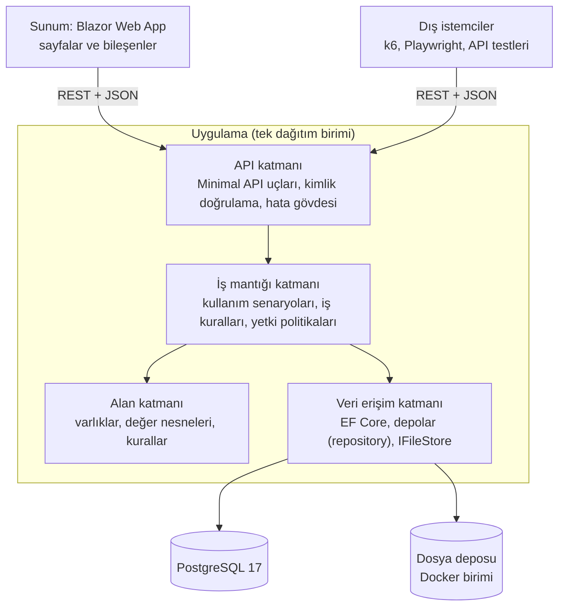
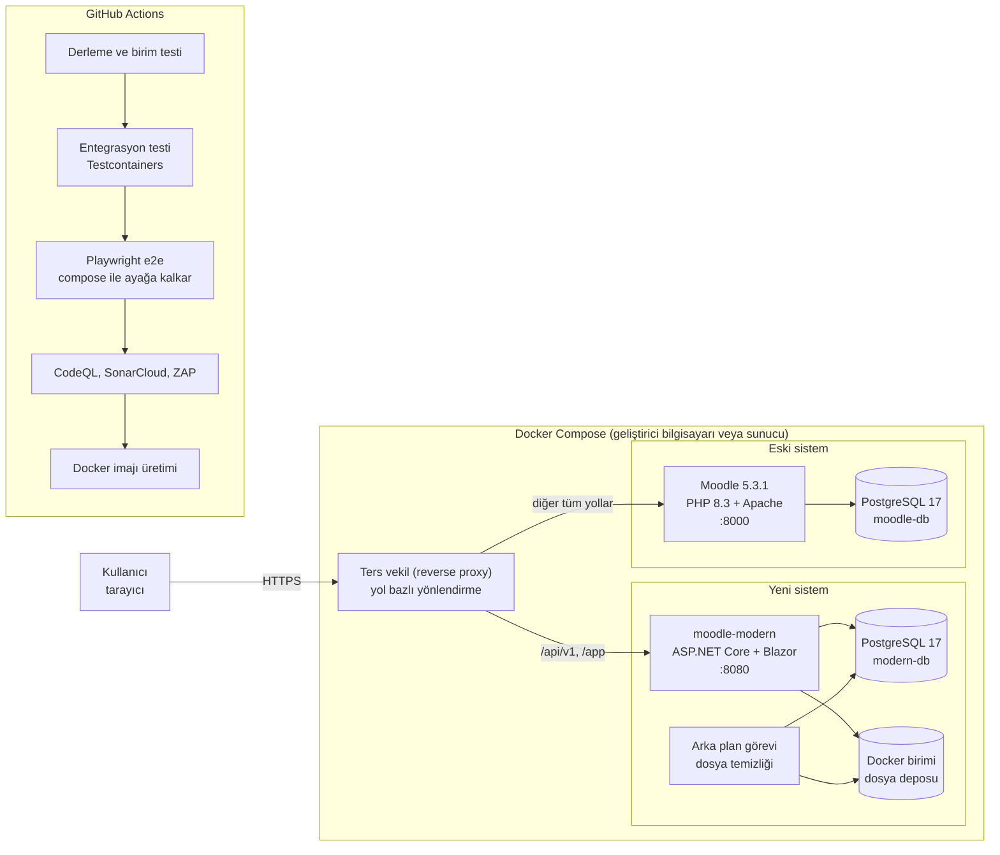

# WBS-2 Hedef Mimari ve Modernizasyon Sürecinin Tasarlanması

## 1. Hedef dil ve teknoloji seçimi (Seray)

Seçim, SRS'teki "farklı bir programlama dili" şartına (WBS-1 §1) ve sürüm planına göre yapılmıştır: Moodle'da var olan işlevler (WBS-3) için 1. sürümde AUTH, CRS, ASG ve GRD (yalnızca öncelik M gereksinimleri), 2. sürümde FILE; yeni işlevler ve veri aktarımı (WBS-4) için ADV ve PLAN yazılacaktır. Puanlar 1 (zayıf) – 5 (çok iyi) arasındadır ve ekibin ilk değerlendirmesidir; grup toplantısında onaylanır.

### 1.1 Adaylar

| Aday | Arka uç | Ön yüz |
| --- | --- | --- |
| **A** | C# · .NET 10 · ASP.NET Core | Blazor Web App |
| **B** | Python 3.13 · FastAPI | React (TypeScript) |
| **C** | TypeScript · Node.js 22 · NestJS | React (TypeScript) |

PHP (Laravel, Symfony) aday alınmamıştır: Moodle zaten PHP'dir ve proje "farklı dilde yeniden yazım"ı sınar.

### 1.2 Karşılaştırma

| Ölçüt | A: C# / .NET | B: Python / FastAPI | C: TypeScript / NestJS |
| --- | --- | --- | --- |
| Performans (K8, K10) | 5 – derlenmiş, düşük bellek; 50 eş zamanlı kullanıcıda p95 ≤ 1.000 ms hedefi rahat | 3 – eşzamansız çalışır ama CPU işinde yavaştır | 4 – tek iş parçacıklı, G/Ç ağırlıklı işte iyi |
| Ekosistem | 4 – kimlik (ASP.NET Core Identity), ORM (EF Core), dosya akışı, arka plan görevleri çerçevenin içinde | 5 – çok geniş kütüphane; kimlik ve yetkilendirme çoğunlukla ek paket ister | 5 – geniş npm ekosistemi; paket sayısı ve sürüm kayması bakım yükü getirir |
| Ekip bilgisi | 5 – eShop pilotu aynı yığınla (.NET 10, Blazor, EF Core) yapıldı; ekip bu yığında çalıştı | 2 – pilotta kullanılmadı | 2 – pilotta kullanılmadı |
| YZ araçlarının kod üretimi | 4 – iyi; Blazor için örnek sayısı React'ten azdır | 5 – en yaygın; en çok eğitim verisi | 5 – çok iyi; React için çok örnek vardır |
| Tür güvenliği (K3, K13) | 5 – derleyici hataları erkenden yakalar | 3 – tür ipuçları isteğe bağlıdır | 4 – TypeScript denetimi, çalışma anında yine de gevşektir |
| Test ve kalite araçları (K5–K7, K13, K14) | 5 – xUnit, coverlet, CodeQL, SonarCloud, analizörler hazır | 4 – pytest, coverage.py, CodeQL | 4 – Jest, c8, CodeQL |
| Docker ve barındırma | 5 – resmî küçük imajlar, pilotta kullanıldı | 5 | 5 |

**Değerlendirme.** Üç aday da Docker'da sorunsuz çalışır; ayrım **ekip bilgisi**, **performans** ve **tür güvenliği**nde ortaya çıkar. B ve C'nin tek üstünlüğü YZ araçlarının biraz daha iyi kod üretmesidir; ama ekip bu yığınları pilotta kullanmadığı için YZ'nin hatalarını fark etme ve düzeltme gücü düşer. Bu proje YZ'nin ürettiği kodun düzeltme eforunu da ölçtüğü için (K17), ekibin tanıdığı dilde ölçmek daha güvenilirdir.

### 1.3 Öneri

**A: C# / .NET 10 + ASP.NET Core + Blazor Web App.**

Gerekçe:
1. **Ekip bilgisi:** Pilotta aynı yığın kullanıldı; WBS-1 §6'daki kalite ölçüm hattı (CI, CodeQL, SonarCloud, Playwright, k6) hazır ve yeniden kullanılabilir.
2. **Kapsam:** 1. sürümün AUTH ve GRD modülleri kimlik, rol ve hesaplama ağırlıklıdır; ASP.NET Core Identity ve ilke tabanlı yetkilendirme (policy-based authorization) bunları çerçeve içinden verir.
3. **Hedefler:** K5 (kapsam ≥ %80), K8 (p95) ve K10 (kaynak) hedefleri bu yığında en rahat yakalanır.
4. **Tür güvenliği:** Gereksinim kimliğine bağlı test yazarken derleyici, YZ'nin ürettiği hataların bir kısmını erkenden yakalar.
5. **Tek dil:** Arka uç ve ön yüz C# olduğundan 5 kişilik ekip tek dilde çalışır; modüller arası geçiş kolay olur.

Risk ve önlem: YZ araçlarının Blazor'daki başarısı React'ten düşük olabilir. Önlem olarak ön yüz bileşenleri küçük tutulur; her bileşen bir API ucuna bağlanır ve YZ çıktısı pilottaki gibi insan incelemesinden geçer. Üretim sütunu (YZ / YZ + insan düzeltmesi) bu riski ölçer.

### 1.4 Seçilen teknoloji yığını

| Katman | Seçim | Gerekçe |
| --- | --- | --- |
| Dil / çalışma zamanı | C# 14, .NET 10 | Yukarıdaki öneri |
| Web ve API | ASP.NET Core (Minimal API), REST + JSON | WBS-2 §3'teki API tablolarıyla birebir; OpenAPI belgesi otomatik üretilir |
| Ön yüz | Blazor Web App; veriyi REST API'den alır | API tek sözleşme olur; k6 ve API testleri aynı uçları kullanır |
| Kimlik | ASP.NET Core Identity + çerez oturumu | Ayrıntı §3.1'de (Sinem) |
| Veri erişimi | Entity Framework Core + Npgsql | Şema geçişleri (migration) kodla sürümlenir |
| Veritabanı | PostgreSQL 17 | Moodle ortamıyla aynı sürüm; veri taşıma ve karşılaştırma kolaylaşır; lisans ücretsizdir |
| Dosya deposu | Yerel disk (Docker birimi); `IFileStore` arayüzü arkasında | §3.6'daki `storage_key` yapısı; sonradan nesne deposuna (S3 uyumlu) geçiş kolay |
| Birim ve entegrasyon testi | xUnit, Testcontainers (gerçek PostgreSQL) | İş mantığı ve veri katmanı gerçek veritabanıyla sınanır |
| Uçtan uca test | Playwright (TypeScript) | Moodle'a da aynı senaryo uygulanır (K1, K2) |
| Yük testi | k6 | K8, K9 |
| Kapsam | coverlet | K5 |
| Statik / dinamik güvenlik | CodeQL, SonarCloud, OWASP ZAP | K6, K7, K13, K14 |
| Konteyner | Docker, Docker Compose | Moodle ortamıyla aynı yaklaşım |
| CI/CD | GitHub Actions | Pilotla aynı; her PR'de derleme, test ve tarama |

## 2. Hedef mimari ve deployment diyagramı (Seray)

### 2.1 Genel yaklaşım

Sistem **modüler monolit**tir: tek dağıtım birimi, içinde modül sınırları açık. Gerekçe: 5 kişilik ekip ve aşamalı sürüm planı (WBS-3, WBS-4) için mikro hizmet işletmesi gereksiz maliyettir; ancak modüller (AUTH, CRS, ASG, GRD, FILE, ADV, PLAN) birbirine yalnızca arayüzlerle bağlandığı için sürüm sürüm eklenebilir ve gerekirse sonradan ayrılabilir.

### 2.2 Katmanlar



| Katman | Sorumluluk | Bağımlılık kuralı |
| --- | --- | --- |
| Sunum (Blazor) | Ekranlar, form doğrulama, API çağrısı | Yalnızca API'yi bilir |
| API | Yol, istek/yanıt şeması, oturum ve yetki denetiminin girişi, tek tip hata gövdesi (K3: yığın izi dönmez) | İş mantığını çağırır, veri erişimini bilmez |
| İş mantığı | Kullanım senaryoları; WBS-1'deki iş kuralları (`*-BR-*`) burada tek yerde yazılır; yetki politikaları | Alan ve veri erişim **arayüzlerine** bağlıdır |
| Alan | Varlıklar ve değişmez kurallar | Hiçbir şeye bağlı değildir |
| Veri erişim | EF Core, depolar, dosya deposu, geçişler | İş mantığının tanımladığı arayüzleri uygular |

Bağımlılık yönü içeriye doğrudur: sunum → API → iş mantığı → alan; veri erişim, iş mantığındaki arayüzleri uygular. Bu kural K13 (bakım) için derleme sırasında mimari testiyle denetlenir.

### 2.3 Klasör yapısı

```text
moodle-modern/
├── src/
│   ├── Moodle.Domain/             # alan katmanı, modül başına klasör
│   │   ├── Auth/  Courses/  Assignments/  Grading/  Files/  Advising/  Planning/
│   ├── Moodle.Application/        # iş mantığı: kullanım senaryoları, arayüzler, yetki politikaları
│   │   ├── Auth/  Courses/  Assignments/  Grading/  Files/  Advising/  Planning/
│   ├── Moodle.Infrastructure/     # veri erişimi
│   │   ├── Persistence/           # DbContext, yapılandırmalar, Migrations/
│   │   ├── Storage/               # IFileStore: yerel disk gerçeklemesi
│   │   └── Jobs/                  # arka plan görevleri (dosya temizliği vb.)
│   ├── Moodle.Api/                # uç noktalar, modül başına bir dosya; Program.cs
│   └── Moodle.Web/                # Blazor Web App (sayfalar, bileşenler)
├── tests/
│   ├── Moodle.UnitTests/          # iş mantığı (K5)
│   ├── Moodle.IntegrationTests/   # API + Testcontainers PostgreSQL
│   ├── e2e/                       # Playwright; aynı senaryo Moodle'a da uygulanır
│   └── performance/               # k6
├── docker/                        # Dockerfile, compose, proxy ayarı
├── .github/workflows/             # CI
└── docs/
```

Her modül, kendi klasörü dışındaki modülün **arayüzünü** çağırır, gerçeklemesini çağırmaz (ör. `ASG`, dosya için `IFileService` kullanır). Yeni kod gereksinim kimliğiyle işaretlenir (WBS-2 §5.2, kural 4).

### 2.4 Kimlik doğrulama ve yetkilendirme yaklaşımı

- Oturum: ASP.NET Core Identity, güvenli ve `HttpOnly` çerez. Ayrıntı §3.1'dedir (Sinem).
- Yetki: Moodle'ın bağlam + rol + yetenek modeli (WBS-1 §4.1) **ilke tabanlı yetkilendirme** olarak karşılanır: her uç bir ilkeye bağlanır, ilke "kullanıcı, bağlam ve yetenek"e bakar.
- Bileşen yetkisi: Dosya gibi paylaşılan servisler, sahip modülün `canRead`/`canWrite` işlevini çağırır (§3.6.3).
- Yetkisiz isteğe `404` döner (varlık sızdırılmaz); ayrım WBS-1'deki rol–yetki matrisine uyar (K4).

### 2.5 Veritabanı ve dosya deposu

- **Veritabanı:** tek PostgreSQL 17 örneği, tek şema; tablo adları modül önekli değildir ama her modülün tabloları kendi `Infrastructure/Persistence` yapılandırmasında tanımlıdır. Şema değişikliği yalnızca EF Core geçişiyle yapılır.
- **Dosya deposu:** içerik adresli, `ab/cd/<sha256>` yolu (§3.6.1). Veritabanında yalnızca üst veri tutulur. Depo `IFileStore` arkasındadır; geliştirmede yerel disk, ileride nesne deposu.
- **Yedekleme:** veritabanı ve dosya deposu birlikte yedeklenmelidir; yalnız biri geri yüklenirse "dosya var, içerik yok" tutarsızlığı oluşur. Bu nokta işletme notudur.

### 2.6 Dağıtım diyagramı



| Bileşen | Teknoloji | Port | Veri |
| --- | --- | --- | --- |
| Yeni uygulama | .NET 10, tek konteyner | 8080 | `modern-db`, dosya birimi |
| Yeni veritabanı | PostgreSQL 17 | 5432 (yalnız ağ içi) | `modern-db` birimi |
| Eski sistem | Moodle 5.3.1, PHP 8.3, Apache | 8000 | `moodle-db`, Moodle veri dizini |
| Ters vekil | nginx veya Caddy | 80/443 | Yok |
| CI | GitHub Actions | — | İmaj kayıt defteri |

Hem eski hem yeni sistem aynı bilgisayarda çalıştığı için K1, K2, K8 ve K10 aynı koşulda ölçülür.

### 2.7 Eski ve yeni sistemin geçiş sürecinde birlikte çalışması

Yaklaşım **modül modül geçiş**tir (strangler fig): ters vekil, hangi yolun hangi sisteme gideceğini söyler; modül hazır oldukça yönlendirme yeni sisteme çevrilir.

1. **Veritabanları ayrıdır.** Yeni sistem, Moodle'ın veritabanına yazmaz; Moodle şeması yeni sistemin sözleşmesi olmaz. Veri, modül geçişinde tek yönlü bir aktarım betiğiyle taşınır (kullanıcılar, dersler, kayıtlar, ödevler, notlar, dosya üst verisi).
2. **Bir modül aynı anda yalnızca bir sistemde yazılır.** Hem eski hem yeni sistemde yazılan modül çakışma doğurur; bu yüzden geçiş anında ilgili yol yeni sisteme çevrilir ve Moodle'da o işlev kapatılır.
3. **Sıra sürüm planına uyar:**

| Sürüm | Modüller | Geçişte bilinmesi gereken |
| --- | --- | --- |
| 1 (WBS-3) | AUTH, CRS, ASG, GRD (yalnızca M gereksinimleri) | Kimlik ilk taşınan modüldür; kullanıcı ve rol aktarımı tamamlanmadan diğerleri açılamaz. Ödev teslimi bireysel çevrimiçi metindir (aşağıya bakın). |
| 2 (WBS-3) | FILE | Moodle'da var olan dosya işlevi eklenir; ASG bu sürümde dosyalı teslimi kazanır. |
| WBS-4 | ADV, PLAN | Yeni işlevler ve veri aktarımı. ADV, AUTH ve CRS'ye bağlıdır; PLAN önceki modüllerin verisini okur. |

4. **Dosya bağımlılığı.** 1. sürümde ödev teslimi **yalnızca bireysel çevrimiçi metindir** (§3.4); bu yüzden 1. sürüm dosya servisi gerektirmez ve FILE 2. sürümde eklenir. Dosyalı teslim için gereken tasarım §3.6'da hazırdır: ASG, dosya için yalnızca `IFileService` arayüzünü çağıracağından 2. sürümde ASG kodu değişmeden dosyalı teslim açılabilir. Ekip dosyalı teslimi 1. sürüme almaya karar verirse, `IFileService` yalnızca ASG'nin ihtiyaç duyduğu çekirdekle (taslak, kaydet, indir, sil, boyut sınırı; WBS-1 §4.6.11) gerçeklenir; kota, çöp kutusu geri alma, yönetici ayarları ve temizlik görevi yine 2. sürümde kalır.
5. **Kimlik paylaşımı.** Geçiş döneminde kullanıcı iki sistemde de oturum açar. Tek oturum açma (SSO) bu proje kapsamında **yoktur**; sınav ve karşılaştırma ortamında test kullanıcıları iki sistemde aynı kimlikle tanımlanır (`ornek-veri.feature`).
6. **Geri dönüş.** Modül yönlendirmesi vekil ayarıyla geri alınabilir; aktarım betiği yeniden çalıştırılabilir (aynı veriyle kurulum 5 dakika, `ortam/README.md`).

### 2.8 Açık noktalar

- Ters vekil için nginx ve Caddy arasında seçim, kurulum denemesinden sonra yapılacaktır.
- Ödev teslim dosyalarının yetkisi §3.4 ile birlikte kesinleşecektir.
- Dil seçimi (C# / .NET 10 + Blazor) ve 1. sürümde ödev teslimi türü (metin / dosyalı) grup oylamasına bağlıdır; §2.7 madde 4 oylama sonucuna göre kesinleşir.

## 3. Veri ve arayüz tasarımı

API tabloları: Metot · Yol · İstek · Yanıt · Hangi rol çağırabilir

### 3.1 Kimlik ve yetkilendirme (Sinem)

#### 3.1.1 Tasarım yaklaşımı

Kimlik doğrulama ve yetkilendirme (AUTH) modülü, Moodle 5.3.1'in mevcut PHP tabanlı altyapısından bağımsız olarak C# ve .NET 10 teknolojileri kullanılarak yeniden geliştirilecektir. Hedef, WBS-1 kapsamında belirlenen mevcut sistem davranışlarını ve işlevsel gereksinimleri korurken daha modüler, güvenli, test edilebilir ve sürdürülebilir bir sistem oluşturmaktır.

Yeni sistemde ASP.NET Core, ASP.NET Core Identity, Entity Framework Core (EF Core), PostgreSQL ve Blazor kullanılacaktır. Moodle'ın mevcut veritabanı yeni uygulamanın çalışma veritabanı olmayacak ve yeni uygulama tarafından doğrudan güncellenmeyecektir.

**Temel tasarım ilkeleri**

1. Kullanıcıların geçerli kimlik bilgileriyle sisteme giriş yapması sağlanacaktır.
2. Askıya alınmış, devre dışı bırakılmış veya kilitlenmiş hesapların giriş yapması engellenecektir.
3. Başarısız giriş denemeleri güvenli biçimde izlenecektir.
4. Yetkilendirme yalnızca kullanıcı rolüne göre değil, ilgili ders veya kaynak kapsamına göre değerlendirilecektir.
5. Oturum oluşturma, sonlandırma ve geçerlilik kontrolleri güvenli biçimde yürütülecektir.
6. Zorunlu parola değiştirme işlemi desteklenecektir.
7. Parolalar açık metin olarak saklanmayacaktır.
8. AUTH modülü, ilk sürümde CRS, ASG ve GRD modüllerinin kimlik doğrulama ve yetkilendirme ihtiyaçlarını karşılayacaktır.
9. İkinci sürümde geliştirilecek FILE modülü de aynı yetkilendirme altyapısını kullanacaktır.
10. Moodle'daki mevcut veriler, gerektiğinde kontrollü veri aktarımıyla yeni veritabanına taşınacaktır.

**Hedef mimari**

| Bileşen | Teknoloji | Sorumluluk |
|---|---|---|
| Authentication | ASP.NET Core Identity | Kullanıcı girişi, parola doğrulama ve hesap durumunun kontrolü |
| Session Management | ASP.NET Core Authentication | Oturum oluşturma, sonlandırma ve geçerlilik kontrolü |
| Authorization | ASP.NET Core Policy-Based Authorization | Rol ve kaynak kapsamlı erişim kararları |
| User Management | ASP.NET Core Identity | Kullanıcı hesaplarının yönetimi |
| Role Management | ASP.NET Core Identity | Sistem rollerinin yönetimi |
| Course Permission Management | Uygulamaya özgü yetkilendirme katmanı | Ders bazlı rol ve izinlerin değerlendirilmesi |
| Data Access | Entity Framework Core | Yeni PostgreSQL veritabanına erişim |
| User Interface | Blazor | Giriş, hesap ve kullanıcı yönetimi ekranları |

Bu bileşenler mantıksal sorumlulukları temsil eder. Ayrı mikroservisler olarak uygulanmaları zorunlu değildir. İlk sürümde modüler monolit yaklaşımı benimsenebilir.

**Moodle ile ilişki**

Moodle 5.3.1, mevcut sistemin davranışlarının analiz edilmesi ve yeni sistemin gereksinimlerinin belirlenmesi amacıyla referans alınacaktır.

Yeni sistem Moodle'ın PHP fonksiyonlarını, `has_capability()` mekanizmasını veya kimlik doğrulama eklentilerini çalışma zamanında kullanmayacaktır.

Bunun yerine mevcut sistemde tespit edilen iş kuralları, ASP.NET Core Identity ve uygulamaya özgü yetkilendirme politikalarıyla yeniden uygulanacaktır.

**Gereksinim ilişkisi:** AUTH-FR-01–AUTH-FR-09.

#### 3.1.2 Veri modeli ve bütünlük kuralları

AUTH modülünün hedef veri modeli, ASP.NET Core Identity ve Entity Framework Core kullanılarak yeni PostgreSQL veritabanında oluşturulacaktır.

Moodle'ın `user`, `role`, `context`, `role_assignments` ve `role_capabilities` tabloları doğrudan kullanılmayacaktır. Bunların karşıladığı işlevler, yeni sistemin veri modeline uygun şekilde yeniden tasarlanacaktır.

**Önerilen veri yapıları**

| Tablo / Varlık | Sorumluluk |
|---|---|
| `AspNetUsers` | Kullanıcı hesapları, kimlik bilgileri ve hesap durumları |
| `AspNetRoles` | Sistem genelindeki roller |
| `AspNetUserRoles` | Kullanıcıların sistem rollerine atanması |
| `AspNetUserClaims` | Kullanıcıya ait ek kimlik ve yetki bilgileri |
| `AspNetRoleClaims` | Rollere tanımlanan ek yetki bilgileri |
| `AspNetUserTokens` | Identity tarafından yönetilen kullanıcı token bilgileri |
| `AspNetUserLogins` | Desteklenmesi durumunda harici giriş sağlayıcıları |
| `CourseRoleAssignments` | Kullanıcıların belirli derslerde sahip oldukları roller |
| `SecurityAuditLogs` | Güvenlikle ilgili olayların izlenmesi |
| `UserSecurityStates` | Uygulamaya özgü hesap durumu ve zorunlu parola değiştirme bilgileri |

Identity tablolarının adları varsayılan şemayı temsil etmektedir. Gerçek tablo adları ve alanlar EF Core yapılandırması sırasında kesinleştirilecektir.

`CourseRoleAssignments`, `SecurityAuditLogs` ve `UserSecurityStates` uygulama için önerilen yeni varlıklardır; ASP.NET Core Identity tarafından otomatik oluşturuldukları varsayılmamaktadır.

**Önerilen veri ilişkileri**

- Bir kullanıcı birden fazla sistem rolüne sahip olabilir.
- Bir kullanıcı birden fazla derse kayıtlı olabilir.
- Bir kullanıcının ders bazlı rolü, başka bir dersteki rolünden farklı olabilir.
- Ders bazlı rol atamaları kullanıcı ve ders kayıtlarıyla ilişkilendirilir.
- Yetki kararları ilgili kullanıcı, işlem ve kaynak kapsamı birlikte değerlendirilerek verilir.
- Kullanıcı hesabının devre dışı bırakılması, mevcut rol atamalarını otomatik olarak silmek zorunda değildir.

**Veri bütünlüğü kuralları**

1. Kullanıcı adları için benzersizlik kontrolü uygulanacaktır. E-posta adreslerinin de benzersiz olması hedeflenmektedir. ASP.NET Core Identity'de e-posta benzersizliği varsayılan olarak zorunlu olmadığından `IdentityOptions.User.RequireUniqueEmail` ayarı etkinleştirilecek ve veri bütünlüğü uygun veritabanı kısıtlarıyla desteklenecektir.
2. Kullanıcı ve rol ilişkileri yabancı anahtarlarla korunacaktır.
3. Ders bazlı rol atamalarında kullanıcı ve ders kayıtlarının mevcut olması zorunlu olacaktır.
4. Aynı kullanıcı, ders ve rol için yinelenen atamalar uygun benzersizlik kısıtlarıyla önlenecektir.
5. Kullanıcı parolaları ASP.NET Core Identity'nin parola karma mekanizmasıyla saklanacaktır.
6. Başarısız giriş sayısı ve hesap kilitlenme durumu Identity'nin desteklediği mekanizmalarla yönetilecektir.
7. Hesap durumu ve zorunlu parola değiştirme gibi uygulamaya özgü bilgiler açıkça tanımlanmış alanlarda tutulacaktır.
8. Güvenlik kayıtlarında açık metin parola, kimlik doğrulama çerezi veya hassas token saklanmayacaktır.
9. Veri değişikliklerinde EF Core üzerinden uygun işlem bütünlüğü ve eşzamanlılık kontrolleri uygulanacaktır.

**Veri erişim yaklaşımı**

Kullanıcı ve rol yönetiminde ASP.NET Core Identity'nin `UserManager` ve `RoleManager` bileşenleri kullanılacaktır.

Kimlik doğrulama işlemleri Identity'nin `SignInManager` bileşeni üzerinden yürütülebilecektir.

Ders bazlı yetki ilişkileri ve uygulamaya özgü veriler EF Core aracılığıyla yönetilecektir.

Yetkilendirme kararları yalnızca veritabanında rol adı sorgulanarak verilmek yerine merkezi bir authorization katmanında değerlendirilecektir.

**Moodle veri aktarımı**

Eski Moodle veritabanı, veri aktarımı sırasında kaynak sistem olarak değerlendirilecektir. Aktarım işlemi yeni uygulamanın çalışma zamanındaki veri erişiminden ayrılacaktır.

Kullanıcı kimlikleri, hesap durumları ve rol ilişkileri hedef şemaya dönüştürülerek aktarılacaktır. Moodle parola karmalarının ASP.NET Core Identity ile doğrudan uyumlu olduğu varsayılmayacak; güvenli parola sıfırlama veya ayrıca doğrulanmış bir geçiş yöntemi kullanılacaktır.

**Gereksinim ilişkisi:** AUTH-FR-02, AUTH-FR-03, AUTH-FR-04, AUTH-FR-06, AUTH-FR-07.

#### 3.1.3 Önerilen REST API tasarımı

AUTH modülünde kullanıcı girişi, oturum yönetimi, parola değiştirme ve yetki sorgulama işlemleri için ASP.NET Core tabanlı servis arayüzleri tasarlanacaktır.

Blazor arayüzü bu servisleri veya aynı uygulama içindeki ilgili servis katmanını kullanacaktır.

Aşağıdaki uç noktalar hedef tasarım önerisidir. Bunların mevcut Moodle'da veya yeni sistemde hâlihazırda geliştirildiği iddia edilmemektedir.

**Önerilen API uç noktaları**

| HTTP | Uç nokta | İşlem | İlgili gereksinim |
|---|---|---|---|
| POST | `/api/v1/auth/login` | Kullanıcı girişinin doğrulanması ve oturum oluşturulması | AUTH-FR-01, 04, 05, 06 |
| POST | `/api/v1/auth/logout` | Kullanıcı oturumunun sonlandırılması | AUTH-FR-08 |
| GET | `/api/v1/auth/session` | Mevcut kullanıcının oturum durumunun sorgulanması | AUTH-FR-08 |
| POST | `/api/v1/auth/change-password` | Kullanıcı parolasının değiştirilmesi | AUTH-FR-09 |
| GET | `/api/v1/auth/permissions` | Kullanıcının belirli kaynak kapsamındaki yetkilerinin sorgulanması | AUTH-FR-02, 03, 07 |

**Örnek istek ve yanıt sözleşmeleri**

`POST /api/v1/auth/login`

İstek:

```json
{
  "username": "student01",
  "password": "example-password"
}
```

Başarılı yanıt:

```json
{
  "authenticated": true,
  "requiresPasswordChange": false
}
```

Bu örnek, parola veya oturum token bilgisinin yanıt gövdesinde paylaşılmasını gerektirmez. İlk sürüm için güvenli HTTP-only kimlik doğrulama çerezleri tercih edilebilir.

`GET /api/v1/auth/permissions?courseId=101`

Örnek yanıt:

```json
{
  "courseId": 101,
  "permissions": [
    "course.view",
    "assignment.submit"
  ]
}
```

Bu yanıt yalnızca çağrıyı yapan kullanıcının görüntülemeye yetkili olduğu bilgileri içerecektir.

**API güvenlik kuralları**

1. Kimlik doğrulama ASP.NET Core Identity üzerinden yürütülecektir.
2. Hesabın devre dışı bırakılma ve kilitlenme durumu giriş sırasında kontrol edilecektir.
3. Geçersiz kimlik bilgileriyle oturum oluşturulmayacaktır.
4. Başarısız giriş denemeleri güvenli biçimde izlenecektir.
5. Kimlik doğrulaması gerektiren uç noktalarda `[Authorize]` veya eşdeğer endpoint authorization kuralları kullanılacaktır.
6. Ders kapsamlı yetkiler sunucu tarafında doğrulanacaktır.
7. İstemciden gelen rol ve kullanıcı kimliği bilgileri tek başına güvenilir kabul edilmeyecektir.
8. Çerez tabanlı kimlik doğrulamada CSRF koruması uygulanacaktır.
9. Parola ve hassas oturum bilgileri log kayıtlarına yazılmayacaktır.
10. Giriş uç noktalarında uygun istek sınırlama politikaları uygulanacaktır.

**Önerilen hata durumları**

| HTTP durum kodu | Açıklama |
|---|---|
| 400 Bad Request | Eksik veya geçersiz istek |
| 401 Unauthorized | Kimlik doğrulaması başarısız veya geçerli oturum bulunmuyor |
| 403 Forbidden | Kullanıcının işlem yetkisi bulunmuyor |
| 404 Not Found | İstenen kaynak bulunamadı veya güvenlik politikası gereği gizlendi |
| 409 Conflict | İşlem sırasında veri veya durum çakışması |
| 429 Too Many Requests | İstek sınırlama kuralı aşıldı |
| 500 Internal Server Error | Beklenmeyen sunucu hatası |

**Modüller arası entegrasyon**

CRS, ASG ve GRD modülleri kullanıcı kimliği ve yetki kararları için AUTH altyapısını kullanacaktır.

Örneğin CRS modülünde ders düzenleme işlemi gerçekleştirilmeden önce kullanıcının ilgili derste düzenleme yetkisine sahip olduğu doğrulanacaktır.

İkinci sürümde FILE modülü de aynı güvenlik ilkelerine uygun şekilde sisteme entegre edilecektir.

**Gereksinim ilişkisi:** AUTH-FR-01–AUTH-FR-09.

#### 3.1.4 Rol ve bağlam tabanlı yetkilendirme tasarımı

Moodle 5.3.1'de yetkilendirme rol, bağlam ve capability mekanizmaları üzerinden gerçekleştirilmektedir.

Yeni sistemde bu işlevsel yaklaşım korunacak, ancak Moodle'ın `has_capability()` fonksiyonu ve mevcut yetkilendirme tabloları kullanılmayacaktır.

Bunun yerine ASP.NET Core Policy-Based Authorization ve uygulamaya özgü ders kapsamlı yetkilendirme mekanizması kullanılacaktır.

**Yetkilendirme modeli**

Yetkilendirme kararında aşağıdaki bilgiler birlikte değerlendirilecektir:

- Kullanıcının kimliği.
- Kullanıcının sistem genelindeki rolü.
- İşlemin gerçekleştirileceği kaynak.
- Kullanıcının ilgili kaynak kapsamındaki rolü.
- Gerçekleştirilmek istenen işlem.
- Kaynağın ve kullanıcının geçerli durumu.

Örneğin bir öğretmenin yalnızca yetkili olduğu derslerin ayarlarını düzenleyebilmesi hedeflenecektir.

**Önerilen yetkilendirme iş akışı**

1. Kullanıcının kimlik doğrulama durumu kontrol edilir.
2. Gerçekleştirilmek istenen işlem belirlenir.
3. İşlemin ilgili olduğu ders veya kaynak tespit edilir.
4. Kullanıcının sistem rolü ve ilgili kaynaktaki rol atamaları sorgulanır.
5. ASP.NET Core authorization policy veya özel authorization handler üzerinden erişim kararı verilir.
6. Yetki varsa işlem gerçekleştirilir.
7. Yetki yoksa işlem reddedilir ve korunan veri değiştirilmez.

**Örnek yetkilendirme matrisi**

| İşlem | Öğrenci | İlgili dersin öğretmeni | Sistem yöneticisi |
|---|---|---|---|
| Kendi hesabıyla giriş yapma | İzinli | İzinli | İzinli |
| Kayıtlı olduğu dersi görüntüleme | İzinli | İzinli | İzinli |
| Kendi ödevini teslim etme | İzinli | Reddedilir | Reddedilir |
| Yetkili olduğu dersin ayarlarını düzenleme | Reddedilir | İzinli | İzinli |
| Notlandırma işlemi gerçekleştirme | Reddedilir | İzinli | İzinli |
| Sistem kullanıcılarını yönetme | Reddedilir | Reddedilir | İzinli |

Bu tablo hedef sistemin örnek yetkilendirme politikasını göstermektedir. Özellikle yönetici ve öğretmenlerin ödev teslimine ilişkin yetkileri, ASG modülünün kesin iş kurallarına göre ayrıca değerlendirilecektir.

**Ders kapsamlı yetkilendirme**

Bir kullanıcı farklı derslerde farklı rollere sahip olabilir.

Örneğin aynı kullanıcı bir derste öğretmen, başka bir derste öğrenci olabilir. Bu nedenle sistem genelindeki rol bilgisi tek başına yeterli değildir.

Ders bazlı rol atamaları yeni sistemde `CourseRoleAssignments` gibi uygulamaya özgü bir veri yapısı üzerinden temsil edilecektir.

**ASP.NET Core yetkilendirme yaklaşımı**

Sistem genelindeki erişim kuralları ASP.NET Core authorization policy mekanizmasıyla tanımlanacaktır.

Kaynak bazlı işlemlerde ise ilgili dersin kimliği ve kullanıcının ders kapsamındaki rolü değerlendirilerek özel authorization handler kullanılabilecektir.

Bu yaklaşım, Moodle'daki bağlam duyarlılığının yeni teknolojilerle yeniden gerçekleştirilmesini hedeflemektedir.

**Güvenlik ilkeleri**

- Yetkilendirme kontrolleri sunucu tarafında uygulanacaktır.
- Blazor arayüzünde bir işlemin gizlenmesi tek başına güvenlik kontrolü kabul edilmeyecektir.
- Kullanıcının istemciden gönderdiği rol bilgileri doğrudan kabul edilmeyecektir.
- Her ders için yetki değerlendirmesi ilgili kaynak üzerinden yapılacaktır.
- Yetkisiz işlemler veri değişikliğine neden olmayacaktır.
- AUTH modülündeki yetki kuralları CRS, ASG ve GRD modüllerinde ortak şekilde uygulanacaktır.

**Gereksinim ilişkisi:** AUTH-FR-02, AUTH-FR-03, AUTH-FR-07.

**Mevcut sistem referansı:** WBS-1 §4.1.7; Moodle `public/lib/accesslib.php`.

#### 3.1.5 İş akışları ve hata yönetimi

AUTH modülünün hedef tasarımında kimlik doğrulama, oturum yönetimi, parola değiştirme ve yetkilendirme işlemleri ASP.NET Core Identity ve uygulamaya özgü servis katmanlarıyla gerçekleştirilecektir.

Aşağıdaki iş akışları yeni sistem için önerilen davranışları tanımlamaktadır.

**1. Kullanıcı girişi**

1. Kullanıcı Blazor giriş ekranından kimlik bilgilerini gönderir.
2. Sistem ilgili kullanıcı hesabını ASP.NET Core Identity üzerinden sorgular.
3. Hesabın aktiflik ve kilitlenme durumu kontrol edilir.
4. Kullanıcının parolası Identity mekanizmasıyla doğrulanır.
5. Doğrulama başarılıysa güvenli kimlik doğrulama oturumu oluşturulur.
6. Zorunlu parola değiştirme koşulu varsa kullanıcı ilgili ekrana yönlendirilir.
7. Doğrulama başarısızsa oturum oluşturulmaz.

**Hata durumları:** Geçersiz kullanıcı bilgileri, yanlış parola, devre dışı bırakılmış hesap, kilitlenmiş hesap ve beklenmeyen sistem hataları.

**2. Kullanıcı çıkışı ve oturum geçerliliği**

1. Kullanıcı çıkış işlemini başlatır.
2. Sistem ilgili kimlik doğrulama oturumunu sonlandırır.
3. Kimlik doğrulama çerezi geçersiz hâle getirilir.
4. Kullanıcı korunan bir kaynağa yeniden erişmeye çalışırsa geçerli kimlik doğrulaması aranır.
5. Geçerli oturum yoksa yeniden giriş yapılması istenir.

Oturum zaman aşımı ve güvenlik damgası doğrulama davranışları ASP.NET Core Identity yapılandırması kapsamında belirlenecektir.

**Hata durumları:** Geçersiz oturum, süresi dolmuş oturum ve oturumsuz korunan kaynağa erişim.

**3. Zorunlu parola değiştirme**

1. Kullanıcı geçerli kimlik bilgileriyle giriş yapar.
2. Sistem kullanıcı hesabının parola değiştirme durumunu kontrol eder.
3. Zorunlu parola değiştirme koşulu varsa kullanıcı parola değiştirme ekranına yönlendirilir.
4. Yeni parola belirlenen güvenlik politikasına göre doğrulanır.
5. Parola ASP.NET Core Identity üzerinden güncellenir.
6. Kullanıcının zorunlu parola değiştirme durumu kaldırılır.
7. Kullanıcı normal erişim akışına devam eder.

**Hata durumları:** Parola politikası ihlali, geçersiz parola değiştirme isteği ve güncelleme hatası.

Zorunlu parola değiştirme durumu, Identity'nin varsayılan özelliklerinden bağımsız olarak uygulamaya özgü bir alan veya güvenlik durumu modeliyle yönetilecektir.

**4. Yetkilendirme kontrolü**

1. Kullanıcı korunan bir işlem başlatır.
2. Sistem kimlik doğrulama durumunu kontrol eder.
3. İşlem için gerekli yetki politikası belirlenir.
4. İşlemin ilgili olduğu ders veya kaynak tespit edilir.
5. Kullanıcının sistem rolü ve kaynak kapsamındaki yetkileri değerlendirilir.
6. Yetki varsa işlem gerçekleştirilir.
7. Yetki yoksa işlem reddedilir.

**Hata durumları:** Geçersiz oturum, yetersiz yetki, geçersiz kaynak veya uygun olmayan rol ataması.

**5. Başarısız giriş ve hesap kilitleme**

1. Kullanıcı geçersiz kimlik bilgileriyle giriş yapmayı dener.
2. Sistem kimlik doğrulama işlemini reddeder.
3. Başarısız giriş denemesi güvenli biçimde izlenir.
4. ASP.NET Core Identity hesap kilitleme politikası değerlendirilir.
5. Yapılandırılmış eşik aşılırsa hesap geçici olarak kilitlenir.
6. Kilit süresi veya tanımlanan güvenli kurtarma süreci tamamlandığında yeniden giriş yapılabilir.

Kilitlenme eşiği ve süresi geliştirme aşamasında belirlenecektir. Mevcut Moodle ortamında gözlemlenen üç başarısız giriş davranışı, yeni sistem için otomatik olarak kabul edilmiş bir politika değildir.

**Hata yönetimi ilkeleri**

- Başarısız giriş işlemleri oturum oluşturmamalıdır.
- Yetkisiz işlemler sunucu tarafında engellenmelidir.
- Kullanıcıya gösterilen hata mesajları hassas hesap bilgilerini açığa çıkarmamalıdır.
- Parola, oturum çerezi ve hassas token bilgileri loglara yazılmamalıdır.
- Güvenlikle ilgili olaylar merkezi ve erişim kontrollü kayıt mekanizmasıyla izlenmelidir.
- Beklenmeyen hatalarda korunan işlemler güvenli biçimde sonlandırılmalıdır.
- Veri bütünlüğünü etkileyen işlemlerde uygun transaction yönetimi kullanılmalıdır.

**Gereksinim ilişkisi**

| İş akışı | İlgili gereksinimler |
|---|---|
| Kullanıcı girişi | AUTH-FR-01, AUTH-FR-04, AUTH-FR-05 |
| Kullanıcı çıkışı ve oturum geçerliliği | AUTH-FR-08 |
| Zorunlu parola değiştirme | AUTH-FR-09 |
| Yetkilendirme kontrolü | AUTH-FR-02, AUTH-FR-03, AUTH-FR-07 |
| Başarısız giriş ve hesap kilitleme | AUTH-FR-05, AUTH-FR-06 |

#### 3.1.6 Gereksinim izlenebilirliği

AUTH modülünün hedef tasarımında WBS-1 kapsamında belirlenen gereksinimler, yeni sistemin tasarım bileşenleri ve doğrulama senaryolarıyla eşleştirilmiştir.

Bu eşleştirme, Moodle'da incelenen davranışların yeni sistemde yeniden uygulanmasını ve WBS-3 geliştirme sürecinde test edilmesini amaçlamaktadır.

**Gereksinim–tasarım–test eşleştirmesi**

| Gereksinim | Yeni sistemde tasarım karşılığı | Test senaryosu |
|---|---|---|
| AUTH-FR-01 | ASP.NET Core Identity; kullanıcı girişi | T-AUTH-01 |
| AUTH-FR-02 | Authorization Policies; sunucu tarafı erişim kontrolü | T-AUTH-02 |
| AUTH-FR-03 | Ders kapsamlı rol atamaları ve yetkilendirme | T-AUTH-03 |
| AUTH-FR-04 | Kullanıcı hesap durumu kontrolü | T-AUTH-04 |
| AUTH-FR-05 | Başarısız giriş doğrulaması ve güvenlik kaydı | T-AUTH-05 |
| AUTH-FR-06 | Identity hesap kilitleme politikası | T-AUTH-06 |
| AUTH-FR-07 | Kaynak kapsamlı authorization handler | T-AUTH-07 |
| AUTH-FR-08 | ASP.NET Core Authentication; oturum yönetimi | T-AUTH-08 |
| AUTH-FR-09 | Identity parola değiştirme ve uygulamaya özgü zorunlu değiştirme akışı | T-AUTH-09 |
| AUTH-NFR-01 | Üretim ortamında hassas hata bilgilerinin gizlenmesi ve güvenli hata yönetimi | T-AUTH-10 |

**Tasarım bölümleriyle ilişki**

- **§3.1.1:** Hedef mimari ve bileşen sorumlulukları.
- **§3.1.2:** Yeni veri modeli ve veri bütünlüğü.
- **§3.1.3:** Önerilen REST API arayüzleri.
- **§3.1.4:** Rol ve ders kapsamlı yetkilendirme.
- **§3.1.5:** Kimlik doğrulama, oturum ve hata yönetimi.

**Doğrulama yaklaşımı**

WBS-1 kapsamında gerçekleştirilen testler mevcut Moodle 5.3.1 sisteminin davranışlarını göstermektedir.

Yeni sistemde aynı işlevsel gereksinimler için testler yeniden çalıştırılacaktır. Mevcut Moodle testlerinin başarılı olması, yeni C# uygulamasının doğrulandığı anlamına gelmemektedir.

Yeni sistemde özellikle aşağıdaki kontroller gerçekleştirilecektir:

1. Geçerli kullanıcı bilgileriyle giriş.
2. Geçersiz parola ile girişin reddedilmesi.
3. Askıya alınmış veya devre dışı bırakılmış hesabın girişinin engellenmesi.
4. Hesap kilitleme politikasının uygulanması.
5. Ders kapsamlı yetkilendirme.
6. Yetkisiz kullanıcının korunan işlemleri gerçekleştirememesi.
7. Oturum kapatma ve zaman aşımı.
8. Zorunlu parola değiştirme işleminin tamamlanması.
9. Güvenlik olaylarının kaydedilmesi.
10. Hassas hata bilgilerinin kullanıcıya gösterilmemesi.

**Kaynak:** WBS-1 §4.1.9 Gereksinimler ve §4.1.10 Test senaryoları.

**Kapsam:** AUTH-FR-01–AUTH-FR-09, T-AUTH-01–T-AUTH-10.

#### 3.1.7 Test sonuçları ve doğrulama durumu

AUTH modülünün mevcut davranışları WBS-1 kapsamında yerel Moodle 5.3.1 ortamında gerçekleştirilen kullanıcı arayüzü ve güvenlik testleriyle incelenmiştir.

T-AUTH-01–T-AUTH-10 arasındaki 10 test senaryosunda beklenen temel davranışlar gözlemlenmiştir. Ancak bazı senaryolarda ek doğrulama gerektiren kapsam sınırlılıkları bulunmaktadır.

Bu sonuçlar **mevcut Moodle sistemine aittir**. Yeni C# / .NET uygulamasının test sonuçları değildir.

**WBS-1 mevcut sistem test sonuçları**

| Test | Doğrulanan davranış | Sonuç |
|---|---|---|
| T-AUTH-01 | Geçerli kullanıcı bilgileriyle giriş | Başarılı |
| T-AUTH-02 | Öğrencinin ders ayarlarına yetkisiz erişiminin engellenmesi | Başarılı |
| T-AUTH-03 | Öğretmenin yetkili olduğu dersin ayarlar formuna erişimi | Başarılı; kaydetme denenmedi |
| T-AUTH-04 | Askıya alınmış hesabın girişinin engellenmesi | Başarılı; silinmiş hesap denenmedi |
| T-AUTH-05 | Yanlış parola ile girişin reddedilmesi | Başarılı; başarısız giriş kaydı doğrulanmadı |
| T-AUTH-06 | Üç başarısız giriş sonrası hesap kilitleme | Başarılı; kilit açma e-postası doğrulanmadı |
| T-AUTH-07 | Farklı derslerde erişim davranışının değişmesi | Başarılı; farklı rol atamaları oluşturulmadı |
| T-AUTH-08 | Çıkış sonrası korunan ders sayfasına erişimin engellenmesi | Başarılı; zaman aşımı denenmedi |
| T-AUTH-09 | Zorunlu parola değiştirme ekranına yönlendirme | Başarılı; parola değişikliği tamamlanmadı |
| T-AUTH-10 | Hata ayıklama kapalıyken hassas hata bilgilerinin gizlenmesi | Başarılı; yerel ortamda doğrulandı |

**Mevcut sistem güvenlik bulguları**

**AUTH-BUG-01:** Geliştirme ortamında yetkisiz erişim hatasıyla birlikte çağrı yığını görüntülenmiştir. `debug=0` ve `debugdisplay=0` ayarlarıyla yapılan tekrarda çağrı yığını görüntülenmemiştir.

Bu durum doğrulanmış bir Moodle yazılım hatası değil, yapılandırmaya bağlı bir gözlem olarak değerlendirilmiştir.

**AUTH-BUG-02:** Yanlış parola ve hesap kilitleme durumlarında kullanılan hata mesajlarının kullanıcı deneyimi ve bilgi ifşası açısından incelenmesi önerilmiştir. Doğrulanmış bir yazılım hatası bulunmamaktadır.

**Yeni sistemde doğrulanacak davranışlar**

1. ASP.NET Core Identity ile kullanıcı girişinin doğrulanması.
2. Kullanıcı hesabının aktiflik ve kilitlenme durumunun kontrol edilmesi.
3. Ders bazlı rol atamalarının uygulanması.
4. Yetkisiz işlemlerin sunucu tarafında engellenmesi.
5. Başarısız giriş kayıtlarının doğrulanması.
6. Hesap kilitleme ve kilit açma süreçlerinin test edilmesi.
7. Oturum sonlandırma ve zaman aşımının doğrulanması.
8. Zorunlu parola değiştirme işleminin uçtan uca tamamlanması.
9. Hata mesajlarının hassas bilgi içermediğinin doğrulanması.
10. AUTH modülünün CRS, ASG ve GRD ile entegrasyon testlerinin yapılması.

**Tasarım değerlendirmesi**

WBS-1 kapsamında gerçekleştirilen testler, mevcut Moodle 5.3.1 sisteminin temel kimlik doğrulama, oturum yönetimi ve bağlama duyarlı yetkilendirme davranışlarını desteklediğini göstermektedir.

Yeni sistemde bu işlevsel davranışlar ASP.NET Core Identity, ASP.NET Core Authorization ve uygulamaya özgü ders kapsamlı yetkilendirme bileşenleriyle yeniden gerçekleştirilecektir.

Moodle'ın mevcut PHP kodları ve veritabanı yeni sistemin çalışma zamanı bağımlılığı olmayacaktır.

Yeni sistem geliştirildikten sonra aynı işlevsel senaryolar yeniden uygulanacak ve sonuçlar WBS-1 referans davranışlarıyla karşılaştırılacaktır.

**Kaynak:** WBS-1 §4.1.9 Gereksinimler, §4.1.10 Test senaryoları ve AUTH-BUG-01–02 bulguları.

**Gereksinim ilişkisi:** AUTH-FR-01–AUTH-FR-09, AUTH-NFR-01–AUTH-NFR-02.
### 3.2 Ders ve kayıt (Sinem)

#### 3.2.1 Tasarım yaklaşımı

Ders ve kayıt (CRS) modülü, Moodle 5.3.1 üzerinde WBS-1 kapsamında incelenen mevcut işlevsel davranışlar temel alınarak C# ve .NET 10 teknolojileriyle yeniden geliştirilecektir.

Yeni sistem, Moodle'ın PHP tabanlı kaynak kodundan ve mevcut çalışma veritabanından bağımsız olacaktır. Ders ve kayıt yönetimi için ASP.NET Core, Entity Framework Core (EF Core), PostgreSQL ve Blazor kullanılacaktır.

Amaç; ders oluşturma, güncelleme ve silme ile kullanıcıyı derse kaydetme, kayıt durumunu güncelleme ve dersten çıkarma işlevlerini yeni mimaride güvenli, sürdürülebilir ve test edilebilir biçimde gerçekleştirmektir.

**Temel tasarım ilkeleri**

1. Ders yönetimi ve kullanıcı kayıt yönetimi ayrı uygulama servisleri üzerinden gerçekleştirilecektir.
2. Veri erişimi EF Core aracılığıyla yeni PostgreSQL veritabanında yürütülecektir.
3. Kullanıcı kimliği ve yetkilendirme kontrolleri AUTH modülü üzerinden sağlanacaktır.
4. Ders ve kayıt işlemlerinde veri doğrulama ve bütünlük kuralları uygulanacaktır.
5. Ders bazlı rol ve yetkiler, yeni sistemin kaynak kapsamlı yetkilendirme modeliyle değerlendirilecektir.
6. Kullanıcı arayüzü Blazor ile geliştirilecektir.
7. Mevcut Moodle veritabanına çalışma zamanında yazma işlemi yapılmayacaktır.
8. Moodle verileri gerektiğinde ayrı bir veri aktarım süreciyle yeni veritabanına taşınacaktır.
9. İlk sürümde zorunlu (M) gereksinimler önceliklendirilecektir.
10. İkinci sürümde geliştirilecek FILE modülüyle ilgili veri ve dosya bağımlılıkları ayrıca ele alınacaktır.

**Hedef mimari bileşenleri**

| Bileşen | Teknoloji | Sorumluluk |
|---|---|---|
| Course Management | ASP.NET Core Application Service | Ders oluşturma, güncelleme ve silme |
| Enrolment Management | ASP.NET Core Application Service | Kullanıcı kayıt işlemlerinin yönetimi |
| Authorization | ASP.NET Core Authorization | Ders ve kategori kapsamlı yetki kontrolleri |
| Data Access | Entity Framework Core | Ders ve kayıt verilerine erişim |
| Database | PostgreSQL | Ders, kategori ve kayıt bilgilerinin saklanması |
| User Interface | Blazor | Ders ve kayıt yönetimi ekranları |
| Validation | ASP.NET Core ve uygulama doğrulama katmanı | Alan doğrulama ve iş kurallarının uygulanması |

Bu bileşenler mantıksal sorumlulukları temsil eder. Ayrı mikroservisler olarak uygulanmaları zorunlu değildir.

**Mevcut sistemle ilişki**

Moodle 5.3.1, CRS modülünün mevcut davranışlarının anlaşılması ve gereksinimlerin belirlenmesi amacıyla referans sistem olarak kullanılacaktır.

WBS-1 kapsamında gerçekleştirilen T-CRS-01–T-CRS-07 testleri mevcut Moodle sisteminin davranışlarını göstermektedir. Yeni sistem geliştirildikten sonra aynı işlevsel senaryolar yeniden doğrulanacaktır.

Testlerde ders kısa adının başında TAB karakteri bulunabildiği gözlemlenmiştir. Bu nedenle yeni sistemde ders kısa adlarının görünmeyen karakterler açısından doğrulanması hedeflenmektedir.

Bu bölümde tanımlanan servisler ve REST API uç noktaları hedef tasarım önerileridir; henüz geliştirilmiş bileşenler değildir.

#### 3.2.2 Veri modeli ve bütünlük kuralları

CRS modülünün hedef veri modeli, EF Core kullanılarak yeni PostgreSQL veritabanında oluşturulacaktır.

Moodle'ın `course`, `course_categories`, `enrol`, `user_enrolments` ve `user` tabloları doğrudan kullanılmayacaktır. Bu tabloların temsil ettiği temel işlevler, yeni sistemin ihtiyaçlarına uygun varlıklarla yeniden tasarlanacaktır.

**Önerilen veri modeli**

| Varlık | Temel alanlar | Sorumluluk |
|---|---|---|
| `Courses` | `Id`, `CategoryId`, `FullName`, `ShortName`, `IdNumber`, `StartDate`, `EndDate`, `IsVisible` | Ders bilgilerinin yönetilmesi |
| `CourseCategories` | `Id`, `Name`, `ParentCategoryId`, `IsVisible` | Ders kategorilerinin ve hiyerarşinin yönetilmesi |
| `EnrolmentMethods` | `Id`, `CourseId`, `MethodType`, `IsEnabled` | Ders kayıt yöntemlerinin tanımlanması |
| `CourseEnrolments` | `Id`, `EnrolmentMethodId`, `UserId`, `Status`, `StartTime`, `EndTime` | Kullanıcıların ders kayıtlarının yönetilmesi |
| `AspNetUsers` | `Id` | Ders kayıtlarının AUTH kullanıcılarıyla ilişkilendirilmesi |
| `CourseRoleAssignments` | `Id`, `CourseId`, `UserId`, `RoleId` | Ders bazlı rol atamalarının yönetilmesi |

Bu tablo ve alan adları önerilen hedef veri modelini temsil etmektedir. Nihai adlandırma, AUTH ve diğer modüllerin ortak EF Core modeliyle uyumlu biçimde belirlenecektir.

**Temel veri ilişkileri**

1. `Courses.CategoryId` → `CourseCategories.Id`
2. `CourseCategories.ParentCategoryId` → `CourseCategories.Id`
3. `EnrolmentMethods.CourseId` → `Courses.Id`
4. `CourseEnrolments.EnrolmentMethodId` → `EnrolmentMethods.Id`
5. `CourseEnrolments.UserId` → `AspNetUsers.Id`
6. `CourseRoleAssignments.CourseId` → `Courses.Id`
7. `CourseRoleAssignments.UserId` → `AspNetUsers.Id`

**Hedef veri bütünlüğü kuralları**

1. Ders oluşturma ve güncelleme işlemlerinde kategori geçerliliği kontrol edilecektir.
2. Ders kısa adı (`ShortName`) benzersiz olacaktır.
3. Boş olmayan ders kimlik numaraları (`IdNumber`) için benzersizlik kontrolü uygulanacaktır.
4. Kısa ad alanındaki baştaki ve sondaki boşluklar ile TAB gibi görünmeyen karakterler açık bir normalizasyon veya reddetme politikasıyla yönetilecektir.
5. Aynı kullanıcı aynı kayıt yöntemi üzerinden birden fazla kez kaydedilemeyecektir.
6. Kayıt işlemlerinde kullanıcı, ders ve kayıt yöntemi ilişkileri doğrulanacaktır.
7. Kayıt başlangıç ve bitiş zamanlarının tutarlılığı kontrol edilecektir.
8. Ders silme sırasında ilişkili kayıtlar ve diğer modül verileri tutarlı biçimde yönetilecektir.
9. Ders bazlı rol atamalarında geçerli kullanıcı, ders ve rol ilişkileri zorunlu olacaktır.
10. Birden fazla veri değişikliği içeren işlemlerde transaction yönetimi uygulanacaktır.

**Benzersizlik ve eşzamanlılık**

Ders kısa adının benzersizliği yalnızca uygulama servisinde kontrol edilmeyecek, uygun veritabanı benzersizlik kısıtlarıyla da desteklenecektir.

Aynı şekilde `CourseEnrolments` için `(EnrolmentMethodId, UserId)` birleşiminde benzersizlik kısıtı önerilmektedir.

Bu yaklaşım, eşzamanlı isteklerde mükerrer kayıt oluşmasını önlemeyi hedeflemektedir.

**Moodle veri aktarımı**

Moodle'daki mevcut ders, kategori ve kullanıcı kayıtları gerektiğinde ayrı bir aktarım süreciyle yeni sisteme taşınacaktır.

Aktarım sırasında eski ve yeni kullanıcı/ders kimlikleri arasındaki eşleştirmeler korunacaktır. Ders kısa adlarında bulunan görünmeyen karakterler, hedef sisteme aktarılmadan önce tespit edilecek ve belirlenen normalizasyon politikasına göre değerlendirilecektir.

Aktarım işlemi Moodle'ın mevcut veritabanını güncellemeyecek; hedef PostgreSQL veritabanına kontrollü veri yazımı gerçekleştirecektir.

**Gereksinim ilişkisi:** CRS-BR-01–CRS-BR-13, CRS-FR-01, CRS-FR-02, CRS-FR-06.

#### 3.2.3 REST API tasarımı

CRS modülünde ders yönetimi ve kullanıcı kayıt işlemleri ASP.NET Core tabanlı REST API uç noktaları üzerinden sunulacaktır.

Blazor arayüzü bu uç noktaları veya aynı uygulama içerisindeki ilgili servis katmanını kullanacaktır.

Aşağıdaki uç noktalar hedef sistem için önerilmiştir; henüz uygulanmış servisler değildir.

**Ders yönetimi API'leri**

| Metot | Yol | İstek | Başarılı yanıt | Yetkili kullanıcı |
|---|---|---|---|---|
| POST | `/api/v1/courses` | `categoryId`, `fullName`, `shortName`, `idNumber`, `startDate`, `endDate` | `201 Created`, ders kimliği | Ders oluşturma yetkisine sahip kullanıcı |
| PATCH | `/api/v1/courses/{courseId}` | Güncellenecek ders alanları | `200 OK`, güncel ders bilgileri | İlgili derste düzenleme yetkisi bulunan kullanıcı |
| DELETE | `/api/v1/courses/{courseId}` | Ders kimliği | `204 No Content` | Ders silme yetkisine sahip kullanıcı |

**Kullanıcı kayıt API'leri**

| Metot | Yol | İstek | Başarılı yanıt | Yetkili kullanıcı |
|---|---|---|---|---|
| POST | `/api/v1/courses/{courseId}/enrolments` | `userId`, `enrolmentMethodId`, `roleId`, `startTime`, `endTime` | `201 Created`, kayıt kimliği | Kullanıcı kaydetme yetkisine sahip kullanıcı |
| PATCH | `/api/v1/courses/{courseId}/enrolments/{enrolmentId}` | `status`, `startTime`, `endTime` | `200 OK`, güncel kayıt bilgileri | Kayıt düzenleme yetkisine sahip kullanıcı |
| DELETE | `/api/v1/courses/{courseId}/enrolments/{enrolmentId}` | Kayıt kimliği | `204 No Content` | Kayıt silme yetkisine sahip kullanıcı |

**Kullanıcı kaydı ve rol atama işlemlerinin bütünlüğü**

Kullanıcının derse kaydedilmesi ve ilgili derste rol atanması, veri modelinde ayrı sorumluluklar olarak ele alınacaktır. Ders kaydı `CourseEnrolments`, ders kapsamlı rol ataması ise `CourseRoleAssignments` üzerinden yönetilecektir.

`POST /api/v1/courses/{courseId}/enrolments` isteğinde `roleId` alanı gönderildiğinde, kayıt oluşturma ve rol atama işlemleri aynı uygulama servisi tarafından yürütülecektir.

Her iki işlem de aynı PostgreSQL veritabanında EF Core üzerinden tek transaction kapsamında gerçekleştirilecektir. İşlemlerden herhangi biri başarısız olursa transaction geri alınacak ve kısmi kayıt oluşması engellenecektir.

Rol atama yetkisi, kayıt oluşturma yetkisinden ayrı olarak AUTH modülü üzerinden doğrulanacaktır. Böylece kullanıcıyı derse kaydetme yetkisi, otomatik olarak herhangi bir rolü atama yetkisi sağlamayacaktır.

İlerleyen aşamalarda ders rolünün bağımsız olarak değiştirilmesi gerektiğinde ayrı bir rol yönetimi servis operasyonu tanımlanabilecektir.

**API tasarım ilkeleri**

1. API sürümlemesi `/api/v1` yolu üzerinden gerçekleştirilecektir.
2. Kimlik doğrulama AUTH modülü tarafından sağlanacaktır.
3. Yetkilendirme ilgili ders veya kategori kapsamına göre uygulanacaktır.
4. İstek alanları sunucu tarafında doğrulanacaktır.
5. Ders kısa adı ve kimlik numarası benzersizlik kontrolleri uygulanacaktır.
6. Kullanıcı, ders ve kayıt yöntemi ilişkileri doğrulanacaktır.
7. Veri değişikliklerinde EF Core transaction mekanizmaları kullanılacaktır.
8. Başarılı işlemlerde uygun HTTP durum kodları döndürülecektir.
9. Hatalı istekler standart hata yanıtlarıyla bildirilecektir.
10. Ders ve kayıt değişiklikleri için uygulamaya özgü olay veya denetim kayıtları oluşturulabilecektir.

**Önerilen hata yanıtları**

| HTTP kodu | Durum |
|---|---|
| `400 Bad Request` | Eksik veya geçersiz istek alanları |
| `401 Unauthorized` | Kimlik doğrulaması yapılmamış istek |
| `403 Forbidden` | İşlem için gerekli yetkinin bulunmaması |
| `404 Not Found` | Ders, kullanıcı kaydı veya ilgili kaynağın bulunamaması |
| `409 Conflict` | Mükerrer kısa ad, kimlik numarası veya kayıt çakışması |
| `422 Unprocessable Content` | Tarih aralığı veya iş kuralı doğrulama hatası |
| `500 Internal Server Error` | Beklenmeyen sunucu hatası |

**Modüller arası entegrasyon**

CRS modülü kullanıcı kimliği ve yetkilendirme için AUTH modülünü kullanacaktır.

ASG ve GRD modülleri, ders ve kullanıcı kayıt bilgilerine ihtiyaç duyduklarında CRS tarafından sağlanan servis arayüzleri üzerinden erişecektir.

İkinci sürümde geliştirilecek FILE modülünün ders ve içerik ilişkileri ayrıca tasarlanacaktır.

**Gereksinim ilişkisi:** CRS-FR-01–CRS-FR-11, CRS-BR-01–CRS-BR-13.

#### 3.2.4 Rol bazlı yetkilendirme

Yeni CRS modülünde yetkilendirme, ASP.NET Core Authorization altyapısı ve AUTH modülünde tanımlanan ders kapsamlı yetkilendirme modeli üzerinden gerçekleştirilecektir.

Moodle'ın `has_capability()` fonksiyonu veya mevcut rol-bağlam tabloları yeni sistemin çalışma zamanı bağımlılığı olmayacaktır.

Ancak WBS-1 kapsamında belirlenen ders ve kategori kapsamlı yetki davranışları hedef sistemde yeniden uygulanacaktır.

**Önerilen yetkilendirme matrisi**

| İşlem | Hedef sistem yetkisi | Kontrol kapsamı |
|---|---|---|
| Ders oluşturma | `course.create` | Kategori veya sistem |
| Ders bilgilerini güncelleme | `course.update` | Ders |
| Ders silme | `course.delete` | Ders |
| Kullanıcıyı derse kaydetme | `enrolment.create` | Ders |
| Kullanıcının kayıt durumunu güncelleme | `enrolment.update` | Ders |
| Kullanıcıyı dersten çıkarma | `enrolment.delete` | Ders |
| Kullanıcıya ders rolü atama | `course.role.assign` | Ders |

Bu yetki adları yeni uygulama için önerilen tanımlardır. Moodle capability adları değildir.

**Yetkilendirme ilkeleri**

1. Korunan her API isteğinde kimlik doğrulaması yapılacaktır.
2. İşlem için gerekli authorization policy belirlenecektir.
3. İlgili ders veya kategori kaynağı tespit edilecektir.
4. Kullanıcının sistem rolü ve kaynak kapsamındaki yetkileri değerlendirilecektir.
5. Yetkisiz işlemler `403 Forbidden` yanıtıyla reddedilecektir.
6. Kayıt işlemlerinde ilgili kayıt yönteminin etkinliği kontrol edilecektir.
7. Rol atamalarında kullanıcının hedef rolü atamaya yetkili olup olmadığı doğrulanacaktır.
8. Yetkilendirme kontrolleri yalnızca Blazor arayüzünde değil, sunucu tarafında da uygulanacaktır.
9. Yetki bulunmadığında korunan veriler değiştirilmeden bırakılacaktır.

**Ders bazlı yetkilendirme örneği**

Bir kullanıcı A dersinde öğretmen, B dersinde öğrenci olabilir.

Bu durumda A dersinin ayarlarını değiştirebilmesi, B dersinin ayarlarını da değiştirebileceği anlamına gelmez.

Yetki kontrolü ilgili ders kimliği ve kullanıcının ders kapsamındaki rol atamaları üzerinden yapılacaktır.

**Gereksinim ilişkisi:** CRS-FR-01, CRS-FR-04–CRS-FR-09, CRS-BR-05, CRS-BR-12.

#### 3.2.5 İşlem akışları ve hata yönetimi

CRS modülündeki ders ve kayıt işlemleri ASP.NET Core API, uygulama servisleri ve EF Core veri erişim katmanı üzerinden yürütülecektir.

**Genel işlem akışı**

1. Kullanıcı Blazor arayüzünden işlemi başlatır.
2. İstek ilgili ASP.NET Core API veya uygulama servisine iletilir.
3. AUTH modülü üzerinden kimlik doğrulama ve yetkilendirme kontrolleri gerçekleştirilir.
4. Servis katmanında iş kuralları ve istek alanları doğrulanır.
5. EF Core üzerinden gerekli veritabanı işlemleri yürütülür.
6. İşlem başarılıysa değişiklikler kaydedilir.
7. Gerekli uygulama olayları veya denetim kayıtları oluşturulur.
8. Kullanıcıya uygun sonuç veya hata mesajı döndürülür.

**Ders yönetimi**

| İşlem | Önerilen servis operasyonu | Temel kontroller |
|---|---|---|
| Ders oluşturma | `CreateCourseAsync()` | Kategori geçerliliği, kısa ad ve kimlik numarası benzersizliği, tarih doğrulama |
| Ders güncelleme | `UpdateCourseAsync()` | Ders varlığı, yetkilendirme, alan doğrulama ve benzersizlik kontrolleri |
| Ders silme | `DeleteCourseAsync()` | Silme yetkisi, ilişkili kayıtlar ve modüller arası veri bütünlüğü |

**Kullanıcı kayıt yönetimi**

| İşlem | Önerilen servis operasyonu | Temel kontroller |
|---|---|---|
| Kullanıcı kaydetme | `EnrolUserAsync()` | Kullanıcı ve kayıt yöntemi varlığı, yetkilendirme, mükerrer kayıt kontrolü |
| Kayıt güncelleme | `UpdateEnrolmentAsync()` | Kayıt varlığı, durum ve zaman alanları |
| Kayıt silme | `UnenrolUserAsync()` | Kayıt varlığı, yetkilendirme ve diğer kayıt yöntemlerinin korunması |

Bu operasyon adları hedef C# servis tasarımını temsil etmektedir.

**İşlem tutarlılığı**

- Birden fazla ilişkili veri değişikliği içeren işlemlerde EF Core transaction mekanizmaları kullanılacaktır.
- Hata durumunda kısmen tamamlanmış veri değişikliklerinin oluşması önlenecektir.
- Ders silme sırasında ilişkili kullanıcı kayıtları ve diğer modüllere ait veriler kontrollü biçimde yönetilecektir.
- Ders silme işlemi, ASG ve GRD modüllerinin veri ilişkileri dikkate alınarak tasarlanacaktır.
- Asenkron silme mekanizması gerekiyorsa işlem durumu ayrıca izlenecektir.
- Kullanıcının bir kayıt yöntemi üzerinden kaydı kaldırıldığında diğer kayıt yöntemlerinden gelen kayıtları korunacaktır.
- Kayıt bilgileri değişmemişse gereksiz veritabanı güncellemelerinden kaçınılacaktır.

**Hata yönetimi**

Doğrulama, yetkilendirme ve veri bütünlüğü hataları standart bir API yanıt yapısıyla sunulacaktır.

Örnek hata yanıtı:

```json
{
  "error": {
    "code": "COURSE_SHORTNAME_CONFLICT",
    "message": "Ders kısa adı zaten kullanılıyor.",
    "field": "shortName"
  }
}
```

Hata mesajlarında hassas sistem bilgileri veya veritabanı ayrıntıları istemciye açıklanmayacaktır.

Sunucu tarafında hata türü, ilgili işlem ve gerekli teknik ayrıntılar güvenli biçimde kaydedilecektir.

**Gereksinim ilişkisi:** CRS-FR-01–CRS-FR-11, CRS-NFR-01–CRS-NFR-08.

#### 3.2.6 Gereksinim eşlemesi

CRS modülünün hedef tasarımında önerilen veri modeli, REST API uç noktaları, yetkilendirme kontrolleri ve servis operasyonları WBS-1 kapsamında belirlenen gereksinimlerle ilişkilendirilmiştir.

**Fonksiyonel gereksinim eşlemesi**

| Gereksinim ID | Hedef tasarım karşılığı | İlgili tasarım bölümü |
|---|---|---|
| CRS-FR-01 | Kategori doğrulamasıyla ders oluşturma API'si | 3.2.2, 3.2.3, 3.2.5 |
| CRS-FR-02 | Kısa ad ve kimlik numarası benzersizlik kontrolü | 3.2.2, 3.2.5 |
| CRS-FR-03 | Ders başlangıç ve bitiş tarihi doğrulaması | 3.2.3, 3.2.5 |
| CRS-FR-04 | Ders bilgilerini güncelleme API'si | 3.2.3, 3.2.5 |
| CRS-FR-05 | İlişkili verileri yöneten ders silme operasyonu | 3.2.3, 3.2.5 |
| CRS-FR-06 | Kayıt yöntemi üzerinden kullanıcıyı derse kaydetme API'si | 3.2.2, 3.2.3, 3.2.5 |
| CRS-FR-07 | Kayıt durumu ve zaman bilgilerini güncelleme API'si | 3.2.3, 3.2.5 |
| CRS-FR-08 | Belirli kayıt yöntemi üzerinden kaydı kaldırma API'si | 3.2.3, 3.2.5 |
| CRS-FR-09 | Ders kapsamlı rol atama ve yetki kontrolleri | 3.2.4, 3.2.5 |
| CRS-FR-10 | Ders ve kayıt değişikliklerinde uygulama olayları veya denetim kayıtları | 3.2.3, 3.2.5 |
| CRS-FR-11 | Gerekirse asenkron ders silme ve işlem durumu yönetimi | 3.2.3, 3.2.5 |

**Fonksiyonel olmayan gereksinim eşlemesi**

| Gereksinim ID | Hedef tasarım karşılığı | İlgili tasarım bölümü |
|---|---|---|
| CRS-NFR-01 | Mükerrer kullanıcı kaydının engellenmesi | 3.2.2, 3.2.5 |
| CRS-NFR-02 | Ders silme sırasında ilişkili verilerin tutarlı yönetilmesi | 3.2.2, 3.2.5 |
| CRS-NFR-03 | Yedekleme ve geri yükleme süreçleriyle çakışmaların önlenmesi | 3.2.5 |
| CRS-NFR-04 | Gerekli durumlarda önbellek geçersiz kılma mekanizması | 3.2.5 |
| CRS-NFR-05 | Değişmeyen kayıt bilgilerinde gereksiz güncellemelerin önlenmesi | 3.2.5 |
| CRS-NFR-06 | İhtiyaç hâlinde asenkron ders silme desteği | 3.2.3, 3.2.5 |
| CRS-NFR-07 | Ders ve kayıt değişikliklerinin izlenmesi | 3.2.3, 3.2.5 |
| CRS-NFR-08 | Moodle eklenti ve hook mekanizmalarına bağımlı olmadan modüler servisler ve tanımlı genişletme noktaları aracılığıyla yeni işlevlerin desteklenmesi | 3.2.1, 3.2.5 |

**İzlenebilirlik yaklaşımı**

- Her CRS fonksiyonel gereksinimi en az bir hedef tasarım bileşeniyle eşleştirilmiştir.
- Fonksiyonel olmayan gereksinimler veri bütünlüğü, güvenilirlik, performans, izlenebilirlik ve genişletilebilirlik açısından değerlendirilmiştir.
- WBS-1 kapsamında belirlenen CRS-BR-01–CRS-BR-13 iş kuralları yeni sistem tasarımında referans alınacaktır.
- İlk sürüm kapsamı, WBS-1 gereksinim tablosunda M olarak sınıflandırılan gereksinimlere göre belirlenecektir.
- Bu eşleme hedef tasarımı göstermektedir; yeni sistemin geliştirilmiş veya test edilmiş olduğu anlamına gelmemektedir.
- Ayrıntılı izlenebilirlik kayıtları `docs/izlenebilirlik.md` ile tutarlı tutulacaktır.

#### 3.2.7 Test bulguları ve tasarım kararları

Moodle 5.3.1 üzerinde ders yönetimi ve kullanıcı kayıt işlemlerinin mevcut davranışlarını değerlendirmek amacıyla manuel arayüz testleri gerçekleştirilmiştir.

İlgili işlemler Moodle'ın PostgreSQL veritabanı üzerinden de kontrol edilmiştir.

Bu testler mevcut Moodle sistemine aittir. Yeni C# / .NET uygulamasının test sonuçları değildir.

**WBS-1 mevcut sistem testleri**

| Test ID | Test senaryosu | Gerçekleşen sonuç | Durum |
|---|---|---|---|
| T-CRS-01 | Yeni ders oluşturma | Yeni ders oluşturuldu ve Moodle arayüzünde görüntülendi. | PASS |
| T-CRS-02 | Ders bilgilerini güncelleme | Dersin tam adı başarıyla güncellendi. | PASS |
| T-CRS-03 | Mükerrer ders kısa adı kontrolü | Aynı kısa adla yeni ders oluşturma girişimi hata mesajıyla engellendi. | PASS |
| T-CRS-04 | Ders silme | Ders silindi; veritabanında ilgili ders kaydının bulunmadığı doğrulandı. | PASS |
| T-CRS-05 | Kullanıcıyı derse kaydetme | Kullanıcı Student rolüyle kaydedildi; veritabanında aktif kayıt doğrulandı. | PASS |
| T-CRS-06 | Kullanıcı kayıt durumunu güncelleme | Kullanıcı kaydı Suspended durumuna getirildi; veritabanında `status = 1` doğrulandı. | PASS |
| T-CRS-07 | Kullanıcıyı dersten çıkarma | Kullanıcı katılımcı listesinden kaldırıldı; ilgili kayıt veritabanında bulunamadı. | PASS |

**Mevcut sistem veritabanı doğrulamaları**

Testlerde Moodle'ın PostgreSQL veritabanındaki `m_course` ve `m_user_enrolments` tabloları kullanılmıştır.

- T-CRS-04: Silinen dersin `id = 6` kaydı için sorgu sonucu `0 rows` olarak gözlemlenmiştir.
- T-CRS-05: `ogrenci5` kullanıcısının `courseid = 5` için kayıt durumunun `status = 0` olduğu doğrulanmıştır.
- T-CRS-06: Aynı kaydın durumunun `status = 1` olarak güncellendiği doğrulanmıştır.
- T-CRS-07: Kullanıcının ilgili ders kaydının kaldırıldığı ve sorgunun `0 rows` döndürdüğü doğrulanmıştır.

**Ek bulgu: Ders kısa adında görünmeyen karakter**

Test sırasında iki dersin kısa adının arayüzde aynı göründüğü gözlemlenmiştir.

Veritabanında yapılan karakter düzeyindeki incelemede ilk dersin kısa adının başında TAB karakteri (`0x09`) bulunduğu belirlenmiştir.

| Ders ID | Kısa adın gerçek içeriği | Uzunluk |
|---|---|---|
| 5 | TAB + `CRS_TEST_01` | 12 |
| 6 | `CRS_TEST_01` | 11 |

Bu nedenle iki kısa ad veritabanında farklı değerler olarak değerlendirilmiştir.

Başında TAB bulunmayan `CRS_TEST_01` kısa adıyla yeniden ders oluşturulmaya çalışıldığında Moodle, kısa adın başka bir ders tarafından kullanıldığını belirten hata mesajı göstermiştir.

Bu bulgu, mevcut kısa ad benzersizlik kontrolünün çalıştığını ancak görünmeyen karakterlerin kullanıcı açısından yanıltıcı ders adlarına neden olabileceğini göstermektedir.

**Yeni sistem için tasarım kararları**

1. Ders kısa adları kaydedilmeden önce görünmeyen karakterler açısından doğrulanacaktır.
2. Kısa ad normalizasyonu uygulanırken veri aktarımı sırasında oluşabilecek çakışmalar değerlendirilecektir.
3. Mükerrer kısa ad kontrolü hem servis katmanında hem de uygun veritabanı kısıtlarıyla desteklenecektir.
4. Ders ve kayıt verileri yeni PostgreSQL veritabanında saklanacaktır.
5. Kullanıcı kimliği ve ders bazlı yetkilendirme AUTH modülüyle entegre olacaktır.
6. Ders ve kayıt işlemlerinde EF Core transaction mekanizmaları kullanılacaktır.
7. Yeni sistem geliştirildikten sonra WBS-1 test senaryoları yeniden uygulanacaktır.

**Değerlendirme sınırları**

Gerçekleştirilen testler seçilen temel işlevsel senaryolarla sınırlıdır.

Eşzamanlı işlem davranışı, yüksek kullanıcı yükü, performans, farklı kayıt yöntemleri ve tüm yetkilendirme senaryoları test edilmemiştir.

Bu nedenle mevcut sistemdeki test sonuçları, yeni CRS modülünün bütün gereksinimlerinin doğrulandığı anlamına gelmemektedir.

**İlgili gereksinimler:** CRS-FR-01, CRS-FR-02, CRS-FR-04–CRS-FR-08, CRS-NFR-01, CRS-NFR-02.

### 3.3 Danışmanlık (İrem)

Moodle'da ADV'nin karşılığı yoktur (WBS-1 §4.3.1); aşağıdaki veri ve API tasarımı sıfırdan tanımlanmıştır ve WBS-1 §4.3.9'daki ADV-FR gereksinimlerini karşılamak üzere kurulmuştur.

#### 3.3.1 Veri tasarımı

| Varlık | Alanlar | İlişki ve kısıt |
| --- | --- | --- |
| Ön şart kuralı | `id, courseId, requiredCourseId, kind (hard\|soft), note, version` | Ders kendi kendinin ön şartı olamaz (`courseId ≠ requiredCourseId`). `(courseId, requiredCourseId)` benzersiz. `kind=hard` kayıt talebini engeller, `kind=soft` yalnızca uyarı üretir (ADV-FR-01, 03). |
| Danışman ataması | `advisorUserId, studentUserId, assignedAt, active` | Bir öğrencinin aktif danışmanı tektir; geçmiş atamalar `active=false` ile saklanır, silinmez. |
| Kayıt talebi | `id, courseId, studentUserId, status (pending\|approved\|rejected\|autoApproved), requiresAdvisorApproval, decidedBy, decidedAt, reason, createdAt, version` | Öğrenci ve ders çifti için en çok bir `pending` talep olabilir. `requiresAdvisorApproval=false` ve tüm zorunlu ön şartlar sağlanıyorsa talep oluşturulduğu anda `autoApproved` olur. |

Zorunlu ön şart sağlanmıyorsa kayıt talebi oluşturulmaz, `422` ile reddedilir (ADV-FR-02). Yumuşak kısıt sağlanmıyorsa talep oluşur ama yanıt gövdesinde uyarı listesi döner (ADV-FR-03). Danışman onayı gerekiyorsa talep `pending` durumunda beklemeye alınır; onay/red kararı `decidedBy`, `decidedAt` ve `reason` ile kayıt altına alınır (ADV-FR-05). Onaylanan talep CRS'nin kayıt uç noktasını (WBS-2 §3.2, Sinem) tetikler; ADV kendi `user_enrolments` yazmaz, yalnızca kararı üretir. Kontenjan kontrolü CRS tarafında yapılır; ADV kontenjan dolu yanıtını (`409`) öğrenciye alternatif ders önerisiyle birlikte iletir (ADV-FR-06, 07).

#### 3.3.2 REST API

Yollar `/api/v1` önekini ve §3.4.2'deki hata biçimini kullanır (`401/403/404/409/422`).

| Metot | Yol | İstek | Yanıt | Hangi rol çağırabilir |
| --- | --- | --- | --- | --- |
| POST | `/courses/{courseId}/prerequisites` | `requiredCourseId, kind, note` | `201` ön şart kuralı | Dersi yönetebilen öğretmen veya yönetici |
| GET | `/courses/{courseId}/prerequisites` | — | `200` kural listesi | Dersi görebilen herkes |
| POST | `/students/{studentId}/advisor` | `advisorUserId` | `200` güncel atama | Yönetici |
| GET | `/students/{studentId}/eligible-courses` | — | `200` `{ eligible: [...], blockedByHardPrerequisite: [...], softWarnings: [...] }` | Öğrencinin kendisi veya danışmanı |
| POST | `/courses/{courseId}/enrollment-requests` | — (öğrenci kimliği oturumdan alınır) | `201` talep (`pending`/`autoApproved`) veya `422` (sağlanmayan zorunlu ön şart) | Öğrenci |
| GET | `/enrollment-requests?status=pending` | Sorgu: `advisorId` | `200` danışmanın bekleyen talepleri | İlgili danışman veya yönetici |
| POST | `/enrollment-requests/{id}/decision` | `decision (approve\|reject), reason, version` | `200` güncellenmiş talep; onaylandıysa CRS kaydını tetikler | Talebin atandığı danışman veya yönetici |

#### 3.3.3 Gereksinim eşlemesi

| Uç | Gereksinim |
| --- | --- |
| `POST`/`GET /courses/{id}/prerequisites` | ADV-FR-01 |
| `POST /enrollment-requests` | ADV-FR-02, 03, 06 |
| `GET /eligible-courses` | ADV-FR-07 |
| `POST /enrollment-requests/{id}/decision` | ADV-FR-04, 05 |
| `POST /students/{id}/advisor` | ADV-FR-04 (danışman ataması önkoşulu) |

#### 3.3.4 Açık noktalar

- CRS'nin kayıt API'si (WBS-2 §3.2) henüz yazılmadı; onay kararının CRS'yi nasıl tetikleyeceği (senkron çağrı mı, olay mı) Sinem'in tasarımıyla birlikte kesinleşecek.
- Kontenjan bilgisinin ADV'ye CRS'den nasıl geleceği (sorgu mu, olay mı) aynı şekilde açık.
- Danışmana "yeni talep var" bildirimi ilk sürüm kapsamı dışıdır (bkz. WBS-1 §4.3.8).

### 3.4 Ödev ve teslim (Aslı Ceren)

#### 3.4.1 Veri tasarımı

| Varlık | Alanlar | İlişki ve kısıt |
| --- | --- | --- |
| Ödev | `id, courseId, sectionId, title, instructions, opensAt, dueAt, cutoffAt, requiresConfirmation, enabledSubmissionTypes, version` | Ders 1:N ödev. Bölüm aynı derse ait olmalıdır. Kimlikler sabit, tarihler isteğe bağlı UTC. |
| Teslim | `id, assignmentId, learnerId, attempt, status, text, submittedAt, updatedAt, version` | Ödev 1:N teslim. `(assignmentId, learnerId, attempt)` benzersiz. İlk deneme 0’dır. `draft` ve `submitted` kalıcı durumlardır. Liste, teslim kaydı yoksa `notSubmitted` gösterir. |
| Teslim kuralı | `assignmentId, learnerId, extendedUntil, locked` | Kullanıcı ve ödev çifti benzersiz. Varsayılan davranış ödev ayarından gelir. |

Açılış, son teslim ve kesim tarihleri verildiklerinde kronolojik sıradadır. Son teslim tarihi gecikme göstergesini etkiler, kesim tarihi yeni kayıt veya gönderme işlemini sınırlar. Yetki, etkin teslim penceresi, durum ve sürüm tek yazma işlemi içinde yeniden kontrol edilir. Sürüm uyuşmazlığı eşzamanlı düzenlemelerin birbirini ezmesini önler. Öğrenci kimliği oturumdan belirlenir. Gönderme onayı kapalıyken kaydetme doğrudan gönderir. Açıkken kayıt taslak oluşturur, ikinci işlem taslağı gönderir. İlk sürüm önerisi bireysel çevrimiçi metinle sınırlıdır. Dosya desteği eklenirse §3.6 dosya alanında `itemId` teslimi gösterir. Sahibi ve ilgili teslimi değerlendirme izni olan görevli okuyabilir. Sahip yalnızca açık ve düzenlenebilir durumdaki teslimine dosya yazabilir.

#### 3.4.2 REST API

Yollar `/api/v1` önekini kullanır. JSON hata gövdesi §3.6.4 ile uyumludur. `401` oturumsuz, `403` kapsamda işlem yetkisi yok, `404` görünmeyen veya bulunamayan nesne, `409` durum ya da sürüm çakışması, `422` alan doğrulama hatasıdır. Başka bir öğrenciye ait görünmeyen teslim için `404` döner.

| Metot | Yol | İstek | Yanıt | Hangi rol çağırabilir |
| --- | --- | --- | --- | --- |
| POST | `/courses/{courseId}/assignments` | `sectionId, title, instructions, opensAt, dueAt, cutoffAt, requiresConfirmation, enabledSubmissionTypes` | `201` ödev ve `Location` başlığı | Derste etkinlik oluşturabilen öğretmen veya yönetici |
| GET | `/assignments/{id}` | — | `200` ödev ve çağıranın izinleri | Etkinliği görebilen ders üyesi |
| GET | `/assignments/{id}/my-submission` | — | `200` `{ status, submission }`. Kayıt yoksa `notSubmitted` ve `null`, aksi hâlde teslim, metin ve sürüm | Kendi teslimini görebilen öğrenci |
| PUT | `/assignments/{id}/my-submission` | `text, version` (ilk kayıtta sürüm 0) | `201` yeni veya `200` güncellenmiş teslim | Uygun kayıt ve teslim yetkisi olan öğrenci |
| POST | `/assignments/{id}/my-submission/submit` | `version` | `200` gönderilen teslim | Taslak sahibi |
| GET | `/assignments/{id}/submissions` | `status, cursor, limit` | `200` izinli öğrenci ve durum sayfası | Ödev değerlendiricisi |
| GET | `/assignments/{id}/submissions/{submissionId}` | — | `200` yetkili teslim görünümü | Sahip veya ilgili öğrenciyi görebilen değerlendirici |

Oluşturma ASG-FR-01’i, teslim yazma ASG-FR-02 ve ASG-BR-01/02’yi, liste ASG-FR-03’ü, teslim okuma ASG-NFR-01’i karşılar.

**22.11.2026 kullanıcı onaylı uygulama kararı:** Bölüm aidiyeti minimal kalıcı crs_sections (Id/CourseId/Name), gerçek ICourseSectionQuery ve yetkili GET/POST /courses/{courseId}/sections ile sağlanır. Yeni grup modeli veya yönetim ekranı eklenmez. [Migration, yetki ve test kararı](asg-file-wbs3/SON-BOLUM-ENTEGRASYONU.md).

### 3.5 Değerlendirme (Aslı Ceren)

#### 3.5.1 Veri tasarımı

| Varlık | Alanlar | İlişki ve kısıt |
| --- | --- | --- |
| Ödev değerlendirmesi | `assignmentId, learnerId, attempt, graderId, score, feedback, gradedAt, version` | Ödev ve öğrenci için deneme benzersiz. Değerlendirici oturumdan alınır. |
| Not kategorisi | `id, courseId, parentId, name, aggregation` | Ebeveyn aynı derstedir ve kategori ağacı döngüsüzdür. |
| Not kalemi | `id, courseId, categoryId, assignmentId, type, name, minScore, maxScore, hidden, hiddenUntil, locked, lockAt` | Alt sınır üst sınırı aşamaz. Bir ödev için tek ana kalem. İlişkiler aynı ders kapsamındadır. |
| Öğrenci notu | `itemId, learnerId, rawScore, finalScore, hidden, hiddenUntil, locked, lockAt, overridden, updatedAt, version` | Kalem ve öğrenci benzersiz. Boş puan ile sıfır ayrıdır. |

Sayısal puanlar sabit hassasiyetli ondalık değerlerdir. Puan kaydında değerlendirici yetkisi, öğrenci kapsamı, deneme ve sınırlar doğrulanır. Alt ve üst sınır dahildir. Sınır dışı değer `422` döndürür ve önceki puanı değiştirmez. Puan ilgili ödev, öğrenci ve deneme üçlüsüyle saklanır. Öğretmen yazma isteği kilitli veya elle değiştirilmiş bir notu düzenlemeye çalışırsa `409` ile reddedilir. Korumasız notta kaynak değerlendirme ve defter kaydı tutarlı biçimde güncellenir. Aktarım sırasında koruma oluşmuşsa mevcut defter değeri saklanır ve yanıt aktarım durumunu bildirir. Kalem ve not düzeyindeki gizleme ile kilit durumları sunucu saatine göre hesaplanır. `hidden=true` süresiz gizler. `hiddenUntil` süreli gizlemeyi, `lockAt` otomatik kilitlemeyi belirtir. Gizli puan öğrenci yanıtında yer almaz. Dersin görünürlük politikası satıra izin veriyorsa kalem adı ve boş puan gösterilir. Politika kalemi gizliyorsa satır da yanıttan çıkarılır. Toplam gösterilecekse dahil edilen kalemler, boş değer davranışı ve yuvarlama politikası açıkça tanımlanır.

#### 3.5.2 REST API

Yollar `/api/v1` önekini ve §3.4.2 hata biçimini kullanır. Ders ve grup kapsamı her istekte sunucuda denetlenir. Kişisel not raporunun öğrenci kimliği oturumdan alınır. İstekle başka bir öğrenci kimliği seçilemez.

| Metot | Yol | İstek | Yanıt | Hangi rol çağırabilir |
| --- | --- | --- | --- | --- |
| GET | `/assignments/{id}/learners/{learnerId}/attempts/{attempt}/grade` | — | `200` `{ assessment, minScore, maxScore, version }`. Puan kaydı yoksa `assessment: null`, `version: 0` | Öğrenciyi değerlendirme yetkisi olan öğretmen, asistan veya yönetici |
| PUT | `/assignments/{id}/learners/{learnerId}/attempts/{attempt}/grade` | `score, feedback, version` (ilk kayıtta sürüm 0) | `200` değerlendirme ve defter aktarım durumu | Öğrenciyi değerlendirme yetkisi olan öğretmen, asistan veya yönetici |
| GET | `/courses/{courseId}/my-grades` | — | `200` oturum sahibinin görünür notları, kalem sınırları ve varsa görünür toplam | Kendi raporuna erişebilen öğrenci |
| GET | `/courses/{courseId}/gradebook` | `groupId, cursor, limit` | `200` izinli öğrenci ve kalem sayfası | Dersin değerlendirici raporu yetkisine sahip öğretmen, asistan veya yönetici |

Puan yazma GRD-FR-01 ve GRD-BR-01/02’yi, kişisel rapor GRD-FR-02 ve GRD-NFR-01’i, ders defteri GRD-FR-03’ü karşılar.

### 3.6 Dosya yönetimi (Seray)

Tasarım dilden bağımsızdır (REST + JSON). Gereksinim kimlikleri WBS-1 §4.6.9'dadır. Eski sistemden **korunan** davranışlar K, **düzeltilenler** D, **yeni eklenenler** Y ile işaretlenmiştir.

#### 3.6.1 Tasarım ilkeleri

| İlke | Eski sistemden | Gerekçe |
| --- | --- | --- |
| İçerik adresli depolama: içerik bir kez saklanır, kayıtlar özetle ona bağlanır | K (FILE-BR-01, 03) | Aynı dosyanın çok kopyası disk israfıdır; Moodle'ın en değerli kararlarından biri. |
| Yükleme önce **taslak alanına** gider, kaydedilince kalıcı alana geçer | K (FILE-BR-05) | Yarım kalan form dosya sahipsizliği yaratmaz. |
| Dosya sunumu sahip bileşenin **yetki politikasından** geçer; yetkisiz isteğe "bulunamadı" döner | K (FILE-BR-11, 12) | Dosyanın varlığı bile sızdırılmaz. |
| Özet algoritması **SHA-256** | D (FILE-NFR-02) | Moodle SHA-1 kullanır; yeni sistemde çakışma direnci yüksek bir algoritma seçilir. Dış görünümü değiştirmez. |
| Taslak süresi **son etkinliğe** göre dolar | D (FILE-BUG-02) | Eski sistem oluşturulma tarihine bakar; düzenlenen taslak silinebilir. |
| Kota **her dosya kaydını** sayar | D (FILE-BUG-01) | Eski sistem aynı ad ve içerikli kayıtları tekilleştirerek eksik sayar. |
| Silinen dosya **bekleme süresi** sonunda kalıcı silinir; içerik silinmeden önce kullanım yeniden denetlenir | D (FILE-BUG-03, 04) | Çöp kutusu yaşa göre çalışır, yarış durumu kilitle kapatılır. |

#### 3.6.2 Veri tasarımı

Moodle'ın tek `files` tablosu, "içerik" ve "kayıt" olmak üzere ikiye ayrılır; böylece içerik tekilliği veritabanı kısıtıyla garanti edilir.

| Tablo | Sütunlar | Anahtar / kısıt |
| --- | --- | --- |
| `file_blob` (içerik) | `content_hash` (SHA-256), `size_bytes`, `storage_key`, `created_at`, `orphaned_at` (boşa düştüğü an, boşsa null) | PK `content_hash` |
| `file_entry` (dosya kaydı) | `id`, `content_hash`, `context_id`, `component`, `area`, `item_id`, `path`, `name`, `owner_user_id`, `size_bytes`, `mime_type`, `status`, `source`, `author`, `license`, `sort_order`, `reference_id`, `created_at`, `updated_at`, `deleted_at` | PK `id`; FK `content_hash` → `file_blob`; **benzersiz** (`context_id`, `component`, `area`, `item_id`, `path`, `name`) (FILE-BR-02); dizin (`component`, `area`, `context_id`, `item_id`) |
| `file_draft` (taslak) | `draft_id`, `owner_user_id`, `created_at`, `last_activity_at` | PK `draft_id`; taslak dosyalar `file_entry` içinde `component='user'`, `area='draft'`, `item_id=draft_id` olarak durur |
| `file_setting` | `max_file_bytes`, `user_quota_bytes`, `draft_ttl_hours`, `trash_retention_hours` | Tek satır; yönetici değiştirir |

- Klasörler `file_entry` içinde `name='.'` kaydıdır (Moodle ile aynı).
- `deleted_at` dolu kayıtlar "çöpte"dir; `orphaned_at`, hiçbir kaydın kullanmadığı içeriği işaretler ve kalıcı silme işi bu işaretten **bekleme süresi** sonra çalışır.
- **Kota:** `SELECT SUM(size_bytes) FROM file_entry WHERE owner_user_id = ? AND component='user' AND area <> 'draft' AND deleted_at IS NULL` (her kayıt sayılır).
- **Fiziksel yol:** `storage_key = ab/cd/<özet>`; depo yerel disk veya nesne deposu olabilir (WBS-2 §2).
- Dış depo referansları (Moodle `files_reference`) ilk sürüm kapsamı dışındadır; `reference_id` sütunu yer tutucudur.

#### 3.6.3 Yetki politikası

Her sahip bileşen (ödev, kaynak, profil vb.) iki işlev kaydeder; dosya servisi karar için yalnızca bunları çağırır (Moodle'daki `*_pluginfile` işlevlerinin karşılığı):

- `canRead(kullanıcı, dosya) → bool`
- `canWrite(kullanıcı, alan) → bool`

Hazır politikalar: **taslak** (yalnızca sahibi), **özel dosyalar** (yalnızca sahibi, `manageownfiles`), **ders dosyaları** (düzenleyen öğretmen ve yönetici, `managefiles`). Ödev teslim dosyaları politikası §3.4'te (Aslı Ceren) tanımlanır.

#### 3.6.4 API

Ön ek `/api/v1`. Tüm uçlar oturum gerektirir; misafir yalnızca bileşen politikası izin verirse okuyabilir.

| Metot | Yol | İstek | Yanıt | Hangi rol çağırabilir |
| --- | --- | --- | --- | --- |
| POST | `/file-drafts` | Gövde yok | `201` `{ "draftId", "expiresAt" }` | Giriş yapmış her kullanıcı (misafir hariç) |
| POST | `/file-drafts/{draftId}/files` | `multipart/form-data`: `file`, isteğe bağlı `path`, `overwrite` (varsayılan `false`) | `201` `{ "fileId", "name", "size", "mimeType", "contentHash" }`. Ad çakışırsa ad benzersizleştirilir ve dönen `name` gerçek addır | Taslağın sahibi |
| GET | `/file-drafts/{draftId}/files` | Sorgu: `path` | `200` `{ "files": [ {fileId, name, size, mimeType} ] }` | Taslağın sahibi |
| DELETE | `/file-drafts/{draftId}/files/{fileId}` | — | `204` | Taslağın sahibi |
| POST | `/file-areas/{contextId}/{component}/{area}/{itemId}/commit` | `{ "draftId", "replace": true }` | `200` `{ "files": [...] }`; taslak temizlenir | `canWrite` politikasının izin verdiği kullanıcı |
| GET | `/file-areas/{contextId}/{component}/{area}/{itemId}/files` | Sorgu: `path` | `200` `{ "files": [...] }` | `canRead` politikası |
| GET | `/files/{fileId}` | — | `200` meta veri: ad, boyut, tür, yazar, lisans, tarih | `canRead` politikası |
| GET | `/files/{fileId}/content` | Sorgu: `download=true\|false` | `200` dosya gövdesi, `Content-Disposition`, doğru `Content-Type`. Taslak dosyalar her zaman indirmeye zorlanır | `canRead` politikası; yetkisizse `404` |
| DELETE | `/files/{fileId}` | — | `204`; dosya çöpe taşınır | `canWrite` politikası |
| POST | `/files/{fileId}/restore` | — | `200` meta veri (bekleme süresi dolmadıysa), `410` süresi dolduysa | Dosya sahibi, düzenleyen öğretmen, yönetici |
| GET | `/users/me/quota` | — | `200` `{ "limitBytes", "usedBytes", "unlimited" }` | Giriş yapmış her kullanıcı |
| GET | `/admin/file-settings` | — | `200` `file_setting` | Yönetici |
| PUT | `/admin/file-settings` | `file_setting` alanları | `200` | Yönetici |
| POST | `/admin/file-maintenance/run` | — | `202` `{ "expiredDrafts", "purgedBlobs" }` (temizlik görevini tetikler; test ve bakım için) | Yönetici |

**Hata gövdesi (hepsi için):** `{ "error": { "code": "...", "message": "..." } }`. Hiçbir durumda yığın izi dönmez (K3).

| Durum | Kod | Ne zaman |
| --- | --- | --- |
| 400 | `invalid_name`, `empty_file` | Geçersiz veya 255 karakteri aşan ad; boş dosya veya klasör (FILE-BR-06, 08) |
| 401 | `not_authenticated` | Oturum yok |
| 404 | `not_found` | Dosya yok **veya yetki yok** (FILE-BR-11) |
| 413 | `file_too_large` | Dosya başına sınır aşıldı (FILE-BR-08) |
| 415 | `type_not_allowed` | Alanın kabul etmediği tür (FILE-BR-09) |
| 422 | `quota_exceeded`, `area_limit_exceeded`, `virus_detected` | Kota, alan sınırı veya antivirüs (FILE-BR-08, 09, 10) |
| 410 | `restore_expired` | Geri alma süresi dolmuş |

#### 3.6.5 Gereksinim eşlemesi

| Uç | Gereksinim |
| --- | --- |
| `POST /file-drafts`, `POST .../files` | FILE-FR-01, 07, 08, 09, 10, 11 |
| `POST .../commit` | FILE-FR-02 |
| `GET /files/{id}/content`, `GET /files/{id}` | FILE-FR-03, 04 |
| `DELETE /files/{id}`, `POST .../restore` | FILE-FR-05, 06; FILE-BUG-03, 04 |
| `GET /users/me/quota` | FILE-FR-09; FILE-BUG-01 |
| `POST /admin/file-maintenance/run` | FILE-FR-12; FILE-BUG-02 |
| Ders dosyaları (`component=course`) | FILE-FR-13 |

#### 3.6.6 Açık noktalar

- Ödev teslim dosyalarının yetki politikası §3.4 ile birlikte kesinleştirilecek.
- `restore` ucu eski sistemde yoktur (**Y**, öncelik **C**); ilk sürümde isteğe bağlıdır.
- Yedekleme ve geri yükleme paketleyicileri kapsam dışıdır.

## 4. Yapay zekâ kullanım yaklaşımı (İrem)

Bu bölüm, projenin her adımında yapay zekânın nerede, hangi araçla ve hangi insan kontrolüyle kullanılacağını tanımlar. Amaç; YZ'den hız kazanmak, ama kabul edilen her çıktının insan incelemesinden ve testten geçmesini garanti etmektir (bkz. WBS-1 §2.6). Bölüm 2.6'da belirtilen kayıt zorunluluğu burada somut bir şablona bağlanır; §8.5'teki (Aslı Ceren) kayıt örneği bu şablonun ilk uygulamasıdır.

### 4.1 Hangi adımda, hangi model

| Adım | YZ'nin işi | Önerilen araç/model | Girdi (bağlam) | Çıktı |
| --- | --- | --- | --- | --- |
| Kodun anlaşılması (WBS-1 §4) | Moodle kaynak kodunda ilgili iş akışını, veri modelini ve yetki kontrolünü bulup özetleme | Claude Code / Codex (kod arama + okuma) | Sabit revizyon `cfe123f2`, modül adı, ilgili dosya yolları | İş akışı özeti, dosya/satır referansları (insan doğrulamadan gereksinime dönüşmez) |
| Gereksinim taslağı (WBS-1 §4.9, §5) | Kod özetinden ve anket sonuçlarından K/D/Y gereksinim taslağı üretme | Aynı araç | Kod özeti, §3 anket sonuçları, §2.5 gereksinim şablonu | Taslak FR/BR/BUG listesi (kimlik, sınıf, kabul kriteri) |
| Hedef dilde kod üretme (WBS-3) | Onaylanmış gereksinim ve API tasarımından (WBS-2 §3) hedef dilde kod üretme | Hedef dile göre seçilecek YZ kod asistanı (Seray'ın WBS-2 §1 seçimine bağlı) | Gereksinim kimliği, ilgili API tablosu, eski kodun davranışı | Derlenen/çalışan kod + birim test taslağı |
| Test senaryosu üretme (WBS-1 §10, WBS-5) | Gereksinimden normal/sınır/hatalı girdi/yetkisiz işlem senaryoları üretme | Claude Code / Codex | Gereksinim kimliği, kabul kriteri, örnek veri (`ortam/ornek-veri.feature`) | Test adımları taslağı (insan eski sistemde çalıştırmadan "sonuç" sütununa yazılmaz) |
| Dokümantasyon (WBS-1, WBS-2, WBS-7) | Tablo, ER diyagramı ve API tablosu taslağı yazma | Claude Code / Codex | Kod özeti, gereksinim listesi, veri modeli notları | Markdown taslağı (modül sahibi düzeltip yayımlar) |

Model seçimi kişiye bağlıdır; herkes kullandığı modeli ve sürümünü §4.3'teki şablonla kaydeder. Ekipte şu ana kadar Claude Code (Claude Sonnet ailesi) ve OpenAI Codex kullanıldığı gözlemlenmiştir (bkz. §8.5); yaklaşım belirli bir modele bağlı değildir.

### 4.2 Uzman kontrol noktaları

| Aşama | Kontrol noktası | Kim onaylar | Neye bakarak |
| --- | --- | --- | --- |
| Kod özeti / iş akışı | YZ'nin okuduğu dosya ve satırların gerçekten o davranışı yaptığı doğrulanır | Modül sahibi | Kaynak kodu kendisi açıp karşılaştırarak |
| Gereksinim taslağı | Her gereksinimin tek ve test edilebilir olduğu, kimlik/sınıf/kaynak alanlarının doğru olduğu kontrol edilir | Modül sahibi | WBS-1 §2.5 şablonu ve eski sistemdeki gözlemlenen davranış |
| Üretilen kod | Davranışın korunduğu, iş kuralının bozulmadığı ve kabul kriterinin karşılandığı kontrol edilir | Modül sahibi (PR incelemesi) + CI | Kod inceleme + GitHub Actions zorunlu kontrolleri: derleme/birim test, CodeQL, E2E (WBS-1 §6, K1-K6) |
| Test senaryosu | Senaryonun eski sistemde gerçekten o sonucu verdiği doğrulanır | Modül sahibi | Eski sistemde elle çalıştırma (WBS-1 §10); "Bekliyor" durumundaki senaryolar sonuç sütununa yazılmadan kabul edilmez |
| Dokümantasyon | Üslup, referans doğruluğu ve başka bölümlerle tutarlılık kontrol edilir | Modül sahibi; son birleştirmede Fatma Zehra (WBS-1 §9) | Kaynak koda ve diğer bölümlere çapraz okuma |

Hiçbir YZ çıktısı, yukarıdaki ilgili kontrol noktasından geçmeden `main`'e eklenmez (bkz. ortak kurallar: PR zorunluluğu).

### 4.3 Kayıt şablonu

Her modül sahibi, WBS-1 §8.5'teki örnekle aynı alanları doldurur. Şablon, PR açıklamasına veya modülün "Yapay zekâ ve efor kaydı" alt başlığına eklenir:

```markdown
**Model ve sürüm:** (ör. Claude Sonnet 5, düşünme seviyesi: Orta)
**Kullanılan adım(lar):** (§4.1 tablosundaki adımlardan hangileri)
**Verilen bağlam:** (hangi dosyalar, hangi gereksinim/anket/WBS bölümü)
**Yapılan iş:** (üretilen taslak, kod veya test — kısaca)
**Yapılan düzeltmeler:** (YZ çıktısının neyi yanlış/eksik yaptığı ve insan tarafından nasıl düzeltildiği; "düzeltme yok" da geçerli bir kayıttır)
**Harcanan süre:** İnsan: _ saat · YZ ile çalışma: _ saat (ayrı kaydedilir, WBS-1 §8.5'teki gibi)
**Kanıt:** (log, ekran görüntüsü veya commit/PR bağlantısı)
```

İnsan ve YZ süreleri ayrı tutulur ve katkı yüzdesi olarak yorumlanmaz (WBS-1 §8.5'teki uygulamayla tutarlı).

### 4.4 Yapay zekâ destekli geliştirme eforunun COCOMO tahminiyle karşılaştırma tasarımı

> **Not:** 18.11.2026'da hocanın onayıyla yöntem değiştirildi: elle geliştirme yapılmaz, elle efor aynı kod için Basic COCOMO ile tahmin edilir.

**Amaç:** WBS-3'te YZ ile yazılan kod için harcanan gerçek eforu, aynı kodun elle yazılsaydı gerektireceği eforun COCOMO tahminiyle karşılaştırmak; YZ ile yazılan kodda hata oranını ve yeniden çalışmayı ölçmek (WBS-1 §6, K17).

**Kapsam:** Bütün kod YZ ile yazılır. Her modülün YZ ile yazılan kodu için satır sayısı ölçülür ve aynı kodun COCOMO tahmini hesaplanır.

**Ölçütler:**

| Ölçüt | Tanım | Kaynak |
| --- | --- | --- |
| Gerçek efor, YZ ile (adam-saat) | YZ ile yazılan kod için harcanan insan süresi; YZ'ye "yönlendirme + inceleme" süresi de insan eforuna dahildir, YZ'nin kendi çalışma süresi ayrı kaydedilir | §4.3 kayıt şablonu |
| Satır sayısı | YZ ile yazılan kodun satır sayısı; boş ve yorum satırları hariç | Kod deposu |
| COCOMO elle tahmini (adam-saat) | Aynı kodun elle yazılsaydı gerektireceği efor: Basic COCOMO (organik), Efor = 2,4 × KLOC^1,05 kişi-ay, 1 kişi-ay = 152 saat | Satır sayısından hesaplanır |
| Efor oranı | Gerçek efor / COCOMO elle tahmini | Yukarıdaki iki ölçüt |
| Hata oranı | YZ ile yazılan kodda inceleme ve testte bulunan hata sayısı / 1.000 satır | Kod inceleme notları + CI bulguları (WBS-1 §6, K6) |
| Yeniden çalışma (re-work) | YZ ile yazılan kodun ilk PR'dan birleşmeye kadar geçen inceleme turu sayısı ve bu turlarda değişen satır oranı | GitHub PR geçmişi |

**Adil karşılaştırma nasıl sağlanır:**
- Herkes YZ kaydına (§4.3) yalnızca YZ ile harcadığı süreyi yazar; elle efor tahmini kişi bazında yapılmaz.
- COCOMO hesabı en sonda karşılaştırma raporunda herkes için aynı kurallarla toplu yapılır: aynı model (Basic, organik), aynı katsayılar, aynı saat/kişi-ay dönüşümü ve aynı satır sayma kuralı (boş ve yorum satırları hariç).
- Süre ölçümü aynı granülerite ile yapılır (§4.3 şablonu); "YZ'yi yönlendirme" süresi de insan eforuna sayılır, yalnızca modelin kendi çalışma süresi ayrı sütunda tutulur.
- Hata ve yeniden çalışma yalnızca YZ ile yazılan kod için ölçülür; kod aynı güncel gereksinim ve API tasarımından başlar (bayat/eski taslaktan değil), aynı kabul kriteri ve test setiyle doğrulanır.
- Sınırlılık: COCOMO büyük projeler için geliştirilmiştir; küçük kodda tahmin yüksek çıkar. Oran kesin ölçüm değil, gösterge olarak yorumlanır.
- Sonuçlar WBS-6'da raporlanır; eşik tanımlanmaz, amaç ölçüp raporlamaktır (WBS-1 §6, K17).

## 5. İzlenebilirlik yöntemi (Fatma Zehra)

Her gereksinim; eski sistemdeki kaynağına, yeni sistemdeki karşılığına ve onu doğrulayan teste bağlanır. Böylece (1) hiçbir gereksinimin unutulmadığı, (2) yazılan her kodun bir gereksinime dayandığı ve (3) eski ile yeni davranışın aynı testle karşılaştırıldığı gösterilebilir. Matris ayrı bir dosyada tutulur: [izlenebilirlik.md](izlenebilirlik.md).

### 5.1 Matrisin sütunları

| Sütun | İçerik | Örnek |
| --- | --- | --- |
| Gereksinim | Kimlik (WBS-1 §2.5) | `ASG-BR-01` |
| Sınıf | K korunacak · D düzeltilecek · Y yeni | K |
| Eski kod | Sabit revizyondaki dosya ve satırlar (`cfe123f2`) | `public/mod/assign/locallib.php:8701-8705` |
| Yeni kod | Yeni sistemdeki dosya veya fonksiyon | Geliştirmede doldurulur |
| Test | Test kimliği; aynı test iki sistemde de çalışır | `T-ASG-01` |
| Eski sonuç | Testin eski sistemdeki sonucu | Geçti / Kaldı (D sınıfında beklenen) |
| Yeni sonuç | Testin yeni sistemdeki sonucu | Geliştirmede doldurulur |
| Üretim | Kod nasıl yazıldı | YZ / YZ + insan düzeltmesi |
| PR | Kodun eklendiği pull request | `#12` |

### 5.2 Kurallar

1. **Her gereksinimin en az bir testi vardır.** Testi olmayan gereksinim "doğrulanmamış" sayılır.
2. **Her test bir gereksinime bağlıdır.** Test adında gereksinim kimliği geçer, ör. `T-ASG-01 ASG-BR-01 taslak ayarı açıkken teslim taslak kalır`.
3. **Eski kod referansı sabit revizyona göre verilir.** Dosya yolu ve satır aralığı `cfe123f2` revizyonundaki hâline aittir; Moodle güncellense de referans değişmez.
4. **Yeni kod, gereksinim kimliğiyle işaretlenir.** Commit mesajında ve pull request açıklamasında ilgili kimlikler yazılır, ör. `ASG-FR-03: teslim kaydetme`.
5. **D sınıfı gereksinimler** için test eski sistemde **kalır** (hata orada vardır), yeni sistemde **geçer**. Eşleme eShop pilotundaki "beklenen başarısızlık" yöntemiyle yapılır.
6. **Y sınıfı gereksinimlerin** eski kod referansı yoktur; bu sütuna kaynağı yazılır (ör. kullanıcı ihtiyaçları anketi, §3).
7. **Üretim sütunu** YZ çıktısının insan düzeltmesi gerektirip gerektirmediğini gösterir; bütün kod YZ ile yazıldığından elle yazım değeri yoktur. Sütun, YZ kodunda hata ve yeniden çalışma ölçümü (WBS-1 §6, K17) için kullanılır ve WBS-2 §4'teki YZ kayıt şablonuyla eşleşir.
8. **Herkes sadece kendi modülünün satırlarını** düzenler; matris dosyasında her modülün ayrı başlığı vardır.

### 5.3 Kontroller

| Kontrol | Ne zaman | Sonuç |
| --- | --- | --- |
| İleri izlenebilirlik: gereksinim → test | Her modül analizi bitince | Testi olmayan gereksinim kalmamalı |
| Geri izlenebilirlik: kod → gereksinim | Her pull request'te | Gereksinim kimliği olmayan değişiklik birleştirilmez (işlevsel olmayan düzenlemeler hariç) |
| Sonuç karşılaştırması | Her geliştirme döngüsü sonunda | K: iki sistemde geçer · D: eski kalır, yeni geçer · Y: yeni geçer |
| Kapsam özeti | Ara ve son raporda | Modül bazında K / D / Y sayıları ve geçme oranları |
## 6. Modernizasyon süreç taslağı (Sinem)

### 6.1 Modernizasyon yaklaşımı

Moodle 5.3.1 modernizasyonunda temel yaklaşım, mevcut sistemin işlevsel davranışlarının ve iş kurallarının analiz edilerek C# ve .NET 10 teknolojileriyle bağımsız bir uygulama olarak yeniden geliştirilmesidir.

Yeni sistemde ASP.NET Core, ASP.NET Core Identity, Entity Framework Core (EF Core), PostgreSQL ve Blazor kullanılacaktır. Moodle'ın mevcut PHP kaynak kodu, veritabanı tabloları ve eklenti mekanizmaları yeni uygulamanın çalışma zamanı bağımlılığı olmayacaktır.

Modernizasyon sürecinde mevcut Moodle sistemi, işlevsel gereksinimlerin belirlenmesi ve hedef sistem davranışlarının karşılaştırılması için referans olarak kullanılacaktır.

**Temel ilkeler**

1. **Mevcut davranışların referans alınması:** WBS-1 kapsamında belirlenen iş kuralları ve temel kullanıcı iş akışları yeni sistem tasarımına aktarılacaktır.
2. **Yeniden geliştirme:** Mevcut PHP kodunun dönüştürülmesi yerine, belirlenen gereksinimler C# ve .NET 10 kullanılarak yeniden uygulanacaktır.
3. **Gereksinim odaklı geliştirme:** Çalışmalar WBS-1 gereksinimleri ve WBS-2 hedef tasarımları doğrultusunda yürütülecektir.
4. **Modüler mimari:** AUTH, CRS, ASG, GRD ve sonraki sürümlerde geliştirilecek FILE modülü arasındaki sorumluluklar açıkça ayrılacaktır.
5. **Bağımsız veri modeli:** Yeni PostgreSQL veritabanı EF Core aracılığıyla yönetilecek, Moodle tablolarına doğrudan bağımlılık oluşturulmayacaktır.
6. **Güvenli geliştirme:** Kimlik doğrulama, yetkilendirme, oturum yönetimi ve veri erişimi kontrolleri sunucu tarafında uygulanacaktır.
7. **Kademeli uygulama:** Geliştirme küçük, test edilebilir ve sürüm kontrolünde izlenebilir görevlerle gerçekleştirilecektir.
8. **Yapay zekâ destekli geliştirme:** Yapay zekâ araçları analiz, kod önerisi, test senaryosu oluşturma ve dokümantasyon çalışmalarında yardımcı olarak kullanılabilecektir.
9. **Uzman doğrulaması:** Yapay zekâ tarafından oluşturulan çıktılar doğrudan kabul edilmeyecek; geliştiriciler tarafından incelenecek ve uygun testlerden geçirilecektir.
10. **İzlenebilirlik:** Gereksinimler, tasarım kararları, kod değişiklikleri, test sonuçları ve yapay zekâ kullanım kayıtları ilişkilendirilecektir.

**Modernizasyon kapsamı**

İlk sürümde AUTH, CRS, ASG ve GRD modüllerinin zorunlu (M) gereksinimlerinin karşılanması önceliklendirilecektir.

Ödev teslimi ilk sürümde metin tabanlı olarak gerçekleştirilecek; dosya yükleme ve dosya yönetimi işlevleri ikinci sürümde FILE modülü kapsamında ele alınacaktır.

Yeni işlevlerin geliştirilmesi ve kapsam genişletmeleri, ilgili gereksinimlerin öncelikleri ve proje planı doğrultusunda değerlendirilecektir.

**Beklenen çıktı**

WBS-1 gereksinimleriyle izlenebilir, WBS-2 hedef tasarımına uygun, .NET 10 tabanlı, modüler, güvenli ve testlerle doğrulanmış bağımsız bir öğrenme yönetim sistemi geliştirilmesi hedeflenmektedir.

### 6.2 Modernizasyon aşamaları

Modernizasyon süreci, mevcut Moodle sisteminin analizinden yeni uygulamanın geliştirilmesine ve doğrulanmasına kadar birbirini takip eden aşamalar halinde planlanacaktır.

Aşamalar sıralı olarak tanımlansa da geliştirme ve test sonuçlarına göre önceki aşamalara geri dönülerek gerekli güncellemeler yapılabilecektir.

**Aşama 1 — Mevcut sistem analizi**

Moodle 5.3.1 modüllerinin işlevleri, veri modelleri, iş kuralları, kullanıcı rolleri ve modüller arası bağımlılıkları incelenir.

- Mevcut kullanıcı iş akışları belirlenir.
- Korunması gereken işlevsel davranışlar tanımlanır.
- Fonksiyonel ve fonksiyonel olmayan gereksinimler oluşturulur.
- Gereksinimler sınıflandırılır ve önceliklendirilir.
- Mevcut sistemin davranışlarını doğrulamak amacıyla temel testler gerçekleştirilir.
- Kaynak kodu incelemeleri ve test bulguları kayıt altına alınır.

**Yapay zekâ desteği:** Kaynak kodunun açıklanması, analiz notlarının düzenlenmesi ve gereksinim taslaklarının oluşturulmasında kullanılabilir.

**Uzman kontrol noktası:** Gereksinimlerin ve mevcut sistem hakkındaki teknik iddiaların kaynak kodu, gözlem veya test kanıtıyla doğrulanması.

**Çıktı:** WBS-1 analiz belgesi, gereksinim listesi ve mevcut sistem test sonuçları.

**Aşama 2 — Hedef sistem tasarımı**

WBS-1 gereksinimleri temel alınarak yeni .NET 10 uygulamasının mimarisi tasarlanır.

- Modüllerin sorumlulukları ve bağımlılıkları belirlenir.
- ASP.NET Core ve Blazor tabanlı uygulama yapısı tasarlanır.
- ASP.NET Core Identity ile kimlik doğrulama ve yetkilendirme yaklaşımı belirlenir.
- EF Core üzerinden yeni PostgreSQL veri modeli tasarlanır.
- REST API uç noktaları ve servis sözleşmeleri hazırlanır.
- Veri bütünlüğü ve güvenlik kuralları tanımlanır.
- Gereksinimler hedef tasarım bileşenleriyle eşleştirilir.

**Yapay zekâ desteği:** Alternatif mimari yaklaşımların değerlendirilmesi, API sözleşmesi önerileri ve veri modeli taslaklarının hazırlanmasında kullanılabilir.

**Uzman kontrol noktası:** Önerilen mimarinin proje gereksinimleri, modüller arası bağımlılıklar, güvenlik ve teknik uygulanabilirlik açısından incelenmesi.

**Çıktı:** WBS-2 hedef tasarım belgesi ve gereksinim izlenebilirliği.

**Aşama 3 — Geliştirme planlaması**

Hedef tasarım, uygulanabilir geliştirme görevlerine ayrılır.

- Gereksinimler önceliklerine göre değerlendirilir.
- İlk sürüm ve sonraki sürümlerin kapsamı netleştirilir.
- AUTH, CRS, ASG ve GRD modülleri arasındaki bağımlılıklar belirlenir.
- Ortak altyapı ve veritabanı hazırlıkları planlanır.
- Geliştirme görevleri ve sorumluları belirlenir.
- Her görev için kabul kriterleri ve test ihtiyaçları hazırlanır.
- Teknik riskler ve olası gecikmeler değerlendirilir.

**Yapay zekâ desteği:** İş kırılımı, geliştirme sırası, test kapsamı ve risk listesi önerilerinde kullanılabilir.

**Uzman kontrol noktası:** Görevlerin uygulanabilirliğinin, kapsamının ve bağımlılıklarının ekip tarafından onaylanması.

**Çıktı:** Geliştirme planı, görev listesi, modül bağımlılıkları ve test planı.

**Aşama 4 — Yeni sistemin kademeli geliştirilmesi**

Onaylanan tasarım kararları doğrultusunda yeni uygulama C# ve .NET 10 kullanılarak geliştirilir.

- ASP.NET Core ve Blazor proje altyapısı hazırlanır.
- EF Core ve PostgreSQL bağlantısı yapılandırılır.
- ASP.NET Core Identity tabanlı AUTH bileşenleri geliştirilir.
- Ders ve kullanıcı kayıt yönetimi için CRS servisleri oluşturulur.
- ASG ve GRD modülleri belirlenen bağımlılıklara göre geliştirilir.
- Gerekli REST API uç noktaları uygulanır.
- Sunucu tarafı doğrulama ve yetkilendirme kontrolleri eklenir.
- Kod değişiklikleri Git üzerinden ayrı branch'lerde yürütülür.
- Pull Request ve kod inceleme süreçleri uygulanır.

**Yapay zekâ desteği:** C# kod taslakları, EF Core yapılandırmaları, Blazor bileşenleri, test kodları ve refactoring önerilerinin hazırlanmasında kullanılabilir.

**Uzman kontrol noktası:** Yapay zekâ tarafından önerilen kodun güvenlik, doğruluk, performans, veri bütünlüğü ve proje standartları açısından incelenmesi.

**Çıktı:** Sürüm kontrolünde izlenebilir, incelenmiş ve test edilebilir uygulama bileşenleri.

**Aşama 5 — Test ve doğrulama**

Geliştirilen uygulama WBS-1 gereksinimleri ve WBS-2 tasarım kararları temel alınarak doğrulanır.

- Birim testleri gerçekleştirilir.
- API ve entegrasyon testleri uygulanır.
- Kimlik doğrulama ve yetkilendirme kontrolleri test edilir.
- Veri bütünlüğü ve eşzamanlılık senaryoları değerlendirilir.
- Blazor kullanıcı iş akışları doğrulanır.
- Mevcut Moodle testleri yeni sistemde karşılaştırma amacıyla yeniden uygulanır.
- Başarısız testler ve eksik doğrulamalar kayıt altına alınır.

**Yapay zekâ desteği:** Test senaryosu önerileri, sınır durumlarının belirlenmesi, hata analizleri ve otomatik test taslaklarının hazırlanmasında kullanılabilir.

**Uzman kontrol noktası:** Testlerin gerçekten çalıştırılması, sonuçların incelenmesi ve kabul kriterlerinin karşılandığının doğrulanması.

**Çıktı:** Test raporları, hata kayıtları ve gereksinim doğrulama durumu.

**Aşama 6 — Veri aktarımı, geçiş ve değerlendirme**

Gerekli olması durumunda Moodle verilerinin yeni PostgreSQL veritabanına kontrollü aktarımı planlanır.

- Aktarılacak veri kapsamı belirlenir.
- Eski ve yeni veri modelleri arasında alan eşleştirmeleri hazırlanır.
- Kullanıcı, ders, kayıt ve rol ilişkileri doğrulanır.
- Parola karmaları için güvenli geçiş yaklaşımı belirlenir.
- Veri aktarımı test ortamında denenir.
- Yedekleme ve geri dönüş planı hazırlanır.
- Yeni sistemin kabul kriterleri değerlendirilir.
- Tamamlanan ve ertelenen işlevler raporlanır.

**Yapay zekâ desteği:** Veri eşleştirme taslakları, dönüşüm kodu önerileri, aktarım kontrol listeleri ve geçiş risklerinin analizinde kullanılabilir.

**Uzman kontrol noktası:** Aktarım sonuçlarının, veri bütünlüğünün, kullanıcı yetkilerinin ve geri dönüş planının doğrulanması.

**Çıktı:** Veri geçiş planı, doğrulama raporu ve modernizasyon değerlendirme kaydı.

**Aşamalar arası ilişki**

Yapay zekâ araçları geliştirme sürecinde yardımcı olarak kullanılacaktır. Ancak üretilen çıktıların doğruluğu, güvenliği ve gereksinimlere uygunluğu proje ekibinin sorumluluğundadır.

Yapay zekâ tarafından oluşturulan bir kod önerisi, yalnızca üretilmiş olması nedeniyle tamamlanmış geliştirme kabul edilmeyecektir. Kod incelemesi ve ilgili testler tamamlandıktan sonra birleştirme sürecine alınacaktır.

Yapay zekâ kullanımının belgelenmesi ve değerlendirilmesi WBS-2 §4 kapsamında tanımlanan yöntemle uyumlu yürütülecektir.

### 6.3 Veri uyumluluğu ve geçiş stratejisi

Yeni uygulama, Moodle 5.3.1 veritabanından bağımsız bir PostgreSQL veritabanı kullanacaktır.

Mevcut Moodle tablolarının korunması veya doğrudan kullanılması hedeflenmemektedir. Bunun yerine işlevsel olarak gerekli veriler yeni EF Core modeline dönüştürülecektir.

#### 6.3.1 Veri geçişi ilkeleri

1. Moodle veritabanı veri aktarımı için kaynak sistem olarak kullanılacaktır.
2. Yeni uygulamanın çalışma veritabanı ayrı olacaktır.
3. Yeni veritabanı şeması EF Core üzerinden yönetilecektir.
4. Veri aktarımı sırasında kaynak Moodle kayıtları değiştirilmeden korunacaktır.
5. Eski ve yeni kimlikler arasında gerekli eşleştirmeler oluşturulacaktır.
6. Birincil anahtar, yabancı anahtar ve benzersizlik kuralları hedef veri modelinde tanımlanacaktır.
7. Geçersiz veya çakışan veriler aktarım öncesinde tespit edilecektir.
8. Veri aktarımı kontrollü, doğrulanabilir ve gerektiğinde tekrarlanabilir biçimde tasarlanacaktır.

#### 6.3.2 Modül bazlı veri bütünlüğü

| Modül | Hedef veri yapısı | Temel kontrol |
|---|---|---|
| AUTH | ASP.NET Core Identity tabloları ve ders bazlı rol atamaları | Kullanıcı kimliği, hesap durumu, rol ve yetkilendirme ilişkileri |
| CRS | Ders, kategori, kayıt yöntemi ve kullanıcı kayıt varlıkları | Ders bilgileri, kayıt ilişkileri ve kayıt durumları |
| ASG | Ödev ve metin tabanlı teslim varlıkları | Ödevlerin, teslimlerin ve kullanıcı ilişkilerinin bütünlüğü |
| GRD | Notlandırma ve değerlendirme varlıkları | Notların ve ilgili değerlendirme ilişkilerinin bütünlüğü |
| FILE | İkinci sürümde tasarlanacak dosya varlıkları | Dosya sahipliği, erişim yetkileri ve dosya bütünlüğü |

Tablodaki veri yapıları hedef sistemin mantıksal sorumluluklarını göstermektedir. Nihai tablo ve alan adları ilgili modül tasarımlarında belirlenecektir.

#### 6.3.3 Veritabanı şema yönetimi

Yeni PostgreSQL veritabanının şeması EF Core Migrations kullanılarak yönetilecektir.

1. Şema değişikliği ilgili gereksinimle ilişkilendirilir.
2. Etkilenen varlıklar ve modüller belirlenir.
3. EF Core migration hazırlanır.
4. Değişiklik geliştirme veya test ortamında uygulanır.
5. Veri bütünlüğü ve entegrasyon testleri gerçekleştirilir.
6. Migration kodu incelemeden geçirilir.
7. Doğrulanan değişiklik kontrollü biçimde birleştirilir.

Moodle'ın PHP tabanlı yükseltme ve şema yönetimi mekanizmaları yeni uygulamanın veritabanı değişiklikleri için kullanılmayacaktır.

#### 6.3.4 Yedekleme ve geri dönüş yaklaşımı

Veri aktarımı veya kritik şema değişikliklerinden önce geri yüklenebilir yedeklerin hazırlanması planlanacaktır.

Yedekleme kapsamı:

- Kaynak Moodle veritabanı.
- Aktarım kapsamına giriyorsa Moodle dosya depolama alanı.
- Yeni PostgreSQL veritabanı.
- Uygulama kaynak kodu ve sürüm bilgileri.
- Ortama özgü yapılandırmaların güvenli yedekleri.
- Veri eşleştirme ve aktarım kayıtları.

Geri dönüş sürecinde uygulama sürümü ile veritabanı şemasının uyumlu olması sağlanacaktır.

Yalnızca Git üzerinden önceki kod sürümüne dönülmesi, veritabanı değişikliklerinin otomatik olarak geri alınacağı anlamına gelmemektedir.

#### 6.3.5 Geçiş doğrulama kriterleri

Veri aktarımı gerçekleştirildiğinde aşağıdaki kontroller uygulanacaktır:

- Aktarılan kullanıcı ve ders kayıtlarının sayısal tutarlılığı.
- Kullanıcıların hesap durumlarının doğru dönüştürülmesi.
- Ders ve kategori ilişkilerinin korunması.
- Kullanıcı kayıtlarının doğru derslerle ilişkilendirilmesi.
- Ders bazlı rol ve yetkilerin hedef sistemde doğru karşılanması.
- Kısa ad gibi alanlarda normalizasyon çakışmalarının yönetilmesi.
- Parola geçişinin güvenli biçimde gerçekleştirilmesi.
- Beklenmeyen veri kaybı veya yetki genişlemesi oluşmaması.

**Geçiş stratejisi**

Öncelikle yeni sistem bağımsız geliştirme ve test ortamında doğrulanacaktır. Veri aktarımı gerekli görülürse ayrı bir test ortamında gerçekleştirilecek ve sonuçlar kontrol edilecektir.

Üretim ortamına geçiş veya veri aktarımı işlemlerinin tamamlandığı varsayılmamaktadır. Bu bölüm, sonraki geliştirme aşamaları için önerilen yaklaşımı tanımlamaktadır.

### 6.4 Test ve kalite güvence stratejisi

Kalite güvencesinin temel amacı, yeni .NET 10 uygulamasının belirlenen gereksinimleri karşılamasını, güvenli çalışmasını ve Moodle'dan referans alınan temel işlevsel davranışları doğru biçimde gerçekleştirmesini sağlamaktır.

Test faaliyetleri WBS-1 gereksinimleri, mevcut sistem testleri ve WBS-2 hedef tasarım kararları temel alınarak yürütülecektir.

#### 6.4.1 Test seviyeleri

| Test seviyesi | Amaç | Örnek doğrulama |
|---|---|---|
| Birim testleri | Servislerin ve iş kurallarının doğrulanması | Ders kısa adı kontrolü, tarih doğrulama |
| Entegrasyon testleri | Modüller ve veri erişim katmanı arasındaki uyum | AUTH–CRS yetkilendirme ve kayıt ilişkileri |
| API testleri | REST API sözleşmelerinin doğrulanması | HTTP durum kodları, istek doğrulama |
| Fonksiyonel testler | Kullanıcı iş akışlarının gereksinimleri karşılaması | Giriş, ders oluşturma, kullanıcı kaydı |
| Güvenlik testleri | Yetkisiz erişimin ve hassas bilgi ifşasının engellenmesi | Authorization policy ve oturum kontrolleri |
| Regresyon testleri | Önceden doğrulanan işlevlerin bozulmadığının kontrolü | AUTH ve CRS senaryolarının yeniden çalıştırılması |
| Veri bütünlüğü testleri | Veri ilişkileri ve kısıtların doğrulanması | Ders silme, mükerrer kayıt ve transaction kontrolü |
| Kullanıcı arayüzü testleri | Blazor ekranlarının beklenen davranışı sağlaması | Form doğrulama ve yetkisiz işlem engelleme |

#### 6.4.2 Mevcut testlerin referans alınması

WBS-1 kapsamında gerçekleştirilen testler, Moodle 5.3.1 sisteminin başlangıç davranışlarını gösteren referans testler olarak kullanılacaktır.

AUTH modülünde T-AUTH-01–T-AUTH-10 senaryoları uygulanmıştır. Bazı senaryolarda silinmiş hesap, oturum zaman aşımı, güvenlik kaydı ve parola değiştirme işleminin tamamlanması gibi ek doğrulama ihtiyaçları bulunmaktadır.

CRS modülünde T-CRS-01–T-CRS-07 senaryolarıyla ders oluşturma, güncelleme, silme ve kullanıcı kayıt işlemlerinin temel davranışları doğrulanmıştır.

Bu testler mevcut Moodle sistemine aittir. Yeni C# uygulamasında aynı senaryoların yeniden çalıştırılması gerekecektir.

#### 6.4.3 Test yürütme süreci

1. Test edilecek gereksinim ve geliştirme görevi belirlenir.
2. İlgili WBS-1 test senaryoları ve WBS-2 tasarım kararları incelenir.
3. Beklenen sonuç ve kabul kriteri tanımlanır.
4. Gerekli test kullanıcıları ve veriler hazırlanır.
5. Otomatik veya manuel testler çalıştırılır.
6. Gerçekleşen sonuçlar beklenen sonuçlarla karşılaştırılır.
7. Başarısız testler ve beklenmeyen davranışlar kayıt altına alınır.
8. Düzeltmelerden sonra ilgili testler yeniden çalıştırılır.
9. Etkilenen modüllerde regresyon testleri uygulanır.
10. Test sonuçları ilgili gereksinim ve Pull Request ile ilişkilendirilir.

Yapay zekâ tarafından önerilen testler de aynı doğrulama sürecinden geçirilecektir. Test kodunun oluşturulması, testin başarıyla çalıştırıldığı anlamına gelmeyecektir.

#### 6.4.4 Kalite ve kabul kriterleri

- İlgili fonksiyonel gereksinimlerin kabul kriterleri karşılanmalıdır.
- İlk sürüm kapsamındaki zorunlu (M) gereksinimler doğrulanmalıdır.
- Yetkisiz kullanıcılar korunan işlemleri gerçekleştirememelidir.
- Kullanıcı, rol, ders ve kayıt verilerinde beklenmeyen veri kaybı oluşmamalıdır.
- Güvenlik kontrolleri sunucu tarafında uygulanmalıdır.
- API yanıtları tanımlanan sözleşmelerle uyumlu olmalıdır.
- Hassas sistem ayrıntıları ve hata ayıklama bilgileri kullanıcıya gösterilmemelidir.
- Kritik ve yüksek öncelikli hatalar kabul öncesinde giderilmeli veya kabulü engelleyip engellemedikleri açıkça karara bağlanmalıdır.
- Test sonuçları gereksinimler ve geliştirme değişiklikleriyle ilişkilendirilmelidir.

WBS-1 kapsamında tanımlanan AUTH-NFR-02 gereksinimi doğrultusunda, test kapsamındaki yetkisiz işlemlerin tamamının reddedilmesi hedeflenmektedir.

#### 6.4.5 Hata ve bulgu yönetimi

Testlerde tespit edilen sorunlar doğrulanmış hatalar ve araştırılması gereken gözlemler olarak ayrı değerlendirilecektir.

Her bulgu için mümkün olduğunda aşağıdaki bilgiler kaydedilecektir:

- İlgili modül ve gereksinim.
- Test senaryosu.
- Beklenen ve gerçekleşen davranış.
- Tekrarlama adımları.
- Etkilenen ortam ve uygulama sürümü.
- Hatanın durumu ve uygulanan düzeltme.
- Yeniden test sonucu.

Örneğin AUTH-BUG-01 kapsamında geliştirme ortamında çağrı yığını görüntülenmesi, hata ayıklama ayarları kapatıldığında gözlemlenmemiştir. Bu bulgu doğrulanmış bir Moodle yazılım hatası olarak değerlendirilmemiştir.

Yeni sistemde benzer bilgi ifşalarının önlenmesi için ASP.NET Core hata yönetimi ve üretim ortamı yapılandırması ayrıca test edilecektir.

#### 6.4.6 Test raporlama ve izlenebilirlik

Test sonuçları gereksinim kimlikleriyle ilişkilendirilecektir.

Her test için başarılı, başarısız, kısmen doğrulanmış veya henüz uygulanmamış durumları açıkça belirtilecektir.

Test raporlarında uygulama sürümü, kullanılan ortam ve ilgili yapılandırma bilgileri yer alacaktır.

Yapay zekâ desteğiyle hazırlanan test senaryoları, gerekli inceleme ve yürütme işlemlerinden geçirilmeden doğrulanmış test olarak raporlanmayacaktır.

**Beklenen çıktı**

Gereksinimlerle ilişkilendirilmiş test sonuçları, hata kayıtları, regresyon testleri ve yeni uygulamanın kabul durumunu gösteren kalite güvence raporu.

### 6.5 Risk yönetimi ve geri dönüş planı

Yeni sistemin C# ve .NET 10 ile yeniden geliştirilmesi sırasında işlevsel uyumsuzluk, veri kaybı, güvenlik hataları, modüller arası entegrasyon sorunları ve geliştirme gecikmeleri ortaya çıkabilir.

Bu riskler önceden değerlendirilecek, uygun önlemler planlanacak ve kritik değişiklikler için geri dönüş yaklaşımı belirlenecektir.

#### 6.5.1 Teknik risklerin belirlenmesi

| Risk | Olası etki | Önleyici yaklaşım |
|---|---|---|
| Mevcut iş kurallarının yanlış yorumlanması | Kullanıcı iş akışlarının farklı davranması | WBS-1 analizi, uzman incelemesi ve karşılaştırmalı testler |
| Yeni veri modelinde bütünlük hataları | Kullanıcı, ders veya kayıt verilerinin kaybı | EF Core kısıtları, transaction ve veri bütünlüğü testleri |
| Yetkilendirme hataları | Yetkisiz kullanıcıların korunan işlemlere erişmesi | ASP.NET Core Authorization ve güvenlik testleri |
| Oturum yönetimi hataları | Geçersiz oturumlarla erişim | ASP.NET Core Identity yapılandırması ve oturum testleri |
| Modüller arası uyumsuzluk | AUTH, CRS, ASG ve GRD işlevlerinde hata | Ortak servis sözleşmeleri ve entegrasyon testleri |
| API sözleşmesi uyumsuzluğu | Blazor arayüzü ve servisler arasında iletişim sorunları | API sözleşmesi incelemesi ve entegrasyon testleri |
| Veri aktarımı hataları | Eksik veya yanlış eşleştirilmiş kayıtlar | Kontrollü aktarım, veri karşılaştırma ve yedekleme |
| EF Core migration hataları | Veritabanı şemasının beklenmeyen biçimde değişmesi | Migration incelemesi ve test ortamında doğrulama |
| Yapay zekâ kaynaklı hatalı kod | Güvenlik açığı, yanlış iş kuralı veya çalışma zamanı hatası | Uzman kod incelemesi ve otomatik testler |
| Yetersiz test kapsamı | Hataların geç fark edilmesi | Gereksinim izlenebilirliği ve ek test senaryoları |
| Geliştirme gecikmeleri | İlk sürüm kapsamının tamamlanamaması | M/S/C önceliklendirmesi ve kademeli geliştirme |

Bu riskler öngörülen geliştirme riskleridir; tamamının mevcut Moodle sisteminde gerçekleştiği anlamına gelmemektedir.

#### 6.5.2 Risk değerlendirme yaklaşımı

Riskler gerçekleşme olasılığı ve sistem üzerindeki etkileri dikkate alınarak değerlendirilecektir.

Özellikle aşağıdaki durumlar yüksek öncelikli ele alınacaktır:

1. Yetkisiz erişime neden olabilecek güvenlik açıkları.
2. Kullanıcı veya ders verilerinin kaybı.
3. Kimlik doğrulama ve oturum yönetimi işlevlerinin bozulması.
4. Modüller arası kritik entegrasyonların çalışmaması.
5. Geri dönüşü zor veritabanı değişiklikleri.
6. Yapay zekâ tarafından önerilen kodun doğrulanmadan birleştirilmesi.
7. İlk sürümün zorunlu gereksinimlerinin tamamlanamaması.

Risk değerlendirmeleri geliştirme ve test aşamalarında güncellenecektir.

#### 6.5.3 Geri dönüş planı

Kritik bir geliştirme değişikliğinin beklenen davranışı karşılamaması durumunda kontrollü geri dönüş uygulanacaktır.

1. Sorunun kapsamı ve etkilenen modüller belirlenir.
2. İlgili değişikliğin Git geçmişindeki karşılığı tespit edilir.
3. Veritabanı ve diğer kalıcı veriler üzerindeki etkiler değerlendirilir.
4. Gerekirse etkilenen işlemler geçici olarak durdurulur.
5. Uygun kaynak kod sürümü ve doğrulanmış yedekler belirlenir.
6. Gerektiğinde veritabanı geri yükleme işlemi gerçekleştirilir.
7. Uygulama kodu ile veritabanı şeması arasındaki uyumluluk kontrol edilir.
8. Temel iş akışları ve güvenlik testleri yeniden çalıştırılır.
9. Geri dönüş sonucu kayıt altına alınır.

Veri aktarımı sonrasında eski Moodle sistemine dönülmesi gerekirse, yeni uygulamada oluşmuş verilerin otomatik olarak Moodle'a geri aktarılabileceği varsayılmayacaktır. Böyle bir gereksinim için ayrıca veri uzlaştırma ve geçiş planı hazırlanacaktır.

#### 6.5.4 Sürüm kontrolü ve değişiklik yönetimi

Geliştirme değişiklikleri Git üzerinden takip edilecek ve ayrı branch'lerde yürütülecektir.

- Her değişiklik ilgili gereksinim veya geliştirme göreviyle ilişkilendirilecektir.
- Commit mesajları yapılan değişikliğin kapsamını açıklayacaktır.
- Pull Request üzerinden kod incelemesi ve birleştirme süreçleri uygulanacaktır.
- Kritik değişiklikler birleştirilmeden önce ilgili testlerden geçirilecektir.
- Yapay zekâ tarafından oluşturulan kodlar da aynı inceleme sürecine tabi olacaktır.
- Gerektiğinde önceki kararlı sürüme dönüş için sürüm geçmişinden yararlanılacaktır.

Git üzerinden kaynak kodunun geri alınması, PostgreSQL veritabanında gerçekleşmiş değişiklikleri otomatik olarak geri almaz.

#### 6.5.5 Risklerin izlenmesi ve raporlanması

Her risk için mümkün olduğunda açıklama, etkilenen modül, olası etki, öncelik, alınacak önlem, sorumlu kişi ve güncel durum kayıt altına alınacaktır.

WBS-1 kapsamında belirlenen ancak tamamen doğrulanmamış davranışlar da risk değerlendirmesinde dikkate alınacaktır.

**Beklenen çıktı**

Teknik risk kayıtları, önleyici tedbirler, sürüm kontrolünde izlenebilir geliştirme değişiklikleri ve uygulanabilir geri dönüş planı.

### 6.6 Modernizasyon başarı ve kabul kriterleri

Modernizasyonun başarısı, WBS-1 kapsamında belirlenen gereksinimlerin yeni .NET 10 uygulamasında karşılanması, WBS-2 hedef tasarımına uygunluk, güvenlik ve veri bütünlüğünün sağlanması ve test sonuçlarıyla doğrulanması üzerinden değerlendirilecektir.

Başarı değerlendirmesi, mevcut Moodle kodunun korunmasına değil, yeni uygulamanın belirlenen işlevsel gereksinimleri doğru biçimde gerçekleştirmesine dayanacaktır.

#### 6.6.1 Fonksiyonel kabul kriterleri

| Kriter | Kabul koşulu | Doğrulama yöntemi |
|---|---|---|
| Kimlik doğrulama | Geçerli kullanıcı bilgileriyle giriş yapılabilmeli, geçersiz girişler reddedilmelidir | AUTH fonksiyonel testleri |
| Yetkilendirme | Kullanıcılar yalnızca yetkili oldukları kaynaklarda korunan işlemleri gerçekleştirebilmelidir | Rol ve authorization policy testleri |
| Oturum yönetimi | Çıkış ve oturum geçerliliği kontrolleri doğru çalışmalıdır | Oturum testleri |
| Ders yönetimi | Ders oluşturma, güncelleme ve silme işlemleri gereksinimlere uygun olmalıdır | CRS fonksiyonel testleri |
| Kullanıcı kayıtları | Derse kayıt, kayıt durumunu değiştirme ve kayıt sonlandırma işlemleri doğru çalışmalıdır | CRS kayıt testleri |
| Ödev yönetimi | İlk sürümde metin tabanlı ödev teslimi desteklenmelidir | ASG fonksiyonel testleri |
| Notlandırma | Yetkili kullanıcılar tanımlanan notlandırma işlemlerini gerçekleştirebilmelidir | GRD fonksiyonel testleri |
| Modüller arası entegrasyon | AUTH, CRS, ASG ve GRD arasındaki temel ilişkiler doğru çalışmalıdır | Entegrasyon testleri |

Bu kriterler ilk sürümün onaylanan kapsamına göre değerlendirilecektir.

#### 6.6.2 Güvenlik ve veri bütünlüğü kriterleri

1. Test kapsamındaki yetkisiz erişim girişimlerinin tamamı reddedilmelidir.
2. Kullanıcıların sistem ve ders kapsamlı yetkileri doğru uygulanmalıdır.
3. Askıya alınmış, devre dışı bırakılmış veya kilitlenmiş hesapların erişim kuralları uygulanmalıdır.
4. Parolalar güvenli karma mekanizmalarıyla saklanmalıdır.
5. Hassas kimlik doğrulama bilgileri ve hata ayıklama ayrıntıları kullanıcıya açıklanmamalıdır.
6. Kullanıcı, ders, kayıt ve diğer modül verilerinde beklenmeyen veri kaybı oluşmamalıdır.
7. EF Core veri modeli uygun bütünlük kısıtlarını sağlamalıdır.
8. Kritik işlemlerde transaction ve hata yönetimi doğrulanmalıdır.
9. Veri aktarımı gerçekleştirildiyse aktarım sonuçları ayrıca doğrulanmalıdır.

#### 6.6.3 Test ve izlenebilirlik kriterleri

- İlk sürüm kapsamındaki zorunlu (M) gereksinimler ilgili tasarım bileşenleriyle eşleştirilmelidir.
- Her gereksinim için uygun kabul kriteri ve doğrulama yöntemi belirlenmelidir.
- Yeni sistemde temel iş akışları fonksiyonel ve entegrasyon testleriyle doğrulanmalıdır.
- WBS-1 testleri mevcut sistem davranışlarının karşılaştırılması için kullanılmalıdır.
- Test sonuçları başarılı, başarısız, kısmen doğrulanmış veya uygulanmamış olarak raporlanmalıdır.
- Kritik güvenlik ve veri bütünlüğü hataları kabul öncesinde değerlendirilmelidir.
- Test kapsamı dışında kalan davranışlar doğrulanmış olarak gösterilmemelidir.
- Yapay zekâ tarafından önerilen kod ve testler uzman incelemesi ve gerçek test yürütmesiyle doğrulanmalıdır.

#### 6.6.4 Sürdürülebilirlik ve bakım kriterleri

Yeni sistemin sürdürülebilir ve bakımı yapılabilir olması hedeflenmektedir.

Bu doğrultuda:

1. Kod değişiklikleri Git üzerinden takip edilmelidir.
2. Tasarım kararları ve önemli teknik değişiklikler belgelenmelidir.
3. Modüller arası bağımlılıklar açık servis sözleşmeleriyle yönetilmelidir.
4. Veri modeli değişiklikleri EF Core Migrations üzerinden izlenmelidir.
5. REST API arayüzlerinin kullanım ve güvenlik kuralları belgelenmelidir.
6. Geliştirme değişiklikleri ilgili gereksinimlerle ilişkilendirilmelidir.
7. Yapay zekâ destekli geliştirme faaliyetleri proje kapsamında belirlenen kayıt yaklaşımıyla belgelenmelidir.
8. Yeni sistemin Moodle PHP koduna veya mevcut Moodle eklentilerine çalışma zamanı bağımlılığı bulunmamalıdır.

#### 6.6.5 Mevcut durum ve hedeflenen kabul

WBS-1 kapsamında AUTH modülü için T-AUTH-01–T-AUTH-10, CRS modülü için T-CRS-01–T-CRS-07 senaryoları uygulanmış ve belirtilen temel davranışlar gözlemlenmiştir.

Bununla birlikte AUTH testlerinde belirlenen kapsam sınırlılıkları ve sonraki doğrulama ihtiyaçları devam etmektedir.

WBS-2 kapsamında hazırlanan hedef tasarımlar, yeni uygulamanın geliştirme aşaması için teknik referans niteliğindedir.

Bu tasarımların belgelenmiş olması, önerilen REST API'lerin, EF Core varlıklarının veya diğer bileşenlerin geliştirilip test edildiği anlamına gelmemektedir.

**Nihai kabul yaklaşımı**

Yeni uygulamanın kabulü için aşağıdaki koşulların sağlandığı gösterilmelidir:

1. İlk sürüm kapsamındaki zorunlu gereksinimlerin karşılanması.
2. AUTH, CRS, ASG ve GRD modüllerinin temel işlevlerinin çalışması.
3. Kritik güvenlik ve veri bütünlüğü kontrollerinin başarılı olması.
4. Modüller arası entegrasyonların doğrulanması.
5. Test sonuçlarının ve açık bulguların kayıt altına alınması.
6. Kod inceleme ve değişiklik yönetimi süreçlerinin tamamlanması.
7. Yapay zekâ destekli geliştirme çıktılarının uzman tarafından değerlendirilmesi.

Karşılanmayan kriterler ve tamamlanmamış doğrulamalar açıkça raporlanacak; kabul kararı bu bilgiler doğrultusunda verilecektir.

**Beklenen çıktı**

Gereksinimlerle ilişkilendirilmiş kabul kriterleri, test ve doğrulama sonuçları, açık kalan bulgular ve yeni sistemin kabul durumunu gösteren değerlendirme kaydı.